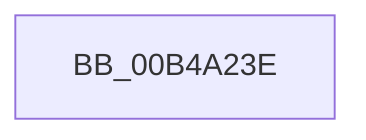

# sub_00B4A23E

- RVA: `0x00B4A23E`–`0x00B4A29A` (길이 `92` bytes)
- VA: `0x0000000140B4A23E`
- 실행 섹션: `PAGE`
- PDB 이름 있음: `아니요`; PDB Function 태그: `아니요`
- unwind 정보 RVA: `0x000BBB14`
- 디코드: `19`개 명령, `92/92` bytes 표시
- 미해석 바이트: `0` (있으면 어셈블리에 `.byte`로 보존)

> 이 문서는 커널 이미지의 기계어와 PDB 기호를 분석해 생성했습니다. 4번과 5번은 함수 원형과 자료형을 바이너리 사용 방식에서 추정한 C 해석이며 원본 소스 복구 결과는 아닙니다.

## 1. Dependencies

- 직접 호출 지점: **1**; 고유 호출 대상: **1**
- 직접 호출자로 확인된 함수: **0**
- RIP 상대 이미지 참조: **3**

### Outgoing calls
- `0x00B4A28F` → [EtwWrite](../../text/41/EtwWrite_function_0041C720.md) (function, `0x0041C720`)

### Direct callers
- 이 함수 시작 RVA로 연결되는 직접 call은 확인되지 않았습니다. 간접 호출은 완전히 역산할 수 없습니다.

### Static image references
- `0x00B4A243` → RVA `0x00B076E0` (` ?? ::NNGAKEGL::`string'`; read)
- `0x00B4A267` → RVA `0x0001E070` (`.rdata`; read)
- `0x00B4A277` → RVA `0x00EFFA30` (`.data`; read)

## 2. Other-region calls and transfers

- 다른 실행 섹션으로 향하는 call: **1**
  - `0x00B4A28F` → [EtwWrite](../../text/41/EtwWrite_function_0041C720.md) (`PAGE` → `.text`)
- call이 아닌 외부 분기/꼬리 이동: **1**
  - `0x00B4A295` → [EtwTiLogDriverObjectUnLoad + 0x35](../AA/EtwTiLogDriverObjectUnLoad_function_00AA7C60.md) (`tail-transfer`)

## 3. Assembly (complete function range)

```asm
00B4A23E  B9 0C 00 00 00                  mov ecx, 0xc
00B4A243  48 8D 15 96 D4 FB FF            lea rdx, [rip - 0x42b6a]
00B4A24A  8D 41 FA                        lea eax, [rcx - 6]
00B4A24D  66 89 44 24 30                  mov word ptr [rsp + 0x30], ax
00B4A252  41 B9 02 00 00 00               mov r9d, 2
00B4A258  48 8D 44 24 30                  lea rax, [rsp + 0x30]
00B4A25D  48 89 54 24 48                  mov qword ptr [rsp + 0x48], rdx
00B4A262  48 89 44 24 38                  mov qword ptr [rsp + 0x38], rax
00B4A267  48 8D 15 02 3E 4D FF            lea rdx, [rip - 0xb2c1fe]
00B4A26E  48 8D 44 24 38                  lea rax, [rsp + 0x38]
00B4A273  89 4C 24 50                     mov dword ptr [rsp + 0x50], ecx
00B4A277  48 8B 0D B2 57 3B 00            mov rcx, qword ptr [rip + 0x3b57b2]
00B4A27E  45 33 C0                        xor r8d, r8d
00B4A281  48 89 44 24 20                  mov qword ptr [rsp + 0x20], rax
00B4A286  4C 89 4C 24 40                  mov qword ptr [rsp + 0x40], r9
00B4A28B  89 7C 24 54                     mov dword ptr [rsp + 0x54], edi
00B4A28F  E8 8C 24 8D FF                  call 0x14041c720
00B4A294  90                              nop
00B4A295  E9 FB D9 F5 FF                  jmp 0x140aa7c95
```

## 4. C-style interpretation (structured pseudocode)

```c
__int64 __fastcall sub_00B4A23E(__int64 a1, __int64 a2, int a3, __int64 a4, __int64 a5, __int64 a6, __int64 a7)
{
    __int64 result;
    unsigned __int64 v_stack_p20;
    unsigned __int16 v_stack_p30;
    unsigned __int64 v_stack_p38;
    unsigned __int64 v_stack_p40;
    unsigned __int64 v_stack_p48;
    unsigned int v_stack_p50;
    unsigned int v_stack_p54;

    v_stack_p30 = (unsigned __int16)(12 - 6);
    v_stack_p48 = v_rip - 273258;
    v_stack_p38 = a6;
    v_stack_p50 = 12;
    a3 = 0;
    v_stack_p20 = a7;
    v_stack_p40 = 2;
    v_stack_p54 = (unsigned int)(v_rdi);
    result = EtwWrite(*(unsigned __int64 *)(v_rip + 3889074), v_rip - 11715070, a3, 2);
}
```

## 5. (Beta) C Style

```c
int64_t sub_00B4A23E(int64_t Arg1, int64_t Arg2, int32_t Arg3, int64_t Arg4, uint64_t Arg5, int64_t Arg6, int64_t Arg7)
{
    int64_t result;
    uint64_t v_stack_p20;
    uint16_t v_stack_p30;
    uint64_t v_stack_p38;
    uint64_t v_stack_p40;
    uint64_t v_stack_p48;
    uint32_t v_stack_p50;
    uint32_t v_stack_p54;

    v_stack_p30 = (uint16_t)(12 - 6);
    v_stack_p48 = v_rip - 273258;
    v_stack_p38 = Arg6;
    v_stack_p50 = 12;
    Arg3 = 0;
    v_stack_p20 = Arg7;
    v_stack_p40 = 2;
    v_stack_p54 = (uint32_t)(local_rdi);
    result = EtwWrite(*(uint64_t *)(v_rip + 0x3B57B2), v_rip - 11715070, Arg3, 2);
}
```

## 6. Execution-region graph

[열기: 2D/3D 그래프와 함수 탐색 컨트롤 패널](../../../control-panel.html?section=page&rva=0x00B4A23E&view=graph)

- 2D 그래프는 위에서 아래로 흐르고, 3D 그래프는 빈 공간을 드래그해 회전합니다. Shift+드래그는 이동, 휠은 확대·축소, 함수 노드 선택은 대상 보고서 이동입니다.

### Static fallback


