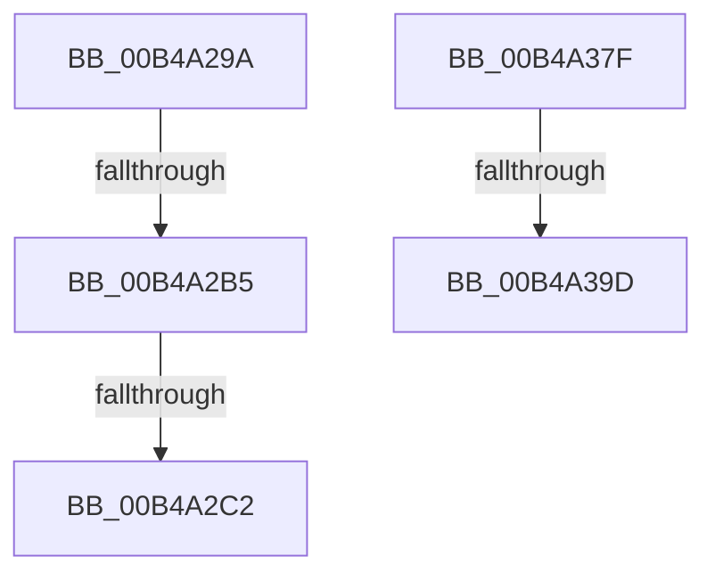

# sub_00B4A29A

- RVA: `0x00B4A29A`–`0x00B4A467` (길이 `461` bytes)
- VA: `0x0000000140B4A29A`
- 실행 섹션: `PAGE`
- PDB 이름 있음: `아니요`; PDB Function 태그: `아니요`
- unwind 정보 RVA: `0x000BBB90`
- 디코드: `86`개 명령, `461/461` bytes 표시
- 미해석 바이트: `0` (있으면 어셈블리에 `.byte`로 보존)

> 이 문서는 커널 이미지의 기계어와 PDB 기호를 분석해 생성했습니다. 4번과 5번은 함수 원형과 자료형을 바이너리 사용 방식에서 추정한 C 해석이며 원본 소스 복구 결과는 아닙니다.

## 1. Dependencies

- 직접 호출 지점: **5**; 고유 호출 대상: **5**
- 직접 호출자로 확인된 함수: **0**
- RIP 상대 이미지 참조: **5**

### Outgoing calls
- `0x00B4A2A8` → [EtwEventEnabled](../../text/39/EtwEventEnabled_function_00392450.md) (function, `0x00392450`)
- `0x00B4A2B5` → [PopIsPlatformAoAcCapable](../../text/49/PopIsPlatformAoAcCapable_function_0049BF40.md) (function, `0x0049BF40`)
- `0x00B4A374` → [EtwWrite](../../text/41/EtwWrite_function_0041C720.md) (function, `0x0041C720`)
- `0x00B4A390` → [tlgKeywordOn](../../text/42/tlgKeywordOn_function_0042EAA0.md) (function, `0x0042EAA0`)
- `0x00B4A45C` → [tlgWriteTransfer_EtwWriteTransfer](../../text/42/tlgWriteTransfer_EtwWriteTransfer_function_004260E0.md) (function, `0x004260E0`)

### Direct callers
- 이 함수 시작 RVA로 연결되는 직접 call은 확인되지 않았습니다. 간접 호출은 완전히 역산할 수 없습니다.

### Static image references
- `0x00B4A29A` → RVA `0x00F0B408` (`.data`; read)
- `0x00B4A2A1` → RVA `0x00021B38` (`.rdata`; read)
- `0x00B4A329` → RVA `0x00F0B6B0` (`.data`; read)
- `0x00B4A389` → RVA `0x00E07748` (`.data`; read)
- `0x00B4A3A4` → RVA `0x0004A552` (`.rdata`; read)

## 2. Other-region calls and transfers

- 다른 실행 섹션으로 향하는 call: **5**
  - `0x00B4A2A8` → [EtwEventEnabled](../../text/39/EtwEventEnabled_function_00392450.md) (`PAGE` → `.text`)
  - `0x00B4A2B5` → [PopIsPlatformAoAcCapable](../../text/49/PopIsPlatformAoAcCapable_function_0049BF40.md) (`PAGE` → `.text`)
  - `0x00B4A374` → [EtwWrite](../../text/41/EtwWrite_function_0041C720.md) (`PAGE` → `.text`)
  - `0x00B4A390` → [tlgKeywordOn](../../text/42/tlgKeywordOn_function_0042EAA0.md) (`PAGE` → `.text`)
  - `0x00B4A45C` → [tlgWriteTransfer_EtwWriteTransfer](../../text/42/tlgWriteTransfer_EtwWriteTransfer_function_004260E0.md) (`PAGE` → `.text`)
- call이 아닌 외부 분기/꼬리 이동: **5**
  - `0x00B4A2AF` → [PopDiagTraceCsEnterReason + 0x6D](../AA/PopDiagTraceCsEnterReason_function_00AA81AC.md) (`tail-transfer`)
  - `0x00B4A2BC` → [PopDiagTraceCsEnterReason + 0x6D](../AA/PopDiagTraceCsEnterReason_function_00AA81AC.md) (`tail-transfer`)
  - `0x00B4A37A` → [PopDiagTraceCsEnterReason + 0x6D](../AA/PopDiagTraceCsEnterReason_function_00AA81AC.md) (`tail-transfer`)
  - `0x00B4A397` → [PopDiagTraceCsEnterReason + 0x7A](../AA/PopDiagTraceCsEnterReason_function_00AA81AC.md) (`tail-transfer`)
  - `0x00B4A462` → [PopDiagTraceCsEnterReason + 0x7A](../AA/PopDiagTraceCsEnterReason_function_00AA81AC.md) (`tail-transfer`)

## 3. Assembly (complete function range)

```asm
00B4A29A  48 8B 0D 67 11 3C 00            mov rcx, qword ptr [rip + 0x3c1167]
00B4A2A1  48 8D 15 90 78 4D FF            lea rdx, [rip - 0xb28770]
00B4A2A8  E8 A3 81 84 FF                  call 0x140392450
00B4A2AD  84 C0                           test al, al
00B4A2AF  0F 84 64 DF F5 FF               je 0x140aa8219
00B4A2B5  E8 86 1C 95 FF                  call 0x14049bf40
00B4A2BA  84 C0                           test al, al
00B4A2BC  0F 84 57 DF F5 FF               je 0x140aa8219
00B4A2C2  48 8B 0D 3F 11 3C 00            mov rcx, qword ptr [rip + 0x3c113f]
00B4A2C9  48 8D 44 24 30                  lea rax, [rsp + 0x30]
00B4A2CE  48 89 44 24 70                  mov qword ptr [rsp + 0x70], rax
00B4A2D3  48 8D 15 5E 78 4D FF            lea rdx, [rip - 0xb287a2]
00B4A2DA  48 8D 44 24 38                  lea rax, [rsp + 0x38]
00B4A2DF  48 C7 44 24 78 04 00 00 00      mov qword ptr [rsp + 0x78], 4
00B4A2E8  48 89 45 80                     mov qword ptr [rbp - 0x80], rax
00B4A2EC  41 B9 08 00 00 00               mov r9d, 8
00B4A2F2  48 8D 44 24 3C                  lea rax, [rsp + 0x3c]
00B4A2F7  48 C7 45 88 04 00 00 00         mov qword ptr [rbp - 0x78], 4
00B4A2FF  48 89 45 90                     mov qword ptr [rbp - 0x70], rax
00B4A303  45 33 C0                        xor r8d, r8d
00B4A306  48 8D 44 24 60                  lea rax, [rsp + 0x60]
00B4A30B  48 C7 45 98 04 00 00 00         mov qword ptr [rbp - 0x68], 4
00B4A313  48 89 45 A0                     mov qword ptr [rbp - 0x60], rax
00B4A317  48 8D 44 24 40                  lea rax, [rsp + 0x40]
00B4A31C  48 89 45 B0                     mov qword ptr [rbp - 0x50], rax
00B4A320  48 8D 44 24 44                  lea rax, [rsp + 0x44]
00B4A325  48 89 45 C0                     mov qword ptr [rbp - 0x40], rax
00B4A329  48 8D 05 80 13 3C 00            lea rax, [rip + 0x3c1380]
00B4A330  48 89 45 D0                     mov qword ptr [rbp - 0x30], rax
00B4A334  48 B8 C4 02 00 00 80 F7 FF FF   movabs rax, 0xfffff780000002c4
00B4A33E  48 89 45 E0                     mov qword ptr [rbp - 0x20], rax
00B4A342  48 8D 44 24 70                  lea rax, [rsp + 0x70]
00B4A347  48 89 44 24 20                  mov qword ptr [rsp + 0x20], rax
00B4A34C  48 C7 45 A8 01 00 00 00         mov qword ptr [rbp - 0x58], 1
00B4A354  48 C7 45 B8 04 00 00 00         mov qword ptr [rbp - 0x48], 4
00B4A35C  48 C7 45 C8 04 00 00 00         mov qword ptr [rbp - 0x38], 4
00B4A364  48 C7 45 D8 08 00 00 00         mov qword ptr [rbp - 0x28], 8
00B4A36C  48 C7 45 E8 04 00 00 00         mov qword ptr [rbp - 0x18], 4
00B4A374  E8 A7 23 8D FF                  call 0x14041c720
00B4A379  90                              nop
00B4A37A  E9 9A DE F5 FF                  jmp 0x140aa8219
00B4A37F  48 BA 00 00 00 00 00 40 00 00   movabs rdx, 0x400000000000
00B4A389  48 8D 0D B8 D3 2B 00            lea rcx, [rip + 0x2bd3b8]
00B4A390  E8 0B 47 8E FF                  call 0x14042eaa0
00B4A395  84 C0                           test al, al
00B4A397  0F 84 89 DE F5 FF               je 0x140aa8226
00B4A39D  48 8B 05 0C 13 3C 00            mov rax, qword ptr [rip + 0x3c130c]
00B4A3A4  48 8D 15 A7 01 50 FF            lea rdx, [rip - 0xaffe59]
00B4A3AB  48 89 44 24 68                  mov qword ptr [rsp + 0x68], rax
00B4A3B0  48 8D 0D 91 D3 2B 00            lea rcx, [rip + 0x2bd391]
00B4A3B7  48 8D 44 24 68                  lea rax, [rsp + 0x68]
00B4A3BC  48 C7 45 18 08 00 00 00         mov qword ptr [rbp + 0x18], 8
00B4A3C4  48 89 45 10                     mov qword ptr [rbp + 0x10], rax
00B4A3C8  45 33 C9                        xor r9d, r9d
00B4A3CB  8B 44 24 30                     mov eax, dword ptr [rsp + 0x30]
00B4A3CF  45 33 C0                        xor r8d, r8d
00B4A3D2  89 44 24 48                     mov dword ptr [rsp + 0x48], eax
00B4A3D6  48 8D 44 24 48                  lea rax, [rsp + 0x48]
00B4A3DB  48 89 45 20                     mov qword ptr [rbp + 0x20], rax
00B4A3DF  8B 44 24 38                     mov eax, dword ptr [rsp + 0x38]
00B4A3E3  89 44 24 4C                     mov dword ptr [rsp + 0x4c], eax
00B4A3E7  48 8D 44 24 4C                  lea rax, [rsp + 0x4c]
00B4A3EC  48 89 45 30                     mov qword ptr [rbp + 0x30], rax
00B4A3F0  8B 44 24 3C                     mov eax, dword ptr [rsp + 0x3c]
00B4A3F4  89 44 24 50                     mov dword ptr [rsp + 0x50], eax
00B4A3F8  48 8D 44 24 50                  lea rax, [rsp + 0x50]
00B4A3FD  48 89 45 40                     mov qword ptr [rbp + 0x40], rax
00B4A401  8B 44 24 40                     mov eax, dword ptr [rsp + 0x40]
00B4A405  89 44 24 54                     mov dword ptr [rsp + 0x54], eax
00B4A409  48 8D 44 24 54                  lea rax, [rsp + 0x54]
00B4A40E  48 89 45 50                     mov qword ptr [rbp + 0x50], rax
00B4A412  8B 44 24 44                     mov eax, dword ptr [rsp + 0x44]
00B4A416  89 44 24 58                     mov dword ptr [rsp + 0x58], eax
00B4A41A  48 8D 44 24 58                  lea rax, [rsp + 0x58]
00B4A41F  48 89 45 60                     mov qword ptr [rbp + 0x60], rax
00B4A423  48 8D 45 F0                     lea rax, [rbp - 0x10]
00B4A427  48 89 44 24 28                  mov qword ptr [rsp + 0x28], rax
00B4A42C  C7 44 24 20 08 00 00 00         mov dword ptr [rsp + 0x20], 8
00B4A434  48 C7 45 28 04 00 00 00         mov qword ptr [rbp + 0x28], 4
00B4A43C  48 C7 45 38 04 00 00 00         mov qword ptr [rbp + 0x38], 4
00B4A444  48 C7 45 48 04 00 00 00         mov qword ptr [rbp + 0x48], 4
00B4A44C  48 C7 45 58 04 00 00 00         mov qword ptr [rbp + 0x58], 4
00B4A454  48 C7 45 68 04 00 00 00         mov qword ptr [rbp + 0x68], 4
00B4A45C  E8 7F BC 8D FF                  call 0x1404260e0
00B4A461  90                              nop
00B4A462  E9 BF DD F5 FF                  jmp 0x140aa8226
```

## 4. C-style interpretation (structured pseudocode)

```c
__int64 __fastcall sub_00B4A29A(__int64 a1, __int64 a2, int a3, __int64 a4, __int64 a5, __int64 a6, __int64 a7, __int64 a8, __int64 a9, __int64 a10, __int64 a11, __int64 a12, __int64 a13, __int64 a14)
{
    __int64 result;
    unsigned __int64 v_stack_p20;
    unsigned __int64 v_stack_p28;
    unsigned int v_stack_p30;
    unsigned int v_stack_p38;
    unsigned __int64 v_stack_p3C;
    unsigned int v_stack_p40;
    unsigned __int64 v_stack_p44;
    unsigned int v_stack_p48;
    unsigned int v_stack_p4C;
    unsigned int v_stack_p50;
    unsigned int v_stack_p54;
    unsigned int v_stack_p58;
    unsigned __int64 v_stack_p68;
    unsigned __int64 v_stack_p70;
    unsigned __int64 v_stack_p78;

    result = EtwEventEnabled(*(unsigned __int64 *)(v_rip + 3936615), v_rip - 11700080, a3, a4);
    result = PopIsPlatformAoAcCapable(*(unsigned __int64 *)(v_rip + 3936615), v_rip - 11700080, a3, a4);
    v_stack_p70 = a6;
    v_stack_p78 = 4;
    *(unsigned __int64 *)(v_rbp - 128) = a7;
    *(unsigned __int64 *)(v_rbp - 120) = 4;
    *(unsigned __int64 *)(v_rbp - 112) = v_stack_p3C;
    a3 = 0;
    *(unsigned __int64 *)(v_rbp - 104) = 4;
    *(unsigned __int64 *)(v_rbp - 96) = a12;
    *(unsigned __int64 *)(v_rbp - 80) = a8;
    *(unsigned __int64 *)(v_rbp - 64) = v_stack_p44;
    *(unsigned __int64 *)(v_rbp - 48) = v_rip + 3937152;
    *(unsigned __int64 *)(v_rbp - 32) = v_rip + 3937152;
    v_stack_p20 = a14;
    *(unsigned __int64 *)(v_rbp - 88) = 1;
    *(unsigned __int64 *)(v_rbp - 72) = 4;
    *(unsigned __int64 *)(v_rbp - 56) = 4;
    *(unsigned __int64 *)(v_rbp - 40) = 8;
    *(unsigned __int64 *)(v_rbp - 24) = 4;
    result = EtwWrite(*(unsigned __int64 *)(v_rip + 3936575), v_rip - 11700130, a3, 8);
}
```

## 5. (Beta) C Style

```c
int64_t sub_00B4A29A(int64_t Arg1, int64_t Arg2, int32_t Arg3, int64_t Arg4, uint64_t Arg5, int64_t Arg6, int64_t Arg7, int64_t Arg8, uint64_t Arg9, uint64_t Arg10, uint64_t Arg11, int64_t Arg12, uint64_t Arg13, int64_t Arg14)
{
    int64_t result;
    uint64_t v_stack_p20;
    uint64_t v_stack_p28;
    uint32_t v_stack_p30;
    uint32_t v_stack_p38;
    uint64_t v_stack_p3C;
    uint32_t v_stack_p40;
    uint64_t v_stack_p44;
    uint32_t v_stack_p48;
    uint32_t v_stack_p4C;
    uint32_t v_stack_p50;
    uint32_t v_stack_p54;
    uint32_t v_stack_p58;
    uint64_t v_stack_p68;
    uint64_t v_stack_p70;
    uint64_t v_stack_p78;

    result = EtwEventEnabled(*(uint64_t *)(v_rip + 0x3C1167), v_rip - 11700080, Arg3, Arg4);
    result = PopIsPlatformAoAcCapable(*(uint64_t *)(v_rip + 0x3C1167), v_rip - 11700080, Arg3, Arg4);
    v_stack_p70 = Arg6;
    v_stack_p78 = 4;
    *(uint64_t *)(local_rbp - 0x80) = Arg7;
    *(uint64_t *)(local_rbp - 0x78) = 4;
    *(uint64_t *)(local_rbp - 0x70) = v_stack_p3C;
    Arg3 = 0;
    *(uint64_t *)(local_rbp - 0x68) = 4;
    *(uint64_t *)(local_rbp - 0x60) = Arg12;
    *(uint64_t *)(local_rbp - 0x50) = Arg8;
    *(uint64_t *)(local_rbp - 0x40) = v_stack_p44;
    *(uint64_t *)(local_rbp - 0x30) = v_rip + 3937152;
    *(uint64_t *)(local_rbp - 0x20) = v_rip + 3937152;
    v_stack_p20 = Arg14;
    *(uint64_t *)(local_rbp - 0x58) = 1;
    *(uint64_t *)(local_rbp - 0x48) = 4;
    *(uint64_t *)(local_rbp - 0x38) = 4;
    *(uint64_t *)(local_rbp - 0x28) = 8;
    *(uint64_t *)(local_rbp - 0x18) = 4;
    result = EtwWrite(*(uint64_t *)(v_rip + 0x3C113F), v_rip - 11700130, Arg3, 8);
}
```

## 6. Execution-region graph

[열기: 2D/3D 그래프와 함수 탐색 컨트롤 패널](../../../control-panel.html?section=page&rva=0x00B4A29A&view=graph)

- 2D 그래프는 위에서 아래로 흐르고, 3D 그래프는 빈 공간을 드래그해 회전합니다. Shift+드래그는 이동, 휠은 확대·축소, 함수 노드 선택은 대상 보고서 이동입니다.

### Static fallback


