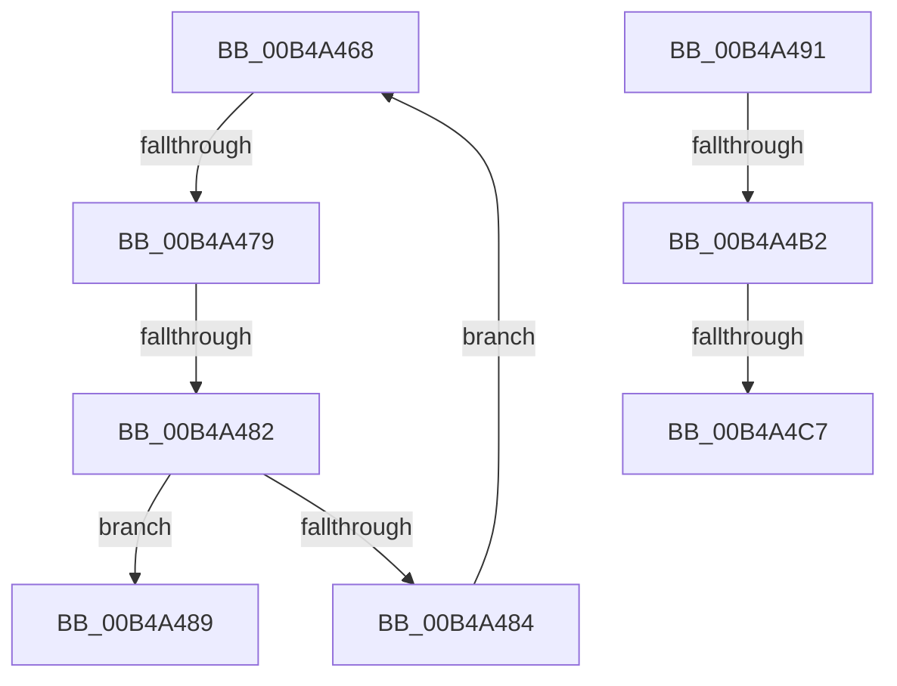

# sub_00B4A468

- RVA: `0x00B4A468`–`0x00B4A4E4` (길이 `124` bytes)
- VA: `0x0000000140B4A468`
- 실행 섹션: `PAGE`
- PDB 이름 있음: `아니요`; PDB Function 태그: `아니요`
- unwind 정보 RVA: `0x000BBBA0`
- 디코드: `31`개 명령, `124/124` bytes 표시
- 미해석 바이트: `0` (있으면 어셈블리에 `.byte`로 보존)

> 이 문서는 커널 이미지의 기계어와 PDB 기호를 분석해 생성했습니다. 4번과 5번은 함수 원형과 자료형을 바이너리 사용 방식에서 추정한 C 해석이며 원본 소스 복구 결과는 아닙니다.

## 1. Dependencies

- 직접 호출 지점: **1**; 고유 호출 대상: **1**
- 직접 호출자로 확인된 함수: **0**
- RIP 상대 이미지 참조: **0**

### Outgoing calls
- `0x00B4A4A1` → [ExAllocatePool2](../../poolcode/B8/ExAllocatePool2_function_00B820F0.md) (function, `0x00B820F0`)

### Direct callers
- 이 함수 시작 RVA로 연결되는 직접 call은 확인되지 않았습니다. 간접 호출은 완전히 역산할 수 없습니다.

### Static image references
- 디코드된 RIP-relative 메모리 참조가 없습니다.

## 2. Other-region calls and transfers

- 다른 실행 섹션으로 향하는 call: **1**
  - `0x00B4A4A1` → [ExAllocatePool2](../../poolcode/B8/ExAllocatePool2_function_00B820F0.md) (`PAGE` → `POOLCODE`)
- call이 아닌 외부 분기/꼬리 이동: **6**
  - `0x00B4A473` → [PnpAddVetoInformation + 0x45](../AA/PnpAddVetoInformation_function_00AA8250.md) (`tail-transfer`)
  - `0x00B4A47C` → [PnpAddVetoInformation + 0x9B](../AA/PnpAddVetoInformation_function_00AA8250.md) (`tail-transfer`)
  - `0x00B4A48C` → [PnpAddVetoInformation + 0x45](../AA/PnpAddVetoInformation_function_00AA8250.md) (`tail-transfer`)
  - `0x00B4A4AC` → [PnpAddVetoInformation + 0x9B](../AA/PnpAddVetoInformation_function_00AA8250.md) (`tail-transfer`)
  - `0x00B4A4C1` → [PnpAddVetoInformation + 0x86](../AA/PnpAddVetoInformation_function_00AA8250.md) (`tail-transfer`)
  - `0x00B4A4DF` → [PnpAddVetoInformation + 0x53](../AA/PnpAddVetoInformation_function_00AA8250.md) (`tail-transfer`)

## 3. Assembly (complete function range)

```asm
00B4A468  48 83 E9 08                     sub rcx, 8
00B4A46C  48 8D 51 08                     lea rdx, [rcx + 8]
00B4A470  48 3B C2                        cmp rax, rdx
00B4A473  0F 84 1C DE F5 FF               je 0x140aa8295
00B4A479  48 39 29                        cmp qword ptr [rcx], rbp
00B4A47C  0F 84 69 DE F5 FF               je 0x140aa82eb
00B4A482  77 05                           ja 0x140b4a489
00B4A484  48 8B 0A                        mov rcx, qword ptr [rdx]
00B4A487  EB DF                           jmp 0x140b4a468
00B4A489  48 8B FA                        mov rdi, rdx
00B4A48C  E9 04 DE F5 FF                  jmp 0x140aa8295
00B4A491  BA 28 00 00 00                  mov edx, 0x28
00B4A496  B9 00 01 00 00                  mov ecx, 0x100
00B4A49B  41 B8 50 6E 70 4F               mov r8d, 0x4f706e50
00B4A4A1  E8 4A 7C 03 00                  call 0x140b820f0
00B4A4A6  48 8B D8                        mov rbx, rax
00B4A4A9  48 85 C0                        test rax, rax
00B4A4AC  0F 84 39 DE F5 FF               je 0x140aa82eb
00B4A4B2  44 89 70 10                     mov dword ptr [rax + 0x10], r14d
00B4A4B6  48 83 C0 18                     add rax, 0x18
00B4A4BA  48 8B 4E 08                     mov rcx, qword ptr [rsi + 8]
00B4A4BE  48 39 31                        cmp qword ptr [rcx], rsi
00B4A4C1  0F 85 0F DE F5 FF               jne 0x140aa82d6
00B4A4C7  48 89 30                        mov qword ptr [rax], rsi
00B4A4CA  48 8B FB                        mov rdi, rbx
00B4A4CD  48 89 48 08                     mov qword ptr [rax + 8], rcx
00B4A4D1  48 89 01                        mov qword ptr [rcx], rax
00B4A4D4  48 89 46 08                     mov qword ptr [rsi + 8], rax
00B4A4D8  48 89 5B 08                     mov qword ptr [rbx + 8], rbx
00B4A4DC  48 89 1B                        mov qword ptr [rbx], rbx
00B4A4DF  E9 BF DD F5 FF                  jmp 0x140aa82a3
```

## 4. C-style interpretation (structured pseudocode)

```c
__int64 __fastcall sub_00B4A468(__int64 a1)
{
    a1 = (a1) - (8);
    if ((*(unsigned __int64 *)(a1)) > v_rbp) goto loc_00B4A489;
    goto loc_00B4A468;
loc_00B4A489:
}
```

## 5. (Beta) C Style

```c
int64_t sub_00B4A468(int64_t Arg1)
{
    Arg1 = (Arg1) - (8);
    if ((*(uint64_t *)(Arg1)) > local_rbp) goto loc_00B4A489;
    goto loc_00B4A468;
loc_00B4A489:
}
```

## 6. Execution-region graph

[열기: 2D/3D 그래프와 함수 탐색 컨트롤 패널](../../../control-panel.html?section=page&rva=0x00B4A468&view=graph)

- 2D 그래프는 위에서 아래로 흐르고, 3D 그래프는 빈 공간을 드래그해 회전합니다. Shift+드래그는 이동, 휠은 확대·축소, 함수 노드 선택은 대상 보고서 이동입니다.

### Static fallback


