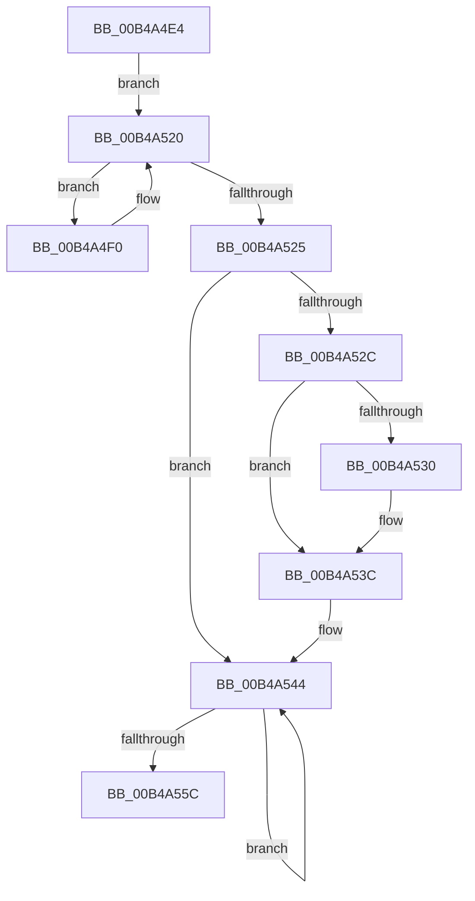

# sub_00B4A4E4

- RVA: `0x00B4A4E4`–`0x00B4A561` (길이 `125` bytes)
- VA: `0x0000000140B4A4E4`
- 실행 섹션: `PAGE`
- PDB 이름 있음: `아니요`; PDB Function 태그: `아니요`
- unwind 정보 RVA: `0x000BBBC4`
- 디코드: `30`개 명령, `125/125` bytes 표시
- 미해석 바이트: `0` (있으면 어셈블리에 `.byte`로 보존)

> 이 문서는 커널 이미지의 기계어와 PDB 기호를 분석해 생성했습니다. 4번과 5번은 함수 원형과 자료형을 바이너리 사용 방식에서 추정한 C 해석이며 원본 소스 복구 결과는 아닙니다.

## 1. Dependencies

- 직접 호출 지점: **3**; 고유 호출 대상: **3**
- 직접 호출자로 확인된 함수: **0**
- RIP 상대 이미지 참조: **0**

### Outgoing calls
- `0x00B4A51B` → [ZwFreeVirtualMemory](../../text/6A/ZwFreeVirtualMemory_function_006AD490.md) (function, `0x006AD490`)
- `0x00B4A537` → [ExDeleteResourceLite](../../text/38/ExDeleteResourceLite_function_0038BA60.md) (function, `0x0038BA60`)
- `0x00B4A552` → [RtlpDestroyHeapSegment](../79/RtlpDestroyHeapSegment_function_00790F88.md) (function, `0x00790F88`)

### Direct callers
- 이 함수 시작 RVA로 연결되는 직접 call은 확인되지 않았습니다. 간접 호출은 완전히 역산할 수 없습니다.

### Static image references
- 디코드된 RIP-relative 메모리 참조가 없습니다.

## 2. Other-region calls and transfers

- 다른 실행 섹션으로 향하는 call: **2**
  - `0x00B4A51B` → [ZwFreeVirtualMemory](../../text/6A/ZwFreeVirtualMemory_function_006AD490.md) (`PAGE` → `.text`)
  - `0x00B4A537` → [ExDeleteResourceLite](../../text/38/ExDeleteResourceLite_function_0038BA60.md) (`PAGE` → `.text`)
- call이 아닌 외부 분기/꼬리 이동: **1**
  - `0x00B4A55C` → [RtlDestroyHeap + 0x2B](../AA/RtlDestroyHeap_function_00AA8790.md) (`tail-transfer`)

## 3. Assembly (complete function range)

```asm
00B4A4E4  48 8D B7 10 01 00 00            lea rsi, [rdi + 0x110]
00B4A4EB  48 8B 1E                        mov rbx, qword ptr [rsi]
00B4A4EE  EB 30                           jmp 0x140b4a520
00B4A4F0  48 8B C3                        mov rax, rbx
00B4A4F3  4C 8D 44 24 40                  lea r8, [rsp + 0x40]
00B4A4F8  48 8B 1B                        mov rbx, qword ptr [rbx]
00B4A4FB  48 8D 54 24 48                  lea rdx, [rsp + 0x48]
00B4A500  48 83 64 24 40 00               and qword ptr [rsp + 0x40], 0
00B4A506  48 25 00 00 FF FF               and rax, 0xffffffffffff0000
00B4A50C  41 B9 00 80 00 00               mov r9d, 0x8000
00B4A512  48 89 44 24 48                  mov qword ptr [rsp + 0x48], rax
00B4A517  48 83 C9 FF                     or rcx, 0xffffffffffffffff
00B4A51B  E8 70 2F B6 FF                  call 0x1406ad490
00B4A520  48 3B F3                        cmp rsi, rbx
00B4A523  75 CB                           jne 0x140b4a4f0
00B4A525  8B 47 70                        mov eax, dword ptr [rdi + 0x70]
00B4A528  A8 01                           test al, 1
00B4A52A  75 18                           jne 0x140b4a544
00B4A52C  85 C0                           test eax, eax
00B4A52E  78 0C                           js 0x140b4a53c
00B4A530  48 8B 8F 60 01 00 00            mov rcx, qword ptr [rdi + 0x160]
00B4A537  E8 24 15 84 FF                  call 0x14038ba60
00B4A53C  48 83 A7 60 01 00 00 00         and qword ptr [rdi + 0x160], 0
00B4A544  48 8B 9F 28 01 00 00            mov rbx, qword ptr [rdi + 0x128]
00B4A54B  48 83 EB 18                     sub rbx, 0x18
00B4A54F  48 8B CB                        mov rcx, rbx
00B4A552  E8 31 6A C4 FF                  call 0x140790f88
00B4A557  48 3B DF                        cmp rbx, rdi
00B4A55A  75 E8                           jne 0x140b4a544
00B4A55C  E9 5A E2 F5 FF                  jmp 0x140aa87bb
```

## 4. C-style interpretation (structured pseudocode)

```c
__int64 __fastcall sub_00B4A4E4(__int64 a1, __int64 a2, __int64 a3, __int64 a4, __int64 a5, __int64 a6, __int64 a7, __int64 a8, __int64 a9)
{
    __int64 result;
    __int64 v_rbx;
    unsigned __int64 v_stack_p48;

    goto loc_00B4A520;
loc_00B4A4F0:
    result = (*(unsigned __int64 *)(v_rdi + 272)) & (0xFFFFFFFFFFFF0000ULL);
    v_stack_p48 = result;
    a1 = (a1) | (-1);
    result = ZwFreeVirtualMemory(a1, a9, a8, (unsigned int)(0x8000ULL));
loc_00B4A520:
    if ((v_rdi + 272) != (*(unsigned __int64 *)(*(unsigned __int64 *)(v_rdi + 272)))) goto loc_00B4A4F0;
    if ((((unsigned __int8)((unsigned int)(*(unsigned int *)(v_rdi + 112)))) & (1)) != 0) goto loc_00B4A544;
    result = (unsigned int)(*(unsigned int *)(v_rdi + 112));
    if (!(sign_flag)) {
        a1 = *(unsigned __int64 *)(v_rdi + 352);
        result = ExDeleteResourceLite(a1, a9, a8, (unsigned int)(0x8000ULL));
    }
loc_00B4A544:
    v_rbx = (*(unsigned __int64 *)(v_rdi + 296)) - (24);
    result = RtlpDestroyHeapSegment(v_rbx, a9, a8, (unsigned int)(0x8000ULL));
    if (v_rbx != v_rdi) goto loc_00B4A544;
}
```

## 5. (Beta) C Style

```c
int64_t sub_00B4A4E4(int64_t Arg1, int64_t Arg2, int64_t Arg3, int64_t Arg4, uint64_t Arg5, uint64_t Arg6, uint64_t Arg7, int64_t Arg8, int64_t Arg9)
{
    int64_t result;
    int64_t local_rbx;
    uint64_t v_stack_p48;

    goto loc_00B4A520;
loc_00B4A4F0:
    result = (*(uint64_t *)(local_rdi + 0x110)) & (0xFFFFFFFFFFFF0000ULL);
    v_stack_p48 = result;
    Arg1 = (Arg1) | (-1);
    result = ZwFreeVirtualMemory(Arg1, Arg9, Arg8, (uint32_t)(0x8000ULL));
loc_00B4A520:
    if ((local_rdi + 272) != (*(uint64_t *)(*(uint64_t *)(local_rdi + 0x110)))) goto loc_00B4A4F0;
    if ((((uint8_t)((uint32_t)(*(uint32_t *)(local_rdi + 0x70)))) & (1)) != 0) goto loc_00B4A544;
    result = (uint32_t)(*(uint32_t *)(local_rdi + 0x70));
    if (!(sign_flag)) {
        Arg1 = *(uint64_t *)(local_rdi + 0x160);
        result = ExDeleteResourceLite(Arg1, Arg9, Arg8, (uint32_t)(0x8000ULL));
    }
loc_00B4A544:
    local_rbx = (*(uint64_t *)(local_rdi + 0x128)) - (24);
    result = RtlpDestroyHeapSegment(local_rbx, Arg9, Arg8, (uint32_t)(0x8000ULL));
    if (local_rbx != local_rdi) goto loc_00B4A544;
}
```

## 6. Execution-region graph

[열기: 2D/3D 그래프와 함수 탐색 컨트롤 패널](../../../control-panel.html?section=page&rva=0x00B4A4E4&view=graph)

- 2D 그래프는 위에서 아래로 흐르고, 3D 그래프는 빈 공간을 드래그해 회전합니다. Shift+드래그는 이동, 휠은 확대·축소, 함수 노드 선택은 대상 보고서 이동입니다.

### Static fallback


