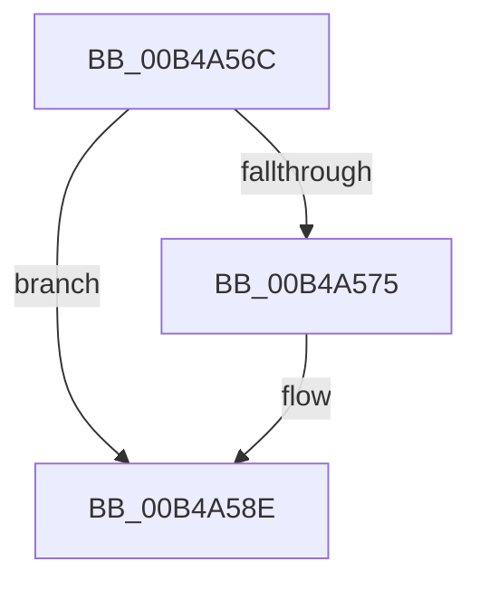

# sub_00B4A56C

- RVA: `0x00B4A56C`–`0x00B4A5AF` (길이 `67` bytes)
- VA: `0x0000000140B4A56C`
- 실행 섹션: `PAGE`
- PDB 이름 있음: `아니요`; PDB Function 태그: `아니요`
- unwind 정보 RVA: `0x000BBE0C`
- 디코드: `14`개 명령, `67/67` bytes 표시
- 미해석 바이트: `0` (있으면 어셈블리에 `.byte`로 보존)

> 이 문서는 커널 이미지의 기계어와 PDB 기호를 분석해 생성했습니다. 4번과 5번은 함수 원형과 자료형을 바이너리 사용 방식에서 추정한 C 해석이며 원본 소스 복구 결과는 아닙니다.

## 1. Dependencies

- 직접 호출 지점: **3**; 고유 호출 대상: **3**
- 직접 호출자로 확인된 함수: **0**
- RIP 상대 이미지 참조: **3**

### Outgoing calls
- `0x00B4A589` → [McTemplateK0zz_EtwWriteTransfer](../../text/5A/McTemplateK0zz_EtwWriteTransfer_function_005A9408.md) (function, `0x005A9408`)
- `0x00B4A59A` → [RtlDeleteElementGenericTableAvl](../../text/3E/RtlDeleteElementGenericTableAvl_function_003EE750.md) (function, `0x003EE750`)
- `0x00B4A5A4` → [PiSwDeviceDereference](../94/PiSwDeviceDereference_function_0094E8A8.md) (function, `0x0094E8A8`)

### Direct callers
- 이 함수 시작 RVA로 연결되는 직접 call은 확인되지 않았습니다. 간접 호출은 완전히 역산할 수 없습니다.

### Static image references
- `0x00B4A56C` → RVA `0x00EF012C` (`.data`; read)
- `0x00B4A579` → RVA `0x000271D0` (`.rdata`; read)
- `0x00B4A593` → RVA `0x00F8AAA0` (`.data`; read)

## 2. Other-region calls and transfers

- 다른 실행 섹션으로 향하는 call: **2**
  - `0x00B4A589` → [McTemplateK0zz_EtwWriteTransfer](../../text/5A/McTemplateK0zz_EtwWriteTransfer_function_005A9408.md) (`PAGE` → `.text`)
  - `0x00B4A59A` → [RtlDeleteElementGenericTableAvl](../../text/3E/RtlDeleteElementGenericTableAvl_function_003EE750.md) (`PAGE` → `.text`)
- call이 아닌 외부 분기/꼬리 이동: **1**
  - `0x00B4A5AA` → [PiSwCloseDevice + 0x42](../AA/PiSwCloseDevice_function_00AAB6F4.md) (`tail-transfer`)

## 3. Assembly (complete function range)

```asm
00B4A56C  F6 05 B9 5B 3A 00 40            test byte ptr [rip + 0x3a5bb9], 0x40
00B4A573  74 19                           je 0x140b4a58e
00B4A575  48 8B 41 10                     mov rax, qword ptr [rcx + 0x10]
00B4A579  48 8D 15 50 CC 4D FF            lea rdx, [rip - 0xb233b0]
00B4A580  4C 8B 49 08                     mov r9, qword ptr [rcx + 8]
00B4A584  48 89 44 24 20                  mov qword ptr [rsp + 0x20], rax
00B4A589  E8 7A EE A5 FF                  call 0x1405a9408
00B4A58E  48 8D 54 24 40                  lea rdx, [rsp + 0x40]
00B4A593  48 8D 0D 06 05 44 00            lea rcx, [rip + 0x440506]
00B4A59A  E8 B1 41 8A FF                  call 0x1403ee750
00B4A59F  48 8B 4C 24 40                  mov rcx, qword ptr [rsp + 0x40]
00B4A5A4  E8 FF 42 E0 FF                  call 0x14094e8a8
00B4A5A9  90                              nop
00B4A5AA  E9 87 11 F6 FF                  jmp 0x140aab736
```

## 4. C-style interpretation (structured pseudocode)

```c
__int64 __fastcall sub_00B4A56C(__int64 a1, __int64 a2, __int64 a3, __int64 a4, __int64 a5, __int64 a6, __int64 a7, __int64 a8)
{
    __int64 result;
    unsigned __int64 v_stack_p20;

    if (((*(unsigned __int8 *)(v_rip + 3824569)) & (64)) != 0) {
        result = *(unsigned __int64 *)(a1 + 16);
        a2 = v_rip - 11678640;
        a4 = *(unsigned __int64 *)(a1 + 8);
        v_stack_p20 = result;
        result = McTemplateK0zz_EtwWriteTransfer(a1, a2, a3, a4);
    }
    result = RtlDeleteElementGenericTableAvl(v_rip + 4457734, a8, a3, a4);
    result = PiSwDeviceDereference(a8, a8, a3, a4);
}
```

## 5. (Beta) C Style

```c
int64_t sub_00B4A56C(void *Arg1, int64_t Arg2, int64_t Arg3, int64_t Arg4, uint64_t Arg5, uint64_t Arg6, uint64_t Arg7, int64_t Arg8)
{
    uint8_t *arg1 = (uint8_t *)Arg1;

    int64_t result;
    uint64_t v_stack_p20;

    if (((*(uint8_t *)(v_rip + 0x3A5BB9)) & (64)) != 0) {
        result = *(uint64_t *)(arg1 + 0x10);
        Arg2 = v_rip - 11678640;
        Arg4 = *(uint64_t *)(arg1 + 0x8);
        v_stack_p20 = result;
        result = McTemplateK0zz_EtwWriteTransfer(Arg1, Arg2, Arg3, Arg4);
    }
    result = RtlDeleteElementGenericTableAvl(v_rip + 4457734, Arg8, Arg3, Arg4);
    result = PiSwDeviceDereference(Arg8, Arg8, Arg3, Arg4);
}
```

### 관측된 메모리 오프셋

구조체 형식이 확인되지 않은 접근은 인자 기준의 오프셋으로만 기록했습니다.

| 기준 인자 | 오프셋 표현 | 폭 (bit) | 접근 |
|---|---:|---:|---|
| `Arg1` | `+ 0x8` | `64` | `R` |
| `Arg1` | `+ 0x10` | `64` | `R` |

## 6. Execution-region graph

[열기: 2D/3D 그래프와 함수 탐색 컨트롤 패널](../../../control-panel.html?section=page&rva=0x00B4A56C&view=graph)

- 2D 그래프는 위에서 아래로 흐르고, 3D 그래프는 빈 공간을 드래그해 회전합니다. Shift+드래그는 이동, 휠은 확대·축소, 함수 노드 선택은 대상 보고서 이동입니다.

### Static fallback


