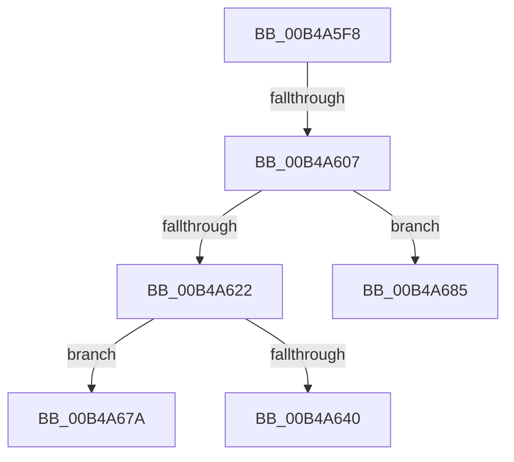

# sub_00B4A5F8

- RVA: `0x00B4A5F8`–`0x00B4A690` (길이 `152` bytes)
- VA: `0x0000000140B4A5F8`
- 실행 섹션: `PAGE`
- PDB 이름 있음: `아니요`; PDB Function 태그: `아니요`
- unwind 정보 RVA: `0x000BBE28`
- 디코드: `37`개 명령, `152/152` bytes 표시
- 미해석 바이트: `0` (있으면 어셈블리에 `.byte`로 보존)

> 이 문서는 커널 이미지의 기계어와 PDB 기호를 분석해 생성했습니다. 4번과 5번은 함수 원형과 자료형을 바이너리 사용 방식에서 추정한 C 해석이며 원본 소스 복구 결과는 아닙니다.

## 1. Dependencies

- 직접 호출 지점: **2**; 고유 호출 대상: **2**
- 직접 호출자로 확인된 함수: **0**
- RIP 상대 이미지 참조: **1**

### Outgoing calls
- `0x00B4A630` → [ExAllocatePool2](../../poolcode/B8/ExAllocatePool2_function_00B820F0.md) (function, `0x00B820F0`)
- `0x00B4A66B` → [RtlUnicodeStringPrintf](../../text/48/RtlUnicodeStringPrintf_function_0048B984.md) (function, `0x0048B984`)

### Direct callers
- 이 함수 시작 RVA로 연결되는 직접 call은 확인되지 않았습니다. 간접 호출은 완전히 역산할 수 없습니다.

### Static image references
- `0x00B4A643` → RVA `0x00B03000` (` ?? ::NNGAKEGL::`string'`; read)

## 2. Other-region calls and transfers

- 다른 실행 섹션으로 향하는 call: **2**
  - `0x00B4A630` → [ExAllocatePool2](../../poolcode/B8/ExAllocatePool2_function_00B820F0.md) (`PAGE` → `POOLCODE`)
  - `0x00B4A66B` → [RtlUnicodeStringPrintf](../../text/48/RtlUnicodeStringPrintf_function_0048B984.md) (`PAGE` → `.text`)
- call이 아닌 외부 분기/꼬리 이동: **4**
  - `0x00B4A601` → [PopIdleWakeSystemImageCallback + 0x4A](../AA/PopIdleWakeSystemImageCallback_function_00AAB880.md) (`tail-transfer`)
  - `0x00B4A675` → [PopIdleWakeSystemImageCallback + 0x4A](../AA/PopIdleWakeSystemImageCallback_function_00AAB880.md) (`tail-transfer`)
  - `0x00B4A680` → [PopIdleWakeSystemImageCallback + 0x4E](../AA/PopIdleWakeSystemImageCallback_function_00AAB880.md) (`tail-transfer`)
  - `0x00B4A68B` → [PopIdleWakeSystemImageCallback + 0x4E](../AA/PopIdleWakeSystemImageCallback_function_00AAB880.md) (`tail-transfer`)

## 3. Assembly (complete function range)

```asm
00B4A5F8  8B 45 40                        mov eax, dword ptr [rbp + 0x40]
00B4A5FB  49 03 C7                        add rax, r15
00B4A5FE  48 3B F8                        cmp rdi, rax
00B4A601  0F 83 C3 12 F6 FF               jae 0x140aab8ca
00B4A607  45 8B 2E                        mov r13d, dword ptr [r14]
00B4A60A  0F B7 75 58                     movzx esi, word ptr [rbp + 0x58]
00B4A60E  49 C1 E5 04                     shl r13, 4
00B4A612  48 83 C6 18                     add rsi, 0x18
00B4A616  4D 03 EE                        add r13, r14
00B4A619  48 81 FE FF FF 00 00            cmp rsi, 0xffff
00B4A620  77 63                           ja 0x140b4a685
00B4A622  41 B8 50 64 69 67               mov r8d, 0x67696450
00B4A628  48 8B D6                        mov rdx, rsi
00B4A62B  B9 00 01 00 00                  mov ecx, 0x100
00B4A630  E8 BB 7A 03 00                  call 0x140b820f0
00B4A635  33 C9                           xor ecx, ecx
00B4A637  49 89 45 10                     mov qword ptr [r13 + 0x10], rax
00B4A63B  48 85 C0                        test rax, rax
00B4A63E  74 3A                           je 0x140b4a67a
00B4A640  41 8B 06                        mov eax, dword ptr [r14]
00B4A643  48 8D 15 B6 89 FB FF            lea rdx, [rip - 0x4764a]
00B4A64A  41 2B FF                        sub edi, r15d
00B4A64D  44 8B CF                        mov r9d, edi
00B4A650  42 C6 44 30 38 01               mov byte ptr [rax + r14 + 0x38], 1
00B4A656  41 FF 06                        inc dword ptr [r14]
00B4A659  66 41 89 4D 08                  mov word ptr [r13 + 8], cx
00B4A65E  49 8D 4D 08                     lea rcx, [r13 + 8]
00B4A662  66 41 89 75 0A                  mov word ptr [r13 + 0xa], si
00B4A667  4C 8B 45 60                     mov r8, qword ptr [rbp + 0x60]
00B4A66B  E8 14 13 94 FF                  call 0x14048b984
00B4A670  44 8B C0                        mov r8d, eax
00B4A673  33 C9                           xor ecx, ecx
00B4A675  E9 50 12 F6 FF                  jmp 0x140aab8ca
00B4A67A  41 B8 9A 00 00 C0               mov r8d, 0xc000009a
00B4A680  E9 49 12 F6 FF                  jmp 0x140aab8ce
00B4A685  41 B8 05 00 00 80               mov r8d, 0x80000005
00B4A68B  E9 3E 12 F6 FF                  jmp 0x140aab8ce
```

## 4. C-style interpretation (structured pseudocode)

```c
__int64 __fastcall sub_00B4A5F8(void)
{
    __int64 result;
    __int64 v_r13;
    __int64 v_rdi;
    __int64 v_rsi;

    result = ((unsigned int)(*(unsigned int *)(v_rbp + 64))) + (v_r15);
    v_r13 = ((unsigned int)(*(unsigned int *)(v_r14))) << (4);
    v_rsi = (*(unsigned __int16 *)(v_rbp + 88)) + (24);
    v_r13 = (v_r13) + (v_r14);
    if (v_rsi > 0xFFFFULL) goto loc_00B4A685;
    result = ExAllocatePool2(256, v_rsi, (unsigned int)(0x67696450ULL), a4);
    a1 = 0;
    *(unsigned __int64 *)(v_r13 + 16) = result;
    if (result == 0) goto loc_00B4A67A;
    v_rdi = (unsigned int)((v_rdi) - ((unsigned int)(v_r15)));
    *(unsigned __int8 *)((unsigned int)(*(unsigned int *)(v_r14)) + v_r14 * 1 + 56) = 1;
    *(unsigned __int16 *)(v_r13 + 8) = 0;
    *(unsigned __int16 *)(v_r13 + 10) = (unsigned __int16)(v_rsi);
    result = RtlUnicodeStringPrintf(v_r13 + 8, v_rip - 292426, *(unsigned __int64 *)(v_rbp + 96), (unsigned int)((unsigned int)(v_rdi)));
    a1 = 0;
loc_00B4A67A:
loc_00B4A685:
}
```

## 5. (Beta) C Style

```c
void sub_00B4A5F8(void)
{
    int64_t result;
    int64_t local_r13;
    int64_t local_rdi;
    int64_t local_rsi;

    result = ((uint32_t)(*(uint32_t *)(local_rbp + 0x40))) + (local_r15);
    local_r13 = ((uint32_t)(*(uint32_t *)(local_r14))) << (4);
    local_rsi = (*(uint16_t *)(local_rbp + 0x58)) + (24);
    local_r13 = (local_r13) + (local_r14);
    if (local_rsi > 0xFFFFULL) goto loc_00B4A685;
    result = ExAllocatePool2(256, local_rsi, (uint32_t)(0x67696450ULL), a4);
    a1 = 0;
    *(uint64_t *)(local_r13 + 0x10) = result;
    if (result == 0) goto loc_00B4A67A;
    local_rdi = (uint32_t)((local_rdi) - ((uint32_t)(local_r15)));
    *(uint8_t *)((uint32_t)(*(uint32_t *)(local_r14)) + local_r14 * 1 + 0x38) = 1;
    *(uint16_t *)(local_r13 + 0x8) = 0;
    *(uint16_t *)(local_r13 + 0xA) = (uint16_t)(local_rsi);
    result = RtlUnicodeStringPrintf(local_r13 + 8, v_rip - 292426, *(uint64_t *)(local_rbp + 0x60), (uint32_t)((uint32_t)(local_rdi)));
    a1 = 0;
loc_00B4A67A:
loc_00B4A685:
}
```

## 6. Execution-region graph

[열기: 2D/3D 그래프와 함수 탐색 컨트롤 패널](../../../control-panel.html?section=page&rva=0x00B4A5F8&view=graph)

- 2D 그래프는 위에서 아래로 흐르고, 3D 그래프는 빈 공간을 드래그해 회전합니다. Shift+드래그는 이동, 휠은 확대·축소, 함수 노드 선택은 대상 보고서 이동입니다.

### Static fallback


