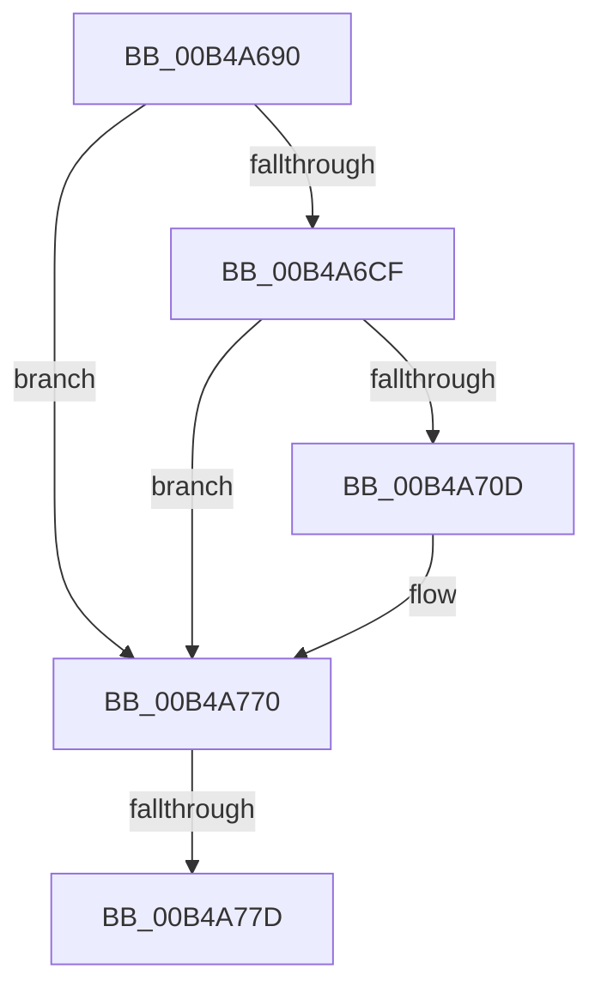

# sub_00B4A690

- RVA: `0x00B4A690`–`0x00B4A78A` (길이 `250` bytes)
- VA: `0x0000000140B4A690`
- 실행 섹션: `PAGE`
- PDB 이름 있음: `아니요`; PDB Function 태그: `아니요`
- unwind 정보 RVA: `0x000BBF30`
- 디코드: `60`개 명령, `250/250` bytes 표시
- 미해석 바이트: `0` (있으면 어셈블리에 `.byte`로 보존)

> 이 문서는 커널 이미지의 기계어와 PDB 기호를 분석해 생성했습니다. 4번과 5번은 함수 원형과 자료형을 바이너리 사용 방식에서 추정한 C 해석이며 원본 소스 복구 결과는 아닙니다.

## 1. Dependencies

- 직접 호출 지점: **4**; 고유 호출 대상: **4**
- 직접 호출자로 확인된 함수: **0**
- RIP 상대 이미지 참조: **0**

### Outgoing calls
- `0x00B4A6C0` → [IopIoRingGetBuffer](../AB/IopIoRingGetBuffer_function_00AB0B88.md) (function, `0x00AB0B88`)
- `0x00B4A702` → [IopIoRingReferenceFileObject](../AD/IopIoRingReferenceFileObject_function_00AD3A8C.md) (function, `0x00AD3A8C`)
- `0x00B4A769` → [IopReadFile](../8A/IopReadFile_function_008AEFF0.md) (function, `0x008AEFF0`)
- `0x00B4A77F` → [IopMcReleaseMdl](../../text/5A/IopMcReleaseMdl_function_005A3CE8.md) (function, `0x005A3CE8`)

### Direct callers
- 이 함수 시작 RVA로 연결되는 직접 call은 확인되지 않았습니다. 간접 호출은 완전히 역산할 수 없습니다.

### Static image references
- 디코드된 RIP-relative 메모리 참조가 없습니다.

## 2. Other-region calls and transfers

- 다른 실행 섹션으로 향하는 call: **1**
  - `0x00B4A77F` → [IopMcReleaseMdl](../../text/5A/IopMcReleaseMdl_function_005A3CE8.md) (`PAGE` → `.text`)
- call이 아닌 외부 분기/꼬리 이동: **2**
  - `0x00B4A777` → [IopIoRingDispatchRead + 0x66](../AA/IopIoRingDispatchRead_function_00AAC974.md) (`tail-transfer`)
  - `0x00B4A785` → [IopIoRingDispatchRead + 0x66](../AA/IopIoRingDispatchRead_function_00AAC974.md) (`tail-transfer`)

## 3. Assembly (complete function range)

```asm
00B4A690  44 8B 4A 30                     mov r9d, dword ptr [rdx + 0x30]
00B4A694  48 8D 45 38                     lea rax, [rbp + 0x38]
00B4A698  48 8B 52 20                     mov rdx, qword ptr [rdx + 0x20]
00B4A69C  48 83 65 40 00                  and qword ptr [rbp + 0x40], 0
00B4A6A1  48 89 44 24 38                  mov qword ptr [rsp + 0x38], rax
00B4A6A6  48 8D 45 40                     lea rax, [rbp + 0x40]
00B4A6AA  48 89 44 24 30                  mov qword ptr [rsp + 0x30], rax
00B4A6AF  41 D1 E8                        shr r8d, 1
00B4A6B2  C6 44 24 28 01                  mov byte ptr [rsp + 0x28], 1
00B4A6B7  41 80 E0 01                     and r8b, 1
00B4A6BB  44 88 74 24 20                  mov byte ptr [rsp + 0x20], r14b
00B4A6C0  E8 C3 64 F6 FF                  call 0x140ab0b88
00B4A6C5  8B F8                           mov edi, eax
00B4A6C7  85 C0                           test eax, eax
00B4A6C9  0F 88 A1 00 00 00               js 0x140b4a770
00B4A6CF  48 83 64 24 38 00               and qword ptr [rsp + 0x38], 0
00B4A6D5  48 8D 45 48                     lea rax, [rbp + 0x48]
00B4A6D9  44 8A 43 10                     mov r8b, byte ptr [rbx + 0x10]
00B4A6DD  45 8A CE                        mov r9b, r14b
00B4A6E0  48 8B 53 18                     mov rdx, qword ptr [rbx + 0x18]
00B4A6E4  41 80 E0 01                     and r8b, 1
00B4A6E8  48 83 65 48 00                  and qword ptr [rbp + 0x48], 0
00B4A6ED  48 8B CE                        mov rcx, rsi
00B4A6F0  48 89 44 24 30                  mov qword ptr [rsp + 0x30], rax
00B4A6F5  C7 44 24 28 01 00 00 00         mov dword ptr [rsp + 0x28], 1
00B4A6FD  C6 44 24 20 00                  mov byte ptr [rsp + 0x20], 0
00B4A702  E8 85 93 F8 FF                  call 0x140ad3a8c
00B4A707  8B F8                           mov edi, eax
00B4A709  85 C0                           test eax, eax
00B4A70B  78 63                           js 0x140b4a770
00B4A70D  48 83 64 24 68 00               and qword ptr [rsp + 0x68], 0
00B4A713  48 8D 45 38                     lea rax, [rbp + 0x38]
00B4A717  48 89 44 24 60                  mov qword ptr [rsp + 0x60], rax
00B4A71C  48 8D 4B 34                     lea rcx, [rbx + 0x34]
00B4A720  48 8B 43 08                     mov rax, qword ptr [rbx + 8]
00B4A724  48 8D 53 28                     lea rdx, [rbx + 0x28]
00B4A728  C7 44 24 58 00 00 00 80         mov dword ptr [rsp + 0x58], 0x80000000
00B4A730  45 33 C9                        xor r9d, r9d
00B4A733  48 89 44 24 50                  mov qword ptr [rsp + 0x50], rax
00B4A738  45 33 C0                        xor r8d, r8d
00B4A73B  8B 43 30                        mov eax, dword ptr [rbx + 0x30]
00B4A73E  48 89 74 24 48                  mov qword ptr [rsp + 0x48], rsi
00B4A743  48 89 4C 24 40                  mov qword ptr [rsp + 0x40], rcx
00B4A748  48 8B 4D 48                     mov rcx, qword ptr [rbp + 0x48]
00B4A74C  48 89 54 24 38                  mov qword ptr [rsp + 0x38], rdx
00B4A751  33 D2                           xor edx, edx
00B4A753  89 44 24 30                     mov dword ptr [rsp + 0x30], eax
00B4A757  48 8B 45 40                     mov rax, qword ptr [rbp + 0x40]
00B4A75B  48 89 44 24 28                  mov qword ptr [rsp + 0x28], rax
00B4A760  48 8D 45 F0                     lea rax, [rbp - 0x10]
00B4A764  48 89 44 24 20                  mov qword ptr [rsp + 0x20], rax
00B4A769  E8 82 48 D6 FF                  call 0x1408aeff0
00B4A76E  8B F8                           mov edi, eax
00B4A770  48 8B 4D 38                     mov rcx, qword ptr [rbp + 0x38]
00B4A774  48 85 C9                        test rcx, rcx
00B4A777  0F 84 5D 22 F6 FF               je 0x140aac9da
00B4A77D  33 D2                           xor edx, edx
00B4A77F  E8 64 95 A5 FF                  call 0x1405a3ce8
00B4A784  90                              nop
00B4A785  E9 50 22 F6 FF                  jmp 0x140aac9da
```

## 4. C-style interpretation (structured pseudocode)

```c
__int64 __fastcall sub_00B4A690(__int64 a1, __int64 a2, int a3, __int64 a4, __int64 a5, __int64 a6, __int64 a7, __int64 a8, __int64 a9, __int64 a10, __int64 a11, __int64 a12, __int64 a13)
{
    __int64 result;
    __int64 v_rdi;
    unsigned __int8 v_stack_p20;
    unsigned __int8 v_stack_p28;
    unsigned __int64 v_stack_p30;
    unsigned __int64 v_stack_p38;
    unsigned __int64 v_stack_p40;
    unsigned __int64 v_stack_p48;
    unsigned __int64 v_stack_p50;
    unsigned int v_stack_p58;
    unsigned __int64 v_stack_p60;

    v_stack_p38 = v_rbp + 56;
    v_stack_p30 = v_rbp + 64;
    a3 = (unsigned int)((a3) >> (1));
    v_stack_p28 = 1;
    a3 = (unsigned __int8)((a3) & (1));
    v_stack_p20 = (unsigned __int8)(v_r14);
    result = IopIoRingGetBuffer(a1, *(unsigned __int64 *)(a2 + 32), a3, (unsigned int)(*(unsigned int *)(a2 + 48)));
    if (sign_flag) goto loc_00B4A770;
    a3 = (unsigned __int8)((*(unsigned __int8 *)(v_rbx + 16)) & (1));
    v_stack_p30 = v_rbp + 72;
    v_stack_p28 = 1;
    v_stack_p20 = 0;
    result = IopIoRingReferenceFileObject(v_rsi, *(unsigned __int64 *)(v_rbx + 24), a3, (unsigned __int8)(v_r14));
    v_rdi = (unsigned int)((unsigned int)(result));
    if (!(sign_flag)) {
        result = v_rbp + 56;
        v_stack_p60 = result;
        a1 = v_rbx + 52;
        result = *(unsigned __int64 *)(v_rbx + 8);
        a2 = v_rbx + 40;
        v_stack_p58 = 0x80000000ULL;
        a4 = 0;
        v_stack_p50 = result;
        a3 = 0;
        result = *(unsigned int *)(v_rbx + 48);
        v_stack_p48 = v_rsi;
        v_stack_p40 = a1;
        a1 = *(unsigned __int64 *)(v_rbp + 72);
        v_stack_p38 = a2;
        a2 = 0;
        v_stack_p30 = (unsigned int)(result);
        result = *(unsigned __int64 *)(v_rbp + 64);
        v_stack_p28 = result;
        result = v_rbp - 16;
        v_stack_p20 = result;
        result = IopReadFile(a1, a2, a3, a4);
        v_rdi = (unsigned int)(result);
    }
    a2 = 0;
    result = IopMcReleaseMdl(*(unsigned __int64 *)(v_rbp + 56), a2, a3, a4);
}
```

## 5. (Beta) C Style

```c
int64_t sub_00B4A690(int64_t Arg1, void *Arg2, int32_t Arg3, int64_t Arg4, uint64_t Arg5, uint64_t Arg6, int64_t Arg7, uint64_t Arg8, uint64_t Arg9, uint64_t Arg10, uint64_t Arg11, uint64_t Arg12, int64_t Arg13)
{
    uint8_t *arg2 = (uint8_t *)Arg2;

    int64_t result;
    int64_t local_rdi;
    uint8_t v_stack_p20;
    uint8_t v_stack_p28;
    uint64_t v_stack_p30;
    uint64_t v_stack_p38;
    uint64_t v_stack_p40;
    uint64_t v_stack_p48;
    uint64_t v_stack_p50;
    uint32_t v_stack_p58;
    uint64_t v_stack_p60;

    v_stack_p38 = local_rbp + 56;
    v_stack_p30 = local_rbp + 64;
    Arg3 = (uint32_t)((Arg3) >> (1));
    v_stack_p28 = 1;
    Arg3 = (uint8_t)((Arg3) & (1));
    v_stack_p20 = (uint8_t)(local_r14);
    result = IopIoRingGetBuffer(Arg1, *(uint64_t *)(arg2 + 0x20), Arg3, (uint32_t)(*(uint32_t *)(arg2 + 0x30)));
    if (sign_flag) goto loc_00B4A770;
    Arg3 = (uint8_t)((*(uint8_t *)(local_rbx + 0x10)) & (1));
    v_stack_p30 = local_rbp + 72;
    v_stack_p28 = 1;
    v_stack_p20 = 0;
    result = IopIoRingReferenceFileObject(local_rsi, *(uint64_t *)(local_rbx + 0x18), Arg3, (uint8_t)(local_r14));
    local_rdi = (uint32_t)((uint32_t)(result));
    if (!(sign_flag)) {
        result = local_rbp + 56;
        v_stack_p60 = result;
        Arg1 = local_rbx + 52;
        result = *(uint64_t *)(local_rbx + 0x8);
        Arg2 = local_rbx + 40;
        v_stack_p58 = 0x80000000ULL;
        Arg4 = 0;
        v_stack_p50 = result;
        Arg3 = 0;
        result = *(uint32_t *)(local_rbx + 0x30);
        v_stack_p48 = local_rsi;
        v_stack_p40 = Arg1;
        Arg1 = *(uint64_t *)(local_rbp + 0x48);
        v_stack_p38 = Arg2;
        Arg2 = 0;
        v_stack_p30 = (uint32_t)(result);
        result = *(uint64_t *)(local_rbp + 0x40);
        v_stack_p28 = result;
        result = local_rbp - 16;
        v_stack_p20 = result;
        result = IopReadFile(Arg1, Arg2, Arg3, Arg4);
        local_rdi = (uint32_t)(result);
    }
    Arg2 = 0;
    result = IopMcReleaseMdl(*(uint64_t *)(local_rbp + 0x38), Arg2, Arg3, Arg4);
}
```

### 관측된 메모리 오프셋

구조체 형식이 확인되지 않은 접근은 인자 기준의 오프셋으로만 기록했습니다.

| 기준 인자 | 오프셋 표현 | 폭 (bit) | 접근 |
|---|---:|---:|---|
| `Arg2` | `+ 0x20` | `64` | `R` |
| `Arg2` | `+ 0x30` | `32` | `R` |

## 6. Execution-region graph

[열기: 2D/3D 그래프와 함수 탐색 컨트롤 패널](../../../control-panel.html?section=page&rva=0x00B4A690&view=graph)

- 2D 그래프는 위에서 아래로 흐르고, 3D 그래프는 빈 공간을 드래그해 회전합니다. Shift+드래그는 이동, 휠은 확대·축소, 함수 노드 선택은 대상 보고서 이동입니다.

### Static fallback


