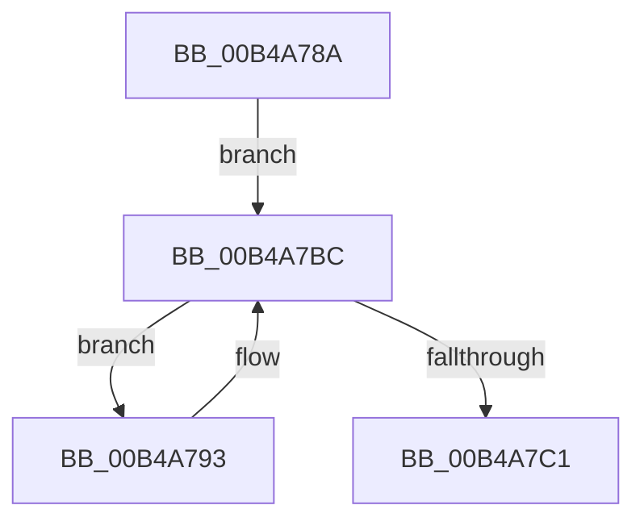

# sub_00B4A78A

- RVA: `0x00B4A78A`–`0x00B4A7C6` (길이 `60` bytes)
- VA: `0x0000000140B4A78A`
- 실행 섹션: `PAGE`
- PDB 이름 있음: `아니요`; PDB Function 태그: `아니요`
- unwind 정보 RVA: `0x000BBF60`
- 디코드: `15`개 명령, `60/60` bytes 표시
- 미해석 바이트: `0` (있으면 어셈블리에 `.byte`로 보존)

> 이 문서는 커널 이미지의 기계어와 PDB 기호를 분석해 생성했습니다. 4번과 5번은 함수 원형과 자료형을 바이너리 사용 방식에서 추정한 C 해석이며 원본 소스 복구 결과는 아닙니다.

## 1. Dependencies

- 직접 호출 지점: **2**; 고유 호출 대상: **2**
- 직접 호출자로 확인된 함수: **0**
- RIP 상대 이미지 참조: **0**

### Outgoing calls
- `0x00B4A7A9` → [PopDirectedDripsVisitDevice](../70/PopDirectedDripsVisitDevice_function_00703068.md) (function, `0x00703068`)
- `0x00B4A7B4` → [PopDirectedDripsInsertQueueDevice](../77/PopDirectedDripsInsertQueueDevice_function_00771E28.md) (function, `0x00771E28`)

### Direct callers
- 이 함수 시작 RVA로 연결되는 직접 call은 확인되지 않았습니다. 간접 호출은 완전히 역산할 수 없습니다.

### Static image references
- 디코드된 RIP-relative 메모리 참조가 없습니다.

## 2. Other-region calls and transfers

- 다른 실행 섹션으로 향하는 call: **0**
- call이 아닌 외부 분기/꼬리 이동: **1**
  - `0x00B4A7C1` → [PopDirectedDripsMarkDfxDevice + 0x90](../AA/PopDirectedDripsMarkDfxDevice_function_00AACA44.md) (`tail-transfer`)

## 3. Assembly (complete function range)

```asm
00B4A78A  48 8B BE 30 FD FF FF            mov rdi, qword ptr [rsi - 0x2d0]
00B4A791  EB 29                           jmp 0x140b4a7bc
00B4A793  48 8D 9F D8 02 00 00            lea rbx, [rdi + 0x2d8]
00B4A79A  41 B9 02 00 00 00               mov r9d, 2
00B4A7A0  48 8B D3                        mov rdx, rbx
00B4A7A3  4D 8B C6                        mov r8, r14
00B4A7A6  49 8B CF                        mov rcx, r15
00B4A7A9  E8 BA 88 BB FF                  call 0x140703068
00B4A7AE  48 8B D3                        mov rdx, rbx
00B4A7B1  49 8B CC                        mov rcx, r12
00B4A7B4  E8 6F 76 C2 FF                  call 0x140771e28
00B4A7B9  48 8B 3F                        mov rdi, qword ptr [rdi]
00B4A7BC  48 85 FF                        test rdi, rdi
00B4A7BF  75 D2                           jne 0x140b4a793
00B4A7C1  E9 0E 23 F6 FF                  jmp 0x140aacad4
```

## 4. C-style interpretation (structured pseudocode)

```c
__int64 __fastcall sub_00B4A78A(void)
{
    __int64 result;

    goto loc_00B4A7BC;
loc_00B4A793:
    result = PopDirectedDripsVisitDevice(v_r15, *(unsigned __int64 *)(v_rsi - 720) + 728, v_r14, 2);
    result = PopDirectedDripsInsertQueueDevice(v_r12, *(unsigned __int64 *)(v_rsi - 720) + 728, v_r14, 2);
loc_00B4A7BC:
    if (*(unsigned __int64 *)(*(unsigned __int64 *)(v_rsi - 720)) != 0) goto loc_00B4A793;
}
```

## 5. (Beta) C Style

```c
void sub_00B4A78A(void)
{
    int64_t result;

    goto loc_00B4A7BC;
loc_00B4A793:
    result = PopDirectedDripsVisitDevice(local_r15, *(uint64_t *)(local_rsi - 0x2D0) + 728, local_r14, 2);
    result = PopDirectedDripsInsertQueueDevice(local_r12, *(uint64_t *)(local_rsi - 0x2D0) + 728, local_r14, 2);
loc_00B4A7BC:
    if (*(uint64_t *)(*(uint64_t *)(local_rsi - 0x2D0)) != 0) goto loc_00B4A793;
}
```

## 6. Execution-region graph

[열기: 2D/3D 그래프와 함수 탐색 컨트롤 패널](../../../control-panel.html?section=page&rva=0x00B4A78A&view=graph)

- 2D 그래프는 위에서 아래로 흐르고, 3D 그래프는 빈 공간을 드래그해 회전합니다. Shift+드래그는 이동, 휠은 확대·축소, 함수 노드 선택은 대상 보고서 이동입니다.

### Static fallback


