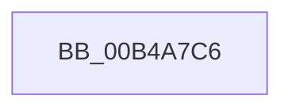

# sub_00B4A7C6

- RVA: `0x00B4A7C6`–`0x00B4A82F` (길이 `105` bytes)
- VA: `0x0000000140B4A7C6`
- 실행 섹션: `PAGE`
- PDB 이름 있음: `아니요`; PDB Function 태그: `아니요`
- unwind 정보 RVA: `0x000BC188`
- 디코드: `24`개 명령, `105/105` bytes 표시
- 미해석 바이트: `0` (있으면 어셈블리에 `.byte`로 보존)

> 이 문서는 커널 이미지의 기계어와 PDB 기호를 분석해 생성했습니다. 4번과 5번은 함수 원형과 자료형을 바이너리 사용 방식에서 추정한 C 해석이며 원본 소스 복구 결과는 아닙니다.

## 1. Dependencies

- 직접 호출 지점: **2**; 고유 호출 대상: **2**
- 직접 호출자로 확인된 함수: **0**
- RIP 상대 이미지 참조: **1**

### Outgoing calls
- `0x00B4A7D5` → [SSHSupportQueryInterruptTime](../../text/4B/SSHSupportQueryInterruptTime_function_004BB458.md) (function, `0x004BB458`)
- `0x00B4A824` → [SSHSupportEtwWrite](../../text/4A/SSHSupportEtwWrite_function_004ADF5C.md) (function, `0x004ADF5C`)

### Direct callers
- 이 함수 시작 RVA로 연결되는 직접 call은 확인되지 않았습니다. 간접 호출은 완전히 역산할 수 없습니다.

### Static image references
- `0x00B4A7DE` → RVA `0x0001E0C8` (`.rdata`; read)

## 2. Other-region calls and transfers

- 다른 실행 섹션으로 향하는 call: **2**
  - `0x00B4A7D5` → [SSHSupportQueryInterruptTime](../../text/4B/SSHSupportQueryInterruptTime_function_004BB458.md) (`PAGE` → `.text`)
  - `0x00B4A824` → [SSHSupportEtwWrite](../../text/4A/SSHSupportEtwWrite_function_004ADF5C.md) (`PAGE` → `.text`)
- call이 아닌 외부 분기/꼬리 이동: **1**
  - `0x00B4A82A` → [SshpTracingWriteCollectionStateChange + 0x46](../AA/SshpTracingWriteCollectionStateChange_function_00AADE8C.md) (`tail-transfer`)

## 3. Assembly (complete function range)

```asm
00B4A7C6  83 65 CC 00                     and dword ptr [rbp - 0x34], 0
00B4A7CA  48 89 7D C0                     mov qword ptr [rbp - 0x40], rdi
00B4A7CE  C7 45 C8 10 00 00 00            mov dword ptr [rbp - 0x38], 0x10
00B4A7D5  E8 7E 0C 97 FF                  call 0x1404bb458
00B4A7DA  83 65 DC 00                     and dword ptr [rbp - 0x24], 0
00B4A7DE  48 8D 15 E3 38 4D FF            lea rdx, [rip - 0xb2c71d]
00B4A7E5  48 89 45 B8                     mov qword ptr [rbp - 0x48], rax
00B4A7E9  41 B9 03 00 00 00               mov r9d, 3
00B4A7EF  48 8D 45 B8                     lea rax, [rbp - 0x48]
00B4A7F3  C7 45 D8 08 00 00 00            mov dword ptr [rbp - 0x28], 8
00B4A7FA  48 89 45 D0                     mov qword ptr [rbp - 0x30], rax
00B4A7FE  33 C0                           xor eax, eax
00B4A800  84 DB                           test bl, bl
00B4A802  C7 45 E8 04 00 00 00            mov dword ptr [rbp - 0x18], 4
00B4A809  0F 95 C0                        setne al
00B4A80C  83 65 EC 00                     and dword ptr [rbp - 0x14], 0
00B4A810  89 45 B0                        mov dword ptr [rbp - 0x50], eax
00B4A813  48 8D 45 B0                     lea rax, [rbp - 0x50]
00B4A817  48 89 45 E0                     mov qword ptr [rbp - 0x20], rax
00B4A81B  48 8D 45 C0                     lea rax, [rbp - 0x40]
00B4A81F  48 89 44 24 20                  mov qword ptr [rsp + 0x20], rax
00B4A824  E8 33 37 96 FF                  call 0x1404adf5c
00B4A829  90                              nop
00B4A82A  E9 A3 36 F6 FF                  jmp 0x140aaded2
```

## 4. C-style interpretation (structured pseudocode)

```c
__int64 __fastcall sub_00B4A7C6(void)
{
    __int64 result;
    unsigned __int64 v_stack_p20;

    *(unsigned __int64 *)(v_rbp - 64) = v_rdi;
    *(unsigned int *)(v_rbp - 56) = 16;
    result = SSHSupportQueryInterruptTime(a1, a2, a3, a4);
    *(unsigned __int64 *)(v_rbp - 72) = result;
    *(unsigned int *)(v_rbp - 40) = 8;
    *(unsigned __int64 *)(v_rbp - 48) = v_rbp - 72;
    result = 0;
    *(unsigned int *)(v_rbp - 24) = 4;
    result = ((unsigned __int8)(v_rbx) != 0) ? 1 : 0;
    *(unsigned int *)(v_rbp - 80) = (unsigned int)(result);
    *(unsigned __int64 *)(v_rbp - 32) = v_rbp - 80;
    v_stack_p20 = v_rbp - 64;
    result = SSHSupportEtwWrite(a1, v_rip - 11716381, a3, 3);
}
```

## 5. (Beta) C Style

```c
void sub_00B4A7C6(void)
{
    int64_t result;
    uint64_t v_stack_p20;

    *(uint64_t *)(local_rbp - 0x40) = local_rdi;
    *(uint32_t *)(local_rbp - 0x38) = 16;
    result = SSHSupportQueryInterruptTime(a1, a2, a3, a4);
    *(uint64_t *)(local_rbp - 0x48) = result;
    *(uint32_t *)(local_rbp - 0x28) = 8;
    *(uint64_t *)(local_rbp - 0x30) = local_rbp - 72;
    result = 0;
    *(uint32_t *)(local_rbp - 0x18) = 4;
    result = ((uint8_t)(local_rbx) != 0) ? 1 : 0;
    *(uint32_t *)(local_rbp - 0x50) = (uint32_t)(result);
    *(uint64_t *)(local_rbp - 0x20) = local_rbp - 80;
    v_stack_p20 = local_rbp - 64;
    result = SSHSupportEtwWrite(a1, v_rip - 11716381, a3, 3);
}
```

## 6. Execution-region graph

[열기: 2D/3D 그래프와 함수 탐색 컨트롤 패널](../../../control-panel.html?section=page&rva=0x00B4A7C6&view=graph)

- 2D 그래프는 위에서 아래로 흐르고, 3D 그래프는 빈 공간을 드래그해 회전합니다. Shift+드래그는 이동, 휠은 확대·축소, 함수 노드 선택은 대상 보고서 이동입니다.

### Static fallback


