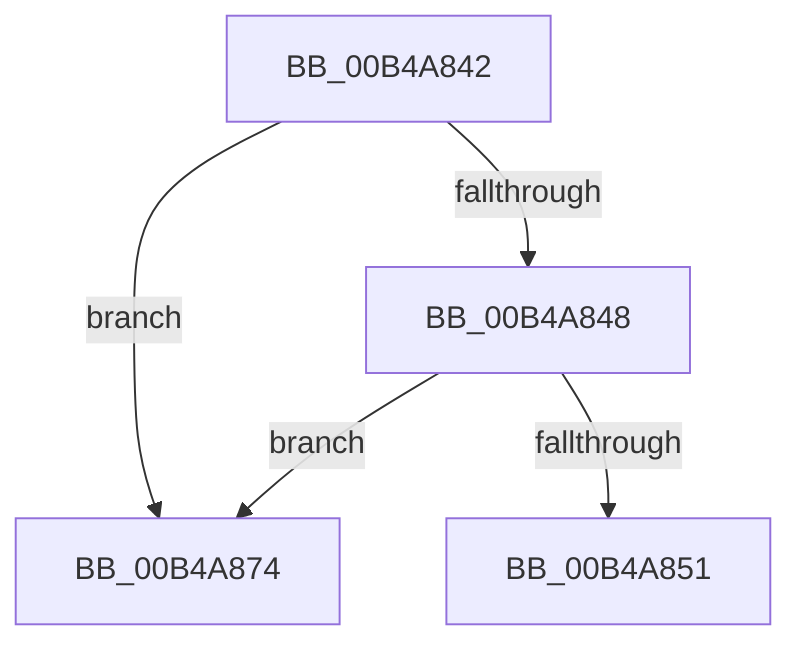

# sub_00B4A842

- RVA: `0x00B4A842`–`0x00B4A87B` (길이 `57` bytes)
- VA: `0x0000000140B4A842`
- 실행 섹션: `PAGE`
- PDB 이름 있음: `아니요`; PDB Function 태그: `아니요`
- unwind 정보 RVA: `0x000BC20C`
- 디코드: `17`개 명령, `57/57` bytes 표시
- 미해석 바이트: `0` (있으면 어셈블리에 `.byte`로 보존)

> 이 문서는 커널 이미지의 기계어와 PDB 기호를 분석해 생성했습니다. 4번과 5번은 함수 원형과 자료형을 바이너리 사용 방식에서 추정한 C 해석이며 원본 소스 복구 결과는 아닙니다.

## 1. Dependencies

- 직접 호출 지점: **2**; 고유 호출 대상: **1**
- 직접 호출자로 확인된 함수: **0**
- RIP 상대 이미지 참조: **0**

### Outgoing calls
- `0x00B4A85E` → [ExFreePoolWithTag](../../poolcode/B8/ExFreePoolWithTag_function_00B82870.md) (function, `0x00B82870`)
- `0x00B4A868` → [ExFreePoolWithTag](../../poolcode/B8/ExFreePoolWithTag_function_00B82870.md) (function, `0x00B82870`)

### Direct callers
- 이 함수 시작 RVA로 연결되는 직접 call은 확인되지 않았습니다. 간접 호출은 완전히 역산할 수 없습니다.

### Static image references
- 디코드된 RIP-relative 메모리 참조가 없습니다.

## 2. Other-region calls and transfers

- 다른 실행 섹션으로 향하는 call: **2**
  - `0x00B4A85E` → [ExFreePoolWithTag](../../poolcode/B8/ExFreePoolWithTag_function_00B82870.md) (`PAGE` → `POOLCODE`)
  - `0x00B4A868` → [ExFreePoolWithTag](../../poolcode/B8/ExFreePoolWithTag_function_00B82870.md) (`PAGE` → `POOLCODE`)
- call이 아닌 외부 분기/꼬리 이동: **1**
  - `0x00B4A86F` → [PiRemoveDeferredSetInterfaceState + 0x2B](../AA/PiRemoveDeferredSetInterfaceState_function_00AAE03C.md) (`tail-transfer`)

## 3. Assembly (complete function range)

```asm
00B4A842  48 39 59 08                     cmp qword ptr [rcx + 8], rbx
00B4A846  75 2C                           jne 0x140b4a874
00B4A848  48 8B 43 08                     mov rax, qword ptr [rbx + 8]
00B4A84C  48 39 18                        cmp qword ptr [rax], rbx
00B4A84F  75 23                           jne 0x140b4a874
00B4A851  48 89 08                        mov qword ptr [rax], rcx
00B4A854  33 D2                           xor edx, edx
00B4A856  48 89 41 08                     mov qword ptr [rcx + 8], rax
00B4A85A  48 8B 4B 18                     mov rcx, qword ptr [rbx + 0x18]
00B4A85E  E8 0D 80 03 00                  call 0x140b82870
00B4A863  33 D2                           xor edx, edx
00B4A865  48 8B CB                        mov rcx, rbx
00B4A868  E8 03 80 03 00                  call 0x140b82870
00B4A86D  33 FF                           xor edi, edi
00B4A86F  E9 F3 37 F6 FF                  jmp 0x140aae067
00B4A874  B9 03 00 00 00                  mov ecx, 3
00B4A879  CD 29                           int 0x29
```

## 4. C-style interpretation (structured pseudocode)

```c
__int64 __fastcall sub_00B4A842(__int64 a1, int a2)
{
    __int64 result;
    __int64 v_rdi;

    if ((*(unsigned __int64 *)(a1 + 8)) != v_rbx) goto loc_00B4A874;
    if ((*(unsigned __int64 *)(*(unsigned __int64 *)(v_rbx + 8))) != v_rbx) goto loc_00B4A874;
    *(unsigned __int64 *)(*(unsigned __int64 *)(v_rbx + 8)) = a1;
    a2 = 0;
    *(unsigned __int64 *)(a1 + 8) = *(unsigned __int64 *)(v_rbx + 8);
    result = ExFreePoolWithTag(*(unsigned __int64 *)(v_rbx + 24), a2, a3, a4);
    a2 = 0;
    result = ExFreePoolWithTag(v_rbx, a2, a3, a4);
    v_rdi = 0;
loc_00B4A874:
    return result;
}
```

## 5. (Beta) C Style

```c
int64_t sub_00B4A842(void *Arg1, int32_t Arg2)
{
    uint8_t *arg1 = (uint8_t *)Arg1;

    int64_t result;
    int64_t local_rdi;

    if ((*(uint64_t *)(arg1 + 0x8)) != local_rbx) goto loc_00B4A874;
    if ((*(uint64_t *)(*(uint64_t *)(local_rbx + 0x8))) != local_rbx) goto loc_00B4A874;
    *(void **)(*(uint64_t *)(local_rbx + 0x8)) = Arg1;
    Arg2 = 0;
    *(uint64_t *)(arg1 + 0x8) = *(uint64_t *)(local_rbx + 0x8);
    result = ExFreePoolWithTag(*(uint64_t *)(local_rbx + 0x18), Arg2, a3, a4);
    Arg2 = 0;
    result = ExFreePoolWithTag(local_rbx, Arg2, a3, a4);
    local_rdi = 0;
loc_00B4A874:
    return result;
}
```

### 관측된 메모리 오프셋

구조체 형식이 확인되지 않은 접근은 인자 기준의 오프셋으로만 기록했습니다.

| 기준 인자 | 오프셋 표현 | 폭 (bit) | 접근 |
|---|---:|---:|---|
| `Arg1` | `+ 0x8` | `64` | `R` |
| `Arg1` | `+ 0x8` | `64` | `W` |

## 6. Execution-region graph

[열기: 2D/3D 그래프와 함수 탐색 컨트롤 패널](../../../control-panel.html?section=page&rva=0x00B4A842&view=graph)

- 2D 그래프는 위에서 아래로 흐르고, 3D 그래프는 빈 공간을 드래그해 회전합니다. Shift+드래그는 이동, 휠은 확대·축소, 함수 노드 선택은 대상 보고서 이동입니다.

### Static fallback


