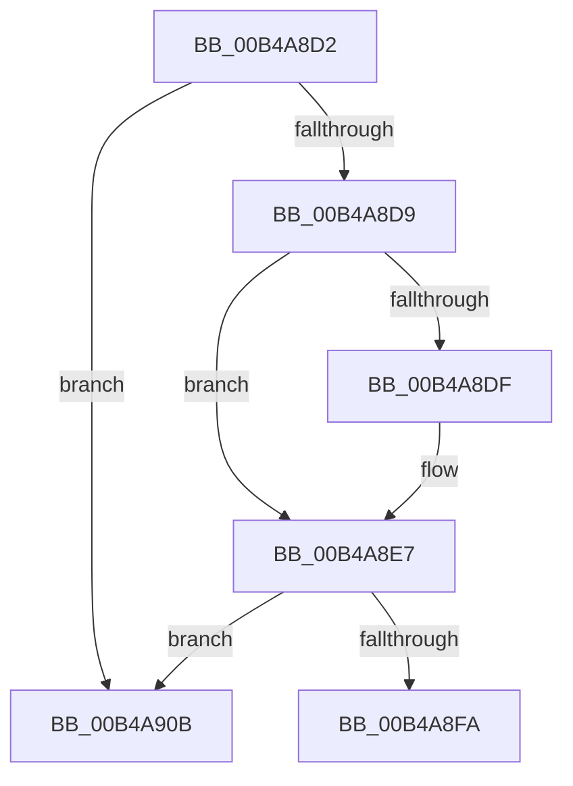

# sub_00B4A8D2

- RVA: `0x00B4A8D2`–`0x00B4A91B` (길이 `73` bytes)
- VA: `0x0000000140B4A8D2`
- 실행 섹션: `PAGE`
- PDB 이름 있음: `아니요`; PDB Function 태그: `아니요`
- unwind 정보 RVA: `0x000BC4D8`
- 디코드: `23`개 명령, `73/73` bytes 표시
- 미해석 바이트: `0` (있으면 어셈블리에 `.byte`로 보존)

> 이 문서는 커널 이미지의 기계어와 PDB 기호를 분석해 생성했습니다. 4번과 5번은 함수 원형과 자료형을 바이너리 사용 방식에서 추정한 C 해석이며 원본 소스 복구 결과는 아닙니다.

## 1. Dependencies

- 직접 호출 지점: **4**; 고유 호출 대상: **4**
- 직접 호출자로 확인된 함수: **0**
- RIP 상대 이미지 참조: **0**

### Outgoing calls
- `0x00B4A8E2` → [IopMcCreateBufferEntryMdl](../72/IopMcCreateBufferEntryMdl_function_00722FA8.md) (function, `0x00722FA8`)
- `0x00B4A8F0` → [IopMcCreatePartialMdl](../72/IopMcCreatePartialMdl_function_00723034.md) (function, `0x00723034`)
- `0x00B4A900` → [IopMcReferenceBufferEntry](../../text/5A/IopMcReferenceBufferEntry_function_005A3CAC.md) (function, `0x005A3CAC`)
- `0x00B4A910` → [IopMcDereferenceMdl](../../text/5A/IopMcDereferenceMdl_function_005A3C18.md) (function, `0x005A3C18`)

### Direct callers
- 이 함수 시작 RVA로 연결되는 직접 call은 확인되지 않았습니다. 간접 호출은 완전히 역산할 수 없습니다.

### Static image references
- 디코드된 RIP-relative 메모리 참조가 없습니다.

## 2. Other-region calls and transfers

- 다른 실행 섹션으로 향하는 call: **2**
  - `0x00B4A900` → [IopMcReferenceBufferEntry](../../text/5A/IopMcReferenceBufferEntry_function_005A3CAC.md) (`PAGE` → `.text`)
  - `0x00B4A910` → [IopMcDereferenceMdl](../../text/5A/IopMcDereferenceMdl_function_005A3C18.md) (`PAGE` → `.text`)
- call이 아닌 외부 분기/꼬리 이동: **2**
  - `0x00B4A906` → [IopMcGetBuffer + 0x47](../AB/IopMcGetBuffer_function_00AB0118.md) (`tail-transfer`)
  - `0x00B4A916` → [IopMcGetBuffer + 0x47](../AB/IopMcGetBuffer_function_00AB0118.md) (`tail-transfer`)

## 3. Assembly (complete function range)

```asm
00B4A8D2  8B 43 0C                        mov eax, dword ptr [rbx + 0xc]
00B4A8D5  A8 05                           test al, 5
00B4A8D7  75 32                           jne 0x140b4a90b
00B4A8D9  48 39 7B 38                     cmp qword ptr [rbx + 0x38], rdi
00B4A8DD  75 08                           jne 0x140b4a8e7
00B4A8DF  48 8B CB                        mov rcx, rbx
00B4A8E2  E8 C1 86 BD FF                  call 0x140722fa8
00B4A8E7  48 8B 16                        mov rdx, qword ptr [rsi]
00B4A8EA  44 8B C5                        mov r8d, ebp
00B4A8ED  48 8B CB                        mov rcx, rbx
00B4A8F0  E8 3F 87 BD FF                  call 0x140723034
00B4A8F5  48 85 C0                        test rax, rax
00B4A8F8  74 11                           je 0x140b4a90b
00B4A8FA  48 8B CB                        mov rcx, rbx
00B4A8FD  49 89 06                        mov qword ptr [r14], rax
00B4A900  E8 A7 93 A5 FF                  call 0x1405a3cac
00B4A905  90                              nop
00B4A906  E9 54 58 F6 FF                  jmp 0x140ab015f
00B4A90B  33 D2                           xor edx, edx
00B4A90D  48 8B CB                        mov rcx, rbx
00B4A910  E8 03 93 A5 FF                  call 0x1405a3c18
00B4A915  90                              nop
00B4A916  E9 44 58 F6 FF                  jmp 0x140ab015f
```

## 4. C-style interpretation (structured pseudocode)

```c
__int64 __fastcall sub_00B4A8D2(void)
{
    __int64 result;

    if ((((unsigned __int8)((unsigned int)(*(unsigned int *)(v_rbx + 12)))) & (5)) != 0) goto loc_00B4A90B;
    result = (unsigned int)(*(unsigned int *)(v_rbx + 12));
    if ((*(unsigned __int64 *)(v_rbx + 56)) == v_rdi) {
        a1 = v_rbx;
        result = IopMcCreateBufferEntryMdl(a1, a2, a3, a4);
    }
    result = IopMcCreatePartialMdl(v_rbx, *(unsigned __int64 *)(v_rsi), (unsigned int)((unsigned int)(v_rbp)), a4);
    if (result == 0) goto loc_00B4A90B;
    *(unsigned __int64 *)(v_r14) = result;
    result = IopMcReferenceBufferEntry(v_rbx, *(unsigned __int64 *)(v_rsi), (unsigned int)((unsigned int)(v_rbp)), a4);
loc_00B4A90B:
    a2 = 0;
    result = IopMcDereferenceMdl(v_rbx, a2, (unsigned int)((unsigned int)(v_rbp)), a4);
}
```

## 5. (Beta) C Style

```c
void sub_00B4A8D2(void)
{
    int64_t result;

    if ((((uint8_t)((uint32_t)(*(uint32_t *)(local_rbx + 0xC)))) & (5)) != 0) goto loc_00B4A90B;
    result = (uint32_t)(*(uint32_t *)(local_rbx + 0xC));
    if ((*(uint64_t *)(local_rbx + 0x38)) == local_rdi) {
        a1 = local_rbx;
        result = IopMcCreateBufferEntryMdl(a1, a2, a3, a4);
    }
    result = IopMcCreatePartialMdl(local_rbx, *(uint64_t *)(local_rsi), (uint32_t)((uint32_t)(local_rbp)), a4);
    if (result == 0) goto loc_00B4A90B;
    *(uint64_t *)(local_r14) = result;
    result = IopMcReferenceBufferEntry(local_rbx, *(uint64_t *)(local_rsi), (uint32_t)((uint32_t)(local_rbp)), a4);
loc_00B4A90B:
    a2 = 0;
    result = IopMcDereferenceMdl(local_rbx, a2, (uint32_t)((uint32_t)(local_rbp)), a4);
}
```

## 6. Execution-region graph

[열기: 2D/3D 그래프와 함수 탐색 컨트롤 패널](../../../control-panel.html?section=page&rva=0x00B4A8D2&view=graph)

- 2D 그래프는 위에서 아래로 흐르고, 3D 그래프는 빈 공간을 드래그해 회전합니다. Shift+드래그는 이동, 휠은 확대·축소, 함수 노드 선택은 대상 보고서 이동입니다.

### Static fallback


