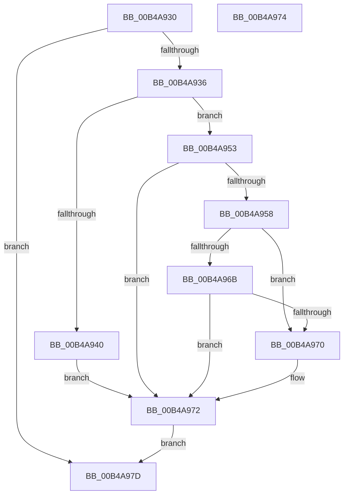

# sub_00B4A930

- RVA: `0x00B4A930`–`0x00B4A987` (길이 `87` bytes)
- VA: `0x0000000140B4A930`
- 실행 섹션: `PAGE`
- PDB 이름 있음: `아니요`; PDB Function 태그: `아니요`
- unwind 정보 RVA: `0x000BC69C`
- 디코드: `25`개 명령, `87/87` bytes 표시
- 미해석 바이트: `0` (있으면 어셈블리에 `.byte`로 보존)

> 이 문서는 커널 이미지의 기계어와 PDB 기호를 분석해 생성했습니다. 4번과 5번은 함수 원형과 자료형을 바이너리 사용 방식에서 추정한 C 해석이며 원본 소스 복구 결과는 아닙니다.

## 1. Dependencies

- 직접 호출 지점: **1**; 고유 호출 대상: **1**
- 직접 호출자로 확인된 함수: **0**
- RIP 상대 이미지 참조: **0**

### Outgoing calls
- `0x00B4A94C` → [ProbeForWrite](../8E/ProbeForWrite_function_008E91C0.md) (function, `0x008E91C0`)

### Direct callers
- 이 함수 시작 RVA로 연결되는 직접 call은 확인되지 않았습니다. 간접 호출은 완전히 역산할 수 없습니다.

### Static image references
- 디코드된 RIP-relative 메모리 참조가 없습니다.

## 2. Other-region calls and transfers

- 다른 실행 섹션으로 향하는 call: **0**
- call이 아닌 외부 분기/꼬리 이동: **2**
  - `0x00B4A978` → [IopIoRingGetBuffer + 0x58](../AB/IopIoRingGetBuffer_function_00AB0B88.md) (`tail-transfer`)
  - `0x00B4A982` → [IopIoRingGetBuffer + 0x58](../AB/IopIoRingGetBuffer_function_00AB0B88.md) (`tail-transfer`)

## 3. Assembly (complete function range)

```asm
00B4A930  38 54 24 70                     cmp byte ptr [rsp + 0x70], dl
00B4A934  74 47                           je 0x140b4a97d
00B4A936  89 54 24 30                     mov dword ptr [rsp + 0x30], edx
00B4A93A  38 54 24 78                     cmp byte ptr [rsp + 0x78], dl
00B4A93E  74 13                           je 0x140b4a953
00B4A940  49 8B D2                        mov rdx, r10
00B4A943  41 B8 01 00 00 00               mov r8d, 1
00B4A949  48 8B CB                        mov rcx, rbx
00B4A94C  E8 6F E8 D9 FF                  call 0x1408e91c0
00B4A951  EB 1F                           jmp 0x140b4a972
00B4A953  45 85 D2                        test r10d, r10d
00B4A956  74 1A                           je 0x140b4a972
00B4A958  4A 8D 0C 13                     lea rcx, [rbx + r10]
00B4A95C  48 B8 00 00 FF FF FF 7F 00 00   movabs rax, 0x7fffffff0000
00B4A966  48 3B C8                        cmp rcx, rax
00B4A969  77 05                           ja 0x140b4a970
00B4A96B  48 3B CB                        cmp rcx, rbx
00B4A96E  73 02                           jae 0x140b4a972
00B4A970  8A 00                           mov al, byte ptr [rax]
00B4A972  EB 09                           jmp 0x140b4a97d
00B4A974  8B 44 24 30                     mov eax, dword ptr [rsp + 0x30]
00B4A978  E9 63 62 F6 FF                  jmp 0x140ab0be0
00B4A97D  48 89 1F                        mov qword ptr [rdi], rbx
00B4A980  33 C0                           xor eax, eax
00B4A982  E9 59 62 F6 FF                  jmp 0x140ab0be0
```

## 4. C-style interpretation (structured pseudocode)

```c
__int64 __fastcall sub_00B4A930(__int64 a1, int a2, __int64 a3, __int64 a4, __int64 a5, __int64 a6, __int64 a7, __int64 a8, __int64 a9, __int64 a10, __int64 a11, __int64 a12, __int64 a13, unsigned __int8 a14, unsigned __int8 a15)
{
    __int64 result;
    unsigned int v_stack_p30;

    if (a14 == ((unsigned __int8)(a2))) goto loc_00B4A97D;
    v_stack_p30 = a2;
    if (a15 == ((unsigned __int8)(a2))) goto loc_00B4A953;
    result = ProbeForWrite(v_rbx, v_r10, 1, a4);
    goto loc_00B4A972;
loc_00B4A953:
    if ((unsigned int)(v_r10) == 0) goto loc_00B4A972;
    if ((v_rbx + v_r10 * 1) > result) goto loc_00B4A970;
    if ((v_rbx + v_r10 * 1) < v_rbx) {
        result = *(unsigned __int8 *)(result);
    }
    goto loc_00B4A97D;
loc_00B4A97D:
    *(unsigned __int64 *)(v_rdi) = v_rbx;
    result = 0;
}
```

## 5. (Beta) C Style

```c
int64_t sub_00B4A930(int64_t Arg1, int32_t Arg2, int64_t Arg3, int64_t Arg4, uint64_t Arg5, uint64_t Arg6, uint64_t Arg7, uint64_t Arg8, uint64_t Arg9, uint64_t Arg10, uint64_t Arg11, uint64_t Arg12, uint64_t Arg13, uint8_t Arg14, uint8_t Arg15)
{
    int64_t result;
    uint32_t v_stack_p30;

    if (Arg14 == ((uint8_t)(Arg2))) goto loc_00B4A97D;
    v_stack_p30 = Arg2;
    if (Arg15 == ((uint8_t)(Arg2))) goto loc_00B4A953;
    result = ProbeForWrite(local_rbx, local_r10, 1, Arg4);
    goto loc_00B4A972;
loc_00B4A953:
    if ((uint32_t)(local_r10) == 0) goto loc_00B4A972;
    if ((local_rbx + local_r10 * 1) > result) goto loc_00B4A970;
    if ((local_rbx + local_r10 * 1) < local_rbx) {
        result = *(uint8_t *)(result);
    }
    goto loc_00B4A97D;
loc_00B4A97D:
    *(uint64_t *)(local_rdi) = local_rbx;
    result = 0;
}
```

## 6. Execution-region graph

[열기: 2D/3D 그래프와 함수 탐색 컨트롤 패널](../../../control-panel.html?section=page&rva=0x00B4A930&view=graph)

- 2D 그래프는 위에서 아래로 흐르고, 3D 그래프는 빈 공간을 드래그해 회전합니다. Shift+드래그는 이동, 휠은 확대·축소, 함수 노드 선택은 대상 보고서 이동입니다.

### Static fallback


