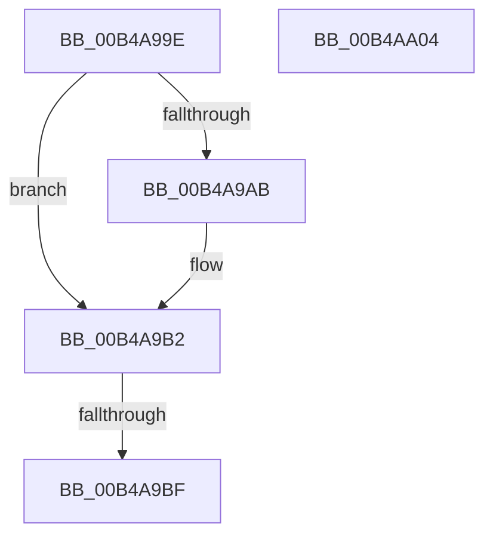

# sub_00B4A99E

- RVA: `0x00B4A99E`–`0x00B4AA05` (길이 `103` bytes)
- VA: `0x0000000140B4A99E`
- 실행 섹션: `PAGE`
- PDB 이름 있음: `아니요`; PDB Function 태그: `아니요`
- unwind 정보 RVA: `0x000BC884`
- 디코드: `26`개 명령, `103/103` bytes 표시
- 미해석 바이트: `0` (있으면 어셈블리에 `.byte`로 보존)

> 이 문서는 커널 이미지의 기계어와 PDB 기호를 분석해 생성했습니다. 4번과 5번은 함수 원형과 자료형을 바이너리 사용 방식에서 추정한 C 해석이며 원본 소스 복구 결과는 아닙니다.

## 1. Dependencies

- 직접 호출 지점: **3**; 고유 호출 대상: **2**
- 직접 호출자로 확인된 함수: **0**
- RIP 상대 이미지 참조: **0**

### Outgoing calls
- `0x00B4A9CA` → [PopIdleWakeSourceAccountingBucketsToDiagnosticBuckets](../AC/PopIdleWakeSourceAccountingBucketsToDiagnosticBuckets_function_00AC2410.md) (function, `0x00AC2410`)
- `0x00B4A9DD` → [PopIdleWakeSourceAccountingBucketsToDiagnosticBuckets](../AC/PopIdleWakeSourceAccountingBucketsToDiagnosticBuckets_function_00AC2410.md) (function, `0x00AC2410`)
- `0x00B4A9E8` → [PopIdleWakeGenerateDescriptionString](../AB/PopIdleWakeGenerateDescriptionString_function_00ABD584.md) (function, `0x00ABD584`)

### Direct callers
- 이 함수 시작 RVA로 연결되는 직접 call은 확인되지 않았습니다. 간접 호출은 완전히 역산할 수 없습니다.

### Static image references
- 디코드된 RIP-relative 메모리 참조가 없습니다.

## 2. Other-region calls and transfers

- 다른 실행 섹션으로 향하는 call: **0**
- call이 아닌 외부 분기/꼬리 이동: **1**
  - `0x00B4A9B9` → [PopIdleWakeSourceAccountingToDiagnostic + 0x37](../AB/PopIdleWakeSourceAccountingToDiagnostic_function_00AB1C44.md) (`tail-transfer`)

## 3. Assembly (complete function range)

```asm
00B4A99E  48 8B CF                        mov rcx, rdi
00B4A9A1  4A 89 4C 43 02                  mov qword ptr [rbx + r8*2 + 2], rcx
00B4A9A6  48 85 C9                        test rcx, rcx
00B4A9A9  74 07                           je 0x140b4a9b2
00B4A9AB  66 FF 83 50 03 00 00            inc word ptr [rbx + 0x350]
00B4A9B2  66 FF C2                        inc dx
00B4A9B5  66 83 FA 20                     cmp dx, 0x20
00B4A9B9  0F 82 BC 72 F6 FF               jb 0x140ab1c7b
00B4A9BF  48 8D 53 08                     lea rdx, [rbx + 8]
00B4A9C3  48 8D 8E A0 01 00 00            lea rcx, [rsi + 0x1a0]
00B4A9CA  E8 41 7A F7 FF                  call 0x140ac2410
00B4A9CF  48 8D 93 80 01 00 00            lea rdx, [rbx + 0x180]
00B4A9D6  48 8D 8E 20 03 00 00            lea rcx, [rsi + 0x320]
00B4A9DD  E8 2E 7A F7 FF                  call 0x140ac2410
00B4A9E2  48 8B D3                        mov rdx, rbx
00B4A9E5  48 8B CE                        mov rcx, rsi
00B4A9E8  E8 97 2B F7 FF                  call 0x140abd584
00B4A9ED  48 8B 5C 24 30                  mov rbx, qword ptr [rsp + 0x30]
00B4A9F2  85 C0                           test eax, eax
00B4A9F4  48 8B 74 24 38                  mov rsi, qword ptr [rsp + 0x38]
00B4A9F9  0F 48 F8                        cmovs edi, eax
00B4A9FC  8B C7                           mov eax, edi
00B4A9FE  48 83 C4 20                     add rsp, 0x20
00B4AA02  5F                              pop rdi
00B4AA03  C3                              ret
00B4AA04  CC                              int3
```

## 4. C-style interpretation (structured pseudocode)

```c
__int64 __fastcall sub_00B4A99E(__int64 a1, unsigned __int16 a2, __int64 a3, __int64 a4, __int64 a5, __int64 a6, __int64 a7)
{
    __int64 result;
    __int64 v_rdi;
    __int64 v_rsp;

    *(unsigned __int64 *)(v_rbx + a3 * 2 + 2) = v_rdi;
    if (v_rdi != 0) {
    }
    a2 = (unsigned __int16)((a2) + 1);
    result = PopIdleWakeSourceAccountingBucketsToDiagnosticBuckets(v_rsi + 416, v_rbx + 8, a3, a4);
    result = PopIdleWakeSourceAccountingBucketsToDiagnosticBuckets(v_rsi + 800, v_rbx + 384, a3, a4);
    result = PopIdleWakeGenerateDescriptionString(v_rsi, v_rbx, a3, a4);
    if (sign_flag) { v_rdi = (unsigned int)(result); }
    v_rsp = (v_rsp) + (32);
    return (unsigned int)((unsigned int)(v_rdi));
}
```

## 5. (Beta) C Style

```c
int64_t sub_00B4A99E(int64_t Arg1, uint16_t Arg2, int64_t Arg3, int64_t Arg4, uint64_t Arg5, int64_t Arg6, int64_t Arg7)
{
    int64_t result;
    int64_t local_rdi;
    int64_t local_rsp;

    *(uint64_t *)(local_rbx + Arg3 * 2 + 0x2) = local_rdi;
    if (local_rdi != 0) {
    }
    Arg2 = (uint16_t)((Arg2) + 1);
    result = PopIdleWakeSourceAccountingBucketsToDiagnosticBuckets(local_rsi + 416, local_rbx + 8, Arg3, Arg4);
    result = PopIdleWakeSourceAccountingBucketsToDiagnosticBuckets(local_rsi + 800, local_rbx + 384, Arg3, Arg4);
    result = PopIdleWakeGenerateDescriptionString(local_rsi, local_rbx, Arg3, Arg4);
    if (sign_flag) { local_rdi = (uint32_t)(result); }
    local_rsp = (local_rsp) + (32);
    return (uint32_t)((uint32_t)(local_rdi));
}
```

## 6. Execution-region graph

[열기: 2D/3D 그래프와 함수 탐색 컨트롤 패널](../../../control-panel.html?section=page&rva=0x00B4A99E&view=graph)

- 2D 그래프는 위에서 아래로 흐르고, 3D 그래프는 빈 공간을 드래그해 회전합니다. Shift+드래그는 이동, 휠은 확대·축소, 함수 노드 선택은 대상 보고서 이동입니다.

### Static fallback


