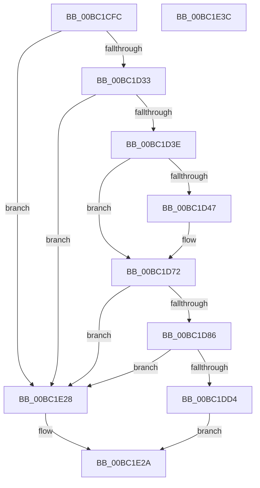

# AnFwConfigureProgressResources

- RVA: `0x00BC1CFC`–`0x00BC1E3D` (길이 `321` bytes)
- VA: `0x0000000140BC1CFC`
- 실행 섹션: `PAGEBGFX`
- PDB 이름 있음: `예`; PDB Function 태그: `아니요`
- unwind 정보 RVA: `0x000DA420`
- 디코드: `77`개 명령, `321/321` bytes 표시
- 미해석 바이트: `0` (있으면 어셈블리에 `.byte`로 보존)

> 이 문서는 커널 이미지의 기계어와 PDB 기호를 분석해 생성했습니다. 4번과 5번은 함수 원형과 자료형을 바이너리 사용 방식에서 추정한 C 해석이며 원본 소스 복구 결과는 아닙니다.

## 1. Dependencies

- 직접 호출 지점: **6**; 고유 호출 대상: **6**
- 직접 호출자로 확인된 함수: **1**
- RIP 상대 이미지 참조: **13**

### Outgoing calls
- `0x00BC1D25` → [KeInitializeEvent](../../text/40/KeInitializeEvent_function_0040DD10.md) (function, `0x0040DD10`)
- `0x00BC1D79` → [BgpFoGetFontHandle](BgpFoGetFontHandle_function_00BC52B0.md) (function, `0x00BC52B0`)
- `0x00BC1DCB` → [BgpTxtCreateRegion](BgpTxtCreateRegion_function_00BC2908.md) (function, `0x00BC2908`)
- `0x00BC1DD4` → [BgpGetBitsPerPixel](../../text/48/BgpGetBitsPerPixel_function_0048CDA0.md) (function, `0x0048CDA0`)
- `0x00BC1DE2` → [BgpGxRectangleSize](../../text/4C/BgpGxRectangleSize_function_004C1DE4.md) (function, `0x004C1DE4`)
- `0x00BC1E16` → [BgpTxtRegionSize](../../text/69/BgpTxtRegionSize_function_0069F484.md) (function, `0x0069F484`)

### Direct callers
- [BgpFwLibraryInitialize](BgpFwLibraryInitialize_function_00BC5400.md) at `0x00BC54FF`
- [BgpFwLibraryInitialize](BgpFwLibraryInitialize_function_00BC5400.md) at `0x00BC5C10`

### Static image references
- `0x00BC1D11` → RVA `0x00E65100` (`.data`; read)
- `0x00BC1D3E` → RVA `0x00EF05DC` (`.data`; read)
- `0x00BC1D4C` → RVA `0x00E0EEB0` (`.data`; write)
- `0x00BC1D53` → RVA `0x00E0EEB4` (`.data`; write)
- `0x00BC1D5F` → RVA `0x00E0EEB8` (`.data`; write)
- `0x00BC1D6B` → RVA `0x00E0EEAC` (`.data`; write)
- `0x00BC1D86` → RVA `0x00EF05D4` (`.data`; read)
- `0x00BC1D99` → RVA `0x00EF05D8` (`.data`; read)
- `0x00BC1DE7` → RVA `0x00E0EEB4` (`.data`; read)
- `0x00BC1DF1` → RVA `0x00E0EEB8` (`.data`; read)
- `0x00BC1E0A` → RVA `0x00EF0474` (`.data`; write)
- `0x00BC1E10` → RVA `0x00EF0470` (`.data`; write)
- `0x00BC1E1B` → RVA `0x00EF0478` (`.data`; write)

## 2. Other-region calls and transfers

- 다른 실행 섹션으로 향하는 call: **4**
  - `0x00BC1D25` → [KeInitializeEvent](../../text/40/KeInitializeEvent_function_0040DD10.md) (`PAGEBGFX` → `.text`)
  - `0x00BC1DD4` → [BgpGetBitsPerPixel](../../text/48/BgpGetBitsPerPixel_function_0048CDA0.md) (`PAGEBGFX` → `.text`)
  - `0x00BC1DE2` → [BgpGxRectangleSize](../../text/4C/BgpGxRectangleSize_function_004C1DE4.md) (`PAGEBGFX` → `.text`)
  - `0x00BC1E16` → [BgpTxtRegionSize](../../text/69/BgpTxtRegionSize_function_0069F484.md) (`PAGEBGFX` → `.text`)
- 별도 외부 분기/꼬리 이동을 확인하지 못했습니다.

## 3. Assembly (complete function range)

```asm
00BC1CFC  48 8B C4                        mov rax, rsp
00BC1CFF  48 89 58 10                     mov qword ptr [rax + 0x10], rbx
00BC1D03  48 89 70 18                     mov qword ptr [rax + 0x18], rsi
00BC1D07  57                              push rdi
00BC1D08  48 83 EC 60                     sub rsp, 0x60
00BC1D0C  48 8B D9                        mov rbx, rcx
00BC1D0F  33 F6                           xor esi, esi
00BC1D11  48 8D 0D E8 33 2A 00            lea rcx, [rip + 0x2a33e8]
00BC1D18  48 89 70 08                     mov qword ptr [rax + 8], rsi
00BC1D1C  41 B0 01                        mov r8b, 1
00BC1D1F  48 89 70 E0                     mov qword ptr [rax - 0x20], rsi
00BC1D23  33 D2                           xor edx, edx
00BC1D25  E8 E6 BF 84 FF                  call 0x14040dd10
00BC1D2A  48 85 DB                        test rbx, rbx
00BC1D2D  0F 84 F5 00 00 00               je 0x140bc1e28
00BC1D33  8B 43 18                        mov eax, dword ptr [rbx + 0x18]
00BC1D36  A8 01                           test al, 1
00BC1D38  0F 84 EA 00 00 00               je 0x140bc1e28
00BC1D3E  83 3D 97 E8 32 00 01            cmp dword ptr [rip + 0x32e897], 1
00BC1D45  75 2B                           jne 0x140bc1d72
00BC1D47  B8 00 E1 00 00                  mov eax, 0xe100
00BC1D4C  66 89 35 5D D1 24 00            mov word ptr [rip + 0x24d15d], si
00BC1D53  66 89 05 5A D1 24 00            mov word ptr [rip + 0x24d15a], ax
00BC1D5A  B8 76 E1 00 00                  mov eax, 0xe176
00BC1D5F  66 89 05 52 D1 24 00            mov word ptr [rip + 0x24d152], ax
00BC1D66  B8 FF E0 00 00                  mov eax, 0xe0ff
00BC1D6B  66 89 05 3A D1 24 00            mov word ptr [rip + 0x24d13a], ax
00BC1D72  48 8D 54 24 48                  lea rdx, [rsp + 0x48]
00BC1D77  33 C9                           xor ecx, ecx
00BC1D79  E8 32 35 00 00                  call 0x140bc52b0
00BC1D7E  85 C0                           test eax, eax
00BC1D80  0F 88 A2 00 00 00               js 0x140bc1e28
00BC1D86  8B 05 48 E8 32 00               mov eax, dword ptr [rip + 0x32e848]
00BC1D8C  4C 8D 4B 1C                     lea r9, [rbx + 0x1c]
00BC1D90  89 44 24 40                     mov dword ptr [rsp + 0x40], eax
00BC1D94  4C 8D 44 24 40                  lea r8, [rsp + 0x40]
00BC1D99  8B 05 39 E8 32 00               mov eax, dword ptr [rip + 0x32e839]
00BC1D9F  48 8D 53 08                     lea rdx, [rbx + 8]
00BC1DA3  89 44 24 44                     mov dword ptr [rsp + 0x44], eax
00BC1DA7  48 8B CB                        mov rcx, rbx
00BC1DAA  8B 43 14                        mov eax, dword ptr [rbx + 0x14]
00BC1DAD  89 44 24 50                     mov dword ptr [rsp + 0x50], eax
00BC1DB1  48 8D 44 24 70                  lea rax, [rsp + 0x70]
00BC1DB6  C7 44 24 28 0A 00 00 00         mov dword ptr [rsp + 0x28], 0xa
00BC1DBE  48 89 44 24 20                  mov qword ptr [rsp + 0x20], rax
00BC1DC3  C7 44 24 54 01 00 00 00         mov dword ptr [rsp + 0x54], 1
00BC1DCB  E8 38 0B 00 00                  call 0x140bc2908
00BC1DD0  85 C0                           test eax, eax
00BC1DD2  78 54                           js 0x140bc1e28
00BC1DD4  E8 C7 AF 8C FF                  call 0x14048cda0
00BC1DD9  8B 4B 0C                        mov ecx, dword ptr [rbx + 0xc]
00BC1DDC  44 8B C0                        mov r8d, eax
00BC1DDF  8B 53 08                        mov edx, dword ptr [rbx + 8]
00BC1DE2  E8 FD FF 8F FF                  call 0x1404c1de4
00BC1DE7  0F B7 0D C6 D0 24 00            movzx ecx, word ptr [rip + 0x24d0c6]
00BC1DEE  83 C0 0F                        add eax, 0xf
00BC1DF1  0F B7 15 C0 D0 24 00            movzx edx, word ptr [rip + 0x24d0c0]
00BC1DF8  83 E0 F0                        and eax, 0xfffffff0
00BC1DFB  2B D1                           sub edx, ecx
00BC1DFD  83 E8 80                        sub eax, -0x80
00BC1E00  48 8B 4C 24 70                  mov rcx, qword ptr [rsp + 0x70]
00BC1E05  FF C2                           inc edx
00BC1E07  0F AF D0                        imul edx, eax
00BC1E0A  89 05 64 E6 32 00               mov dword ptr [rip + 0x32e664], eax
00BC1E10  89 15 5A E6 32 00               mov dword ptr [rip + 0x32e65a], edx
00BC1E16  E8 69 D6 AD FF                  call 0x14069f484
00BC1E1B  89 05 57 E6 32 00               mov dword ptr [rip + 0x32e657], eax
00BC1E21  48 8B 44 24 70                  mov rax, qword ptr [rsp + 0x70]
00BC1E26  EB 02                           jmp 0x140bc1e2a
00BC1E28  33 C0                           xor eax, eax
00BC1E2A  4C 8D 5C 24 60                  lea r11, [rsp + 0x60]
00BC1E2F  49 8B 5B 18                     mov rbx, qword ptr [r11 + 0x18]
00BC1E33  49 8B 73 20                     mov rsi, qword ptr [r11 + 0x20]
00BC1E37  49 8B E3                        mov rsp, r11
00BC1E3A  5F                              pop rdi
00BC1E3B  C3                              ret
00BC1E3C  CC                              int3
```

## 4. C-style interpretation (structured pseudocode)

```c
__int64 __fastcall AnFwConfigureProgressResources(__int64 a1, int a2)
{
    __int64 result;
    __int64 v_rsi;
    __int64 v_rsp;
    unsigned int v_stack_m14;
    unsigned int v_stack_m18;
    unsigned __int64 v_stack_m20;
    unsigned int v_stack_m24;
    unsigned int v_stack_m28;
    unsigned int v_stack_m40;
    unsigned __int64 v_stack_m48;
    unsigned __int64 v_stack_m8;
    unsigned __int64 v_stack_p8;

    *(unsigned __int64 *)(v_rsp + 16) = v_rbx;
    *(unsigned __int64 *)(v_rsp + 24) = v_rsi;
    v_rsp = (v_rsp) - (96);
    v_rsi = 0;
    *(unsigned __int64 *)(v_rsp + 8) = 0;
    *(unsigned __int64 *)(v_rsp - 32) = 0;
    a2 = 0;
    result = KeInitializeEvent(v_rip + 2765800, a2, 1, a4);
    if (a1 == 0) goto loc_00BC1E28;
    if ((((unsigned __int8)((unsigned int)(*(unsigned int *)(a1 + 24)))) & (1)) == 0) goto loc_00BC1E28;
    result = (unsigned int)(*(unsigned int *)(a1 + 24));
    if ((*(unsigned int *)(v_rip + 3336343)) == 1) {
        result = 0xE100ULL;
        *(unsigned __int16 *)(v_rip + 2412893) = 0;
        *(unsigned __int16 *)(v_rip + 2412890) = (unsigned __int16)(result);
        result = 0xE176ULL;
        *(unsigned __int16 *)(v_rip + 2412882) = (unsigned __int16)(result);
        result = 0xE0FFULL;
        *(unsigned __int16 *)(v_rip + 2412858) = (unsigned __int16)(result);
    }
    a1 = 0;
    result = BgpFoGetFontHandle(a1, v_stack_m20, 1, a4);
    if (sign_flag) goto loc_00BC1E28;
    v_stack_m28 = (unsigned int)((unsigned int)(*(unsigned int *)(v_rip + 3336264)));
    v_stack_m24 = (unsigned int)((unsigned int)(*(unsigned int *)(v_rip + 3336249)));
    v_stack_m18 = (unsigned int)((unsigned int)(*(unsigned int *)(a1 + 20)));
    v_stack_m40 = 10;
    v_stack_m48 = v_stack_p8;
    v_stack_m14 = 1;
    result = BgpTxtCreateRegion(0, a1 + 8, v_stack_m28, a1 + 28);
    if (sign_flag) goto loc_00BC1E28;
    result = BgpGetBitsPerPixel(0, a1 + 8, v_stack_m28, a1 + 28);
    result = BgpGxRectangleSize((unsigned int)(*(unsigned int *)(a1 + 12)), (unsigned int)(*(unsigned int *)(a1 + 8)), (unsigned int)((unsigned int)(result)), a1 + 28);
    result = (unsigned int)((result) + (15));
    result = (unsigned int)((result) & (0xFFFFFFF0ULL));
    a2 = (unsigned int)((*(unsigned __int16 *)(v_rip + 2412736)) - ((unsigned int)(*(unsigned __int16 *)(v_rip + 2412742))));
    result = (unsigned int)((result) - (-128));
    a2 = (unsigned int)((a2) + 1);
    a2 = (unsigned int)((a2) * ((unsigned int)(result)));
    *(unsigned int *)(v_rip + 3335780) = (unsigned int)(result);
    *(unsigned int *)(v_rip + 3335770) = a2;
    result = BgpTxtRegionSize(v_stack_p8, a2, (unsigned int)((unsigned int)(result)), a1 + 28);
    *(unsigned int *)(v_rip + 3335767) = (unsigned int)(result);
    goto loc_00BC1E2A;
loc_00BC1E28:
    result = 0;
loc_00BC1E2A:
    return result;
}
```

## 5. (Beta) C Style

```c
int64_t AnFwConfigureProgressResources(int64_t Arg1, int32_t Arg2)
{
    int64_t result;
    int64_t local_rsi;
    int64_t local_rsp;
    uint32_t v_stack_m14;
    uint32_t v_stack_m18;
    uint64_t v_stack_m20;
    uint32_t v_stack_m24;
    uint32_t v_stack_m28;
    uint32_t v_stack_m40;
    uint64_t v_stack_m48;
    uint64_t v_stack_m8;
    uint64_t v_stack_p8;

    *(uint64_t *)(local_rsp + 0x10) = local_rbx;
    *(uint64_t *)(local_rsp + 0x18) = local_rsi;
    local_rsp = (local_rsp) - (96);
    local_rsi = 0;
    *(uint64_t *)(local_rsp + 0x8) = 0;
    *(uint64_t *)(local_rsp - 0x20) = 0;
    Arg2 = 0;
    result = KeInitializeEvent(v_rip + 2765800, Arg2, 1, a4);
    if (Arg1 == 0) goto loc_00BC1E28;
    if ((((uint8_t)((uint32_t)(*(uint32_t *)(Arg1 + 0x18)))) & (1)) == 0) goto loc_00BC1E28;
    result = (uint32_t)(*(uint32_t *)(Arg1 + 0x18));
    if ((*(uint32_t *)(v_rip + 0x32E897)) == 1) {
        result = 0xE100ULL;
        *(uint16_t *)(v_rip + 0x24D15D) = 0;
        *(uint16_t *)(v_rip + 0x24D15A) = (uint16_t)(result);
        result = 0xE176ULL;
        *(uint16_t *)(v_rip + 0x24D152) = (uint16_t)(result);
        result = 0xE0FFULL;
        *(uint16_t *)(v_rip + 0x24D13A) = (uint16_t)(result);
    }
    Arg1 = 0;
    result = BgpFoGetFontHandle(Arg1, v_stack_m20, 1, a4);
    if (sign_flag) goto loc_00BC1E28;
    v_stack_m28 = (uint32_t)((uint32_t)(*(uint32_t *)(v_rip + 0x32E848)));
    v_stack_m24 = (uint32_t)((uint32_t)(*(uint32_t *)(v_rip + 0x32E839)));
    v_stack_m18 = (uint32_t)((uint32_t)(*(uint32_t *)(Arg1 + 0x14)));
    v_stack_m40 = 10;
    v_stack_m48 = v_stack_p8;
    v_stack_m14 = 1;
    result = BgpTxtCreateRegion(0, Arg1 + 8, v_stack_m28, Arg1 + 28);
    if (sign_flag) goto loc_00BC1E28;
    result = BgpGetBitsPerPixel(0, Arg1 + 8, v_stack_m28, Arg1 + 28);
    result = BgpGxRectangleSize((uint32_t)(*(uint32_t *)(Arg1 + 0xC)), (uint32_t)(*(uint32_t *)(Arg1 + 0x8)), (uint32_t)((uint32_t)(result)), Arg1 + 28);
    result = (uint32_t)((result) + (15));
    result = (uint32_t)((result) & (0xFFFFFFF0ULL));
    Arg2 = (uint32_t)((*(uint16_t *)(v_rip + 0x24D0C0)) - ((uint32_t)(*(uint16_t *)(v_rip + 0x24D0C6))));
    result = (uint32_t)((result) - (-128));
    Arg2 = (uint32_t)((Arg2) + 1);
    Arg2 = (uint32_t)((Arg2) * ((uint32_t)(result)));
    *(uint32_t *)(v_rip + 0x32E664) = (uint32_t)(result);
    *(uint32_t *)(v_rip + 0x32E65A) = Arg2;
    result = BgpTxtRegionSize(v_stack_p8, Arg2, (uint32_t)((uint32_t)(result)), Arg1 + 28);
    *(uint32_t *)(v_rip + 0x32E657) = (uint32_t)(result);
    goto loc_00BC1E2A;
loc_00BC1E28:
    result = 0;
loc_00BC1E2A:
    return result;
}
```

## 6. Execution-region graph

[열기: 2D/3D 그래프와 함수 탐색 컨트롤 패널](../../../control-panel.html?section=pagebgfx&rva=0x00BC1CFC&view=graph)

- 2D 그래프는 위에서 아래로 흐르고, 3D 그래프는 빈 공간을 드래그해 회전합니다. Shift+드래그는 이동, 휠은 확대·축소, 함수 노드 선택은 대상 보고서 이동입니다.

### Static fallback


