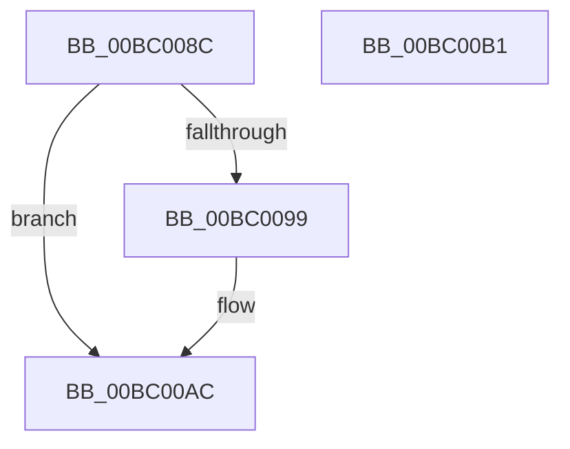

# AnFwDisableBackgroundUpdateTimer

- RVA: `0x00BC008C`–`0x00BC00B2` (길이 `38` bytes)
- VA: `0x0000000140BC008C`
- 실행 섹션: `PAGEBGFX`
- PDB 이름 있음: `예`; PDB Function 태그: `아니요`
- unwind 정보 RVA: `0x0005C788`
- 디코드: `9`개 명령, `38/38` bytes 표시
- 미해석 바이트: `0` (있으면 어셈블리에 `.byte`로 보존)

> 이 문서는 커널 이미지의 기계어와 PDB 기호를 분석해 생성했습니다. 4번과 5번은 함수 원형과 자료형을 바이너리 사용 방식에서 추정한 C 해석이며 원본 소스 복구 결과는 아닙니다.

## 1. Dependencies

- 직접 호출 지점: **1**; 고유 호출 대상: **1**
- 직접 호출자로 확인된 함수: **4**
- RIP 상대 이미지 참조: **3**

### Outgoing calls
- `0x00BC00A0` → [KeCancelTimer](../../text/23/KeCancelTimer_function_002327E0.md) (function, `0x002327E0`)

### Direct callers
- [AnFwDisplayBackgroundUpdate](AnFwDisplayBackgroundUpdate_function_00BC1E44.md) at `0x00BC1FB5`
- [AnFwpBackgroundUpdateTimer](AnFwpBackgroundUpdateTimer_function_00BC21B0.md) at `0x00BC2263`
- [ResFwFreeContext](ResFwFreeContext_function_00BC34C4.md) at `0x00BC3500`
- [AnFwDisplayFade](AnFwDisplayFade_function_00BC36EC.md) at `0x00BC380A`
- [AnFwDisplayFade](AnFwDisplayFade_function_00BC36EC.md) at `0x00BC3C82`

### Static image references
- `0x00BC0090` → RVA `0x00EEFEE0` (`.data`; read)
- `0x00BC0099` → RVA `0x00E65000` (`.data`; read)
- `0x00BC00A5` → RVA `0x00EEFEE0` (`.data`; write)

## 2. Other-region calls and transfers

- 다른 실행 섹션으로 향하는 call: **1**
  - `0x00BC00A0` → [KeCancelTimer](../../text/23/KeCancelTimer_function_002327E0.md) (`PAGEBGFX` → `.text`)
- 별도 외부 분기/꼬리 이동을 확인하지 못했습니다.

## 3. Assembly (complete function range)

```asm
00BC008C  48 83 EC 28                     sub rsp, 0x28
00BC0090  80 3D 49 FE 32 00 00            cmp byte ptr [rip + 0x32fe49], 0
00BC0097  74 13                           je 0x140bc00ac
00BC0099  48 8D 0D 60 4F 2A 00            lea rcx, [rip + 0x2a4f60]
00BC00A0  E8 3B 27 67 FF                  call 0x1402327e0
00BC00A5  C6 05 34 FE 32 00 00            mov byte ptr [rip + 0x32fe34], 0
00BC00AC  48 83 C4 28                     add rsp, 0x28
00BC00B0  C3                              ret
00BC00B1  CC                              int3
```

## 4. C-style interpretation (structured pseudocode)

```c
__int64 __fastcall AnFwDisableBackgroundUpdateTimer(void)
{
    __int64 result;
    __int64 v_rsp;

    v_rsp = (v_rsp) - (40);
    if ((*(unsigned __int8 *)(v_rip + 3341897)) != 0) {
        a1 = v_rip + 2772832;
        result = KeCancelTimer(a1, a2, a3, a4);
        *(unsigned __int8 *)(v_rip + 3341876) = 0;
    }
    v_rsp = (v_rsp) + (40);
    return result;
}
```

## 5. (Beta) C Style

```c
void AnFwDisableBackgroundUpdateTimer(void)
{
    int64_t result;
    int64_t local_rsp;

    local_rsp = (local_rsp) - (40);
    if ((*(uint8_t *)(v_rip + 0x32FE49)) != 0) {
        a1 = v_rip + 2772832;
        result = KeCancelTimer(a1, a2, a3, a4);
        *(uint8_t *)(v_rip + 0x32FE34) = 0;
    }
    local_rsp = (local_rsp) + (40);
    return result;
}
```

## 6. Execution-region graph

[열기: 2D/3D 그래프와 함수 탐색 컨트롤 패널](../../../control-panel.html?section=pagebgfx&rva=0x00BC008C&view=graph)

- 2D 그래프는 위에서 아래로 흐르고, 3D 그래프는 빈 공간을 드래그해 회전합니다. Shift+드래그는 이동, 휠은 확대·축소, 함수 노드 선택은 대상 보고서 이동입니다.

### Static fallback


