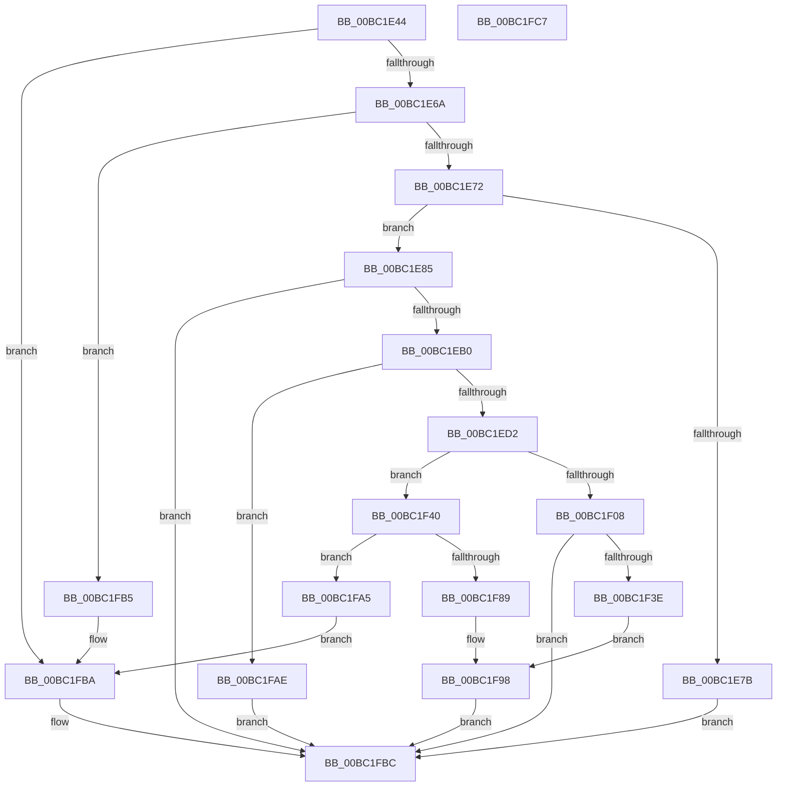

# AnFwDisplayBackgroundUpdate

- RVA: `0x00BC1E44`–`0x00BC1FC8` (길이 `388` bytes)
- VA: `0x0000000140BC1E44`
- 실행 섹션: `PAGEBGFX`
- PDB 이름 있음: `예`; PDB Function 태그: `아니요`
- unwind 정보 RVA: `0x000C6858`
- 디코드: `91`개 명령, `388/388` bytes 표시
- 미해석 바이트: `0` (있으면 어셈블리에 `.byte`로 보존)

> 이 문서는 커널 이미지의 기계어와 PDB 기호를 분석해 생성했습니다. 4번과 5번은 함수 원형과 자료형을 바이너리 사용 방식에서 추정한 C 해석이며 원본 소스 복구 결과는 아닙니다.

## 1. Dependencies

- 직접 호출 지점: **13**; 고유 호출 대상: **10**
- 직접 호출자로 확인된 함수: **2**
- RIP 상대 이미지 참조: **15**

### Outgoing calls
- `0x00BC1E91` → `indirect target` (indirect, 간접 대상)
- `0x00BC1EA3` → [RtlULongLongMult](../../text/43/RtlULongLongMult_function_0043E530.md) (function, `0x0043E530`)
- `0x00BC1EE5` → [DbgPrintEx](../../text/35/DbgPrintEx_function_00359290.md) (function, `0x00359290`)
- `0x00BC1EF9` → [DbgPrintEx](../../text/35/DbgPrintEx_function_00359290.md) (function, `0x00359290`)
- `0x00BC1F0E` → [BgpClearScreen](../../text/69/BgpClearScreen_function_0069EAB0.md) (function, `0x0069EAB0`)
- `0x00BC1F22` → [DbgPrintEx](../../text/35/DbgPrintEx_function_00359290.md) (function, `0x00359290`)
- `0x00BC1F35` → [BgpGxDrawBitmapImage](BgpGxDrawBitmapImage_function_00BC26EC.md) (function, `0x00BC26EC`)
- `0x00BC1F51` → [KeInitializeTimer](../../text/45/KeInitializeTimer_function_0045B590.md) (function, `0x0045B590`)
- `0x00BC1F6A` → [KeInitializeDpc](../../text/45/KeInitializeDpc_function_0045BBD0.md) (function, `0x0045BBD0`)
- `0x00BC1F80` → [KeSetCoalescableTimer](../../text/22/KeSetCoalescableTimer_function_0022FFD0.md) (function, `0x0022FFD0`)
- `0x00BC1F8C` → [KeCancelTimer](../../text/23/KeCancelTimer_function_002327E0.md) (function, `0x002327E0`)
- `0x00BC1F9E` → [BgpClearScreen](../../text/69/BgpClearScreen_function_0069EAB0.md) (function, `0x0069EAB0`)
- `0x00BC1FB5` → [AnFwDisableBackgroundUpdateTimer](AnFwDisableBackgroundUpdateTimer_function_00BC008C.md) (function, `0x00BC008C`)

### Direct callers
- [BgDisplayBackgroundUpdate](BgDisplayBackgroundUpdate_function_00BC05EC.md) at `0x00BC060C`
- [BgpFwLibraryDisable](BgpFwLibraryDisable_function_00BC1724.md) at `0x00BC1738`

### Static image references
- `0x00BC1E5A` → RVA `0x00EF0450` (`.data`; read)
- `0x00BC1E72` → RVA `0x00EEFEE0` (`.data`; read)
- `0x00BC1E85` → RVA `0x00E00A50` (`.data`; read)
- `0x00BC1EBC` → RVA `0x00EF04F0` (`.data`; read)
- `0x00BC1EDB` → RVA `0x00BC5D90` (` ?? ::CIJCHKMG::`string'`; read)
- `0x00BC1EEC` → RVA `0x00BC5DC0` (` ?? ::CIJCHKMG::`string'`; read)
- `0x00BC1F08` → RVA `0x00EF05D4` (`.data`; read)
- `0x00BC1F15` → RVA `0x00BC5E00` (` ?? ::CIJCHKMG::`string'`; read)
- `0x00BC1F27` → RVA `0x00EF0498` (`.data`; read)
- `0x00BC1F2E` → RVA `0x00EF04AC` (`.data`; read)
- `0x00BC1F40` → RVA `0x00EF04F0` (`.data`; write)
- `0x00BC1F47` → RVA `0x00E65000` (`.data`; read)
- `0x00BC1F56` → RVA `0x00E650C0` (`.data`; read)
- `0x00BC1F63` → RVA `0x00BC21B0` (`AnFwpBackgroundUpdateTimer`; read)
- `0x00BC1F91` → RVA `0x00EEFEE0` (`.data`; write)

## 2. Other-region calls and transfers

- 다른 실행 섹션으로 향하는 call: **10**
  - `0x00BC1EA3` → [RtlULongLongMult](../../text/43/RtlULongLongMult_function_0043E530.md) (`PAGEBGFX` → `.text`)
  - `0x00BC1EE5` → [DbgPrintEx](../../text/35/DbgPrintEx_function_00359290.md) (`PAGEBGFX` → `.text`)
  - `0x00BC1EF9` → [DbgPrintEx](../../text/35/DbgPrintEx_function_00359290.md) (`PAGEBGFX` → `.text`)
  - `0x00BC1F0E` → [BgpClearScreen](../../text/69/BgpClearScreen_function_0069EAB0.md) (`PAGEBGFX` → `.text`)
  - `0x00BC1F22` → [DbgPrintEx](../../text/35/DbgPrintEx_function_00359290.md) (`PAGEBGFX` → `.text`)
  - `0x00BC1F51` → [KeInitializeTimer](../../text/45/KeInitializeTimer_function_0045B590.md) (`PAGEBGFX` → `.text`)
  - `0x00BC1F6A` → [KeInitializeDpc](../../text/45/KeInitializeDpc_function_0045BBD0.md) (`PAGEBGFX` → `.text`)
  - `0x00BC1F80` → [KeSetCoalescableTimer](../../text/22/KeSetCoalescableTimer_function_0022FFD0.md) (`PAGEBGFX` → `.text`)
  - `0x00BC1F8C` → [KeCancelTimer](../../text/23/KeCancelTimer_function_002327E0.md) (`PAGEBGFX` → `.text`)
  - `0x00BC1F9E` → [BgpClearScreen](../../text/69/BgpClearScreen_function_0069EAB0.md) (`PAGEBGFX` → `.text`)
- 별도 외부 분기/꼬리 이동을 확인하지 못했습니다.

## 3. Assembly (complete function range)

```asm
00BC1E44  48 89 74 24 08                  mov qword ptr [rsp + 8], rsi
00BC1E49  57                              push rdi
00BC1E4A  48 83 EC 30                     sub rsp, 0x30
00BC1E4E  48 83 64 24 48 00               and qword ptr [rsp + 0x48], 0
00BC1E54  48 83 64 24 50 00               and qword ptr [rsp + 0x50], 0
00BC1E5A  F7 05 EC E5 32 00 00 00 00 04   test dword ptr [rip + 0x32e5ec], 0x4000000
00BC1E64  0F 84 50 01 00 00               je 0x140bc1fba
00BC1E6A  84 C9                           test cl, cl
00BC1E6C  0F 84 43 01 00 00               je 0x140bc1fb5
00BC1E72  80 3D 67 E0 32 00 00            cmp byte ptr [rip + 0x32e067], 0
00BC1E79  74 0A                           je 0x140bc1e85
00BC1E7B  B8 01 00 00 C0                  mov eax, 0xc0000001
00BC1E80  E9 37 01 00 00                  jmp 0x140bc1fbc
00BC1E85  48 8B 05 C4 EB 23 00            mov rax, qword ptr [rip + 0x23ebc4]
00BC1E8C  48 8D 4C 24 50                  lea rcx, [rsp + 0x50]
00BC1E91  FF D0                           call rax
00BC1E93  0F 1F 00                        nop dword ptr [rax]
00BC1E96  4C 8D 44 24 48                  lea r8, [rsp + 0x48]
00BC1E9B  BA E8 03 00 00                  mov edx, 0x3e8
00BC1EA0  48 8B C8                        mov rcx, rax
00BC1EA3  E8 88 C6 87 FF                  call 0x14043e530
00BC1EA8  85 C0                           test eax, eax
00BC1EAA  0F 88 0C 01 00 00               js 0x140bc1fbc
00BC1EB0  48 8B 44 24 48                  mov rax, qword ptr [rsp + 0x48]
00BC1EB5  33 D2                           xor edx, edx
00BC1EB7  48 F7 74 24 50                  div qword ptr [rsp + 0x50]
00BC1EBC  48 8B 0D 2D E6 32 00            mov rcx, qword ptr [rip + 0x32e62d]
00BC1EC3  48 8B F8                        mov rdi, rax
00BC1EC6  48 03 C1                        add rax, rcx
00BC1EC9  48 3B C7                        cmp rax, rdi
00BC1ECC  0F 82 DC 00 00 00               jb 0x140bc1fae
00BC1ED2  33 D2                           xor edx, edx
00BC1ED4  48 8D 34 0F                     lea rsi, [rdi + rcx]
00BC1ED8  44 8B CF                        mov r9d, edi
00BC1EDB  4C 8D 05 AE 3E 00 00            lea r8, [rip + 0x3eae]
00BC1EE2  8D 4A 65                        lea ecx, [rdx + 0x65]
00BC1EE5  E8 A6 73 79 FF                  call 0x140359290
00BC1EEA  33 D2                           xor edx, edx
00BC1EEC  4C 8D 05 CD 3E 00 00            lea r8, [rip + 0x3ecd]
00BC1EF3  44 8B CE                        mov r9d, esi
00BC1EF6  8D 4A 65                        lea ecx, [rdx + 0x65]
00BC1EF9  E8 92 73 79 FF                  call 0x140359290
00BC1EFE  48 83 3D EA E5 32 00 64         cmp qword ptr [rip + 0x32e5ea], 0x64
00BC1F06  73 38                           jae 0x140bc1f40
00BC1F08  8B 0D C6 E6 32 00               mov ecx, dword ptr [rip + 0x32e6c6]
00BC1F0E  E8 9D CB AD FF                  call 0x14069eab0
00BC1F13  33 D2                           xor edx, edx
00BC1F15  4C 8D 05 E4 3E 00 00            lea r8, [rip + 0x3ee4]
00BC1F1C  44 8B CF                        mov r9d, edi
00BC1F1F  8D 4A 65                        lea ecx, [rdx + 0x65]
00BC1F22  E8 69 73 79 FF                  call 0x140359290
00BC1F27  48 8B 0D 6A E5 32 00            mov rcx, qword ptr [rip + 0x32e56a]
00BC1F2E  48 8D 15 77 E5 32 00            lea rdx, [rip + 0x32e577]
00BC1F35  E8 B2 07 00 00                  call 0x140bc26ec
00BC1F3A  85 C0                           test eax, eax
00BC1F3C  79 7E                           jns 0x140bc1fbc
00BC1F3E  EB 58                           jmp 0x140bc1f98
00BC1F40  48 89 35 A9 E5 32 00            mov qword ptr [rip + 0x32e5a9], rsi
00BC1F47  48 8D 35 B2 30 2A 00            lea rsi, [rip + 0x2a30b2]
00BC1F4E  48 8B CE                        mov rcx, rsi
00BC1F51  E8 3A 96 89 FF                  call 0x14045b590
00BC1F56  48 8D 3D 63 31 2A 00            lea rdi, [rip + 0x2a3163]
00BC1F5D  45 33 C0                        xor r8d, r8d
00BC1F60  48 8B CF                        mov rcx, rdi
00BC1F63  48 8D 15 46 02 00 00            lea rdx, [rip + 0x246]
00BC1F6A  E8 61 9C 89 FF                  call 0x14045bbd0
00BC1F6F  45 33 C9                        xor r9d, r9d
00BC1F72  48 89 7C 24 20                  mov qword ptr [rsp + 0x20], rdi
00BC1F77  33 D2                           xor edx, edx
00BC1F79  48 8B CE                        mov rcx, rsi
00BC1F7C  45 8D 41 64                     lea r8d, [r9 + 0x64]
00BC1F80  E8 4B E0 66 FF                  call 0x14022ffd0
00BC1F85  84 C0                           test al, al
00BC1F87  74 1C                           je 0x140bc1fa5
00BC1F89  48 8B CE                        mov rcx, rsi
00BC1F8C  E8 4F 08 67 FF                  call 0x1402327e0
00BC1F91  C6 05 48 DF 32 00 00            mov byte ptr [rip + 0x32df48], 0
00BC1F98  8B 0D 36 E6 32 00               mov ecx, dword ptr [rip + 0x32e636]
00BC1F9E  E8 0D CB AD FF                  call 0x14069eab0
00BC1FA3  EB 17                           jmp 0x140bc1fbc
00BC1FA5  C6 05 34 DF 32 00 01            mov byte ptr [rip + 0x32df34], 1
00BC1FAC  EB 0C                           jmp 0x140bc1fba
00BC1FAE  B8 95 00 00 C0                  mov eax, 0xc0000095
00BC1FB3  EB 07                           jmp 0x140bc1fbc
00BC1FB5  E8 D2 E0 FF FF                  call 0x140bc008c
00BC1FBA  33 C0                           xor eax, eax
00BC1FBC  48 8B 74 24 40                  mov rsi, qword ptr [rsp + 0x40]
00BC1FC1  48 83 C4 30                     add rsp, 0x30
00BC1FC5  5F                              pop rdi
00BC1FC6  C3                              ret
00BC1FC7  CC                              int3
```

## 4. C-style interpretation (structured pseudocode)

```c
__int64 __fastcall AnFwDisplayBackgroundUpdate(unsigned __int8 a1)
{
    __int64 result;
    __int64 v_rsp;
    unsigned __int64 v_stack_m18;
    unsigned __int64 v_stack_p10;
    unsigned __int64 v_stack_p18;
    unsigned __int64 v_stack_p8;

    v_stack_p8 = v_rsi;
    v_rsp = (v_rsp) - (48);
    if (((*(unsigned int *)(v_rip + 3335660)) & (0x4000000ULL)) == 0) goto loc_00BC1FBA;
    if (a1 == 0) goto loc_00BC1FB5;
    if ((*(unsigned __int8 *)(v_rip + 3334247)) == 0) goto loc_00BC1E85;
    goto loc_00BC1FBC;
loc_00BC1E85:
    result = kernel_indirect_call(v_stack_p18, a2, a3, a4);
    result = RtlULongLongMult(result, 1000, v_stack_p10, a4);
    if (sign_flag) goto loc_00BC1FBC;
    a2 = 0;
    result = (v_stack_p10) + (*(unsigned __int64 *)(v_rip + 3335725));
    if (result < v_stack_p10) goto loc_00BC1FAE;
    a2 = 0;
    result = DbgPrintEx(a2 + 101, a2, v_rip + 16046, (unsigned int)((unsigned int)(v_stack_p10)));
    a2 = 0;
    result = DbgPrintEx(a2 + 101, a2, v_rip + 16077, (unsigned int)((unsigned int)(v_stack_p10 + *(unsigned __int64 *)(v_rip + 3335725) * 1)));
    if ((*(unsigned __int64 *)(v_rip + 3335658)) >= 100) goto loc_00BC1F40;
    result = BgpClearScreen((unsigned int)(*(unsigned int *)(v_rip + 3335878)), a2, v_rip + 16077, (unsigned int)((unsigned int)(v_stack_p10 + *(unsigned __int64 *)(v_rip + 3335725) * 1)));
    a2 = 0;
    result = DbgPrintEx(a2 + 101, a2, v_rip + 16100, (unsigned int)((unsigned int)(v_stack_p10)));
    result = BgpGxDrawBitmapImage(*(unsigned __int64 *)(v_rip + 3335530), v_rip + 3335543, v_rip + 16100, (unsigned int)((unsigned int)(v_stack_p10)));
    if (!sign_flag) goto loc_00BC1FBC;
    goto loc_00BC1F98;
loc_00BC1F40:
    *(unsigned __int64 *)(v_rip + 3335593) = v_stack_p10 + *(unsigned __int64 *)(v_rip + 3335725) * 1;
    result = KeInitializeTimer(v_rip + 2764978, v_rip + 3335543, v_rip + 16100, (unsigned int)((unsigned int)(v_stack_p10)));
    a3 = 0;
    result = KeInitializeDpc(v_rip + 2765155, v_rip + 582, a3, (unsigned int)((unsigned int)(v_stack_p10)));
    a4 = 0;
    v_stack_m18 = v_rip + 2765155;
    a2 = 0;
    result = KeSetCoalescableTimer(v_rip + 2764978, a2, a4 + 100, a4);
    if ((unsigned __int8)(result) == 0) goto loc_00BC1FA5;
    result = KeCancelTimer(v_rip + 2764978, a2, a4 + 100, a4);
    *(unsigned __int8 *)(v_rip + 3333960) = 0;
loc_00BC1F98:
    result = BgpClearScreen((unsigned int)(*(unsigned int *)(v_rip + 3335734)), a2, a4 + 100, a4);
    goto loc_00BC1FBC;
loc_00BC1FA5:
    *(unsigned __int8 *)(v_rip + 3333940) = 1;
    goto loc_00BC1FBA;
loc_00BC1FAE:
    goto loc_00BC1FBC;
loc_00BC1FB5:
    result = AnFwDisableBackgroundUpdateTimer((unsigned int)(*(unsigned int *)(v_rip + 3335734)), a2, a4 + 100, a4);
loc_00BC1FBA:
    result = 0;
loc_00BC1FBC:
    v_rsp = (v_rsp) + (48);
    return result;
}
```

## 5. (Beta) C Style

```c
int64_t AnFwDisplayBackgroundUpdate(uint8_t Arg1)
{
    int64_t result;
    int64_t local_rsp;
    uint64_t v_stack_m18;
    uint64_t v_stack_p10;
    uint64_t v_stack_p18;
    uint64_t v_stack_p8;

    v_stack_p8 = local_rsi;
    local_rsp = (local_rsp) - (48);
    if (((*(uint32_t *)(v_rip + 0x32E5EC)) & (0x4000000ULL)) == 0) goto loc_00BC1FBA;
    if (Arg1 == 0) goto loc_00BC1FB5;
    if ((*(uint8_t *)(v_rip + 0x32E067)) == 0) goto loc_00BC1E85;
    goto loc_00BC1FBC;
loc_00BC1E85:
    result = kernel_indirect_call(v_stack_p18, a2, a3, a4);
    result = RtlULongLongMult(result, 1000, v_stack_p10, a4);
    if (sign_flag) goto loc_00BC1FBC;
    a2 = 0;
    result = (v_stack_p10) + (*(uint64_t *)(v_rip + 0x32E62D));
    if (result < v_stack_p10) goto loc_00BC1FAE;
    a2 = 0;
    result = DbgPrintEx(a2 + 101, a2, v_rip + 16046, (uint32_t)((uint32_t)(v_stack_p10)));
    a2 = 0;
    result = DbgPrintEx(a2 + 101, a2, v_rip + 16077, (uint32_t)((uint32_t)(v_stack_p10 + *(uint64_t *)(v_rip + 0x32E62D) * 1)));
    if ((*(uint64_t *)(v_rip + 0x32E5EA)) >= 100) goto loc_00BC1F40;
    result = BgpClearScreen((uint32_t)(*(uint32_t *)(v_rip + 0x32E6C6)), a2, v_rip + 16077, (uint32_t)((uint32_t)(v_stack_p10 + *(uint64_t *)(v_rip + 0x32E62D) * 1)));
    a2 = 0;
    result = DbgPrintEx(a2 + 101, a2, v_rip + 16100, (uint32_t)((uint32_t)(v_stack_p10)));
    result = BgpGxDrawBitmapImage(*(uint64_t *)(v_rip + 0x32E56A), v_rip + 3335543, v_rip + 16100, (uint32_t)((uint32_t)(v_stack_p10)));
    if (!sign_flag) goto loc_00BC1FBC;
    goto loc_00BC1F98;
loc_00BC1F40:
    *(uint64_t *)(v_rip + 0x32E5A9) = v_stack_p10 + *(uint64_t *)(v_rip + 0x32E62D) * 1;
    result = KeInitializeTimer(v_rip + 2764978, v_rip + 3335543, v_rip + 16100, (uint32_t)((uint32_t)(v_stack_p10)));
    a3 = 0;
    result = KeInitializeDpc(v_rip + 2765155, v_rip + 582, a3, (uint32_t)((uint32_t)(v_stack_p10)));
    a4 = 0;
    v_stack_m18 = v_rip + 2765155;
    a2 = 0;
    result = KeSetCoalescableTimer(v_rip + 2764978, a2, a4 + 100, a4);
    if ((uint8_t)(result) == 0) goto loc_00BC1FA5;
    result = KeCancelTimer(v_rip + 2764978, a2, a4 + 100, a4);
    *(uint8_t *)(v_rip + 0x32DF48) = 0;
loc_00BC1F98:
    result = BgpClearScreen((uint32_t)(*(uint32_t *)(v_rip + 0x32E636)), a2, a4 + 100, a4);
    goto loc_00BC1FBC;
loc_00BC1FA5:
    *(uint8_t *)(v_rip + 0x32DF34) = 1;
    goto loc_00BC1FBA;
loc_00BC1FAE:
    goto loc_00BC1FBC;
loc_00BC1FB5:
    result = AnFwDisableBackgroundUpdateTimer((uint32_t)(*(uint32_t *)(v_rip + 0x32E636)), a2, a4 + 100, a4);
loc_00BC1FBA:
    result = 0;
loc_00BC1FBC:
    local_rsp = (local_rsp) + (48);
    return result;
}
```

## 6. Execution-region graph

[열기: 2D/3D 그래프와 함수 탐색 컨트롤 패널](../../../control-panel.html?section=pagebgfx&rva=0x00BC1E44&view=graph)

- 2D 그래프는 위에서 아래로 흐르고, 3D 그래프는 빈 공간을 드래그해 회전합니다. Shift+드래그는 이동, 휠은 확대·축소, 함수 노드 선택은 대상 보고서 이동입니다.

### Static fallback


