# AnFwDisplayFade

- RVA: `0x00BC36EC`–`0x00BC3CAB` (길이 `1,471` bytes)
- VA: `0x0000000140BC36EC`
- 실행 섹션: `PAGEBGFX`
- PDB 이름 있음: `예`; PDB Function 태그: `예`
- unwind 정보 RVA: `0x000AA564`
- 디코드: `360`개 명령, `1,471/1,471` bytes 표시
- 미해석 바이트: `0` (있으면 어셈블리에 `.byte`로 보존)

> 이 문서는 커널 이미지의 기계어와 PDB 기호를 분석해 생성했습니다. 4번과 5번은 함수 원형과 자료형을 바이너리 사용 방식에서 추정한 C 해석이며 원본 소스 복구 결과는 아닙니다.

## 1. Dependencies

- 직접 호출 지점: **28**; 고유 호출 대상: **18**
- 직접 호출자로 확인된 함수: **1**
- RIP 상대 이미지 참조: **26**

### Outgoing calls
- `0x00BC378D` → [BgpTxtGetRegionContext](BgpTxtGetRegionContext_function_00BC3D94.md) (function, `0x00BC3D94`)
- `0x00BC379C` → [BgpTxtGetRegionContext](BgpTxtGetRegionContext_function_00BC3D94.md) (function, `0x00BC3D94`)
- `0x00BC37F8` → [BgpFwFreeMemory](../../text/3E/BgpFwFreeMemory_function_003E25E0.md) (function, `0x003E25E0`)
- `0x00BC3800` → [BgpFwFreeMemory](../../text/3E/BgpFwFreeMemory_function_003E25E0.md) (function, `0x003E25E0`)
- `0x00BC3805` → [AnFwpDisableProgressTimer](AnFwpDisableProgressTimer_function_00BC3CB4.md) (function, `0x00BC3CB4`)
- `0x00BC380A` → [AnFwDisableBackgroundUpdateTimer](AnFwDisableBackgroundUpdateTimer_function_00BC008C.md) (function, `0x00BC008C`)
- `0x00BC3817` → [BgpGetBitsPerPixel](../../text/48/BgpGetBitsPerPixel_function_0048CDA0.md) (function, `0x0048CDA0`)
- `0x00BC3823` → [BgpFwQueryPerformanceCounter](../../text/4C/BgpFwQueryPerformanceCounter_function_004C0614.md) (function, `0x004C0614`)
- `0x00BC384E` → [BgpGxParseBitmap](BgpGxParseBitmap_function_00BC00B8.md) (function, `0x00BC00B8`)
- `0x00BC3875` → [BgpGxRectangleSize](../../text/4C/BgpGxRectangleSize_function_004C1DE4.md) (function, `0x004C1DE4`)
- `0x00BC3896` → [BgpGxConvertRectangleEx](../../text/46/BgpGxConvertRectangleEx_function_004696D4.md) (function, `0x004696D4`)
- `0x00BC38C1` → [BgpGxRectangleSize](../../text/4C/BgpGxRectangleSize_function_004C1DE4.md) (function, `0x004C1DE4`)
- `0x00BC3973` → [BgpGxReadRectangle](BgpGxReadRectangle_function_00BC3D18.md) (function, `0x00BC3D18`)
- `0x00BC3992` → [BgpGxRectangleSize](../../text/4C/BgpGxRectangleSize_function_004C1DE4.md) (function, `0x004C1DE4`)
- `0x00BC39DA` → [BgpGxFindSubRectangle](BgpGxFindSubRectangle_function_00BC4168.md) (function, `0x00BC4168`)
- `0x00BC3A1C` → [GxpBitsToBytes](../../text/4C/GxpBitsToBytes_function_004C74F0.md) (function, `0x004C74F0`)
- `0x00BC3A27` → [BgpFwAllocateMemory](../../text/3E/BgpFwAllocateMemory_function_003E4374.md) (function, `0x003E4374`)
- `0x00BC3A66` → [memset](../../text/6C/memset_function_006C6C40.md) (function, `0x006C6C40`)
- `0x00BC3A8F` → [BgpGxRectangleCreate](BgpGxRectangleCreate_function_00BC3E78.md) (function, `0x00BC3E78`)
- `0x00BC3AA9` → [memset](../../text/6C/memset_function_006C6C40.md) (function, `0x006C6C40`)
- `0x00BC3AC5` → [BgpGxRectangleDestroy](BgpGxRectangleDestroy_function_00BC3F04.md) (function, `0x00BC3F04`)
- `0x00BC3AE7` → [_security_check_cookie](../../text/6A/_security_check_cookie_function_006AC640.md) (function, `0x006AC640`)
- `0x00BC3BE8` → [BgpGxFindSubRectangle](BgpGxFindSubRectangle_function_00BC4168.md) (function, `0x00BC4168`)
- `0x00BC3C37` → [BgpGxFindSubRectangle](BgpGxFindSubRectangle_function_00BC4168.md) (function, `0x00BC4168`)
- `0x00BC3C7D` → [AnFwpDisableProgressTimer](AnFwpDisableProgressTimer_function_00BC3CB4.md) (function, `0x00BC3CB4`)
- `0x00BC3C82` → [AnFwDisableBackgroundUpdateTimer](AnFwDisableBackgroundUpdateTimer_function_00BC008C.md) (function, `0x00BC008C`)
- `0x00BC3C8C` → [BgpClearScreen](../../text/69/BgpClearScreen_function_0069EAB0.md) (function, `0x0069EAB0`)
- `0x00BC3CA0` → [BgpGxRectangleDestroy](BgpGxRectangleDestroy_function_00BC3F04.md) (function, `0x00BC3F04`)

### Direct callers
- [BgDisplayFade](BgDisplayFade_function_00BC36A4.md) at `0x00BC36C1`

### Static image references
- `0x00BC370F` → RVA `0x00E0A740` (`.data`; read)
- `0x00BC3750` → RVA `0x00EF0450` (`.data`; read)
- `0x00BC3786` → RVA `0x00EF0510` (`.data`; read)
- `0x00BC3792` → RVA `0x00EF0518` (`.data`; read)
- `0x00BC37BD` → RVA `0x00E0EEE0` (`.data`; write)
- `0x00BC37C9` → RVA `0x00E0EEF0` (`.data`; write)
- `0x00BC37D4` → RVA `0x00E0EF00` (`.data`; write)
- `0x00BC37DD` → RVA `0x00E0EF20` (`.data`; write)
- `0x00BC37E8` → RVA `0x00E0EF30` (`.data`; write)
- `0x00BC37F2` → RVA `0x00E0EF40` (`.data`; write)
- `0x00BC3828` → RVA `0x00EF0498` (`.data`; read)
- `0x00BC382F` → RVA `0x00EEFF48` (`.data`; write)
- `0x00BC3836` → RVA `0x00E65148` (`.data`; write)
- `0x00BC38C6` → RVA `0x00EF04AC` (`.data`; read)
- `0x00BC38CF` → RVA `0x00EF04B4` (`.data`; read)
- `0x00BC38D9` → RVA `0x00EF04B8` (`.data`; read)
- `0x00BC38E3` → RVA `0x00E0EEE8` (`.data`; read)
- `0x00BC38ED` → RVA `0x00EF04B0` (`.data`; read)
- `0x00BC38F7` → RVA `0x00E0EEE0` (`.data`; read)
- `0x00BC3909` → RVA `0x00E0EEEC` (`.data`; read)
- `0x00BC390F` → RVA `0x00E0EEE4` (`.data`; read)
- `0x00BC3923` → RVA `0x00E0EF20` (`.data`; read)
- `0x00BC3929` → RVA `0x00E0EF28` (`.data`; read)
- `0x00BC392F` → RVA `0x00E0EF2C` (`.data`; read)
- `0x00BC393B` → RVA `0x00E0EF24` (`.data`; read)
- `0x00BC39B8` → RVA `0x00EF05D4` (`.data`; read)

## 2. Other-region calls and transfers

- 다른 실행 섹션으로 향하는 call: **14**
  - `0x00BC37F8` → [BgpFwFreeMemory](../../text/3E/BgpFwFreeMemory_function_003E25E0.md) (`PAGEBGFX` → `.text`)
  - `0x00BC3800` → [BgpFwFreeMemory](../../text/3E/BgpFwFreeMemory_function_003E25E0.md) (`PAGEBGFX` → `.text`)
  - `0x00BC3817` → [BgpGetBitsPerPixel](../../text/48/BgpGetBitsPerPixel_function_0048CDA0.md) (`PAGEBGFX` → `.text`)
  - `0x00BC3823` → [BgpFwQueryPerformanceCounter](../../text/4C/BgpFwQueryPerformanceCounter_function_004C0614.md) (`PAGEBGFX` → `.text`)
  - `0x00BC3875` → [BgpGxRectangleSize](../../text/4C/BgpGxRectangleSize_function_004C1DE4.md) (`PAGEBGFX` → `.text`)
  - `0x00BC3896` → [BgpGxConvertRectangleEx](../../text/46/BgpGxConvertRectangleEx_function_004696D4.md) (`PAGEBGFX` → `.text`)
  - `0x00BC38C1` → [BgpGxRectangleSize](../../text/4C/BgpGxRectangleSize_function_004C1DE4.md) (`PAGEBGFX` → `.text`)
  - `0x00BC3992` → [BgpGxRectangleSize](../../text/4C/BgpGxRectangleSize_function_004C1DE4.md) (`PAGEBGFX` → `.text`)
  - `0x00BC3A1C` → [GxpBitsToBytes](../../text/4C/GxpBitsToBytes_function_004C74F0.md) (`PAGEBGFX` → `.text`)
  - `0x00BC3A27` → [BgpFwAllocateMemory](../../text/3E/BgpFwAllocateMemory_function_003E4374.md) (`PAGEBGFX` → `.text`)
  - `0x00BC3A66` → [memset](../../text/6C/memset_function_006C6C40.md) (`PAGEBGFX` → `.text`)
  - `0x00BC3AA9` → [memset](../../text/6C/memset_function_006C6C40.md) (`PAGEBGFX` → `.text`)
  - `0x00BC3AE7` → [_security_check_cookie](../../text/6A/_security_check_cookie_function_006AC640.md) (`PAGEBGFX` → `.text`)
  - `0x00BC3C8C` → [BgpClearScreen](../../text/69/BgpClearScreen_function_0069EAB0.md) (`PAGEBGFX` → `.text`)
- call이 아닌 외부 분기/꼬리 이동: **17**
  - `0x00BC3951` → [sub_00BC65EE + 0xB](Unknown_function_00BC65EE.md) (`tail-transfer`)
  - `0x00BC3A73` → [sub_00BC65EE + 0xB4](Unknown_function_00BC65EE.md) (`tail-transfer`)
  - `0x00BC3AAF` → [sub_00BC65EE + 0xB4](Unknown_function_00BC65EE.md) (`tail-transfer`)
  - `0x00BC3B12` → [sub_00BC65EE + 0xB](Unknown_function_00BC65EE.md) (`tail-transfer`)
  - `0x00BC3B39` → [sub_00BC65EE](Unknown_function_00BC65EE.md) (`tail-transfer`)
  - `0x00BC3B42` → [sub_00BC65EE](Unknown_function_00BC65EE.md) (`tail-transfer`)
  - `0x00BC3B4B` → [sub_00BC65EE](Unknown_function_00BC65EE.md) (`tail-transfer`)
  - `0x00BC3B54` → [sub_00BC65EE](Unknown_function_00BC65EE.md) (`tail-transfer`)
  - `0x00BC3B84` → [sub_00BC65EE](Unknown_function_00BC65EE.md) (`tail-transfer`)
  - `0x00BC3B8D` → [sub_00BC65EE](Unknown_function_00BC65EE.md) (`tail-transfer`)
  - `0x00BC3B96` → [sub_00BC65EE](Unknown_function_00BC65EE.md) (`tail-transfer`)
  - `0x00BC3B9F` → [sub_00BC65EE](Unknown_function_00BC65EE.md) (`tail-transfer`)
  - `0x00BC3BBF` → [sub_00BC65EE + 0x61](Unknown_function_00BC65EE.md) (`tail-transfer`)
  - `0x00BC3C0D` → [sub_00BC65EE + 0x7A](Unknown_function_00BC65EE.md) (`tail-transfer`)
  - `0x00BC3C58` → [sub_00BC65EE + 0x99](Unknown_function_00BC65EE.md) (`tail-transfer`)
  - `0x00BC3C97` → [sub_00BC65EE + 0x1E2](Unknown_function_00BC65EE.md) (`tail-transfer`)
  - `0x00BC3CA6` → [sub_00BC65EE + 0x1E2](Unknown_function_00BC65EE.md) (`tail-transfer`)

## 3. Assembly (complete function range)

```asm
00BC36EC  48 8B C4                        mov rax, rsp
00BC36EF  48 89 70 08                     mov qword ptr [rax + 8], rsi
00BC36F3  48 89 78 10                     mov qword ptr [rax + 0x10], rdi
00BC36F7  4C 89 60 18                     mov qword ptr [rax + 0x18], r12
00BC36FB  4C 89 68 20                     mov qword ptr [rax + 0x20], r13
00BC36FF  55                              push rbp
00BC3700  41 56                           push r14
00BC3702  41 57                           push r15
00BC3704  48 8D 68 A1                     lea rbp, [rax - 0x5f]
00BC3708  48 81 EC D0 00 00 00            sub rsp, 0xd0
00BC370F  48 8B 05 2A 70 24 00            mov rax, qword ptr [rip + 0x24702a]
00BC3716  48 33 C4                        xor rax, rsp
00BC3719  48 89 45 37                     mov qword ptr [rbp + 0x37], rax
00BC371D  33 C0                           xor eax, eax
00BC371F  C6 45 A7 00                     mov byte ptr [rbp - 0x59], 0
00BC3723  48 21 45 BF                     and qword ptr [rbp - 0x41], rax
00BC3727  33 FF                           xor edi, edi
00BC3729  48 21 45 D7                     and qword ptr [rbp - 0x29], rax
00BC372D  45 33 E4                        xor r12d, r12d
00BC3730  48 21 45 F7                     and qword ptr [rbp - 9], rax
00BC3734  45 33 ED                        xor r13d, r13d
00BC3737  48 21 45 0F                     and qword ptr [rbp + 0xf], rax
00BC373B  33 F6                           xor esi, esi
00BC373D  21 45 B7                        and dword ptr [rbp - 0x49], eax
00BC3740  0F 57 C0                        xorps xmm0, xmm0
00BC3743  48 89 45 E7                     mov qword ptr [rbp - 0x19], rax
00BC3747  45 33 F6                        xor r14d, r14d
00BC374A  89 45 EF                        mov dword ptr [rbp - 0x11], eax
00BC374D  45 33 FF                        xor r15d, r15d
00BC3750  8B 05 FA CC 32 00               mov eax, dword ptr [rip + 0x32ccfa]
00BC3756  48 89 7D C7                     mov qword ptr [rbp - 0x39], rdi
00BC375A  48 89 7D FF                     mov qword ptr [rbp - 1], rdi
00BC375E  4C 89 65 AF                     mov qword ptr [rbp - 0x51], r12
00BC3762  4C 89 6D 07                     mov qword ptr [rbp + 7], r13
00BC3766  48 89 75 DF                     mov qword ptr [rbp - 0x21], rsi
00BC376A  0F 11 45 17                     movups xmmword ptr [rbp + 0x17], xmm0
00BC376E  0F 11 45 27                     movups xmmword ptr [rbp + 0x27], xmm0
00BC3772  0F BA E0 0D                     bt eax, 0xd
00BC3776  0F 82 61 03 00 00               jb 0x140bc3add
00BC377C  0F BA E0 15                     bt eax, 0x15
00BC3780  0F 82 F7 04 00 00               jb 0x140bc3c7d
00BC3786  48 8B 0D 83 CD 32 00            mov rcx, qword ptr [rip + 0x32cd83]
00BC378D  E8 02 06 00 00                  call 0x140bc3d94
00BC3792  48 8B 0D 7F CD 32 00            mov rcx, qword ptr [rip + 0x32cd7f]
00BC3799  4C 8B F0                        mov r14, rax
00BC379C  E8 F3 05 00 00                  call 0x140bc3d94
00BC37A1  48 8B F0                        mov rsi, rax
00BC37A4  4D 85 F6                        test r14, r14
00BC37A7  0F 84 CC 04 00 00               je 0x140bc3c79
00BC37AD  48 85 C0                        test rax, rax
00BC37B0  0F 84 C3 04 00 00               je 0x140bc3c79
00BC37B6  41 0F 10 06                     movups xmm0, xmmword ptr [r14]
00BC37BA  49 8B CE                        mov rcx, r14
00BC37BD  0F 29 05 1C B7 24 00            movaps xmmword ptr [rip + 0x24b71c], xmm0
00BC37C4  41 0F 10 4E 10                  movups xmm1, xmmword ptr [r14 + 0x10]
00BC37C9  0F 29 0D 20 B7 24 00            movaps xmmword ptr [rip + 0x24b720], xmm1
00BC37D0  41 8B 46 20                     mov eax, dword ptr [r14 + 0x20]
00BC37D4  89 05 26 B7 24 00               mov dword ptr [rip + 0x24b726], eax
00BC37DA  0F 10 06                        movups xmm0, xmmword ptr [rsi]
00BC37DD  0F 29 05 3C B7 24 00            movaps xmmword ptr [rip + 0x24b73c], xmm0
00BC37E4  0F 10 4E 10                     movups xmm1, xmmword ptr [rsi + 0x10]
00BC37E8  0F 29 0D 41 B7 24 00            movaps xmmword ptr [rip + 0x24b741], xmm1
00BC37EF  8B 46 20                        mov eax, dword ptr [rsi + 0x20]
00BC37F2  89 05 48 B7 24 00               mov dword ptr [rip + 0x24b748], eax
00BC37F8  E8 E3 ED 81 FF                  call 0x1403e25e0
00BC37FD  48 8B CE                        mov rcx, rsi
00BC3800  E8 DB ED 81 FF                  call 0x1403e25e0
00BC3805  E8 AA 04 00 00                  call 0x140bc3cb4
00BC380A  E8 7D C8 FF FF                  call 0x140bc008c
00BC380F  40 88 7D A8                     mov byte ptr [rbp - 0x58], dil
00BC3813  40 88 7D A9                     mov byte ptr [rbp - 0x57], dil
00BC3817  E8 84 95 8C FF                  call 0x14048cda0
00BC381C  33 C9                           xor ecx, ecx
00BC381E  89 45 CF                        mov dword ptr [rbp - 0x31], eax
00BC3821  8B F0                           mov esi, eax
00BC3823  E8 EC CD 8F FF                  call 0x1404c0614
00BC3828  48 8B 0D 69 CC 32 00            mov rcx, qword ptr [rip + 0x32cc69]
00BC382F  48 89 05 12 C7 32 00            mov qword ptr [rip + 0x32c712], rax
00BC3836  48 89 05 0B 19 2A 00            mov qword ptr [rip + 0x2a190b], rax
00BC383D  48 85 C9                        test rcx, rcx
00BC3840  0F 84 C8 02 00 00               je 0x140bc3b0e
00BC3846  48 8D 55 AF                     lea rdx, [rbp - 0x51]
00BC384A  40 88 7D AA                     mov byte ptr [rbp - 0x56], dil
00BC384E  E8 65 C8 FF FF                  call 0x140bc00b8
00BC3853  4C 8B 65 AF                     mov r12, qword ptr [rbp - 0x51]
00BC3857  44 8B F0                        mov r14d, eax
00BC385A  85 C0                           test eax, eax
00BC385C  0F 88 72 02 00 00               js 0x140bc3ad4
00BC3862  45 8B 44 24 08                  mov r8d, dword ptr [r12 + 8]
00BC3867  41 3B F0                        cmp esi, r8d
00BC386A  74 49                           je 0x140bc38b5
00BC386C  41 8B 0C 24                     mov ecx, dword ptr [r12]
00BC3870  41 8B 54 24 04                  mov edx, dword ptr [r12 + 4]
00BC3875  E8 6A E5 8F FF                  call 0x1404c1de4
00BC387A  48 21 7D AF                     and qword ptr [rbp - 0x51], rdi
00BC387E  4C 8D 45 AF                     lea r8, [rbp - 0x51]
00BC3882  45 33 C9                        xor r9d, r9d
00BC3885  8B D6                           mov edx, esi
00BC3887  49 8B CC                        mov rcx, r12
00BC388A  44 8D 78 0F                     lea r15d, [rax + 0xf]
00BC388E  41 83 E7 F0                     and r15d, 0xfffffff0
00BC3892  41 83 C7 20                     add r15d, 0x20
00BC3896  E8 39 5E 8A FF                  call 0x1404696d4
00BC389B  44 8B F0                        mov r14d, eax
00BC389E  85 C0                           test eax, eax
00BC38A0  0F 88 2E 02 00 00               js 0x140bc3ad4
00BC38A6  4C 89 65 17                     mov qword ptr [rbp + 0x17], r12
00BC38AA  4C 8B 65 AF                     mov r12, qword ptr [rbp - 0x51]
00BC38AE  C7 45 B7 01 00 00 00            mov dword ptr [rbp - 0x49], 1
00BC38B5  41 8B 0C 24                     mov ecx, dword ptr [r12]
00BC38B9  44 8B C6                        mov r8d, esi
00BC38BC  41 8B 54 24 04                  mov edx, dword ptr [r12 + 4]
00BC38C1  E8 1E E5 8F FF                  call 0x1404c1de4
00BC38C6  8B 15 E0 CB 32 00               mov edx, dword ptr [rip + 0x32cbe0]
00BC38CC  83 C0 0F                        add eax, 0xf
00BC38CF  44 8B 15 DE CB 32 00            mov r10d, dword ptr [rip + 0x32cbde]
00BC38D6  83 E0 F0                        and eax, 0xfffffff0
00BC38D9  44 8B 0D D8 CB 32 00            mov r9d, dword ptr [rip + 0x32cbd8]
00BC38E0  83 C0 20                        add eax, 0x20
00BC38E3  44 8B 1D FE B5 24 00            mov r11d, dword ptr [rip + 0x24b5fe]
00BC38EA  44 03 D2                        add r10d, edx
00BC38ED  44 8B 05 BC CB 32 00            mov r8d, dword ptr [rip + 0x32cbbc]
00BC38F4  45 03 C8                        add r9d, r8d
00BC38F7  44 03 1D E2 B5 24 00            add r11d, dword ptr [rip + 0x24b5e2]
00BC38FE  41 8D 0C 07                     lea ecx, [r15 + rax]
00BC3902  89 55 BB                        mov dword ptr [rbp - 0x45], edx
00BC3905  44 8D 3C 41                     lea r15d, [rcx + rax*2]
00BC3909  8B 05 DD B5 24 00               mov eax, dword ptr [rip + 0x24b5dd]
00BC390F  8B 0D CF B5 24 00               mov ecx, dword ptr [rip + 0x24b5cf]
00BC3915  03 C1                           add eax, ecx
00BC3917  39 15 C3 B5 24 00               cmp dword ptr [rip + 0x24b5c3], edx
00BC391D  0F 83 F4 01 00 00               jae 0x140bc3b17
00BC3923  8B 15 F7 B5 24 00               mov edx, dword ptr [rip + 0x24b5f7]
00BC3929  8B 0D F9 B5 24 00               mov ecx, dword ptr [rip + 0x24b5f9]
00BC392F  44 8B 1D F6 B5 24 00            mov r11d, dword ptr [rip + 0x24b5f6]
00BC3936  03 CA                           add ecx, edx
00BC3938  89 4D AF                        mov dword ptr [rbp - 0x51], ecx
00BC393B  8B 0D E3 B5 24 00               mov ecx, dword ptr [rip + 0x24b5e3]
00BC3941  44 03 D9                        add r11d, ecx
00BC3944  3B 55 BB                        cmp edx, dword ptr [rbp - 0x45]
00BC3947  0F 83 16 02 00 00               jae 0x140bc3b63
00BC394D  40 38 7D A8                     cmp byte ptr [rbp - 0x58], dil
00BC3951  0F 84 A2 2C 00 00               je 0x140bc65f9
00BC3957  44 89 7D AF                     mov dword ptr [rbp - 0x51], r15d
00BC395B  44 38 6D A9                     cmp byte ptr [rbp - 0x57], r13b
00BC395F  75 4C                           jne 0x140bc39ad
00BC3961  4C 8D 05 C0 B5 24 00            lea r8, [rip + 0x24b5c0]
00BC3968  48 8D 15 B1 B5 24 00            lea rdx, [rip + 0x24b5b1]
00BC396F  48 8D 4D 07                     lea rcx, [rbp + 7]
00BC3973  E8 A0 03 00 00                  call 0x140bc3d18
00BC3978  4C 8B 6D 07                     mov r13, qword ptr [rbp + 7]
00BC397C  44 8B F0                        mov r14d, eax
00BC397F  85 C0                           test eax, eax
00BC3981  0F 88 2D 01 00 00               js 0x140bc3ab4
00BC3987  41 8B 4D 00                     mov ecx, dword ptr [r13]
00BC398B  44 8B C6                        mov r8d, esi
00BC398E  41 8B 55 04                     mov edx, dword ptr [r13 + 4]
00BC3992  E8 4D E4 8F FF                  call 0x1404c1de4
00BC3997  44 8D 78 0F                     lea r15d, [rax + 0xf]
00BC399B  8B 45 AF                        mov eax, dword ptr [rbp - 0x51]
00BC399E  41 83 E7 F0                     and r15d, 0xfffffff0
00BC39A2  41 83 C7 20                     add r15d, 0x20
00BC39A6  42 8D 04 78                     lea eax, [rax + r15*2]
00BC39AA  44 03 F8                        add r15d, eax
00BC39AD  80 7D AA 00                     cmp byte ptr [rbp - 0x56], 0
00BC39B1  48 8B 35 F4 CA 32 00            mov rsi, qword ptr [rip + 0x32caf4]
00BC39B8  8B 3D 16 CC 32 00               mov edi, dword ptr [rip + 0x32cc16]
00BC39BE  48 89 75 AF                     mov qword ptr [rbp - 0x51], rsi
00BC39C2  75 26                           jne 0x140bc39ea
00BC39C4  48 8D 45 A7                     lea rax, [rbp - 0x59]
00BC39C8  8B D7                           mov edx, edi
00BC39CA  4C 8D 4D BF                     lea r9, [rbp - 0x41]
00BC39CE  48 89 44 24 20                  mov qword ptr [rsp + 0x20], rax
00BC39D3  4C 8D 45 D7                     lea r8, [rbp - 0x29]
00BC39D7  49 8B CC                        mov rcx, r12
00BC39DA  E8 89 07 00 00                  call 0x140bc4168
00BC39DF  44 8B F0                        mov r14d, eax
00BC39E2  85 C0                           test eax, eax
00BC39E4  0F 89 C4 01 00 00               jns 0x140bc3bae
00BC39EA  80 7D A8 00                     cmp byte ptr [rbp - 0x58], 0
00BC39EE  0F 84 DD 01 00 00               je 0x140bc3bd1
00BC39F4  80 7D A9 00                     cmp byte ptr [rbp - 0x57], 0
00BC39F8  0F 84 23 02 00 00               je 0x140bc3c21
00BC39FE  80 7D AA 00                     cmp byte ptr [rbp - 0x56], 0
00BC3A02  75 67                           jne 0x140bc3a6b
00BC3A04  41 8B 04 24                     mov eax, dword ptr [r12]
00BC3A08  8B C8                           mov ecx, eax
00BC3A0A  45 8B 74 24 04                  mov r14d, dword ptr [r12 + 4]
00BC3A0F  8B 7D CF                        mov edi, dword ptr [rbp - 0x31]
00BC3A12  41 0F AF CE                     imul ecx, r14d
00BC3A16  89 45 AF                        mov dword ptr [rbp - 0x51], eax
00BC3A19  0F AF CF                        imul ecx, edi
00BC3A1C  E8 CF 3A 90 FF                  call 0x1404c74f0
00BC3A21  89 45 BB                        mov dword ptr [rbp - 0x45], eax
00BC3A24  8D 48 48                        lea ecx, [rax + 0x48]
00BC3A27  E8 48 09 82 FF                  call 0x1403e4374
00BC3A2C  48 8B C8                        mov rcx, rax
00BC3A2F  48 85 C0                        test rax, rax
00BC3A32  0F 84 32 02 00 00               je 0x140bc3c6a
00BC3A38  8B 45 AF                        mov eax, dword ptr [rbp - 0x51]
00BC3A3B  33 D2                           xor edx, edx
00BC3A3D  83 61 10 00                     and dword ptr [rcx + 0x10], 0
00BC3A41  89 01                           mov dword ptr [rcx], eax
00BC3A43  8B 45 BB                        mov eax, dword ptr [rbp - 0x45]
00BC3A46  89 41 0C                        mov dword ptr [rcx + 0xc], eax
00BC3A49  48 8D 41 48                     lea rax, [rcx + 0x48]
00BC3A4D  44 89 71 04                     mov dword ptr [rcx + 4], r14d
00BC3A51  45 33 F6                        xor r14d, r14d
00BC3A54  48 89 41 18                     mov qword ptr [rcx + 0x18], rax
00BC3A58  89 79 08                        mov dword ptr [rcx + 8], edi
00BC3A5B  44 8B 41 0C                     mov r8d, dword ptr [rcx + 0xc]
00BC3A5F  48 89 4D 0F                     mov qword ptr [rbp + 0xf], rcx
00BC3A63  48 8B C8                        mov rcx, rax
00BC3A66  E8 D5 31 B0 FF                  call 0x1406c6c40
00BC3A6B  80 7D A8 00                     cmp byte ptr [rbp - 0x58], 0
00BC3A6F  48 8B 7D C7                     mov rdi, qword ptr [rbp - 0x39]
00BC3A73  0F 85 29 2C 00 00               jne 0x140bc66a2
00BC3A79  8B 47 04                        mov eax, dword ptr [rdi + 4]
00BC3A7C  4C 8D 45 F7                     lea r8, [rbp - 9]
00BC3A80  8B 55 CF                        mov edx, dword ptr [rbp - 0x31]
00BC3A83  48 8D 4D E7                     lea rcx, [rbp - 0x19]
00BC3A87  89 45 E7                        mov dword ptr [rbp - 0x19], eax
00BC3A8A  8B 07                           mov eax, dword ptr [rdi]
00BC3A8C  89 45 EB                        mov dword ptr [rbp - 0x15], eax
00BC3A8F  E8 E4 03 00 00                  call 0x140bc3e78
00BC3A94  44 8B F0                        mov r14d, eax
00BC3A97  85 C0                           test eax, eax
00BC3A99  78 19                           js 0x140bc3ab4
00BC3A9B  48 8B 45 F7                     mov rax, qword ptr [rbp - 9]
00BC3A9F  33 D2                           xor edx, edx
00BC3AA1  44 8B 40 0C                     mov r8d, dword ptr [rax + 0xc]
00BC3AA5  48 8B 48 18                     mov rcx, qword ptr [rax + 0x18]
00BC3AA9  E8 92 31 B0 FF                  call 0x1406c6c40
00BC3AAE  90                              nop
00BC3AAF  E9 EE 2B 00 00                  jmp 0x140bc66a2
00BC3AB4  8B 45 B7                        mov eax, dword ptr [rbp - 0x49]
00BC3AB7  85 C0                           test eax, eax
00BC3AB9  74 19                           je 0x140bc3ad4
00BC3ABB  48 8D 75 17                     lea rsi, [rbp + 0x17]
00BC3ABF  44 8B F8                        mov r15d, eax
00BC3AC2  48 8B 0E                        mov rcx, qword ptr [rsi]
00BC3AC5  E8 3A 04 00 00                  call 0x140bc3f04
00BC3ACA  48 8D 76 08                     lea rsi, [rsi + 8]
00BC3ACE  49 83 EF 01                     sub r15, 1
00BC3AD2  75 EE                           jne 0x140bc3ac2
00BC3AD4  45 85 F6                        test r14d, r14d
00BC3AD7  0F 88 9C 01 00 00               js 0x140bc3c79
00BC3ADD  41 8B C6                        mov eax, r14d
00BC3AE0  48 8B 4D 37                     mov rcx, qword ptr [rbp + 0x37]
00BC3AE4  48 33 CC                        xor rcx, rsp
00BC3AE7  E8 54 8B AE FF                  call 0x1406ac640
00BC3AEC  4C 8D 9C 24 D0 00 00 00         lea r11, [rsp + 0xd0]
00BC3AF4  49 8B 73 20                     mov rsi, qword ptr [r11 + 0x20]
00BC3AF8  49 8B 7B 28                     mov rdi, qword ptr [r11 + 0x28]
00BC3AFC  4D 8B 63 30                     mov r12, qword ptr [r11 + 0x30]
00BC3B00  4D 8B 6B 38                     mov r13, qword ptr [r11 + 0x38]
00BC3B04  49 8B E3                        mov rsp, r11
00BC3B07  41 5F                           pop r15
00BC3B09  41 5E                           pop r14
00BC3B0B  5D                              pop rbp
00BC3B0C  C3                              ret
00BC3B0D  CC                              int3
00BC3B0E  C6 45 AA 01                     mov byte ptr [rbp - 0x56], 1
00BC3B12  E9 E2 2A 00 00                  jmp 0x140bc65f9
00BC3B17  44 39 15 C2 B3 24 00            cmp dword ptr [rip + 0x24b3c2], r10d
00BC3B1E  0F 87 FF FD FF FF               ja 0x140bc3923
00BC3B24  41 3B C8                        cmp ecx, r8d
00BC3B27  0F 82 F6 FD FF FF               jb 0x140bc3923
00BC3B2D  41 3B C9                        cmp ecx, r9d
00BC3B30  0F 87 ED FD FF FF               ja 0x140bc3923
00BC3B36  44 3B DA                        cmp r11d, edx
00BC3B39  0F 82 AF 2A 00 00               jb 0x140bc65ee
00BC3B3F  45 3B DA                        cmp r11d, r10d
00BC3B42  0F 87 A6 2A 00 00               ja 0x140bc65ee
00BC3B48  41 3B C0                        cmp eax, r8d
00BC3B4B  0F 82 9D 2A 00 00               jb 0x140bc65ee
00BC3B51  41 3B C1                        cmp eax, r9d
00BC3B54  0F 87 94 2A 00 00               ja 0x140bc65ee
00BC3B5A  C6 45 A8 01                     mov byte ptr [rbp - 0x58], 1
00BC3B5E  E9 C0 FD FF FF                  jmp 0x140bc3923
00BC3B63  41 3B D2                        cmp edx, r10d
00BC3B66  0F 87 E1 FD FF FF               ja 0x140bc394d
00BC3B6C  41 3B C8                        cmp ecx, r8d
00BC3B6F  0F 82 D8 FD FF FF               jb 0x140bc394d
00BC3B75  41 3B C9                        cmp ecx, r9d
00BC3B78  0F 87 CF FD FF FF               ja 0x140bc394d
00BC3B7E  8B 45 AF                        mov eax, dword ptr [rbp - 0x51]
00BC3B81  3B 45 BB                        cmp eax, dword ptr [rbp - 0x45]
00BC3B84  0F 82 64 2A 00 00               jb 0x140bc65ee
00BC3B8A  41 3B C2                        cmp eax, r10d
00BC3B8D  0F 87 5B 2A 00 00               ja 0x140bc65ee
00BC3B93  45 3B D8                        cmp r11d, r8d
00BC3B96  0F 82 52 2A 00 00               jb 0x140bc65ee
00BC3B9C  45 3B D9                        cmp r11d, r9d
00BC3B9F  0F 87 49 2A 00 00               ja 0x140bc65ee
00BC3BA5  C6 45 A9 01                     mov byte ptr [rbp - 0x57], 1
00BC3BA9  E9 9F FD FF FF                  jmp 0x140bc394d
00BC3BAE  8B 4D B7                        mov ecx, dword ptr [rbp - 0x49]
00BC3BB1  4C 89 64 CD 17                  mov qword ptr [rbp + rcx*8 + 0x17], r12
00BC3BB6  FF C1                           inc ecx
00BC3BB8  80 7D A7 00                     cmp byte ptr [rbp - 0x59], 0
00BC3BBC  89 4D B7                        mov dword ptr [rbp - 0x49], ecx
00BC3BBF  0F 84 8A 2A 00 00               je 0x140bc664f
00BC3BC5  C6 45 AA 01                     mov byte ptr [rbp - 0x56], 1
00BC3BC9  45 33 E4                        xor r12d, r12d
00BC3BCC  E9 19 FE FF FF                  jmp 0x140bc39ea
00BC3BD1  48 8B 4D C7                     mov rcx, qword ptr [rbp - 0x39]
00BC3BD5  48 8D 45 A7                     lea rax, [rbp - 0x59]
00BC3BD9  4C 8D 4D BF                     lea r9, [rbp - 0x41]
00BC3BDD  48 89 44 24 20                  mov qword ptr [rsp + 0x20], rax
00BC3BE2  4C 8D 45 D7                     lea r8, [rbp - 0x29]
00BC3BE6  8B D7                           mov edx, edi
00BC3BE8  E8 7B 05 00 00                  call 0x140bc4168
00BC3BED  44 8B F0                        mov r14d, eax
00BC3BF0  85 C0                           test eax, eax
00BC3BF2  0F 88 FC FD FF FF               js 0x140bc39f4
00BC3BF8  8B 55 B7                        mov edx, dword ptr [rbp - 0x49]
00BC3BFB  48 8B 4D C7                     mov rcx, qword ptr [rbp - 0x39]
00BC3BFF  48 89 4C D5 17                  mov qword ptr [rbp + rdx*8 + 0x17], rcx
00BC3C04  FF C2                           inc edx
00BC3C06  80 7D A7 00                     cmp byte ptr [rbp - 0x59], 0
00BC3C0A  89 55 B7                        mov dword ptr [rbp - 0x49], edx
00BC3C0D  0F 84 55 2A 00 00               je 0x140bc6668
00BC3C13  48 83 65 C7 00                  and qword ptr [rbp - 0x39], 0
00BC3C18  C6 45 A8 01                     mov byte ptr [rbp - 0x58], 1
00BC3C1C  E9 D3 FD FF FF                  jmp 0x140bc39f4
00BC3C21  48 8D 45 A7                     lea rax, [rbp - 0x59]
00BC3C25  8B D7                           mov edx, edi
00BC3C27  4C 8D 4D BF                     lea r9, [rbp - 0x41]
00BC3C2B  48 89 44 24 20                  mov qword ptr [rsp + 0x20], rax
00BC3C30  4C 8D 45 D7                     lea r8, [rbp - 0x29]
00BC3C34  49 8B CD                        mov rcx, r13
00BC3C37  E8 2C 05 00 00                  call 0x140bc4168
00BC3C3C  44 8B F0                        mov r14d, eax
00BC3C3F  85 C0                           test eax, eax
00BC3C41  0F 88 B7 FD FF FF               js 0x140bc39fe
00BC3C47  8B 4D B7                        mov ecx, dword ptr [rbp - 0x49]
00BC3C4A  4C 89 6C CD 17                  mov qword ptr [rbp + rcx*8 + 0x17], r13
00BC3C4F  FF C1                           inc ecx
00BC3C51  80 7D A7 00                     cmp byte ptr [rbp - 0x59], 0
00BC3C55  89 4D B7                        mov dword ptr [rbp - 0x49], ecx
00BC3C58  0F 84 29 2A 00 00               je 0x140bc6687
00BC3C5E  C6 45 A9 01                     mov byte ptr [rbp - 0x57], 1
00BC3C62  45 33 ED                        xor r13d, r13d
00BC3C65  E9 94 FD FF FF                  jmp 0x140bc39fe
00BC3C6A  48 8B 7D C7                     mov rdi, qword ptr [rbp - 0x39]
00BC3C6E  41 BE 17 00 00 C0               mov r14d, 0xc0000017
00BC3C74  E9 3B FE FF FF                  jmp 0x140bc3ab4
00BC3C79  48 8B 75 DF                     mov rsi, qword ptr [rbp - 0x21]
00BC3C7D  E8 32 00 00 00                  call 0x140bc3cb4
00BC3C82  E8 05 C4 FF FF                  call 0x140bc008c
00BC3C87  B9 00 00 00 FF                  mov ecx, 0xff000000
00BC3C8C  E8 1F AE AD FF                  call 0x14069eab0
00BC3C91  44 8B F0                        mov r14d, eax
00BC3C94  48 85 FF                        test rdi, rdi
00BC3C97  0F 84 33 2B 00 00               je 0x140bc67d0
00BC3C9D  48 8B CF                        mov rcx, rdi
00BC3CA0  E8 5F 02 00 00                  call 0x140bc3f04
00BC3CA5  90                              nop
00BC3CA6  E9 25 2B 00 00                  jmp 0x140bc67d0
```

## 4. C-style interpretation (structured pseudocode)

```c
__int64 __fastcall AnFwDisplayFade(__int64 a1, __int64 a2, __int64 a3, int a4)
{
    __int64 result;
    __int64 v_r10;
    __int64 v_r11;
    __int64 v_r12;
    __int64 v_r13;
    __int64 v_r14;
    __int64 v_r15;
    __int64 v_rdi;
    __int64 v_rsi;
    __int64 v_rsp;
    unsigned __int64 v_stack_m18;
    unsigned __int64 v_stack_mB0;
    unsigned __int64 v_stack_mC8;

    *(unsigned __int64 *)(v_rsp + 8) = v_rsi;
    *(unsigned __int64 *)(v_rsp + 16) = v_rdi;
    *(unsigned __int64 *)(v_rsp + 24) = v_r12;
    *(unsigned __int64 *)(v_rsp + 32) = v_r13;
    v_rsp = (v_rsp) - (208);
    result = (*(unsigned __int64 *)(v_rip + 2388010)) ^ (v_rsp);
    *(unsigned __int64 *)(v_rsp - 95 + 55) = result;
    result = 0;
    *(unsigned __int8 *)(v_rsp - 95 - 89) = 0;
    v_rdi = 0;
    v_r12 = 0;
    v_r13 = 0;
    v_rsi = 0;
    *(unsigned __int64 *)(v_rsp - 95 - 25) = 0;
    v_r14 = 0;
    *(unsigned int *)(v_rsp - 95 - 17) = 0;
    v_r15 = 0;
    *(unsigned __int64 *)(v_rsp - 95 - 57) = 0;
    *(unsigned __int64 *)(v_rsp - 95 - 1) = 0;
    *(unsigned __int64 *)(v_rsp - 95 - 81) = 0;
    *(unsigned __int64 *)(v_rsp - 95 + 7) = 0;
    *(unsigned __int64 *)(v_rsp - 95 - 33) = 0;
    *(unsigned __int64 *)(v_rsp - 95 + 23) = v_xmm0;
    *(unsigned __int64 *)(v_rsp - 95 + 39) = v_xmm0;
    if (condition_is_below) goto loc_00BC3ADD;
    if (condition_is_below) goto loc_00BC3C7D;
    result = BgpTxtGetRegionContext(*(unsigned __int64 *)(v_rip + 3329411), a2, a3, a4);
    result = BgpTxtGetRegionContext(*(unsigned __int64 *)(v_rip + 3329407), a2, a3, a4);
    if (result == 0) goto loc_00BC3C79;
    if (result == 0) goto loc_00BC3C79;
    *(unsigned __int64 *)(v_rip + 2406172) = v_xmm0;
    *(unsigned __int64 *)(v_rip + 2406176) = v_xmm1;
    *(unsigned int *)(v_rip + 2406182) = (unsigned int)((unsigned int)(*(unsigned int *)(result + 32)));
    *(unsigned __int64 *)(v_rip + 2406204) = v_xmm0;
    *(unsigned __int64 *)(v_rip + 2406209) = v_xmm1;
    *(unsigned int *)(v_rip + 2406216) = (unsigned int)((unsigned int)(*(unsigned int *)(result + 32)));
    result = BgpFwFreeMemory(result, a2, a3, a4);
    result = BgpFwFreeMemory(result, a2, a3, a4);
    result = AnFwpDisableProgressTimer(result, a2, a3, a4);
    result = AnFwDisableBackgroundUpdateTimer(result, a2, a3, a4);
    *(unsigned __int8 *)(v_rsp - 95 - 88) = 0;
    *(unsigned __int8 *)(v_rsp - 95 - 87) = 0;
    result = BgpGetBitsPerPixel(result, a2, a3, a4);
    a1 = 0;
    *(unsigned int *)(v_rsp - 95 - 49) = (unsigned int)(result);
    result = BgpFwQueryPerformanceCounter(a1, a2, a3, a4);
    *(unsigned __int64 *)(v_rip + 3327762) = result;
    *(unsigned __int64 *)(v_rip + 2758923) = result;
    if (*(unsigned __int64 *)(v_rip + 3329129) == 0) goto loc_00BC3B0E;
    *(unsigned __int8 *)(v_rsp - 95 - 86) = 0;
    result = BgpGxParseBitmap(*(unsigned __int64 *)(v_rip + 3329129), v_rsp - 95 - 81, a3, a4);
    if (sign_flag) goto loc_00BC3AD4;
    if (((unsigned int)((unsigned int)((unsigned int)(result)))) == ((unsigned int)((unsigned int)(*(unsigned int *)(*(unsigned __int64 *)(v_rsp - 95 - 81) + 8))))) goto loc_00BC38B5;
    result = BgpGxRectangleSize((unsigned int)(*(unsigned int *)(*(unsigned __int64 *)(v_rsp - 95 - 81))), (unsigned int)(*(unsigned int *)(*(unsigned __int64 *)(v_rsp - 95 - 81) + 4)), (unsigned int)(*(unsigned int *)(*(unsigned __int64 *)(v_rsp - 95 - 81) + 8)), a4);
    a4 = 0;
    v_r15 = (unsigned int)((result + 15) & (0xFFFFFFF0ULL));
    v_r15 = (unsigned int)((v_r15) + (32));
    result = BgpGxConvertRectangleEx(*(unsigned __int64 *)(v_rsp - 95 - 81), (unsigned int)((unsigned int)((unsigned int)((unsigned int)(result)))), v_rsp - 95 - 81, a4);
    if (sign_flag) goto loc_00BC3AD4;
    *(unsigned __int64 *)(v_rsp - 95 + 23) = *(unsigned __int64 *)(v_rsp - 95 - 81);
    *(unsigned int *)(v_rsp - 95 - 73) = 1;
loc_00BC38B5:
    result = BgpGxRectangleSize((unsigned int)(*(unsigned int *)(*(unsigned __int64 *)(v_rsp - 95 - 81))), (unsigned int)(*(unsigned int *)(*(unsigned __int64 *)(v_rsp - 95 - 81) + 4)), (unsigned int)((unsigned int)((unsigned int)((unsigned int)(result)))), a4);
    result = (unsigned int)((result) + (15));
    result = (unsigned int)((result) & (0xFFFFFFF0ULL));
    result = (unsigned int)((result) + (32));
    v_r10 = (unsigned int)(((unsigned int)(*(unsigned int *)(v_rip + 3328990))) + ((unsigned int)((unsigned int)(*(unsigned int *)(v_rip + 3328992)))));
    a4 = (unsigned int)(((unsigned int)(*(unsigned int *)(v_rip + 3328984))) + ((unsigned int)((unsigned int)(*(unsigned int *)(v_rip + 3328956)))));
    v_r11 = (unsigned int)(((unsigned int)(*(unsigned int *)(v_rip + 2405886))) + (*(unsigned int *)(v_rip + 2405858)));
    *(unsigned int *)(v_rsp - 95 - 69) = (unsigned int)((unsigned int)(*(unsigned int *)(v_rip + 3328992)));
    result = (unsigned int)(((unsigned int)(*(unsigned int *)(v_rip + 2405853))) + ((unsigned int)((unsigned int)(*(unsigned int *)(v_rip + 2405839)))));
    if ((*(unsigned int *)(v_rip + 2405827)) >= ((unsigned int)((unsigned int)(*(unsigned int *)(v_rip + 3328992))))) goto loc_00BC3B17;
loc_00BC3923:
    a1 = (unsigned int)(((unsigned int)(*(unsigned int *)(v_rip + 2405881))) + ((unsigned int)((unsigned int)(*(unsigned int *)(v_rip + 2405879)))));
    *(unsigned int *)(v_rsp - 95 - 81) = (unsigned int)(a1);
    v_r11 = (unsigned int)(((unsigned int)(*(unsigned int *)(v_rip + 2405878))) + ((unsigned int)((unsigned int)(*(unsigned int *)(v_rip + 2405859)))));
    if (((unsigned int)((unsigned int)(*(unsigned int *)(v_rip + 2405879)))) >= (*(unsigned int *)(v_rsp - 95 - 69))) goto loc_00BC3B63;
loc_00BC394D:
    *(unsigned int *)(v_rsp - 95 - 81) = (unsigned int)(v_r15 + result * 1 + result * 2);
    if ((*(unsigned __int8 *)(v_rsp - 95 - 87)) != 0) goto loc_00BC39AD;
    result = BgpGxReadRectangle(v_rsp - 95 + 7, v_rip + 2405809, v_rip + 2405824, a4);
    if (sign_flag) goto loc_00BC3AB4;
    result = BgpGxRectangleSize((unsigned int)(*(unsigned int *)(*(unsigned __int64 *)(v_rsp - 95 + 7))), (unsigned int)(*(unsigned int *)(*(unsigned __int64 *)(v_rsp - 95 + 7) + 4)), (unsigned int)((unsigned int)((unsigned int)((unsigned int)(result)))), a4);
    v_r15 = (unsigned int)((result + 15) & (0xFFFFFFF0ULL));
    v_r15 = (unsigned int)((v_r15) + (32));
    v_r15 = (unsigned int)((v_r15) + ((unsigned int)((unsigned int)(*(unsigned int *)(v_rsp - 95 - 81)) + v_r15 * 2)));
loc_00BC39AD:
    *(unsigned __int64 *)(v_rsp - 95 - 81) = *(unsigned __int64 *)(v_rip + 3328756);
    if ((*(unsigned __int8 *)(v_rsp - 95 - 86)) != 0) goto loc_00BC39EA;
    v_stack_mC8 = v_rsp - 95 - 89;
    result = BgpGxFindSubRectangle(*(unsigned __int64 *)(v_rsp - 95 - 81), (unsigned int)((unsigned int)((unsigned int)(*(unsigned int *)(v_rip + 3329046)))), v_rsp - 95 - 41, v_rsp - 95 - 65);
    if (!sign_flag) goto loc_00BC3BAE;
loc_00BC39EA:
    if ((*(unsigned __int8 *)(v_rsp - 95 - 88)) == 0) goto loc_00BC3BD1;
loc_00BC39F4:
    if ((*(unsigned __int8 *)(v_rsp - 95 - 87)) == 0) goto loc_00BC3C21;
loc_00BC39FE:
    if ((*(unsigned __int8 *)(v_rsp - 95 - 86)) != 0) goto loc_00BC3A6B;
    a1 = (unsigned int)(((unsigned int)((unsigned int)((unsigned int)(*(unsigned int *)(*(unsigned __int64 *)(v_rsp - 95 - 81)))))) * ((unsigned int)((unsigned int)(*(unsigned int *)(*(unsigned __int64 *)(v_rsp - 95 - 81) + 4)))));
    *(unsigned int *)(v_rsp - 95 - 81) = (unsigned int)((unsigned int)(*(unsigned int *)(*(unsigned __int64 *)(v_rsp - 95 - 81))));
    a1 = (unsigned int)((a1) * ((unsigned int)((unsigned int)(*(unsigned int *)(v_rsp - 95 - 49)))));
    result = GxpBitsToBytes(a1, (unsigned int)((unsigned int)((unsigned int)(*(unsigned int *)(v_rip + 3329046)))), v_rsp - 95 - 41, v_rsp - 95 - 65);
    *(unsigned int *)(v_rsp - 95 - 69) = (unsigned int)(result);
    result = BgpFwAllocateMemory(result + 72, (unsigned int)((unsigned int)((unsigned int)(*(unsigned int *)(v_rip + 3329046)))), v_rsp - 95 - 41, v_rsp - 95 - 65);
    if (result == 0) goto loc_00BC3C6A;
    a2 = 0;
    *(unsigned int *)(result) = (unsigned int)((unsigned int)(*(unsigned int *)(v_rsp - 95 - 81)));
    *(unsigned int *)(result + 12) = (unsigned int)((unsigned int)(*(unsigned int *)(v_rsp - 95 - 69)));
    *(unsigned int *)(result + 4) = (unsigned int)((unsigned int)(*(unsigned int *)(*(unsigned __int64 *)(v_rsp - 95 - 81) + 4)));
    v_r14 = 0;
    *(unsigned __int64 *)(result + 24) = result + 72;
    *(unsigned int *)(result + 8) = (unsigned int)((unsigned int)(*(unsigned int *)(v_rsp - 95 - 49)));
    *(unsigned __int64 *)(v_rsp - 95 + 15) = result;
    result = memset(result + 72, a2, (unsigned int)(*(unsigned int *)(result + 12)), v_rsp - 95 - 65);
loc_00BC3A6B:
    *(unsigned int *)(v_rsp - 95 - 25) = (unsigned int)((unsigned int)(*(unsigned int *)(*(unsigned __int64 *)(v_rsp - 95 - 57) + 4)));
    *(unsigned int *)(v_rsp - 95 - 21) = (unsigned int)((unsigned int)(*(unsigned int *)(*(unsigned __int64 *)(v_rsp - 95 - 57))));
    result = BgpGxRectangleCreate(v_rsp - 95 - 25, (unsigned int)(*(unsigned int *)(v_rsp - 95 - 49)), v_rsp - 95 - 9, v_rsp - 95 - 65);
    if (sign_flag) goto loc_00BC3AB4;
    a2 = 0;
    result = memset(*(unsigned __int64 *)(*(unsigned __int64 *)(v_rsp - 95 - 9) + 24), a2, (unsigned int)(*(unsigned int *)(*(unsigned __int64 *)(v_rsp - 95 - 9) + 12)), v_rsp - 95 - 65);
loc_00BC3AB4:
    if ((unsigned int)((unsigned int)(*(unsigned int *)(v_rsp - 95 - 73))) == 0) goto loc_00BC3AD4;
loc_00BC3AC2:
    result = BgpGxRectangleDestroy(*(unsigned __int64 *)(v_rsp - 95 + 23), a2, (unsigned int)(*(unsigned int *)(*(unsigned __int64 *)(v_rsp - 95 - 9) + 12)), v_rsp - 95 - 65);
    v_r15 = ((unsigned int)((unsigned int)((unsigned int)(*(unsigned int *)(v_rsp - 95 - 73))))) - (1);
    if (condition_is_not_equal) goto loc_00BC3AC2;
loc_00BC3AD4:
    if (sign_flag) goto loc_00BC3C79;
loc_00BC3ADD:
    a1 = (*(unsigned __int64 *)(v_rsp - 95 + 55)) ^ (v_rsp);
    result = _security_check_cookie(a1, a2, (unsigned int)(*(unsigned int *)(*(unsigned __int64 *)(v_rsp - 95 - 9) + 12)), v_rsp - 95 - 65);
    return result;
loc_00BC3B0E:
    *(unsigned __int8 *)(v_rsp - 95 - 86) = 1;
loc_00BC3B17:
    if ((*(unsigned int *)(v_rip + 2405314)) > ((unsigned int)(v_r10))) goto loc_00BC3923;
    if (((unsigned int)(a1)) < ((unsigned int)((unsigned int)(*(unsigned int *)(*(unsigned __int64 *)(v_rsp - 95 - 9) + 12))))) goto loc_00BC3923;
    if (((unsigned int)(a1)) > ((unsigned int)(v_rsp - 95 - 65))) goto loc_00BC3923;
    *(unsigned __int8 *)(v_rsp - 95 - 88) = 1;
    goto loc_00BC3923;
loc_00BC3B63:
    if (0 > ((unsigned int)(v_r10))) goto loc_00BC394D;
    if (((unsigned int)(a1)) < ((unsigned int)((unsigned int)(*(unsigned int *)(*(unsigned __int64 *)(v_rsp - 95 - 9) + 12))))) goto loc_00BC394D;
    if (((unsigned int)(a1)) > ((unsigned int)(v_rsp - 95 - 65))) goto loc_00BC394D;
    *(unsigned __int8 *)(v_rsp - 95 - 87) = 1;
    goto loc_00BC394D;
loc_00BC3BAE:
    *(unsigned __int64 *)(v_rsp - 95 + (unsigned int)(*(unsigned int *)(v_rsp - 95 - 73)) * 8 + 23) = *(unsigned __int64 *)(v_stack_m18 + 48);
    a1 = (unsigned int)(((unsigned int)(*(unsigned int *)(v_rsp - 95 - 73))) + 1);
    *(unsigned int *)(v_rsp - 95 - 73) = (unsigned int)(a1);
    *(unsigned __int8 *)(v_rsp - 95 - 86) = 1;
    v_r12 = 0;
    goto loc_00BC39EA;
loc_00BC3BD1:
    v_stack_mB0 = v_rsp - 95 - 89;
    result = BgpGxFindSubRectangle(*(unsigned __int64 *)(v_rsp - 95 - 57), (unsigned int)((unsigned int)(*(unsigned __int64 *)(v_stack_m18 + 40))), v_rsp - 95 - 41, v_rsp - 95 - 65);
    if (sign_flag) goto loc_00BC39F4;
    *(unsigned __int64 *)(v_rsp - 95 + (unsigned int)(*(unsigned int *)(v_rsp - 95 - 73)) * 8 + 23) = *(unsigned __int64 *)(v_rsp - 95 - 57);
    a2 = (unsigned int)(((unsigned int)(*(unsigned int *)(v_rsp - 95 - 73))) + 1);
    *(unsigned int *)(v_rsp - 95 - 73) = (unsigned int)(a2);
    *(unsigned __int8 *)(v_rsp - 95 - 88) = 1;
    goto loc_00BC39F4;
loc_00BC3C21:
    v_stack_mB0 = v_rsp - 95 - 89;
    result = BgpGxFindSubRectangle(*(unsigned __int64 *)(v_stack_m18 + 56), (unsigned int)((unsigned int)(*(unsigned __int64 *)(v_stack_m18 + 40))), v_rsp - 95 - 41, v_rsp - 95 - 65);
    if (sign_flag) goto loc_00BC39FE;
    *(unsigned __int64 *)(v_rsp - 95 + (unsigned int)(*(unsigned int *)(v_rsp - 95 - 73)) * 8 + 23) = *(unsigned __int64 *)(v_stack_m18 + 56);
    a1 = (unsigned int)(((unsigned int)(*(unsigned int *)(v_rsp - 95 - 73))) + 1);
    *(unsigned int *)(v_rsp - 95 - 73) = (unsigned int)(a1);
    *(unsigned __int8 *)(v_rsp - 95 - 87) = 1;
    v_r13 = 0;
    goto loc_00BC39FE;
loc_00BC3C6A:
    goto loc_00BC3AB4;
loc_00BC3C79:
loc_00BC3C7D:
    result = AnFwpDisableProgressTimer(a1, (unsigned int)((unsigned int)(*(unsigned __int64 *)(v_stack_m18 + 40))), v_rsp - 95 - 41, v_rsp - 95 - 65);
    result = AnFwDisableBackgroundUpdateTimer(a1, (unsigned int)((unsigned int)(*(unsigned __int64 *)(v_stack_m18 + 40))), v_rsp - 95 - 41, v_rsp - 95 - 65);
    result = BgpClearScreen((unsigned int)(0xFF000000ULL), (unsigned int)((unsigned int)(*(unsigned __int64 *)(v_stack_m18 + 40))), v_rsp - 95 - 41, v_rsp - 95 - 65);
    result = BgpGxRectangleDestroy(*(unsigned __int64 *)(v_rsp - 95 - 57), (unsigned int)((unsigned int)(*(unsigned __int64 *)(v_stack_m18 + 40))), v_rsp - 95 - 41, v_rsp - 95 - 65);
}
```

## 5. (Beta) C Style

```c
int64_t AnFwDisplayFade(int64_t Arg1, int64_t Arg2, int64_t Arg3, int32_t Arg4)
{
    int64_t result;
    int64_t local_r10;
    int64_t local_r11;
    int64_t local_r12;
    int64_t local_r13;
    int64_t local_r14;
    int64_t local_r15;
    int64_t local_rdi;
    int64_t local_rsi;
    int64_t local_rsp;
    uint64_t v_stack_m18;
    uint64_t v_stack_mB0;
    uint64_t v_stack_mC8;

    *(uint64_t *)(local_rsp + 0x8) = local_rsi;
    *(uint64_t *)(local_rsp + 0x10) = local_rdi;
    *(uint64_t *)(local_rsp + 0x18) = local_r12;
    *(uint64_t *)(local_rsp + 0x20) = local_r13;
    local_rsp = (local_rsp) - (208);
    result = (*(uint64_t *)(v_rip + 0x24702A)) ^ (local_rsp);
    *(uint64_t *)(local_rsp - 0x5F + 0x37) = result;
    result = 0;
    *(uint8_t *)(local_rsp - 0x5F - 0x59) = 0;
    local_rdi = 0;
    local_r12 = 0;
    local_r13 = 0;
    local_rsi = 0;
    *(uint64_t *)(local_rsp - 0x5F - 0x19) = 0;
    local_r14 = 0;
    *(uint32_t *)(local_rsp - 0x5F - 0x11) = 0;
    local_r15 = 0;
    *(uint64_t *)(local_rsp - 0x5F - 0x39) = 0;
    *(uint64_t *)(local_rsp - 0x5F - 0x1) = 0;
    *(uint64_t *)(local_rsp - 0x5F - 0x51) = 0;
    *(uint64_t *)(local_rsp - 0x5F + 0x7) = 0;
    *(uint64_t *)(local_rsp - 0x5F - 0x21) = 0;
    *(uint64_t *)(local_rsp - 0x5F + 0x17) = v_xmm0;
    *(uint64_t *)(local_rsp - 0x5F + 0x27) = v_xmm0;
    if (condition_is_below) goto loc_00BC3ADD;
    if (condition_is_below) goto loc_00BC3C7D;
    result = BgpTxtGetRegionContext(*(uint64_t *)(v_rip + 0x32CD83), Arg2, Arg3, Arg4);
    result = BgpTxtGetRegionContext(*(uint64_t *)(v_rip + 0x32CD7F), Arg2, Arg3, Arg4);
    if (result == 0) goto loc_00BC3C79;
    if (result == 0) goto loc_00BC3C79;
    *(uint64_t *)(v_rip + 0x24B71C) = v_xmm0;
    *(uint64_t *)(v_rip + 0x24B720) = v_xmm1;
    *(uint32_t *)(v_rip + 0x24B726) = (uint32_t)((uint32_t)(*(uint32_t *)(result + 0x20)));
    *(uint64_t *)(v_rip + 0x24B73C) = v_xmm0;
    *(uint64_t *)(v_rip + 0x24B741) = v_xmm1;
    *(uint32_t *)(v_rip + 0x24B748) = (uint32_t)((uint32_t)(*(uint32_t *)(result + 0x20)));
    result = BgpFwFreeMemory(result, Arg2, Arg3, Arg4);
    result = BgpFwFreeMemory(result, Arg2, Arg3, Arg4);
    result = AnFwpDisableProgressTimer(result, Arg2, Arg3, Arg4);
    result = AnFwDisableBackgroundUpdateTimer(result, Arg2, Arg3, Arg4);
    *(uint8_t *)(local_rsp - 0x5F - 0x58) = 0;
    *(uint8_t *)(local_rsp - 0x5F - 0x57) = 0;
    result = BgpGetBitsPerPixel(result, Arg2, Arg3, Arg4);
    Arg1 = 0;
    *(uint32_t *)(local_rsp - 0x5F - 0x31) = (uint32_t)(result);
    result = BgpFwQueryPerformanceCounter(Arg1, Arg2, Arg3, Arg4);
    *(uint64_t *)(v_rip + 0x32C712) = result;
    *(uint64_t *)(v_rip + 0x2A190B) = result;
    if (*(uint64_t *)(v_rip + 0x32CC69) == 0) goto loc_00BC3B0E;
    *(uint8_t *)(local_rsp - 0x5F - 0x56) = 0;
    result = BgpGxParseBitmap(*(uint64_t *)(v_rip + 0x32CC69), local_rsp - 95 - 81, Arg3, Arg4);
    if (sign_flag) goto loc_00BC3AD4;
    if (((uint32_t)((uint32_t)((uint32_t)(result)))) == ((uint32_t)((uint32_t)(*(uint32_t *)(*(uint64_t *)(local_rsp - 0x5F - 0x51) + 0x8))))) goto loc_00BC38B5;
    result = BgpGxRectangleSize((uint32_t)(*(uint32_t *)(*(uint64_t *)(local_rsp - 0x5F - 0x51))), (uint32_t)(*(uint32_t *)(*(uint64_t *)(local_rsp - 0x5F - 0x51) + 0x4)), (uint32_t)(*(uint32_t *)(*(uint64_t *)(local_rsp - 0x5F - 0x51) + 0x8)), Arg4);
    Arg4 = 0;
    local_r15 = (uint32_t)((result + 15) & (0xFFFFFFF0ULL));
    local_r15 = (uint32_t)((local_r15) + (32));
    result = BgpGxConvertRectangleEx(*(uint64_t *)(local_rsp - 0x5F - 0x51), (uint32_t)((uint32_t)((uint32_t)((uint32_t)(result)))), local_rsp - 95 - 81, Arg4);
    if (sign_flag) goto loc_00BC3AD4;
    *(uint64_t *)(local_rsp - 0x5F + 0x17) = *(uint64_t *)(local_rsp - 0x5F - 0x51);
    *(uint32_t *)(local_rsp - 0x5F - 0x49) = 1;
loc_00BC38B5:
    result = BgpGxRectangleSize((uint32_t)(*(uint32_t *)(*(uint64_t *)(local_rsp - 0x5F - 0x51))), (uint32_t)(*(uint32_t *)(*(uint64_t *)(local_rsp - 0x5F - 0x51) + 0x4)), (uint32_t)((uint32_t)((uint32_t)((uint32_t)(result)))), Arg4);
    result = (uint32_t)((result) + (15));
    result = (uint32_t)((result) & (0xFFFFFFF0ULL));
    result = (uint32_t)((result) + (32));
    local_r10 = (uint32_t)(((uint32_t)(*(uint32_t *)(v_rip + 0x32CBDE))) + ((uint32_t)((uint32_t)(*(uint32_t *)(v_rip + 0x32CBE0)))));
    Arg4 = (uint32_t)(((uint32_t)(*(uint32_t *)(v_rip + 0x32CBD8))) + ((uint32_t)((uint32_t)(*(uint32_t *)(v_rip + 0x32CBBC)))));
    local_r11 = (uint32_t)(((uint32_t)(*(uint32_t *)(v_rip + 0x24B5FE))) + (*(uint32_t *)(v_rip + 0x24B5E2)));
    *(uint32_t *)(local_rsp - 0x5F - 0x45) = (uint32_t)((uint32_t)(*(uint32_t *)(v_rip + 0x32CBE0)));
    result = (uint32_t)(((uint32_t)(*(uint32_t *)(v_rip + 0x24B5DD))) + ((uint32_t)((uint32_t)(*(uint32_t *)(v_rip + 0x24B5CF)))));
    if ((*(uint32_t *)(v_rip + 0x24B5C3)) >= ((uint32_t)((uint32_t)(*(uint32_t *)(v_rip + 0x32CBE0))))) goto loc_00BC3B17;
loc_00BC3923:
    Arg1 = (uint32_t)(((uint32_t)(*(uint32_t *)(v_rip + 0x24B5F9))) + ((uint32_t)((uint32_t)(*(uint32_t *)(v_rip + 0x24B5F7)))));
    *(uint32_t *)(local_rsp - 0x5F - 0x51) = (uint32_t)(Arg1);
    local_r11 = (uint32_t)(((uint32_t)(*(uint32_t *)(v_rip + 0x24B5F6))) + ((uint32_t)((uint32_t)(*(uint32_t *)(v_rip + 0x24B5E3)))));
    if (((uint32_t)((uint32_t)(*(uint32_t *)(v_rip + 0x24B5F7)))) >= (*(uint32_t *)(local_rsp - 0x5F - 0x45))) goto loc_00BC3B63;
loc_00BC394D:
    *(uint32_t *)(local_rsp - 0x5F - 0x51) = (uint32_t)(local_r15 + result * 1 + result * 2);
    if ((*(uint8_t *)(local_rsp - 0x5F - 0x57)) != 0) goto loc_00BC39AD;
    result = BgpGxReadRectangle(local_rsp - 95 + 7, v_rip + 2405809, v_rip + 2405824, Arg4);
    if (sign_flag) goto loc_00BC3AB4;
    result = BgpGxRectangleSize((uint32_t)(*(uint32_t *)(*(uint64_t *)(local_rsp - 0x5F + 0x7))), (uint32_t)(*(uint32_t *)(*(uint64_t *)(local_rsp - 0x5F + 0x7) + 0x4)), (uint32_t)((uint32_t)((uint32_t)((uint32_t)(result)))), Arg4);
    local_r15 = (uint32_t)((result + 15) & (0xFFFFFFF0ULL));
    local_r15 = (uint32_t)((local_r15) + (32));
    local_r15 = (uint32_t)((local_r15) + ((uint32_t)((uint32_t)(*(uint32_t *)(local_rsp - 0x5F - 0x51)) + local_r15 * 2)));
loc_00BC39AD:
    *(uint64_t *)(local_rsp - 0x5F - 0x51) = *(uint64_t *)(v_rip + 0x32CAF4);
    if ((*(uint8_t *)(local_rsp - 0x5F - 0x56)) != 0) goto loc_00BC39EA;
    v_stack_mC8 = local_rsp - 95 - 89;
    result = BgpGxFindSubRectangle(*(uint64_t *)(local_rsp - 0x5F - 0x51), (uint32_t)((uint32_t)((uint32_t)(*(uint32_t *)(v_rip + 0x32CC16)))), local_rsp - 95 - 41, local_rsp - 95 - 65);
    if (!sign_flag) goto loc_00BC3BAE;
loc_00BC39EA:
    if ((*(uint8_t *)(local_rsp - 0x5F - 0x58)) == 0) goto loc_00BC3BD1;
loc_00BC39F4:
    if ((*(uint8_t *)(local_rsp - 0x5F - 0x57)) == 0) goto loc_00BC3C21;
loc_00BC39FE:
    if ((*(uint8_t *)(local_rsp - 0x5F - 0x56)) != 0) goto loc_00BC3A6B;
    Arg1 = (uint32_t)(((uint32_t)((uint32_t)((uint32_t)(*(uint32_t *)(*(uint64_t *)(local_rsp - 0x5F - 0x51)))))) * ((uint32_t)((uint32_t)(*(uint32_t *)(*(uint64_t *)(local_rsp - 0x5F - 0x51) + 0x4)))));
    *(uint32_t *)(local_rsp - 0x5F - 0x51) = (uint32_t)((uint32_t)(*(uint32_t *)(*(uint64_t *)(local_rsp - 0x5F - 0x51))));
    Arg1 = (uint32_t)((Arg1) * ((uint32_t)((uint32_t)(*(uint32_t *)(local_rsp - 0x5F - 0x31)))));
    result = GxpBitsToBytes(Arg1, (uint32_t)((uint32_t)((uint32_t)(*(uint32_t *)(v_rip + 0x32CC16)))), local_rsp - 95 - 41, local_rsp - 95 - 65);
    *(uint32_t *)(local_rsp - 0x5F - 0x45) = (uint32_t)(result);
    result = BgpFwAllocateMemory(result + 72, (uint32_t)((uint32_t)((uint32_t)(*(uint32_t *)(v_rip + 0x32CC16)))), local_rsp - 95 - 41, local_rsp - 95 - 65);
    if (result == 0) goto loc_00BC3C6A;
    Arg2 = 0;
    *(uint32_t *)(result) = (uint32_t)((uint32_t)(*(uint32_t *)(local_rsp - 0x5F - 0x51)));
    *(uint32_t *)(result + 0xC) = (uint32_t)((uint32_t)(*(uint32_t *)(local_rsp - 0x5F - 0x45)));
    *(uint32_t *)(result + 0x4) = (uint32_t)((uint32_t)(*(uint32_t *)(*(uint64_t *)(local_rsp - 0x5F - 0x51) + 0x4)));
    local_r14 = 0;
    *(uint64_t *)(result + 0x18) = result + 72;
    *(uint32_t *)(result + 0x8) = (uint32_t)((uint32_t)(*(uint32_t *)(local_rsp - 0x5F - 0x31)));
    *(uint64_t *)(local_rsp - 0x5F + 0xF) = result;
    result = memset(result + 72, Arg2, (uint32_t)(*(uint32_t *)(result + 0xC)), local_rsp - 95 - 65);
loc_00BC3A6B:
    *(uint32_t *)(local_rsp - 0x5F - 0x19) = (uint32_t)((uint32_t)(*(uint32_t *)(*(uint64_t *)(local_rsp - 0x5F - 0x39) + 0x4)));
    *(uint32_t *)(local_rsp - 0x5F - 0x15) = (uint32_t)((uint32_t)(*(uint32_t *)(*(uint64_t *)(local_rsp - 0x5F - 0x39))));
    result = BgpGxRectangleCreate(local_rsp - 95 - 25, (uint32_t)(*(uint32_t *)(local_rsp - 0x5F - 0x31)), local_rsp - 95 - 9, local_rsp - 95 - 65);
    if (sign_flag) goto loc_00BC3AB4;
    Arg2 = 0;
    result = memset(*(uint64_t *)(*(uint64_t *)(local_rsp - 0x5F - 0x9) + 0x18), Arg2, (uint32_t)(*(uint32_t *)(*(uint64_t *)(local_rsp - 0x5F - 0x9) + 0xC)), local_rsp - 95 - 65);
loc_00BC3AB4:
    if ((uint32_t)((uint32_t)(*(uint32_t *)(local_rsp - 0x5F - 0x49))) == 0) goto loc_00BC3AD4;
loc_00BC3AC2:
    result = BgpGxRectangleDestroy(*(uint64_t *)(local_rsp - 0x5F + 0x17), Arg2, (uint32_t)(*(uint32_t *)(*(uint64_t *)(local_rsp - 0x5F - 0x9) + 0xC)), local_rsp - 95 - 65);
    local_r15 = ((uint32_t)((uint32_t)((uint32_t)(*(uint32_t *)(local_rsp - 0x5F - 0x49))))) - (1);
    if (condition_is_not_equal) goto loc_00BC3AC2;
loc_00BC3AD4:
    if (sign_flag) goto loc_00BC3C79;
loc_00BC3ADD:
    Arg1 = (*(uint64_t *)(local_rsp - 0x5F + 0x37)) ^ (local_rsp);
    result = _security_check_cookie(Arg1, Arg2, (uint32_t)(*(uint32_t *)(*(uint64_t *)(local_rsp - 0x5F - 0x9) + 0xC)), local_rsp - 95 - 65);
    return result;
loc_00BC3B0E:
    *(uint8_t *)(local_rsp - 0x5F - 0x56) = 1;
loc_00BC3B17:
    if ((*(uint32_t *)(v_rip + 0x24B3C2)) > ((uint32_t)(local_r10))) goto loc_00BC3923;
    if (((uint32_t)(Arg1)) < ((uint32_t)((uint32_t)(*(uint32_t *)(*(uint64_t *)(local_rsp - 0x5F - 0x9) + 0xC))))) goto loc_00BC3923;
    if (((uint32_t)(Arg1)) > ((uint32_t)(local_rsp - 95 - 65))) goto loc_00BC3923;
    *(uint8_t *)(local_rsp - 0x5F - 0x58) = 1;
    goto loc_00BC3923;
loc_00BC3B63:
    if (0 > ((uint32_t)(local_r10))) goto loc_00BC394D;
    if (((uint32_t)(Arg1)) < ((uint32_t)((uint32_t)(*(uint32_t *)(*(uint64_t *)(local_rsp - 0x5F - 0x9) + 0xC))))) goto loc_00BC394D;
    if (((uint32_t)(Arg1)) > ((uint32_t)(local_rsp - 95 - 65))) goto loc_00BC394D;
    *(uint8_t *)(local_rsp - 0x5F - 0x57) = 1;
    goto loc_00BC394D;
loc_00BC3BAE:
    *(uint64_t *)(local_rsp - 0x5F + (uint32_t)(*(uint32_t *)(local_rsp - 0x5F - 0x49)) * 8 + 0x17) = *(uint64_t *)(v_stack_m18 + 0x30);
    Arg1 = (uint32_t)(((uint32_t)(*(uint32_t *)(local_rsp - 0x5F - 0x49))) + 1);
    *(uint32_t *)(local_rsp - 0x5F - 0x49) = (uint32_t)(Arg1);
    *(uint8_t *)(local_rsp - 0x5F - 0x56) = 1;
    local_r12 = 0;
    goto loc_00BC39EA;
loc_00BC3BD1:
    v_stack_mB0 = local_rsp - 95 - 89;
    result = BgpGxFindSubRectangle(*(uint64_t *)(local_rsp - 0x5F - 0x39), (uint32_t)((uint32_t)(*(uint64_t *)(v_stack_m18 + 0x28))), local_rsp - 95 - 41, local_rsp - 95 - 65);
    if (sign_flag) goto loc_00BC39F4;
    *(uint64_t *)(local_rsp - 0x5F + (uint32_t)(*(uint32_t *)(local_rsp - 0x5F - 0x49)) * 8 + 0x17) = *(uint64_t *)(local_rsp - 0x5F - 0x39);
    Arg2 = (uint32_t)(((uint32_t)(*(uint32_t *)(local_rsp - 0x5F - 0x49))) + 1);
    *(uint32_t *)(local_rsp - 0x5F - 0x49) = (uint32_t)(Arg2);
    *(uint8_t *)(local_rsp - 0x5F - 0x58) = 1;
    goto loc_00BC39F4;
loc_00BC3C21:
    v_stack_mB0 = local_rsp - 95 - 89;
    result = BgpGxFindSubRectangle(*(uint64_t *)(v_stack_m18 + 0x38), (uint32_t)((uint32_t)(*(uint64_t *)(v_stack_m18 + 0x28))), local_rsp - 95 - 41, local_rsp - 95 - 65);
    if (sign_flag) goto loc_00BC39FE;
    *(uint64_t *)(local_rsp - 0x5F + (uint32_t)(*(uint32_t *)(local_rsp - 0x5F - 0x49)) * 8 + 0x17) = *(uint64_t *)(v_stack_m18 + 0x38);
    Arg1 = (uint32_t)(((uint32_t)(*(uint32_t *)(local_rsp - 0x5F - 0x49))) + 1);
    *(uint32_t *)(local_rsp - 0x5F - 0x49) = (uint32_t)(Arg1);
    *(uint8_t *)(local_rsp - 0x5F - 0x57) = 1;
    local_r13 = 0;
    goto loc_00BC39FE;
loc_00BC3C6A:
    goto loc_00BC3AB4;
loc_00BC3C79:
loc_00BC3C7D:
    result = AnFwpDisableProgressTimer(Arg1, (uint32_t)((uint32_t)(*(uint64_t *)(v_stack_m18 + 0x28))), local_rsp - 95 - 41, local_rsp - 95 - 65);
    result = AnFwDisableBackgroundUpdateTimer(Arg1, (uint32_t)((uint32_t)(*(uint64_t *)(v_stack_m18 + 0x28))), local_rsp - 95 - 41, local_rsp - 95 - 65);
    result = BgpClearScreen((uint32_t)(0xFF000000ULL), (uint32_t)((uint32_t)(*(uint64_t *)(v_stack_m18 + 0x28))), local_rsp - 95 - 41, local_rsp - 95 - 65);
    result = BgpGxRectangleDestroy(*(uint64_t *)(local_rsp - 0x5F - 0x39), (uint32_t)((uint32_t)(*(uint64_t *)(v_stack_m18 + 0x28))), local_rsp - 95 - 41, local_rsp - 95 - 65);
}
```

## 6. Execution-region graph

[열기: 2D/3D 그래프와 함수 탐색 컨트롤 패널](../../../control-panel.html?section=pagebgfx&rva=0x00BC36EC&view=graph)

- 2D 그래프는 위에서 아래로 흐르고, 3D 그래프는 빈 공간을 드래그해 회전합니다. Shift+드래그는 이동, 휠은 확대·축소, 함수 노드 선택은 대상 보고서 이동입니다.

### Static fallback

```mermaid
flowchart TD
  bb_00BC36EC[BB_00BC36EC]
  bb_00BC377C[BB_00BC377C]
  bb_00BC3786[BB_00BC3786]
  bb_00BC37AD[BB_00BC37AD]
  bb_00BC37B6[BB_00BC37B6]
  bb_00BC3846[BB_00BC3846]
  bb_00BC3862[BB_00BC3862]
  bb_00BC386C[BB_00BC386C]
  bb_00BC38A6[BB_00BC38A6]
  bb_00BC38B5[BB_00BC38B5]
  bb_00BC3923[BB_00BC3923]
  bb_00BC394D[BB_00BC394D]
  bb_00BC3957[BB_00BC3957]
  bb_00BC3961[BB_00BC3961]
  bb_00BC3987[BB_00BC3987]
  bb_00BC39AD[BB_00BC39AD]
  bb_00BC39C4[BB_00BC39C4]
  bb_00BC39EA[BB_00BC39EA]
  bb_00BC39F4[BB_00BC39F4]
  bb_00BC39FE[BB_00BC39FE]
  bb_00BC3A04[BB_00BC3A04]
  bb_00BC3A38[BB_00BC3A38]
  bb_00BC3A6B[BB_00BC3A6B]
  bb_00BC3A79[BB_00BC3A79]
  bb_00BC3A9B[BB_00BC3A9B]
  bb_00BC3AB4[BB_00BC3AB4]
  bb_00BC3ABB[BB_00BC3ABB]
  bb_00BC3AC2[BB_00BC3AC2]
  bb_00BC3AD4[BB_00BC3AD4]
  bb_00BC3ADD[BB_00BC3ADD]
  bb_00BC3B0D[BB_00BC3B0D]
  bb_00BC3B0E[BB_00BC3B0E]
  bb_00BC3B17[BB_00BC3B17]
  bb_00BC3B24[BB_00BC3B24]
  bb_00BC3B2D[BB_00BC3B2D]
  bb_00BC3B36[BB_00BC3B36]
  bb_00BC3B3F[BB_00BC3B3F]
  bb_00BC3B48[BB_00BC3B48]
  bb_00BC3B51[BB_00BC3B51]
  bb_00BC3B5A[BB_00BC3B5A]
  bb_00BC3B63[BB_00BC3B63]
  bb_00BC3B6C[BB_00BC3B6C]
  bb_00BC3B75[BB_00BC3B75]
  bb_00BC3B7E[BB_00BC3B7E]
  bb_00BC3B8A[BB_00BC3B8A]
  bb_00BC3B93[BB_00BC3B93]
  bb_00BC3B9C[BB_00BC3B9C]
  bb_00BC3BA5[BB_00BC3BA5]
  bb_00BC3BAE[BB_00BC3BAE]
  bb_00BC3BC5[BB_00BC3BC5]
  bb_00BC3BD1[BB_00BC3BD1]
  bb_00BC3BF8[BB_00BC3BF8]
  bb_00BC3C13[BB_00BC3C13]
  bb_00BC3C21[BB_00BC3C21]
  bb_00BC3C47[BB_00BC3C47]
  bb_00BC3C5E[BB_00BC3C5E]
  bb_00BC3C6A[BB_00BC3C6A]
  bb_00BC3C79[BB_00BC3C79]
  bb_00BC3C7D[BB_00BC3C7D]
  bb_00BC3C9D[BB_00BC3C9D]
  bb_00BC36EC -->|branch| bb_00BC3ADD
  bb_00BC36EC -->|fallthrough| bb_00BC377C
  bb_00BC377C -->|branch| bb_00BC3C7D
  bb_00BC377C -->|fallthrough| bb_00BC3786
  bb_00BC3786 -->|branch| bb_00BC3C79
  bb_00BC3786 -->|fallthrough| bb_00BC37AD
  bb_00BC37AD -->|branch| bb_00BC3C79
  bb_00BC37AD -->|fallthrough| bb_00BC37B6
  bb_00BC37B6 -->|branch| bb_00BC3B0E
  bb_00BC37B6 -->|fallthrough| bb_00BC3846
  bb_00BC3846 -->|branch| bb_00BC3AD4
  bb_00BC3846 -->|fallthrough| bb_00BC3862
  bb_00BC3862 -->|branch| bb_00BC38B5
  bb_00BC3862 -->|fallthrough| bb_00BC386C
  bb_00BC386C -->|branch| bb_00BC3AD4
  bb_00BC386C -->|fallthrough| bb_00BC38A6
  bb_00BC38A6 -->|flow| bb_00BC38B5
  bb_00BC38B5 -->|branch| bb_00BC3B17
  bb_00BC38B5 -->|fallthrough| bb_00BC3923
  bb_00BC3923 -->|branch| bb_00BC3B63
  bb_00BC3923 -->|fallthrough| bb_00BC394D
  bb_00BC394D -->|fallthrough| bb_00BC3957
  bb_00BC3957 -->|branch| bb_00BC39AD
  bb_00BC3957 -->|fallthrough| bb_00BC3961
  bb_00BC3961 -->|branch| bb_00BC3AB4
  bb_00BC3961 -->|fallthrough| bb_00BC3987
  bb_00BC3987 -->|flow| bb_00BC39AD
  bb_00BC39AD -->|branch| bb_00BC39EA
  bb_00BC39AD -->|fallthrough| bb_00BC39C4
  bb_00BC39C4 -->|branch| bb_00BC3BAE
  bb_00BC39C4 -->|fallthrough| bb_00BC39EA
  bb_00BC39EA -->|branch| bb_00BC3BD1
  bb_00BC39EA -->|fallthrough| bb_00BC39F4
  bb_00BC39F4 -->|branch| bb_00BC3C21
  bb_00BC39F4 -->|fallthrough| bb_00BC39FE
  bb_00BC39FE -->|branch| bb_00BC3A6B
  bb_00BC39FE -->|fallthrough| bb_00BC3A04
  bb_00BC3A04 -->|branch| bb_00BC3C6A
  bb_00BC3A04 -->|fallthrough| bb_00BC3A38
  bb_00BC3A38 -->|flow| bb_00BC3A6B
  bb_00BC3A6B -->|fallthrough| bb_00BC3A79
  bb_00BC3A79 -->|branch| bb_00BC3AB4
  bb_00BC3A79 -->|fallthrough| bb_00BC3A9B
  bb_00BC3AB4 -->|branch| bb_00BC3AD4
  bb_00BC3AB4 -->|fallthrough| bb_00BC3ABB
  bb_00BC3ABB -->|flow| bb_00BC3AC2
  bb_00BC3AC2 -->|branch| bb_00BC3AC2
  bb_00BC3AC2 -->|fallthrough| bb_00BC3AD4
  bb_00BC3AD4 -->|branch| bb_00BC3C79
  bb_00BC3AD4 -->|fallthrough| bb_00BC3ADD
  bb_00BC3B0D -->|flow| bb_00BC3B0E
  bb_00BC3B17 -->|branch| bb_00BC3923
  bb_00BC3B17 -->|fallthrough| bb_00BC3B24
  bb_00BC3B24 -->|branch| bb_00BC3923
  bb_00BC3B24 -->|fallthrough| bb_00BC3B2D
  bb_00BC3B2D -->|branch| bb_00BC3923
  bb_00BC3B2D -->|fallthrough| bb_00BC3B36
  bb_00BC3B36 -->|fallthrough| bb_00BC3B3F
  bb_00BC3B3F -->|fallthrough| bb_00BC3B48
  bb_00BC3B48 -->|fallthrough| bb_00BC3B51
  bb_00BC3B51 -->|fallthrough| bb_00BC3B5A
  bb_00BC3B5A -->|branch| bb_00BC3923
  bb_00BC3B63 -->|branch| bb_00BC394D
  bb_00BC3B63 -->|fallthrough| bb_00BC3B6C
  bb_00BC3B6C -->|branch| bb_00BC394D
  bb_00BC3B6C -->|fallthrough| bb_00BC3B75
  bb_00BC3B75 -->|branch| bb_00BC394D
  bb_00BC3B75 -->|fallthrough| bb_00BC3B7E
  bb_00BC3B7E -->|fallthrough| bb_00BC3B8A
  bb_00BC3B8A -->|fallthrough| bb_00BC3B93
  bb_00BC3B93 -->|fallthrough| bb_00BC3B9C
  bb_00BC3B9C -->|fallthrough| bb_00BC3BA5
  bb_00BC3BA5 -->|branch| bb_00BC394D
  bb_00BC3BAE -->|fallthrough| bb_00BC3BC5
  bb_00BC3BC5 -->|branch| bb_00BC39EA
  bb_00BC3BD1 -->|branch| bb_00BC39F4
  bb_00BC3BD1 -->|fallthrough| bb_00BC3BF8
  bb_00BC3BF8 -->|fallthrough| bb_00BC3C13
  bb_00BC3C13 -->|branch| bb_00BC39F4
  bb_00BC3C21 -->|branch| bb_00BC39FE
  bb_00BC3C21 -->|fallthrough| bb_00BC3C47
  bb_00BC3C47 -->|fallthrough| bb_00BC3C5E
  bb_00BC3C5E -->|branch| bb_00BC39FE
  bb_00BC3C6A -->|branch| bb_00BC3AB4
  bb_00BC3C79 -->|flow| bb_00BC3C7D
  bb_00BC3C7D -->|fallthrough| bb_00BC3C9D
```


