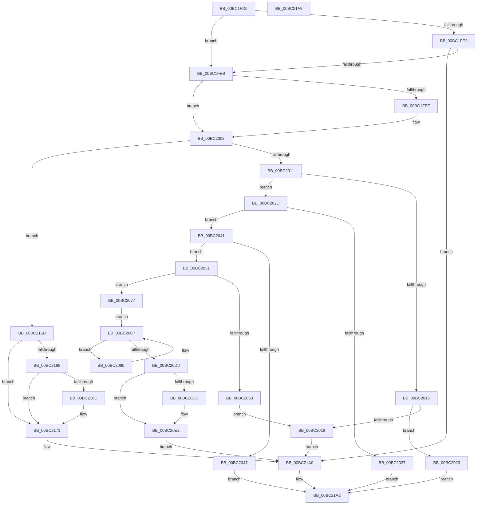

# AnFwDisplayProgressIndicator

- RVA: `0x00BC1FD0`–`0x00BC21A9` (길이 `473` bytes)
- VA: `0x0000000140BC1FD0`
- 실행 섹션: `PAGEBGFX`
- PDB 이름 있음: `예`; PDB Function 태그: `아니요`
- unwind 정보 RVA: `0x000DA434`
- 디코드: `112`개 명령, `473/473` bytes 표시
- 미해석 바이트: `0` (있으면 어셈블리에 `.byte`로 보존)

> 이 문서는 커널 이미지의 기계어와 PDB 기호를 분석해 생성했습니다. 4번과 5번은 함수 원형과 자료형을 바이너리 사용 방식에서 추정한 C 해석이며 원본 소스 복구 결과는 아닙니다.

## 1. Dependencies

- 직접 호출 지점: **11**; 고유 호출 대상: **8**
- 직접 호출자로 확인된 함수: **2**
- RIP 상대 이미지 참조: **14**

### Outgoing calls
- `0x00BC2019` → [AnFwpProgressAnimationManual](AnFwpProgressAnimationManual_function_00BC227C.md) (function, `0x00BC227C`)
- `0x00BC2087` → [LogFwStat](LogFwStat_function_00BC4790.md) (function, `0x00BC4790`)
- `0x00BC20B1` → [BgpTxtDisplayCharacter](../../text/47/BgpTxtDisplayCharacter_function_0047F120.md) (function, `0x0047F120`)
- `0x00BC2102` → [BgpTxtDisplayCharacter](../../text/47/BgpTxtDisplayCharacter_function_0047F120.md) (function, `0x0047F120`)
- `0x00BC2110` → [LogFwStat](LogFwStat_function_00BC4790.md) (function, `0x00BC4790`)
- `0x00BC2123` → [KeInitializeTimer](../../text/45/KeInitializeTimer_function_0045B590.md) (function, `0x0045B590`)
- `0x00BC213C` → [KeInitializeDpc](../../text/45/KeInitializeDpc_function_0045BBD0.md) (function, `0x0045BBD0`)
- `0x00BC2156` → [KeSetCoalescableTimer](../../text/22/KeSetCoalescableTimer_function_0022FFD0.md) (function, `0x0022FFD0`)
- `0x00BC216C` → [AnFwpDisableProgressTimer](AnFwpDisableProgressTimer_function_00BC3CB4.md) (function, `0x00BC3CB4`)
- `0x00BC2196` → [BgpTxtDisplayCharacter](../../text/47/BgpTxtDisplayCharacter_function_0047F120.md) (function, `0x0047F120`)
- `0x00BC219B` → [BgpTxtCacheDestroy](BgpTxtCacheDestroy_function_00BC4354.md) (function, `0x00BC4354`)

### Direct callers
- [BgDisplayProgressIndicator](BgDisplayProgressIndicator_function_00BC0628.md) at `0x00BC0648`
- [BgpFwLibraryDisable](BgpFwLibraryDisable_function_00BC1724.md) at `0x00BC1775`

### Static image references
- `0x00BC1FD6` → RVA `0x00EEFEE1` (`.data`; read)
- `0x00BC1FEB` → RVA `0x00EF0450` (`.data`; read)
- `0x00BC202D` → RVA `0x00EF0510` (`.data`; read)
- `0x00BC2053` → RVA `0x00EEFEE1` (`.data`; write)
- `0x00BC205A` → RVA `0x00E0EEB4` (`.data`; read)
- `0x00BC2066` → RVA `0x00EEFEE8` (`.data`; read/write)
- `0x00BC206E` → RVA `0x00E0EEAC` (`.data`; write)
- `0x00BC208C` → RVA `0x00E0EEAC` (`.data`; read)
- `0x00BC20C7` → RVA `0x00E0EEB8` (`.data`; read)
- `0x00BC20D0` → RVA `0x00EF05DC` (`.data`; read)
- `0x00BC2115` → RVA `0x00E65040` (`.data`; read)
- `0x00BC211C` → RVA `0x00EEFEE8` (`.data`; write)
- `0x00BC2128` → RVA `0x00E64F80` (`.data`; read)
- `0x00BC2135` → RVA `0x00BC49D0` (`AnFwpProgressIndicatorTimer`; read)

## 2. Other-region calls and transfers

- 다른 실행 섹션으로 향하는 call: **6**
  - `0x00BC20B1` → [BgpTxtDisplayCharacter](../../text/47/BgpTxtDisplayCharacter_function_0047F120.md) (`PAGEBGFX` → `.text`)
  - `0x00BC2102` → [BgpTxtDisplayCharacter](../../text/47/BgpTxtDisplayCharacter_function_0047F120.md) (`PAGEBGFX` → `.text`)
  - `0x00BC2123` → [KeInitializeTimer](../../text/45/KeInitializeTimer_function_0045B590.md) (`PAGEBGFX` → `.text`)
  - `0x00BC213C` → [KeInitializeDpc](../../text/45/KeInitializeDpc_function_0045BBD0.md) (`PAGEBGFX` → `.text`)
  - `0x00BC2156` → [KeSetCoalescableTimer](../../text/22/KeSetCoalescableTimer_function_0022FFD0.md) (`PAGEBGFX` → `.text`)
  - `0x00BC2196` → [BgpTxtDisplayCharacter](../../text/47/BgpTxtDisplayCharacter_function_0047F120.md) (`PAGEBGFX` → `.text`)
- 별도 외부 분기/꼬리 이동을 확인하지 못했습니다.

## 3. Assembly (complete function range)

```asm
00BC1FD0  40 57                           push rdi
00BC1FD2  48 83 EC 40                     sub rsp, 0x40
00BC1FD6  8A 15 05 DF 32 00               mov dl, byte ptr [rip + 0x32df05]
00BC1FDC  44 8A C1                        mov r8b, cl
00BC1FDF  84 C9                           test cl, cl
00BC1FE1  75 08                           jne 0x140bc1feb
00BC1FE3  84 D2                           test dl, dl
00BC1FE5  0F 84 B5 01 00 00               je 0x140bc21a0
00BC1FEB  8B 0D 5F E4 32 00               mov ecx, dword ptr [rip + 0x32e45f]
00BC1FF1  32 C0                           xor al, al
00BC1FF3  BF 01 00 00 00                  mov edi, 1
00BC1FF8  0F BA E1 14                     bt ecx, 0x14
00BC1FFC  73 0A                           jae 0x140bc2008
00BC1FFE  0F BA E1 0C                     bt ecx, 0xc
00BC2002  0F B6 C0                        movzx eax, al
00BC2005  0F 42 C7                        cmovb eax, edi
00BC2008  45 84 C0                        test r8b, r8b
00BC200B  0F 84 4C 01 00 00               je 0x140bc215d
00BC2011  84 D2                           test dl, dl
00BC2013  74 18                           je 0x140bc202d
00BC2015  84 C0                           test al, al
00BC2017  74 0A                           je 0x140bc2023
00BC2019  E8 5E 02 00 00                  call 0x140bc227c
00BC201E  E9 7D 01 00 00                  jmp 0x140bc21a0
00BC2023  B8 BB 00 00 C0                  mov eax, 0xc00000bb
00BC2028  E9 75 01 00 00                  jmp 0x140bc21a2
00BC202D  48 83 3D DB E4 32 00 00         cmp qword ptr [rip + 0x32e4db], 0
00BC2035  75 0A                           jne 0x140bc2041
00BC2037  B8 9A 00 00 C0                  mov eax, 0xc000009a
00BC203C  E9 61 01 00 00                  jmp 0x140bc21a2
00BC2041  0F BA E1 12                     bt ecx, 0x12
00BC2045  73 0A                           jae 0x140bc2051
00BC2047  B8 01 00 00 C0                  mov eax, 0xc0000001
00BC204C  E9 51 01 00 00                  jmp 0x140bc21a2
00BC2051  84 C0                           test al, al
00BC2053  40 88 3D 87 DE 32 00            mov byte ptr [rip + 0x32de87], dil
00BC205A  0F B7 05 53 CE 24 00            movzx eax, word ptr [rip + 0x24ce53]
00BC2061  74 14                           je 0x140bc2077
00BC2063  66 2B C7                        sub ax, di
00BC2066  48 83 25 7A DE 32 00 00         and qword ptr [rip + 0x32de7a], 0
00BC206E  66 89 05 37 CE 24 00            mov word ptr [rip + 0x24ce37], ax
00BC2075  EB A2                           jmp 0x140bc2019
00BC2077  45 33 C0                        xor r8d, r8d
00BC207A  66 89 05 2B CE 24 00            mov word ptr [rip + 0x24ce2b], ax
00BC2081  8B CF                           mov ecx, edi
00BC2083  41 8D 50 02                     lea edx, [r8 + 2]
00BC2087  E8 04 27 00 00                  call 0x140bc4790
00BC208C  0F B7 05 19 CE 24 00            movzx eax, word ptr [rip + 0x24ce19]
00BC2093  EB 32                           jmp 0x140bc20c7
00BC2095  48 83 64 24 30 00               and qword ptr [rsp + 0x30], 0
00BC209B  45 33 C9                        xor r9d, r9d
00BC209E  48 8B 0D 6B E4 32 00            mov rcx, qword ptr [rip + 0x32e46b]
00BC20A5  44 8B C7                        mov r8d, edi
00BC20A8  48 83 64 24 20 00               and qword ptr [rsp + 0x20], 0
00BC20AE  0F B7 D0                        movzx edx, ax
00BC20B1  E8 6A D0 8B FF                  call 0x14047f120
00BC20B6  0F B7 05 EF CD 24 00            movzx eax, word ptr [rip + 0x24cdef]
00BC20BD  66 03 C7                        add ax, di
00BC20C0  66 89 05 E5 CD 24 00            mov word ptr [rip + 0x24cde5], ax
00BC20C7  66 3B 05 EA CD 24 00            cmp ax, word ptr [rip + 0x24cdea]
00BC20CE  76 C5                           jbe 0x140bc2095
00BC20D0  39 3D 06 E5 32 00               cmp dword ptr [rip + 0x32e506], edi
00BC20D6  BA 76 E1 00 00                  mov edx, 0xe176
00BC20DB  74 05                           je 0x140bc20e2
00BC20DD  BA CB E0 00 00                  mov edx, 0xe0cb
00BC20E2  48 83 64 24 30 00               and qword ptr [rsp + 0x30], 0
00BC20E8  45 33 C9                        xor r9d, r9d
00BC20EB  48 8B 0D 1E E4 32 00            mov rcx, qword ptr [rip + 0x32e41e]
00BC20F2  45 33 C0                        xor r8d, r8d
00BC20F5  48 83 64 24 20 00               and qword ptr [rsp + 0x20], 0
00BC20FB  66 89 15 AA CD 24 00            mov word ptr [rip + 0x24cdaa], dx
00BC2102  E8 19 D0 8B FF                  call 0x14047f120
00BC2107  45 33 C0                        xor r8d, r8d
00BC210A  33 C9                           xor ecx, ecx
00BC210C  41 8D 50 02                     lea edx, [r8 + 2]
00BC2110  E8 7B 26 00 00                  call 0x140bc4790
00BC2115  48 8D 0D 24 2F 2A 00            lea rcx, [rip + 0x2a2f24]
00BC211C  48 89 05 C5 DD 32 00            mov qword ptr [rip + 0x32ddc5], rax
00BC2123  E8 68 94 89 FF                  call 0x14045b590
00BC2128  48 8D 3D 51 2E 2A 00            lea rdi, [rip + 0x2a2e51]
00BC212F  45 33 C0                        xor r8d, r8d
00BC2132  48 8B CF                        mov rcx, rdi
00BC2135  48 8D 15 94 28 00 00            lea rdx, [rip + 0x2894]
00BC213C  E8 8F 9A 89 FF                  call 0x14045bbd0
00BC2141  45 33 C9                        xor r9d, r9d
00BC2144  48 89 7C 24 20                  mov qword ptr [rsp + 0x20], rdi
00BC2149  33 D2                           xor edx, edx
00BC214B  48 8D 0D EE 2E 2A 00            lea rcx, [rip + 0x2a2eee]
00BC2152  45 8D 41 1E                     lea r8d, [r9 + 0x1e]
00BC2156  E8 75 DE 66 FF                  call 0x14022ffd0
00BC215B  EB 43                           jmp 0x140bc21a0
00BC215D  BA 00 0C 00 00                  mov edx, 0xc00
00BC2162  23 CA                           and ecx, edx
00BC2164  3B CA                           cmp ecx, edx
00BC2166  74 09                           je 0x140bc2171
00BC2168  84 C0                           test al, al
00BC216A  75 05                           jne 0x140bc2171
00BC216C  E8 43 1B 00 00                  call 0x140bc3cb4
00BC2171  48 83 64 24 30 00               and qword ptr [rsp + 0x30], 0
00BC2177  BA CB E0 00 00                  mov edx, 0xe0cb
00BC217C  48 8B 0D 8D E3 32 00            mov rcx, qword ptr [rip + 0x32e38d]
00BC2183  45 33 C9                        xor r9d, r9d
00BC2186  48 83 64 24 20 00               and qword ptr [rsp + 0x20], 0
00BC218C  45 33 C0                        xor r8d, r8d
00BC218F  66 89 15 16 CD 24 00            mov word ptr [rip + 0x24cd16], dx
00BC2196  E8 85 CF 8B FF                  call 0x14047f120
00BC219B  E8 B4 21 00 00                  call 0x140bc4354
00BC21A0  33 C0                           xor eax, eax
00BC21A2  48 83 C4 40                     add rsp, 0x40
00BC21A6  5F                              pop rdi
00BC21A7  C3                              ret
00BC21A8  CC                              int3
```

## 4. C-style interpretation (structured pseudocode)

```c
__int64 __fastcall AnFwDisplayProgressIndicator(unsigned __int8 a1, __int64 a2, __int64 a3, int a4)
{
    __int64 result;
    __int64 v_rsp;
    unsigned __int64 v_stack_m18;
    unsigned __int64 v_stack_m28;

    v_rsp = (v_rsp) - (64);
    if (a1 != 0) goto loc_00BC1FEB;
    if ((unsigned __int8)(*(unsigned __int8 *)(v_rip + 3333893)) == 0) goto loc_00BC21A0;
loc_00BC1FEB:
    result = 0;
    if (!(condition_is_above_or_equal)) {
        result = 0;
        if (condition_is_below) { result = 1; }
    }
    if (a1 == 0) goto loc_00BC215D;
    if ((unsigned __int8)(*(unsigned __int8 *)(v_rip + 3333893)) == 0) goto loc_00BC202D;
    if ((unsigned __int8)(result) == 0) goto loc_00BC2023;
loc_00BC2019:
    result = AnFwpProgressAnimationManual((unsigned int)(*(unsigned int *)(v_rip + 3335263)), *(unsigned __int8 *)(v_rip + 3333893), a1, a4);
    goto loc_00BC21A0;
loc_00BC2023:
    goto loc_00BC21A2;
loc_00BC202D:
    if ((*(unsigned __int64 *)(v_rip + 3335387)) != 0) goto loc_00BC2041;
    goto loc_00BC21A2;
loc_00BC2041:
    if ((*(unsigned __int64 *)(v_rip + 3335387)) >= 0) goto loc_00BC2051;
    goto loc_00BC21A2;
loc_00BC2051:
    *(unsigned __int8 *)(v_rip + 3333767) = 1;
    if ((unsigned __int8)((unsigned int)(0xC0000001ULL)) == 0) goto loc_00BC2077;
    result = (unsigned __int16)((*(unsigned __int16 *)(v_rip + 2412115)) - (1));
    *(unsigned __int16 *)(v_rip + 2412087) = (unsigned __int16)(result);
    goto loc_00BC2019;
loc_00BC2077:
    a3 = 0;
    *(unsigned __int16 *)(v_rip + 2412075) = (unsigned __int16)(result);
    result = LogFwStat(1, a3 + 2, a3, a4);
    goto loc_00BC20C7;
loc_00BC2095:
    a4 = 0;
    result = BgpTxtDisplayCharacter(*(unsigned __int64 *)(v_rip + 3335275), (unsigned __int16)(*(unsigned __int16 *)(v_rip + 2412057)), 1, a4);
    result = (unsigned __int16)((*(unsigned __int16 *)(v_rip + 2412015)) + (1));
    *(unsigned __int16 *)(v_rip + 2412005) = (unsigned __int16)(result);
loc_00BC20C7:
    if (((unsigned __int16)(result)) <= (*(unsigned __int16 *)(v_rip + 2412010))) goto loc_00BC2095;
    if ((*(unsigned int *)(v_rip + 3335430)) != 1) {
        a2 = 0xE0CBULL;
    }
    a4 = 0;
    a3 = 0;
    *(unsigned __int16 *)(v_rip + 2411946) = (unsigned __int16)(a2);
    result = BgpTxtDisplayCharacter(*(unsigned __int64 *)(v_rip + 3335198), a2, a3, a4);
    a3 = 0;
    a1 = 0;
    result = LogFwStat(a1, a3 + 2, a3, a4);
    *(unsigned __int64 *)(v_rip + 3333573) = result;
    result = KeInitializeTimer(v_rip + 2764580, a3 + 2, a3, a4);
    a3 = 0;
    result = KeInitializeDpc(v_rip + 2764369, v_rip + 10388, a3, a4);
    a4 = 0;
    v_stack_m28 = v_rip + 2764369;
    a2 = 0;
    result = KeSetCoalescableTimer(v_rip + 2764526, a2, a4 + 30, a4);
    goto loc_00BC21A0;
loc_00BC215D:
    a1 = (unsigned int)((v_rip + 2764526) & ((unsigned int)((unsigned int)(0xC00ULL))));
    if (a1 == ((unsigned int)((unsigned int)(0xC00ULL)))) goto loc_00BC2171;
    if ((unsigned __int8)(result) == 0) {
        result = AnFwpDisableProgressTimer(a1, (unsigned int)(0xC00ULL), a4 + 30, a4);
    }
    a4 = 0;
    a3 = 0;
    *(unsigned __int16 *)(v_rip + 2411798) = (unsigned __int16)((unsigned int)(0xE0CBULL));
    result = BgpTxtDisplayCharacter(*(unsigned __int64 *)(v_rip + 3335053), (unsigned int)(0xE0CBULL), a3, a4);
    result = BgpTxtCacheDestroy(*(unsigned __int64 *)(v_rip + 3335053), (unsigned int)(0xE0CBULL), a3, a4);
loc_00BC21A0:
    result = 0;
loc_00BC21A2:
    v_rsp = (v_rsp) + (64);
    return result;
}
```

## 5. (Beta) C Style

```c
int64_t AnFwDisplayProgressIndicator(uint8_t Arg1, int64_t Arg2, int64_t Arg3, int32_t Arg4)
{
    int64_t result;
    int64_t local_rsp;
    uint64_t v_stack_m18;
    uint64_t v_stack_m28;

    local_rsp = (local_rsp) - (64);
    if (Arg1 != 0) goto loc_00BC1FEB;
    if ((uint8_t)(*(uint8_t *)(v_rip + 0x32DF05)) == 0) goto loc_00BC21A0;
loc_00BC1FEB:
    result = 0;
    if (!(condition_is_above_or_equal)) {
        result = 0;
        if (condition_is_below) { result = 1; }
    }
    if (Arg1 == 0) goto loc_00BC215D;
    if ((uint8_t)(*(uint8_t *)(v_rip + 0x32DF05)) == 0) goto loc_00BC202D;
    if ((uint8_t)(result) == 0) goto loc_00BC2023;
loc_00BC2019:
    result = AnFwpProgressAnimationManual((uint32_t)(*(uint32_t *)(v_rip + 0x32E45F)), *(uint8_t *)(v_rip + 0x32DF05), Arg1, Arg4);
    goto loc_00BC21A0;
loc_00BC2023:
    goto loc_00BC21A2;
loc_00BC202D:
    if ((*(uint64_t *)(v_rip + 0x32E4DB)) != 0) goto loc_00BC2041;
    goto loc_00BC21A2;
loc_00BC2041:
    if ((*(uint64_t *)(v_rip + 0x32E4DB)) >= 0) goto loc_00BC2051;
    goto loc_00BC21A2;
loc_00BC2051:
    *(uint8_t *)(v_rip + 0x32DE87) = 1;
    if ((uint8_t)((uint32_t)(0xC0000001ULL)) == 0) goto loc_00BC2077;
    result = (uint16_t)((*(uint16_t *)(v_rip + 0x24CE53)) - (1));
    *(uint16_t *)(v_rip + 0x24CE37) = (uint16_t)(result);
    goto loc_00BC2019;
loc_00BC2077:
    Arg3 = 0;
    *(uint16_t *)(v_rip + 0x24CE2B) = (uint16_t)(result);
    result = LogFwStat(1, Arg3 + 2, Arg3, Arg4);
    goto loc_00BC20C7;
loc_00BC2095:
    Arg4 = 0;
    result = BgpTxtDisplayCharacter(*(uint64_t *)(v_rip + 0x32E46B), (uint16_t)(*(uint16_t *)(v_rip + 0x24CE19)), 1, Arg4);
    result = (uint16_t)((*(uint16_t *)(v_rip + 0x24CDEF)) + (1));
    *(uint16_t *)(v_rip + 0x24CDE5) = (uint16_t)(result);
loc_00BC20C7:
    if (((uint16_t)(result)) <= (*(uint16_t *)(v_rip + 0x24CDEA))) goto loc_00BC2095;
    if ((*(uint32_t *)(v_rip + 0x32E506)) != 1) {
        Arg2 = 0xE0CBULL;
    }
    Arg4 = 0;
    Arg3 = 0;
    *(uint16_t *)(v_rip + 0x24CDAA) = (uint16_t)(Arg2);
    result = BgpTxtDisplayCharacter(*(uint64_t *)(v_rip + 0x32E41E), Arg2, Arg3, Arg4);
    Arg3 = 0;
    Arg1 = 0;
    result = LogFwStat(Arg1, Arg3 + 2, Arg3, Arg4);
    *(uint64_t *)(v_rip + 0x32DDC5) = result;
    result = KeInitializeTimer(v_rip + 2764580, Arg3 + 2, Arg3, Arg4);
    Arg3 = 0;
    result = KeInitializeDpc(v_rip + 2764369, v_rip + 10388, Arg3, Arg4);
    Arg4 = 0;
    v_stack_m28 = v_rip + 2764369;
    Arg2 = 0;
    result = KeSetCoalescableTimer(v_rip + 2764526, Arg2, Arg4 + 30, Arg4);
    goto loc_00BC21A0;
loc_00BC215D:
    Arg1 = (uint32_t)((v_rip + 2764526) & ((uint32_t)((uint32_t)(0xC00ULL))));
    if (Arg1 == ((uint32_t)((uint32_t)(0xC00ULL)))) goto loc_00BC2171;
    if ((uint8_t)(result) == 0) {
        result = AnFwpDisableProgressTimer(Arg1, (uint32_t)(0xC00ULL), Arg4 + 30, Arg4);
    }
    Arg4 = 0;
    Arg3 = 0;
    *(uint16_t *)(v_rip + 0x24CD16) = (uint16_t)((uint32_t)(0xE0CBULL));
    result = BgpTxtDisplayCharacter(*(uint64_t *)(v_rip + 0x32E38D), (uint32_t)(0xE0CBULL), Arg3, Arg4);
    result = BgpTxtCacheDestroy(*(uint64_t *)(v_rip + 0x32E38D), (uint32_t)(0xE0CBULL), Arg3, Arg4);
loc_00BC21A0:
    result = 0;
loc_00BC21A2:
    local_rsp = (local_rsp) + (64);
    return result;
}
```

## 6. Execution-region graph

[열기: 2D/3D 그래프와 함수 탐색 컨트롤 패널](../../../control-panel.html?section=pagebgfx&rva=0x00BC1FD0&view=graph)

- 2D 그래프는 위에서 아래로 흐르고, 3D 그래프는 빈 공간을 드래그해 회전합니다. Shift+드래그는 이동, 휠은 확대·축소, 함수 노드 선택은 대상 보고서 이동입니다.

### Static fallback


