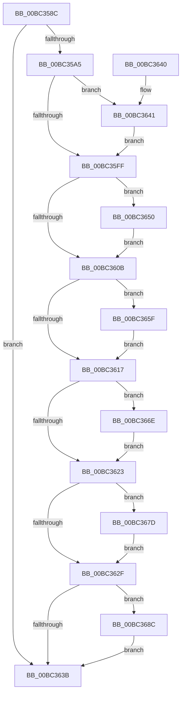

# AnFwFadeCompletion

- RVA: `0x00BC358C`–`0x00BC369B` (길이 `271` bytes)
- VA: `0x0000000140BC358C`
- 실행 섹션: `PAGEBGFX`
- PDB 이름 있음: `예`; PDB Function 태그: `아니요`
- unwind 정보 RVA: `0x0007977C`
- 디코드: `61`개 명령, `271/271` bytes 표시
- 미해석 바이트: `0` (있으면 어셈블리에 `.byte`로 보존)

> 이 문서는 커널 이미지의 기계어와 PDB 기호를 분석해 생성했습니다. 4번과 5번은 함수 원형과 자료형을 바이너리 사용 방식에서 추정한 C 해석이며 원본 소스 복구 결과는 아닙니다.

## 1. Dependencies

- 직접 호출 지점: **11**; 고유 호출 대상: **5**
- 직접 호출자로 확인된 함수: **4**
- RIP 상대 이미지 참조: **18**

### Outgoing calls
- `0x00BC35A7` → [BgpFwQueryPerformanceCounter](../../text/4C/BgpFwQueryPerformanceCounter_function_004C0614.md) (function, `0x004C0614`)
- `0x00BC35B5` → [BgpFwQueryPerformanceCounter](../../text/4C/BgpFwQueryPerformanceCounter_function_004C0614.md) (function, `0x004C0614`)
- `0x00BC35CF` → [BgpFwReleaseLock](../../text/4B/BgpFwReleaseLock_function_004B357C.md) (function, `0x004B357C`)
- `0x00BC35E9` → [KeWaitForSingleObject](../../text/20/KeWaitForSingleObject_function_0020E6B0.md) (function, `0x0020E6B0`)
- `0x00BC35EE` → [BgpFwAcquireLock](../../text/4B/BgpFwAcquireLock_function_004B3AA4.md) (function, `0x004B3AA4`)
- `0x00BC3641` → [BgpGxRectangleDestroy](BgpGxRectangleDestroy_function_00BC3F04.md) (function, `0x00BC3F04`)
- `0x00BC3650` → [BgpGxRectangleDestroy](BgpGxRectangleDestroy_function_00BC3F04.md) (function, `0x00BC3F04`)
- `0x00BC365F` → [BgpGxRectangleDestroy](BgpGxRectangleDestroy_function_00BC3F04.md) (function, `0x00BC3F04`)
- `0x00BC366E` → [BgpGxRectangleDestroy](BgpGxRectangleDestroy_function_00BC3F04.md) (function, `0x00BC3F04`)
- `0x00BC367D` → [BgpGxRectangleDestroy](BgpGxRectangleDestroy_function_00BC3F04.md) (function, `0x00BC3F04`)
- `0x00BC368C` → [BgpGxRectangleDestroy](BgpGxRectangleDestroy_function_00BC3F04.md) (function, `0x00BC3F04`)

### Direct callers
- [BgpConsoleDisplayCharacter](BgpConsoleDisplayCharacter_function_00BC0AB0.md) at `0x00BC0AFE`
- [BgpConsoleDisplayString](BgpConsoleDisplayString_function_00BC0E60.md) at `0x00BC0EC0`
- [BgpFwLibraryDisable](BgpFwLibraryDisable_function_00BC1724.md) at `0x00BC173D`
- [ResFwFreeContext](ResFwFreeContext_function_00BC34C4.md) at `0x00BC3505`

### Static image references
- `0x00BC3590` → RVA `0x00EF0450` (`.data`; read)
- `0x00BC35AE` → RVA `0x00EEFF48` (`.data`; write)
- `0x00BC35BA` → RVA `0x00E65158` (`.data`; read)
- `0x00BC35C1` → RVA `0x00EEFFA0` (`.data`; write)
- `0x00BC35C8` → RVA `0x00EEFF40` (`.data`; write)
- `0x00BC35DA` → RVA `0x00E65100` (`.data`; read)
- `0x00BC35F3` → RVA `0x00E0EED8` (`.data`; read)
- `0x00BC35FF` → RVA `0x00E0EF08` (`.data`; read)
- `0x00BC360B` → RVA `0x00E0EF10` (`.data`; read)
- `0x00BC3617` → RVA `0x00E0EF18` (`.data`; read)
- `0x00BC3623` → RVA `0x00E0EF48` (`.data`; read)
- `0x00BC362F` → RVA `0x00E0EF50` (`.data`; read)
- `0x00BC3646` → RVA `0x00E0EED8` (`.data`; read/write)
- `0x00BC3655` → RVA `0x00E0EF08` (`.data`; read/write)
- `0x00BC3664` → RVA `0x00E0EF10` (`.data`; read/write)
- `0x00BC3673` → RVA `0x00E0EF18` (`.data`; read/write)
- `0x00BC3682` → RVA `0x00E0EF48` (`.data`; read/write)
- `0x00BC3691` → RVA `0x00E0EF50` (`.data`; read/write)

## 2. Other-region calls and transfers

- 다른 실행 섹션으로 향하는 call: **5**
  - `0x00BC35A7` → [BgpFwQueryPerformanceCounter](../../text/4C/BgpFwQueryPerformanceCounter_function_004C0614.md) (`PAGEBGFX` → `.text`)
  - `0x00BC35B5` → [BgpFwQueryPerformanceCounter](../../text/4C/BgpFwQueryPerformanceCounter_function_004C0614.md) (`PAGEBGFX` → `.text`)
  - `0x00BC35CF` → [BgpFwReleaseLock](../../text/4B/BgpFwReleaseLock_function_004B357C.md) (`PAGEBGFX` → `.text`)
  - `0x00BC35E9` → [KeWaitForSingleObject](../../text/20/KeWaitForSingleObject_function_0020E6B0.md) (`PAGEBGFX` → `.text`)
  - `0x00BC35EE` → [BgpFwAcquireLock](../../text/4B/BgpFwAcquireLock_function_004B3AA4.md) (`PAGEBGFX` → `.text`)
- 별도 외부 분기/꼬리 이동을 확인하지 못했습니다.

## 3. Assembly (complete function range)

```asm
00BC358C  48 83 EC 38                     sub rsp, 0x38
00BC3590  8B 05 BA CE 32 00               mov eax, dword ptr [rip + 0x32ceba]
00BC3596  B9 00 0C 00 00                  mov ecx, 0xc00
00BC359B  23 C1                           and eax, ecx
00BC359D  3B C1                           cmp eax, ecx
00BC359F  0F 84 96 00 00 00               je 0x140bc363b
00BC35A5  33 C9                           xor ecx, ecx
00BC35A7  E8 68 D0 8F FF                  call 0x1404c0614
00BC35AC  33 C9                           xor ecx, ecx
00BC35AE  48 89 05 93 C9 32 00            mov qword ptr [rip + 0x32c993], rax
00BC35B5  E8 5A D0 8F FF                  call 0x1404c0614
00BC35BA  48 2B 05 97 1B 2A 00            sub rax, qword ptr [rip + 0x2a1b97]
00BC35C1  48 89 05 D8 C9 32 00            mov qword ptr [rip + 0x32c9d8], rax
00BC35C8  48 89 05 71 C9 32 00            mov qword ptr [rip + 0x32c971], rax
00BC35CF  E8 A8 FF 8E FF                  call 0x1404b357c
00BC35D4  48 83 64 24 20 00               and qword ptr [rsp + 0x20], 0
00BC35DA  48 8D 0D 1F 1B 2A 00            lea rcx, [rip + 0x2a1b1f]
00BC35E1  45 33 C9                        xor r9d, r9d
00BC35E4  45 33 C0                        xor r8d, r8d
00BC35E7  33 D2                           xor edx, edx
00BC35E9  E8 C2 B0 64 FF                  call 0x14020e6b0
00BC35EE  E8 B1 04 8F FF                  call 0x1404b3aa4
00BC35F3  48 8B 0D DE B8 24 00            mov rcx, qword ptr [rip + 0x24b8de]
00BC35FA  48 85 C9                        test rcx, rcx
00BC35FD  75 42                           jne 0x140bc3641
00BC35FF  48 8B 0D 02 B9 24 00            mov rcx, qword ptr [rip + 0x24b902]
00BC3606  48 85 C9                        test rcx, rcx
00BC3609  75 45                           jne 0x140bc3650
00BC360B  48 8B 0D FE B8 24 00            mov rcx, qword ptr [rip + 0x24b8fe]
00BC3612  48 85 C9                        test rcx, rcx
00BC3615  75 48                           jne 0x140bc365f
00BC3617  48 8B 0D FA B8 24 00            mov rcx, qword ptr [rip + 0x24b8fa]
00BC361E  48 85 C9                        test rcx, rcx
00BC3621  75 4B                           jne 0x140bc366e
00BC3623  48 8B 0D 1E B9 24 00            mov rcx, qword ptr [rip + 0x24b91e]
00BC362A  48 85 C9                        test rcx, rcx
00BC362D  75 4E                           jne 0x140bc367d
00BC362F  48 8B 0D 1A B9 24 00            mov rcx, qword ptr [rip + 0x24b91a]
00BC3636  48 85 C9                        test rcx, rcx
00BC3639  75 51                           jne 0x140bc368c
00BC363B  48 83 C4 38                     add rsp, 0x38
00BC363F  C3                              ret
00BC3640  CC                              int3
00BC3641  E8 BE 08 00 00                  call 0x140bc3f04
00BC3646  48 83 25 8A B8 24 00 00         and qword ptr [rip + 0x24b88a], 0
00BC364E  EB AF                           jmp 0x140bc35ff
00BC3650  E8 AF 08 00 00                  call 0x140bc3f04
00BC3655  48 83 25 AB B8 24 00 00         and qword ptr [rip + 0x24b8ab], 0
00BC365D  EB AC                           jmp 0x140bc360b
00BC365F  E8 A0 08 00 00                  call 0x140bc3f04
00BC3664  48 83 25 A4 B8 24 00 00         and qword ptr [rip + 0x24b8a4], 0
00BC366C  EB A9                           jmp 0x140bc3617
00BC366E  E8 91 08 00 00                  call 0x140bc3f04
00BC3673  48 83 25 9D B8 24 00 00         and qword ptr [rip + 0x24b89d], 0
00BC367B  EB A6                           jmp 0x140bc3623
00BC367D  E8 82 08 00 00                  call 0x140bc3f04
00BC3682  48 83 25 BE B8 24 00 00         and qword ptr [rip + 0x24b8be], 0
00BC368A  EB A3                           jmp 0x140bc362f
00BC368C  E8 73 08 00 00                  call 0x140bc3f04
00BC3691  48 83 25 B7 B8 24 00 00         and qword ptr [rip + 0x24b8b7], 0
00BC3699  EB A0                           jmp 0x140bc363b
```

## 4. C-style interpretation (structured pseudocode)

```c
__int64 __fastcall AnFwFadeCompletion(__int64 a1, int a2, int a3, int a4)
{
    __int64 result;
    __int64 v_rsp;
    unsigned __int64 v_stack_m18;

    v_rsp = (v_rsp) - (56);
    result = (unsigned int)(((unsigned int)(*(unsigned int *)(v_rip + 3329722))) & ((unsigned int)((unsigned int)(0xC00ULL))));
    if (((unsigned int)(result)) == ((unsigned int)((unsigned int)(0xC00ULL)))) goto loc_00BC363B;
    a1 = 0;
    result = BgpFwQueryPerformanceCounter(a1, a2, a3, a4);
    a1 = 0;
    *(unsigned __int64 *)(v_rip + 3328403) = result;
    result = BgpFwQueryPerformanceCounter(a1, a2, a3, a4);
    result = (result) - (*(unsigned __int64 *)(v_rip + 2759575));
    *(unsigned __int64 *)(v_rip + 3328472) = result;
    *(unsigned __int64 *)(v_rip + 3328369) = result;
    result = BgpFwReleaseLock(a1, a2, a3, a4);
    a4 = 0;
    a3 = 0;
    a2 = 0;
    result = KeWaitForSingleObject(v_rip + 2759455, a2, a3, a4);
    result = BgpFwAcquireLock(v_rip + 2759455, a2, a3, a4);
    if (*(unsigned __int64 *)(v_rip + 2406622) != 0) goto loc_00BC3641;
loc_00BC35FF:
    if (*(unsigned __int64 *)(v_rip + 2406658) != 0) goto loc_00BC3650;
loc_00BC360B:
    if (*(unsigned __int64 *)(v_rip + 2406654) != 0) goto loc_00BC365F;
loc_00BC3617:
    if (*(unsigned __int64 *)(v_rip + 2406650) != 0) goto loc_00BC366E;
loc_00BC3623:
    if (*(unsigned __int64 *)(v_rip + 2406686) != 0) goto loc_00BC367D;
loc_00BC362F:
    if (*(unsigned __int64 *)(v_rip + 2406682) != 0) goto loc_00BC368C;
loc_00BC363B:
    v_rsp = (v_rsp) + (56);
    return result;
loc_00BC3641:
    result = BgpGxRectangleDestroy(*(unsigned __int64 *)(v_rip + 2406682), a2, a3, a4);
    goto loc_00BC35FF;
loc_00BC3650:
    result = BgpGxRectangleDestroy(*(unsigned __int64 *)(v_rip + 2406682), a2, a3, a4);
    goto loc_00BC360B;
loc_00BC365F:
    result = BgpGxRectangleDestroy(*(unsigned __int64 *)(v_rip + 2406682), a2, a3, a4);
    goto loc_00BC3617;
loc_00BC366E:
    result = BgpGxRectangleDestroy(*(unsigned __int64 *)(v_rip + 2406682), a2, a3, a4);
    goto loc_00BC3623;
loc_00BC367D:
    result = BgpGxRectangleDestroy(*(unsigned __int64 *)(v_rip + 2406682), a2, a3, a4);
    goto loc_00BC362F;
loc_00BC368C:
    result = BgpGxRectangleDestroy(*(unsigned __int64 *)(v_rip + 2406682), a2, a3, a4);
    goto loc_00BC363B;
}
```

## 5. (Beta) C Style

```c
int64_t AnFwFadeCompletion(int64_t Arg1, int32_t Arg2, int32_t Arg3, int32_t Arg4)
{
    int64_t result;
    int64_t local_rsp;
    uint64_t v_stack_m18;

    local_rsp = (local_rsp) - (56);
    result = (uint32_t)(((uint32_t)(*(uint32_t *)(v_rip + 0x32CEBA))) & ((uint32_t)((uint32_t)(0xC00ULL))));
    if (((uint32_t)(result)) == ((uint32_t)((uint32_t)(0xC00ULL)))) goto loc_00BC363B;
    Arg1 = 0;
    result = BgpFwQueryPerformanceCounter(Arg1, Arg2, Arg3, Arg4);
    Arg1 = 0;
    *(uint64_t *)(v_rip + 0x32C993) = result;
    result = BgpFwQueryPerformanceCounter(Arg1, Arg2, Arg3, Arg4);
    result = (result) - (*(uint64_t *)(v_rip + 0x2A1B97));
    *(uint64_t *)(v_rip + 0x32C9D8) = result;
    *(uint64_t *)(v_rip + 0x32C971) = result;
    result = BgpFwReleaseLock(Arg1, Arg2, Arg3, Arg4);
    Arg4 = 0;
    Arg3 = 0;
    Arg2 = 0;
    result = KeWaitForSingleObject(v_rip + 2759455, Arg2, Arg3, Arg4);
    result = BgpFwAcquireLock(v_rip + 2759455, Arg2, Arg3, Arg4);
    if (*(uint64_t *)(v_rip + 0x24B8DE) != 0) goto loc_00BC3641;
loc_00BC35FF:
    if (*(uint64_t *)(v_rip + 0x24B902) != 0) goto loc_00BC3650;
loc_00BC360B:
    if (*(uint64_t *)(v_rip + 0x24B8FE) != 0) goto loc_00BC365F;
loc_00BC3617:
    if (*(uint64_t *)(v_rip + 0x24B8FA) != 0) goto loc_00BC366E;
loc_00BC3623:
    if (*(uint64_t *)(v_rip + 0x24B91E) != 0) goto loc_00BC367D;
loc_00BC362F:
    if (*(uint64_t *)(v_rip + 0x24B91A) != 0) goto loc_00BC368C;
loc_00BC363B:
    local_rsp = (local_rsp) + (56);
    return result;
loc_00BC3641:
    result = BgpGxRectangleDestroy(*(uint64_t *)(v_rip + 0x24B91A), Arg2, Arg3, Arg4);
    goto loc_00BC35FF;
loc_00BC3650:
    result = BgpGxRectangleDestroy(*(uint64_t *)(v_rip + 0x24B91A), Arg2, Arg3, Arg4);
    goto loc_00BC360B;
loc_00BC365F:
    result = BgpGxRectangleDestroy(*(uint64_t *)(v_rip + 0x24B91A), Arg2, Arg3, Arg4);
    goto loc_00BC3617;
loc_00BC366E:
    result = BgpGxRectangleDestroy(*(uint64_t *)(v_rip + 0x24B91A), Arg2, Arg3, Arg4);
    goto loc_00BC3623;
loc_00BC367D:
    result = BgpGxRectangleDestroy(*(uint64_t *)(v_rip + 0x24B91A), Arg2, Arg3, Arg4);
    goto loc_00BC362F;
loc_00BC368C:
    result = BgpGxRectangleDestroy(*(uint64_t *)(v_rip + 0x24B91A), Arg2, Arg3, Arg4);
    goto loc_00BC363B;
}
```

## 6. Execution-region graph

[열기: 2D/3D 그래프와 함수 탐색 컨트롤 패널](../../../control-panel.html?section=pagebgfx&rva=0x00BC358C&view=graph)

- 2D 그래프는 위에서 아래로 흐르고, 3D 그래프는 빈 공간을 드래그해 회전합니다. Shift+드래그는 이동, 휠은 확대·축소, 함수 노드 선택은 대상 보고서 이동입니다.

### Static fallback


