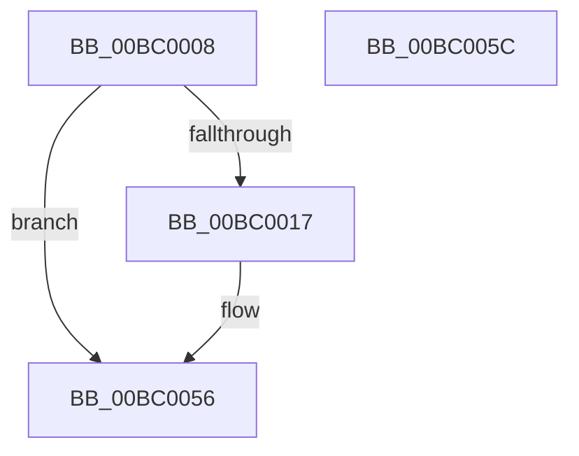

# AnFwProgressIndicatorTransition

- RVA: `0x00BC0008`–`0x00BC005D` (길이 `85` bytes)
- VA: `0x0000000140BC0008`
- 실행 섹션: `PAGEBGFX`
- PDB 이름 있음: `예`; PDB Function 태그: `아니요`
- unwind 정보 RVA: `0x00064C80`
- 디코드: `21`개 명령, `85/85` bytes 표시
- 미해석 바이트: `0` (있으면 어셈블리에 `.byte`로 보존)

> 이 문서는 커널 이미지의 기계어와 PDB 기호를 분석해 생성했습니다. 4번과 5번은 함수 원형과 자료형을 바이너리 사용 방식에서 추정한 C 해석이며 원본 소스 복구 결과는 아닙니다.

## 1. Dependencies

- 직접 호출 지점: **3**; 고유 호출 대상: **3**
- 직접 호출자로 확인된 함수: **1**
- RIP 상대 이미지 참조: **4**

### Outgoing calls
- `0x00BC001E` → [KeInitializeTimer](../../text/45/KeInitializeTimer_function_0045B590.md) (function, `0x0045B590`)
- `0x00BC0037` → [KeInitializeDpc](../../text/45/KeInitializeDpc_function_0045BBD0.md) (function, `0x0045BBD0`)
- `0x00BC0051` → [KeSetCoalescableTimer](../../text/22/KeSetCoalescableTimer_function_0022FFD0.md) (function, `0x0022FFD0`)

### Direct callers
- [BgpFwLibraryInitialize](BgpFwLibraryInitialize_function_00BC5400.md) at `0x00BC551A`

### Static image references
- `0x00BC000E` → RVA `0x00EEFEE1` (`.data`; read)
- `0x00BC0017` → RVA `0x00E65040` (`.data`; read)
- `0x00BC0023` → RVA `0x00E64F80` (`.data`; read)
- `0x00BC0030` → RVA `0x00BC49D0` (`AnFwpProgressIndicatorTimer`; read)

## 2. Other-region calls and transfers

- 다른 실행 섹션으로 향하는 call: **3**
  - `0x00BC001E` → [KeInitializeTimer](../../text/45/KeInitializeTimer_function_0045B590.md) (`PAGEBGFX` → `.text`)
  - `0x00BC0037` → [KeInitializeDpc](../../text/45/KeInitializeDpc_function_0045BBD0.md) (`PAGEBGFX` → `.text`)
  - `0x00BC0051` → [KeSetCoalescableTimer](../../text/22/KeSetCoalescableTimer_function_0022FFD0.md) (`PAGEBGFX` → `.text`)
- 별도 외부 분기/꼬리 이동을 확인하지 못했습니다.

## 3. Assembly (complete function range)

```asm
00BC0008  40 53                           push rbx
00BC000A  48 83 EC 30                     sub rsp, 0x30
00BC000E  80 3D CC FE 32 00 00            cmp byte ptr [rip + 0x32fecc], 0
00BC0015  74 3F                           je 0x140bc0056
00BC0017  48 8D 0D 22 50 2A 00            lea rcx, [rip + 0x2a5022]
00BC001E  E8 6D B5 89 FF                  call 0x14045b590
00BC0023  48 8D 1D 56 4F 2A 00            lea rbx, [rip + 0x2a4f56]
00BC002A  45 33 C0                        xor r8d, r8d
00BC002D  48 8B CB                        mov rcx, rbx
00BC0030  48 8D 15 99 49 00 00            lea rdx, [rip + 0x4999]
00BC0037  E8 94 BB 89 FF                  call 0x14045bbd0
00BC003C  45 33 C9                        xor r9d, r9d
00BC003F  48 89 5C 24 20                  mov qword ptr [rsp + 0x20], rbx
00BC0044  33 D2                           xor edx, edx
00BC0046  48 8D 0D F3 4F 2A 00            lea rcx, [rip + 0x2a4ff3]
00BC004D  45 8D 41 1E                     lea r8d, [r9 + 0x1e]
00BC0051  E8 7A FF 66 FF                  call 0x14022ffd0
00BC0056  48 83 C4 30                     add rsp, 0x30
00BC005A  5B                              pop rbx
00BC005B  C3                              ret
00BC005C  CC                              int3
```

## 4. C-style interpretation (structured pseudocode)

```c
__int64 __fastcall AnFwProgressIndicatorTransition(__int64 a1, __int64 a2, int a3, int a4)
{
    __int64 result;
    __int64 v_rbx;
    __int64 v_rsp;
    unsigned __int64 v_stack_m18;

    v_rsp = (v_rsp) - (48);
    if ((*(unsigned __int8 *)(v_rip + 3342028)) != 0) {
        a1 = v_rip + 2773026;
        result = KeInitializeTimer(a1, a2, a3, a4);
        v_rbx = v_rip + 2772822;
        a3 = 0;
        a1 = v_rbx;
        a2 = v_rip + 18841;
        result = KeInitializeDpc(a1, a2, a3, a4);
        a4 = 0;
        v_stack_m18 = v_rbx;
        a2 = 0;
        a1 = v_rip + 2772979;
        a3 = a4 + 30;
        result = KeSetCoalescableTimer(a1, a2, a3, a4);
    }
    v_rsp = (v_rsp) + (48);
    return result;
}
```

## 5. (Beta) C Style

```c
int64_t AnFwProgressIndicatorTransition(int64_t Arg1, int64_t Arg2, int32_t Arg3, int32_t Arg4)
{
    int64_t result;
    int64_t local_rbx;
    int64_t local_rsp;
    uint64_t v_stack_m18;

    local_rsp = (local_rsp) - (48);
    if ((*(uint8_t *)(v_rip + 0x32FECC)) != 0) {
        Arg1 = v_rip + 2773026;
        result = KeInitializeTimer(Arg1, Arg2, Arg3, Arg4);
        local_rbx = v_rip + 2772822;
        Arg3 = 0;
        Arg1 = local_rbx;
        Arg2 = v_rip + 18841;
        result = KeInitializeDpc(Arg1, Arg2, Arg3, Arg4);
        Arg4 = 0;
        v_stack_m18 = local_rbx;
        Arg2 = 0;
        Arg1 = v_rip + 2772979;
        Arg3 = Arg4 + 30;
        result = KeSetCoalescableTimer(Arg1, Arg2, Arg3, Arg4);
    }
    local_rsp = (local_rsp) + (48);
    return result;
}
```

## 6. Execution-region graph

[열기: 2D/3D 그래프와 함수 탐색 컨트롤 패널](../../../control-panel.html?section=pagebgfx&rva=0x00BC0008&view=graph)

- 2D 그래프는 위에서 아래로 흐르고, 3D 그래프는 빈 공간을 드래그해 회전합니다. Shift+드래그는 이동, 휠은 확대·축소, 함수 노드 선택은 대상 보고서 이동입니다.

### Static fallback


