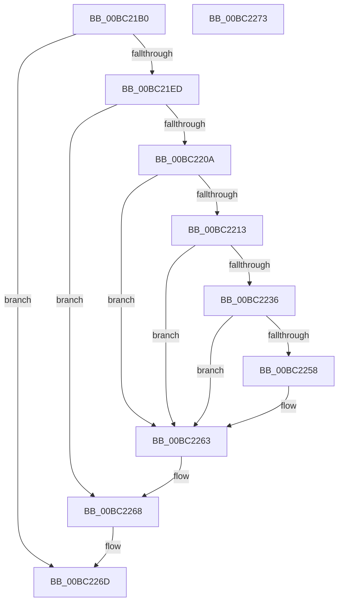

# AnFwpBackgroundUpdateTimer

- RVA: `0x00BC21B0`–`0x00BC2274` (길이 `196` bytes)
- VA: `0x0000000140BC21B0`
- 실행 섹션: `PAGEBGFX`
- PDB 이름 있음: `예`; PDB Function 태그: `아니요`
- unwind 정보 RVA: `0x00064C80`
- 디코드: `46`개 명령, `196/196` bytes 표시
- 미해석 바이트: `0` (있으면 어셈블리에 `.byte`로 보존)

> 이 문서는 커널 이미지의 기계어와 PDB 기호를 분석해 생성했습니다. 4번과 5번은 함수 원형과 자료형을 바이너리 사용 방식에서 추정한 C 해석이며 원본 소스 복구 결과는 아닙니다.

## 1. Dependencies

- 직접 호출 지점: **10**; 고유 호출 대상: **9**
- 직접 호출자로 확인된 함수: **0**
- RIP 상대 이미지 참조: **7**

### Outgoing calls
- `0x00BC21CE` → `indirect target` (indirect, 간접 대상)
- `0x00BC21E0` → [RtlULongLongMult](../../text/43/RtlULongLongMult_function_0043E530.md) (function, `0x0043E530`)
- `0x00BC21FC` → [BgpFwAcquireLock](../../text/4B/BgpFwAcquireLock_function_004B3AA4.md) (function, `0x004B3AA4`)
- `0x00BC2213` → [AnFwpDisableProgressTimer](AnFwpDisableProgressTimer_function_00BC3CB4.md) (function, `0x00BC3CB4`)
- `0x00BC2227` → [DbgPrintEx](../../text/35/DbgPrintEx_function_00359290.md) (function, `0x00359290`)
- `0x00BC223C` → [BgpClearScreen](../../text/69/BgpClearScreen_function_0069EAB0.md) (function, `0x0069EAB0`)
- `0x00BC224F` → [BgpGxDrawBitmapImage](BgpGxDrawBitmapImage_function_00BC26EC.md) (function, `0x00BC26EC`)
- `0x00BC225E` → [BgpClearScreen](../../text/69/BgpClearScreen_function_0069EAB0.md) (function, `0x0069EAB0`)
- `0x00BC2263` → [AnFwDisableBackgroundUpdateTimer](AnFwDisableBackgroundUpdateTimer_function_00BC008C.md) (function, `0x00BC008C`)
- `0x00BC2268` → [BgpFwReleaseLock](../../text/4B/BgpFwReleaseLock_function_004B357C.md) (function, `0x004B357C`)

### Direct callers
- 이 함수 시작 RVA로 연결되는 직접 call은 확인되지 않았습니다. 간접 호출은 완전히 역산할 수 없습니다.

### Static image references
- `0x00BC21B6` → RVA `0x00E00A50` (`.data`; read)
- `0x00BC2201` → RVA `0x00EF04F0` (`.data`; read)
- `0x00BC220A` → RVA `0x00EEFEE0` (`.data`; read)
- `0x00BC221A` → RVA `0x00BC5E00` (` ?? ::CIJCHKMG::`string'`; read)
- `0x00BC222C` → RVA `0x00EF0498` (`.data`; read)
- `0x00BC2236` → RVA `0x00EF05D4` (`.data`; read)
- `0x00BC2248` → RVA `0x00EF04AC` (`.data`; read)

## 2. Other-region calls and transfers

- 다른 실행 섹션으로 향하는 call: **6**
  - `0x00BC21E0` → [RtlULongLongMult](../../text/43/RtlULongLongMult_function_0043E530.md) (`PAGEBGFX` → `.text`)
  - `0x00BC21FC` → [BgpFwAcquireLock](../../text/4B/BgpFwAcquireLock_function_004B3AA4.md) (`PAGEBGFX` → `.text`)
  - `0x00BC2227` → [DbgPrintEx](../../text/35/DbgPrintEx_function_00359290.md) (`PAGEBGFX` → `.text`)
  - `0x00BC223C` → [BgpClearScreen](../../text/69/BgpClearScreen_function_0069EAB0.md) (`PAGEBGFX` → `.text`)
  - `0x00BC225E` → [BgpClearScreen](../../text/69/BgpClearScreen_function_0069EAB0.md) (`PAGEBGFX` → `.text`)
  - `0x00BC2268` → [BgpFwReleaseLock](../../text/4B/BgpFwReleaseLock_function_004B357C.md) (`PAGEBGFX` → `.text`)
- 별도 외부 분기/꼬리 이동을 확인하지 못했습니다.

## 3. Assembly (complete function range)

```asm
00BC21B0  40 53                           push rbx
00BC21B2  48 83 EC 30                     sub rsp, 0x30
00BC21B6  48 8B 05 93 E8 23 00            mov rax, qword ptr [rip + 0x23e893]
00BC21BD  48 8D 4C 24 28                  lea rcx, [rsp + 0x28]
00BC21C2  48 83 64 24 20 00               and qword ptr [rsp + 0x20], 0
00BC21C8  48 83 64 24 28 00               and qword ptr [rsp + 0x28], 0
00BC21CE  FF D0                           call rax
00BC21D0  0F 1F 00                        nop dword ptr [rax]
00BC21D3  4C 8D 44 24 20                  lea r8, [rsp + 0x20]
00BC21D8  BA E8 03 00 00                  mov edx, 0x3e8
00BC21DD  48 8B C8                        mov rcx, rax
00BC21E0  E8 4B C3 87 FF                  call 0x14043e530
00BC21E5  85 C0                           test eax, eax
00BC21E7  0F 88 80 00 00 00               js 0x140bc226d
00BC21ED  48 8B 44 24 20                  mov rax, qword ptr [rsp + 0x20]
00BC21F2  33 D2                           xor edx, edx
00BC21F4  48 F7 74 24 28                  div qword ptr [rsp + 0x28]
00BC21F9  48 8B D8                        mov rbx, rax
00BC21FC  E8 A3 18 8F FF                  call 0x1404b3aa4
00BC2201  48 3B 1D E8 E2 32 00            cmp rbx, qword ptr [rip + 0x32e2e8]
00BC2208  72 5E                           jb 0x140bc2268
00BC220A  80 3D CF DC 32 00 00            cmp byte ptr [rip + 0x32dccf], 0
00BC2211  74 50                           je 0x140bc2263
00BC2213  E8 9C 1A 00 00                  call 0x140bc3cb4
00BC2218  33 D2                           xor edx, edx
00BC221A  4C 8D 05 DF 3B 00 00            lea r8, [rip + 0x3bdf]
00BC2221  44 8B CB                        mov r9d, ebx
00BC2224  8D 4A 65                        lea ecx, [rdx + 0x65]
00BC2227  E8 64 70 79 FF                  call 0x140359290
00BC222C  48 83 3D 64 E2 32 00 00         cmp qword ptr [rip + 0x32e264], 0
00BC2234  74 2D                           je 0x140bc2263
00BC2236  8B 0D 98 E3 32 00               mov ecx, dword ptr [rip + 0x32e398]
00BC223C  E8 6F C8 AD FF                  call 0x14069eab0
00BC2241  48 8B 0D 50 E2 32 00            mov rcx, qword ptr [rip + 0x32e250]
00BC2248  48 8D 15 5D E2 32 00            lea rdx, [rip + 0x32e25d]
00BC224F  E8 98 04 00 00                  call 0x140bc26ec
00BC2254  85 C0                           test eax, eax
00BC2256  79 0B                           jns 0x140bc2263
00BC2258  8B 0D 76 E3 32 00               mov ecx, dword ptr [rip + 0x32e376]
00BC225E  E8 4D C8 AD FF                  call 0x14069eab0
00BC2263  E8 24 DE FF FF                  call 0x140bc008c
00BC2268  E8 0F 13 8F FF                  call 0x1404b357c
00BC226D  48 83 C4 30                     add rsp, 0x30
00BC2271  5B                              pop rbx
00BC2272  C3                              ret
00BC2273  CC                              int3
```

## 4. C-style interpretation (structured pseudocode)

```c
__int64 __fastcall AnFwpBackgroundUpdateTimer(void)
{
    __int64 result;
    __int64 v_rsp;
    unsigned __int64 v_stack_m10;
    unsigned __int64 v_stack_m18;

    v_rsp = (v_rsp) - (48);
    result = kernel_indirect_call(v_stack_m10, a2, a3, a4);
    result = RtlULongLongMult(result, 1000, v_stack_m18, a4);
    if (sign_flag) goto loc_00BC226D;
    a2 = 0;
    result = BgpFwAcquireLock(result, a2, v_stack_m18, a4);
    if (v_stack_m18 < (*(unsigned __int64 *)(v_rip + 3334888))) goto loc_00BC2268;
    if ((*(unsigned __int8 *)(v_rip + 3333327)) == 0) goto loc_00BC2263;
    result = AnFwpDisableProgressTimer(result, a2, v_stack_m18, a4);
    a2 = 0;
    result = DbgPrintEx(a2 + 101, a2, v_rip + 15327, (unsigned int)((unsigned int)(v_stack_m18)));
    if ((*(unsigned __int64 *)(v_rip + 3334756)) == 0) goto loc_00BC2263;
    result = BgpClearScreen((unsigned int)(*(unsigned int *)(v_rip + 3335064)), a2, v_rip + 15327, (unsigned int)((unsigned int)(v_stack_m18)));
    result = BgpGxDrawBitmapImage(*(unsigned __int64 *)(v_rip + 3334736), v_rip + 3334749, v_rip + 15327, (unsigned int)((unsigned int)(v_stack_m18)));
    if (sign_flag) {
        a1 = *(unsigned int *)(v_rip + 3335030);
        result = BgpClearScreen(a1, v_rip + 3334749, v_rip + 15327, (unsigned int)((unsigned int)(v_stack_m18)));
    }
    result = AnFwDisableBackgroundUpdateTimer(a1, v_rip + 3334749, v_rip + 15327, (unsigned int)((unsigned int)(v_stack_m18)));
loc_00BC2268:
    result = BgpFwReleaseLock(a1, v_rip + 3334749, v_rip + 15327, (unsigned int)((unsigned int)(v_stack_m18)));
loc_00BC226D:
    v_rsp = (v_rsp) + (48);
    return result;
}
```

## 5. (Beta) C Style

```c
void AnFwpBackgroundUpdateTimer(void)
{
    int64_t result;
    int64_t local_rsp;
    uint64_t v_stack_m10;
    uint64_t v_stack_m18;

    local_rsp = (local_rsp) - (48);
    result = kernel_indirect_call(v_stack_m10, a2, a3, a4);
    result = RtlULongLongMult(result, 1000, v_stack_m18, a4);
    if (sign_flag) goto loc_00BC226D;
    a2 = 0;
    result = BgpFwAcquireLock(result, a2, v_stack_m18, a4);
    if (v_stack_m18 < (*(uint64_t *)(v_rip + 0x32E2E8))) goto loc_00BC2268;
    if ((*(uint8_t *)(v_rip + 0x32DCCF)) == 0) goto loc_00BC2263;
    result = AnFwpDisableProgressTimer(result, a2, v_stack_m18, a4);
    a2 = 0;
    result = DbgPrintEx(a2 + 101, a2, v_rip + 15327, (uint32_t)((uint32_t)(v_stack_m18)));
    if ((*(uint64_t *)(v_rip + 0x32E264)) == 0) goto loc_00BC2263;
    result = BgpClearScreen((uint32_t)(*(uint32_t *)(v_rip + 0x32E398)), a2, v_rip + 15327, (uint32_t)((uint32_t)(v_stack_m18)));
    result = BgpGxDrawBitmapImage(*(uint64_t *)(v_rip + 0x32E250), v_rip + 3334749, v_rip + 15327, (uint32_t)((uint32_t)(v_stack_m18)));
    if (sign_flag) {
        a1 = *(uint32_t *)(v_rip + 0x32E376);
        result = BgpClearScreen(a1, v_rip + 3334749, v_rip + 15327, (uint32_t)((uint32_t)(v_stack_m18)));
    }
    result = AnFwDisableBackgroundUpdateTimer(a1, v_rip + 3334749, v_rip + 15327, (uint32_t)((uint32_t)(v_stack_m18)));
loc_00BC2268:
    result = BgpFwReleaseLock(a1, v_rip + 3334749, v_rip + 15327, (uint32_t)((uint32_t)(v_stack_m18)));
loc_00BC226D:
    local_rsp = (local_rsp) + (48);
    return result;
}
```

## 6. Execution-region graph

[열기: 2D/3D 그래프와 함수 탐색 컨트롤 패널](../../../control-panel.html?section=pagebgfx&rva=0x00BC21B0&view=graph)

- 2D 그래프는 위에서 아래로 흐르고, 3D 그래프는 빈 공간을 드래그해 회전합니다. Shift+드래그는 이동, 휠은 확대·축소, 함수 노드 선택은 대상 보고서 이동입니다.

### Static fallback


