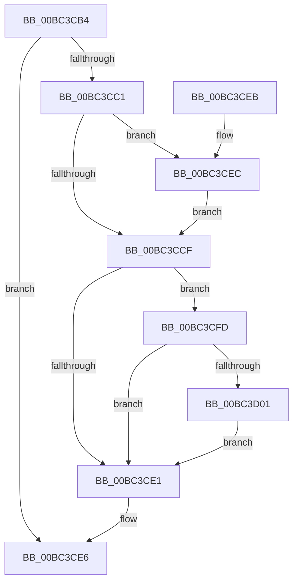

# AnFwpDisableProgressTimer

- RVA: `0x00BC3CB4`–`0x00BC3D0F` (길이 `91` bytes)
- VA: `0x0000000140BC3CB4`
- 실행 섹션: `PAGEBGFX`
- PDB 이름 있음: `예`; PDB Function 태그: `아니요`
- unwind 정보 RVA: `0x000841D0`
- 디코드: `26`개 명령, `91/91` bytes 표시
- 미해석 바이트: `0` (있으면 어셈블리에 `.byte`로 보존)

> 이 문서는 커널 이미지의 기계어와 PDB 기호를 분석해 생성했습니다. 4번과 5번은 함수 원형과 자료형을 바이너리 사용 방식에서 추정한 C 해석이며 원본 소스 복구 결과는 아닙니다.

## 1. Dependencies

- 직접 호출 지점: **2**; 고유 호출 대상: **2**
- 직접 호출자로 확인된 함수: **3**
- RIP 상대 이미지 참조: **4**

### Outgoing calls
- `0x00BC3CE1` → [BgpTxtCacheDestroy](BgpTxtCacheDestroy_function_00BC4354.md) (function, `0x00BC4354`)
- `0x00BC3D08` → [KeCancelTimer](../../text/23/KeCancelTimer_function_002327E0.md) (function, `0x002327E0`)

### Direct callers
- [AnFwDisplayProgressIndicator](AnFwDisplayProgressIndicator_function_00BC1FD0.md) at `0x00BC216C`
- [AnFwpBackgroundUpdateTimer](AnFwpBackgroundUpdateTimer_function_00BC21B0.md) at `0x00BC2213`
- [AnFwDisplayFade](AnFwDisplayFade_function_00BC36EC.md) at `0x00BC3805`
- [AnFwDisplayFade](AnFwDisplayFade_function_00BC36EC.md) at `0x00BC3C7D`

### Static image references
- `0x00BC3CB8` → RVA `0x00EEFEE1` (`.data`; read)
- `0x00BC3CC1` → RVA `0x00EF0450` (`.data`; read)
- `0x00BC3CD4` → RVA `0x00EEFEE1` (`.data`; write)
- `0x00BC3D01` → RVA `0x00E65040` (`.data`; read)

## 2. Other-region calls and transfers

- 다른 실행 섹션으로 향하는 call: **1**
  - `0x00BC3D08` → [KeCancelTimer](../../text/23/KeCancelTimer_function_002327E0.md) (`PAGEBGFX` → `.text`)
- 별도 외부 분기/꼬리 이동을 확인하지 못했습니다.

## 3. Assembly (complete function range)

```asm
00BC3CB4  48 83 EC 28                     sub rsp, 0x28
00BC3CB8  80 3D 22 C2 32 00 00            cmp byte ptr [rip + 0x32c222], 0
00BC3CBF  74 25                           je 0x140bc3ce6
00BC3CC1  8B 05 89 C7 32 00               mov eax, dword ptr [rip + 0x32c789]
00BC3CC7  32 C9                           xor cl, cl
00BC3CC9  0F BA E0 14                     bt eax, 0x14
00BC3CCD  72 1D                           jb 0x140bc3cec
00BC3CCF  BA 00 0C 00 00                  mov edx, 0xc00
00BC3CD4  C6 05 06 C2 32 00 00            mov byte ptr [rip + 0x32c206], 0
00BC3CDB  23 C2                           and eax, edx
00BC3CDD  3B C2                           cmp eax, edx
00BC3CDF  75 1C                           jne 0x140bc3cfd
00BC3CE1  E8 6E 06 00 00                  call 0x140bc4354
00BC3CE6  48 83 C4 28                     add rsp, 0x28
00BC3CEA  C3                              ret
00BC3CEB  CC                              int3
00BC3CEC  0F BA E0 0C                     bt eax, 0xc
00BC3CF0  0F B6 C9                        movzx ecx, cl
00BC3CF3  BA 01 00 00 00                  mov edx, 1
00BC3CF8  0F 42 CA                        cmovb ecx, edx
00BC3CFB  EB D2                           jmp 0x140bc3ccf
00BC3CFD  84 C9                           test cl, cl
00BC3CFF  75 E0                           jne 0x140bc3ce1
00BC3D01  48 8D 0D 38 13 2A 00            lea rcx, [rip + 0x2a1338]
00BC3D08  E8 D3 EA 66 FF                  call 0x1402327e0
00BC3D0D  EB D2                           jmp 0x140bc3ce1
```

## 4. C-style interpretation (structured pseudocode)

```c
__int64 __fastcall AnFwpDisableProgressTimer(unsigned __int8 a1)
{
    __int64 result;
    __int64 v_rsp;

    v_rsp = (v_rsp) - (40);
    if ((*(unsigned __int8 *)(v_rip + 3326498)) == 0) goto loc_00BC3CE6;
    a1 = 0;
    if (condition_is_below) goto loc_00BC3CEC;
loc_00BC3CCF:
    *(unsigned __int8 *)(v_rip + 3326470) = 0;
    result = (unsigned int)(((unsigned int)(*(unsigned int *)(v_rip + 3327881))) & ((unsigned int)((unsigned int)(0xC00ULL))));
    if (((unsigned int)(result)) != ((unsigned int)((unsigned int)(0xC00ULL)))) goto loc_00BC3CFD;
loc_00BC3CE1:
    result = BgpTxtCacheDestroy(a1, (unsigned int)(0xC00ULL), a3, a4);
loc_00BC3CE6:
    v_rsp = (v_rsp) + (40);
    return result;
loc_00BC3CEC:
    a1 = 0;
    if (condition_is_below) { a1 = 1; }
    goto loc_00BC3CCF;
loc_00BC3CFD:
    if (a1 != 0) goto loc_00BC3CE1;
    result = KeCancelTimer(v_rip + 2757432, 1, a3, a4);
    goto loc_00BC3CE1;
}
```

## 5. (Beta) C Style

```c
int64_t AnFwpDisableProgressTimer(uint8_t Arg1)
{
    int64_t result;
    int64_t local_rsp;

    local_rsp = (local_rsp) - (40);
    if ((*(uint8_t *)(v_rip + 0x32C222)) == 0) goto loc_00BC3CE6;
    Arg1 = 0;
    if (condition_is_below) goto loc_00BC3CEC;
loc_00BC3CCF:
    *(uint8_t *)(v_rip + 0x32C206) = 0;
    result = (uint32_t)(((uint32_t)(*(uint32_t *)(v_rip + 0x32C789))) & ((uint32_t)((uint32_t)(0xC00ULL))));
    if (((uint32_t)(result)) != ((uint32_t)((uint32_t)(0xC00ULL)))) goto loc_00BC3CFD;
loc_00BC3CE1:
    result = BgpTxtCacheDestroy(Arg1, (uint32_t)(0xC00ULL), a3, a4);
loc_00BC3CE6:
    local_rsp = (local_rsp) + (40);
    return result;
loc_00BC3CEC:
    Arg1 = 0;
    if (condition_is_below) { Arg1 = 1; }
    goto loc_00BC3CCF;
loc_00BC3CFD:
    if (Arg1 != 0) goto loc_00BC3CE1;
    result = KeCancelTimer(v_rip + 2757432, 1, a3, a4);
    goto loc_00BC3CE1;
}
```

## 6. Execution-region graph

[열기: 2D/3D 그래프와 함수 탐색 컨트롤 패널](../../../control-panel.html?section=pagebgfx&rva=0x00BC3CB4&view=graph)

- 2D 그래프는 위에서 아래로 흐르고, 3D 그래프는 빈 공간을 드래그해 회전합니다. Shift+드래그는 이동, 휠은 확대·축소, 함수 노드 선택은 대상 보고서 이동입니다.

### Static fallback


