# AnFwpFadeAnimationTimer

- RVA: `0x00BC2F50`–`0x00BC33F4` (길이 `1,188` bytes)
- VA: `0x0000000140BC2F50`
- 실행 섹션: `PAGEBGFX`
- PDB 이름 있음: `예`; PDB Function 태그: `예`
- unwind 정보 RVA: `0x000A7FE4`
- 디코드: `285`개 명령, `1,188/1,188` bytes 표시
- 미해석 바이트: `0` (있으면 어셈블리에 `.byte`로 보존)

> 이 문서는 커널 이미지의 기계어와 PDB 기호를 분석해 생성했습니다. 4번과 5번은 함수 원형과 자료형을 바이너리 사용 방식에서 추정한 C 해석이며 원본 소스 복구 결과는 아닙니다.

## 1. Dependencies

- 직접 호출 지점: **17**; 고유 호출 대상: **7**
- 직접 호출자로 확인된 함수: **0**
- RIP 상대 이미지 참조: **41**

### Outgoing calls
- `0x00BC2F72` → [BgpFwAcquireLock](../../text/4B/BgpFwAcquireLock_function_004B3AA4.md) (function, `0x004B3AA4`)
- `0x00BC2F85` → [BgpFwQueryPerformanceCounter](../../text/4C/BgpFwQueryPerformanceCounter_function_004C0614.md) (function, `0x004C0614`)
- `0x00BC2F9A` → [BgpFwQueryPerformanceCounter](../../text/4C/BgpFwQueryPerformanceCounter_function_004C0614.md) (function, `0x004C0614`)
- `0x00BC302A` → [BgpGetBitsPerPixel](../../text/48/BgpGetBitsPerPixel_function_0048CDA0.md) (function, `0x0048CDA0`)
- `0x00BC30CA` → [BgpFwQueryPerformanceCounter](../../text/4C/BgpFwQueryPerformanceCounter_function_004C0614.md) (function, `0x004C0614`)
- `0x00BC30D8` → [BgpFwQueryPerformanceCounter](../../text/4C/BgpFwQueryPerformanceCounter_function_004C0614.md) (function, `0x004C0614`)
- `0x00BC30F4` → [BgpFwQueryPerformanceCounter](../../text/4C/BgpFwQueryPerformanceCounter_function_004C0614.md) (function, `0x004C0614`)
- `0x00BC3116` → [BgpGxDrawRectangle](../../text/48/BgpGxDrawRectangle_function_0048C91C.md) (function, `0x0048C91C`)
- `0x00BC3144` → [BgpGxDrawRectangle](../../text/48/BgpGxDrawRectangle_function_0048C91C.md) (function, `0x0048C91C`)
- `0x00BC315C` → [BgpFwQueryPerformanceCounter](../../text/4C/BgpFwQueryPerformanceCounter_function_004C0614.md) (function, `0x004C0614`)
- `0x00BC316A` → [BgpFwQueryPerformanceCounter](../../text/4C/BgpFwQueryPerformanceCounter_function_004C0614.md) (function, `0x004C0614`)
- `0x00BC3189` → [BgpFwQueryPerformanceCounter](../../text/4C/BgpFwQueryPerformanceCounter_function_004C0614.md) (function, `0x004C0614`)
- `0x00BC3197` → [BgpFwQueryPerformanceCounter](../../text/4C/BgpFwQueryPerformanceCounter_function_004C0614.md) (function, `0x004C0614`)
- `0x00BC321B` → [BgpFwReleaseLock](../../text/4B/BgpFwReleaseLock_function_004B357C.md) (function, `0x004B357C`)
- `0x00BC336C` → [BgpGxDrawRectangle](../../text/48/BgpGxDrawRectangle_function_0048C91C.md) (function, `0x0048C91C`)
- `0x00BC33D9` → [KeCancelTimer](../../text/23/KeCancelTimer_function_002327E0.md) (function, `0x002327E0`)
- `0x00BC33EA` → [KeSetEvent](../../text/33/KeSetEvent_function_0033F310.md) (function, `0x0033F310`)

### Direct callers
- 이 함수 시작 RVA로 연결되는 직접 call은 확인되지 않았습니다. 간접 호출은 완전히 역산할 수 없습니다.

### Static image references
- `0x00BC2F77` → RVA `0x00EEFEE2` (`.data`; read)
- `0x00BC2F8C` → RVA `0x00EEFF48` (`.data`; write)
- `0x00BC2F93` → RVA `0x00E65150` (`.data`; write)
- `0x00BC2F9F` → RVA `0x00E0EEC4` (`.data`; read)
- `0x00BC2FA5` → RVA `0x00EF0454` (`.data`; read)
- `0x00BC2FAB` → RVA `0x00E0EEC0` (`.data`; read)
- `0x00BC2FB4` → RVA `0x00E0EF08` (`.data`; read)
- `0x00BC2FBB` → RVA `0x00E0EF18` (`.data`; read)
- `0x00BC2FC2` → RVA `0x00E0EF50` (`.data`; read)
- `0x00BC2FC9` → RVA `0x00E0EED0` (`.data`; read)
- `0x00BC2FD0` → RVA `0x00E0EED1` (`.data`; read)
- `0x00BC2FD7` → RVA `0x00E0EED2` (`.data`; read)
- `0x00BC2FDE` → RVA `0x00E0EED8` (`.data`; read)
- `0x00BC2FE5` → RVA `0x00E0EF48` (`.data`; read)
- `0x00BC2FF3` → RVA `0x00E65140` (`.data`; write)
- `0x00BC2FFA` → RVA `0x00E0EEC8` (`.data`; read)
- `0x00BC30DD` → RVA `0x00E65140` (`.data`; read)
- `0x00BC30E6` → RVA `0x00EEFFB0` (`.data`; read/write)
- `0x00BC30ED` → RVA `0x00EEFFA0` (`.data`; write)
- `0x00BC3100` → RVA `0x00E65138` (`.data`; write)
- `0x00BC313D` → RVA `0x00E0EEE0` (`.data`; read)
- `0x00BC316F` → RVA `0x00E65138` (`.data`; read)
- `0x00BC317B` → RVA `0x00EEFFB8` (`.data`; read/write)
- `0x00BC319C` → RVA `0x00E65150` (`.data`; read)
- `0x00BC31A3` → RVA `0x00E0F118` (`.data`; read)
- `0x00BC31B3` → RVA `0x00E0F118` (`.data`; write)
- `0x00BC31BA` → RVA `0x00EEFF30` (`.data`; read)
- `0x00BC31C3` → RVA `0x00EEFF30` (`.data`; write)
- `0x00BC31CA` → RVA `0x00EEFF58` (`.data`; read/write)
- `0x00BC31D1` → RVA `0x00EEFF50` (`.data`; read/write)
- `0x00BC31DD` → RVA `0x00EEFF38` (`.data`; read/write)
- `0x00BC31F0` → RVA `0x00E0EED0` (`.data`; write)
- `0x00BC31FE` → RVA `0x00E0EED1` (`.data`; write)
- `0x00BC3208` → RVA `0x00E0EEC0` (`.data`; write)
- `0x00BC320E` → RVA `0x00E0EEC4` (`.data`; write)
- `0x00BC3214` → RVA `0x00E0EED2` (`.data`; write)
- `0x00BC32DE` → RVA `0x00E0EF10` (`.data`; read)
- `0x00BC3365` → RVA `0x00E0EF20` (`.data`; read)
- `0x00BC33CB` → RVA `0x00E65080` (`.data`; read)
- `0x00BC33D2` → RVA `0x00EEFEE2` (`.data`; write)
- `0x00BC33E1` → RVA `0x00E65100` (`.data`; read)

## 2. Other-region calls and transfers

- 다른 실행 섹션으로 향하는 call: **17**
  - `0x00BC2F72` → [BgpFwAcquireLock](../../text/4B/BgpFwAcquireLock_function_004B3AA4.md) (`PAGEBGFX` → `.text`)
  - `0x00BC2F85` → [BgpFwQueryPerformanceCounter](../../text/4C/BgpFwQueryPerformanceCounter_function_004C0614.md) (`PAGEBGFX` → `.text`)
  - `0x00BC2F9A` → [BgpFwQueryPerformanceCounter](../../text/4C/BgpFwQueryPerformanceCounter_function_004C0614.md) (`PAGEBGFX` → `.text`)
  - `0x00BC302A` → [BgpGetBitsPerPixel](../../text/48/BgpGetBitsPerPixel_function_0048CDA0.md) (`PAGEBGFX` → `.text`)
  - `0x00BC30CA` → [BgpFwQueryPerformanceCounter](../../text/4C/BgpFwQueryPerformanceCounter_function_004C0614.md) (`PAGEBGFX` → `.text`)
  - `0x00BC30D8` → [BgpFwQueryPerformanceCounter](../../text/4C/BgpFwQueryPerformanceCounter_function_004C0614.md) (`PAGEBGFX` → `.text`)
  - `0x00BC30F4` → [BgpFwQueryPerformanceCounter](../../text/4C/BgpFwQueryPerformanceCounter_function_004C0614.md) (`PAGEBGFX` → `.text`)
  - `0x00BC3116` → [BgpGxDrawRectangle](../../text/48/BgpGxDrawRectangle_function_0048C91C.md) (`PAGEBGFX` → `.text`)
  - `0x00BC3144` → [BgpGxDrawRectangle](../../text/48/BgpGxDrawRectangle_function_0048C91C.md) (`PAGEBGFX` → `.text`)
  - `0x00BC315C` → [BgpFwQueryPerformanceCounter](../../text/4C/BgpFwQueryPerformanceCounter_function_004C0614.md) (`PAGEBGFX` → `.text`)
  - `0x00BC316A` → [BgpFwQueryPerformanceCounter](../../text/4C/BgpFwQueryPerformanceCounter_function_004C0614.md) (`PAGEBGFX` → `.text`)
  - `0x00BC3189` → [BgpFwQueryPerformanceCounter](../../text/4C/BgpFwQueryPerformanceCounter_function_004C0614.md) (`PAGEBGFX` → `.text`)
  - `0x00BC3197` → [BgpFwQueryPerformanceCounter](../../text/4C/BgpFwQueryPerformanceCounter_function_004C0614.md) (`PAGEBGFX` → `.text`)
  - `0x00BC321B` → [BgpFwReleaseLock](../../text/4B/BgpFwReleaseLock_function_004B357C.md) (`PAGEBGFX` → `.text`)
  - `0x00BC336C` → [BgpGxDrawRectangle](../../text/48/BgpGxDrawRectangle_function_0048C91C.md) (`PAGEBGFX` → `.text`)
  - `0x00BC33D9` → [KeCancelTimer](../../text/23/KeCancelTimer_function_002327E0.md) (`PAGEBGFX` → `.text`)
  - `0x00BC33EA` → [KeSetEvent](../../text/33/KeSetEvent_function_0033F310.md) (`PAGEBGFX` → `.text`)
- call이 아닌 외부 분기/꼬리 이동: **3**
  - `0x00BC3383` → [sub_00BC6540 + 0x2E](Unknown_function_00BC6540.md) (`tail-transfer`)
  - `0x00BC339D` → [sub_00BC6540](Unknown_function_00BC6540.md) (`tail-transfer`)
  - `0x00BC33A3` → [sub_00BC6540 + 0x24](Unknown_function_00BC6540.md) (`tail-transfer`)

## 3. Assembly (complete function range)

```asm
00BC2F50  48 8B C4                        mov rax, rsp
00BC2F53  48 89 58 08                     mov qword ptr [rax + 8], rbx
00BC2F57  48 89 68 10                     mov qword ptr [rax + 0x10], rbp
00BC2F5B  48 89 70 18                     mov qword ptr [rax + 0x18], rsi
00BC2F5F  57                              push rdi
00BC2F60  41 54                           push r12
00BC2F62  41 55                           push r13
00BC2F64  41 56                           push r14
00BC2F66  41 57                           push r15
00BC2F68  48 83 EC 50                     sub rsp, 0x50
00BC2F6C  33 DB                           xor ebx, ebx
00BC2F6E  48 89 58 C0                     mov qword ptr [rax - 0x40], rbx
00BC2F72  E8 2D 0B 8F FF                  call 0x1404b3aa4
00BC2F77  38 1D 65 CF 32 00               cmp byte ptr [rip + 0x32cf65], bl
00BC2F7D  0F 84 98 02 00 00               je 0x140bc321b
00BC2F83  33 C9                           xor ecx, ecx
00BC2F85  E8 8A D6 8F FF                  call 0x1404c0614
00BC2F8A  33 C9                           xor ecx, ecx
00BC2F8C  48 89 05 B5 CF 32 00            mov qword ptr [rip + 0x32cfb5], rax
00BC2F93  48 89 05 B6 21 2A 00            mov qword ptr [rip + 0x2a21b6], rax
00BC2F9A  E8 75 D6 8F FF                  call 0x1404c0614
00BC2F9F  8B 15 1F BF 24 00               mov edx, dword ptr [rip + 0x24bf1f]
00BC2FA5  8B 0D A9 D4 32 00               mov ecx, dword ptr [rip + 0x32d4a9]
00BC2FAB  44 8B 05 0E BF 24 00            mov r8d, dword ptr [rip + 0x24bf0e]
00BC2FB2  2B CA                           sub ecx, edx
00BC2FB4  4C 8B 0D 4D BF 24 00            mov r9, qword ptr [rip + 0x24bf4d]
00BC2FBB  48 8B 3D 56 BF 24 00            mov rdi, qword ptr [rip + 0x24bf56]
00BC2FC2  4C 8B 1D 87 BF 24 00            mov r11, qword ptr [rip + 0x24bf87]
00BC2FC9  44 8A 2D 00 BF 24 00            mov r13b, byte ptr [rip + 0x24bf00]
00BC2FD0  44 8A 25 FA BE 24 00            mov r12b, byte ptr [rip + 0x24befa]
00BC2FD7  0F B6 2D F4 BE 24 00            movzx ebp, byte ptr [rip + 0x24bef4]
00BC2FDE  4C 8B 15 F3 BE 24 00            mov r10, qword ptr [rip + 0x24bef3]
00BC2FE5  4C 8B 35 5C BF 24 00            mov r14, qword ptr [rip + 0x24bf5c]
00BC2FEC  48 89 05 55 CF 32 00            mov qword ptr [rip + 0x32cf55], rax
00BC2FF3  48 89 05 46 21 2A 00            mov qword ptr [rip + 0x2a2146], rax
00BC2FFA  48 8B 05 C7 BE 24 00            mov rax, qword ptr [rip + 0x24bec7]
00BC3001  48 89 44 24 38                  mov qword ptr [rsp + 0x38], rax
00BC3006  41 8B C0                        mov eax, r8d
00BC3009  89 54 24 20                     mov dword ptr [rsp + 0x20], edx
00BC300D  33 D2                           xor edx, edx
00BC300F  F7 F1                           div ecx
00BC3011  4C 89 4C 24 28                  mov qword ptr [rsp + 0x28], r9
00BC3016  44 2B C0                        sub r8d, eax
00BC3019  48 89 7C 24 40                  mov qword ptr [rsp + 0x40], rdi
00BC301E  4C 89 5C 24 30                  mov qword ptr [rsp + 0x30], r11
00BC3023  47 8D 3C 80                     lea r15d, [r8 + r8*4]
00BC3027  45 03 FF                        add r15d, r15d
00BC302A  E8 71 9D 8C FF                  call 0x14048cda0
00BC302F  83 F8 18                        cmp eax, 0x18
00BC3032  0F 84 46 03 00 00               je 0x140bc337e
00BC3038  33 F6                           xor esi, esi
00BC303A  40 84 ED                        test bpl, bpl
00BC303D  0F 84 9B 02 00 00               je 0x140bc32de
00BC3043  33 FF                           xor edi, edi
00BC3045  45 84 ED                        test r13b, r13b
00BC3048  75 73                           jne 0x140bc30bd
00BC304A  49 8B 59 18                     mov rbx, qword ptr [r9 + 0x18]
00BC304E  45 33 C9                        xor r9d, r9d
00BC3051  4D 8B 5A 18                     mov r11, qword ptr [r10 + 0x18]
00BC3055  41 39 7A 0C                     cmp dword ptr [r10 + 0xc], edi
00BC3059  76 62                           jbe 0x140bc30bd
00BC305B  43 83 3C 19 00                  cmp dword ptr [r9 + r11], 0
00BC3060  74 51                           je 0x140bc30b3
00BC3062  43 0F B6 04 19                  movzx eax, byte ptr [r9 + r11]
00BC3067  41 8D 51 02                     lea edx, [r9 + 2]
00BC306B  41 0F AF C7                     imul eax, r15d
00BC306F  44 8D 47 01                     lea r8d, [rdi + 1]
00BC3073  C1 E8 0A                        shr eax, 0xa
00BC3076  85 C0                           test eax, eax
00BC3078  41 88 04 19                     mov byte ptr [r9 + rbx], al
00BC307C  8D 42 FF                        lea eax, [rdx - 1]
00BC307F  44 0F 44 C7                     cmove r8d, edi
00BC3083  8B C8                           mov ecx, eax
00BC3085  42 0F B6 04 18                  movzx eax, byte ptr [rax + r11]
00BC308A  41 0F AF C7                     imul eax, r15d
00BC308E  41 8D 78 01                     lea edi, [r8 + 1]
00BC3092  C1 E8 0A                        shr eax, 0xa
00BC3095  88 04 19                        mov byte ptr [rcx + rbx], al
00BC3098  85 C0                           test eax, eax
00BC309A  42 0F B6 0C 1A                  movzx ecx, byte ptr [rdx + r11]
00BC309F  41 0F 44 F8                     cmove edi, r8d
00BC30A3  41 0F AF CF                     imul ecx, r15d
00BC30A7  C1 E9 0A                        shr ecx, 0xa
00BC30AA  88 0C 1A                        mov byte ptr [rdx + rbx], cl
00BC30AD  85 C9                           test ecx, ecx
00BC30AF  74 02                           je 0x140bc30b3
00BC30B1  FF C7                           inc edi
00BC30B3  41 83 C1 04                     add r9d, 4
00BC30B7  45 3B 4A 0C                     cmp r9d, dword ptr [r10 + 0xc]
00BC30BB  72 9E                           jb 0x140bc305b
00BC30BD  33 DB                           xor ebx, ebx
00BC30BF  45 84 E4                        test r12b, r12b
00BC30C2  0F 84 93 01 00 00               je 0x140bc325b
00BC30C8  33 C9                           xor ecx, ecx
00BC30CA  E8 45 D5 8F FF                  call 0x1404c0614
00BC30CF  33 C9                           xor ecx, ecx
00BC30D1  48 89 05 70 CE 32 00            mov qword ptr [rip + 0x32ce70], rax
00BC30D8  E8 37 D5 8F FF                  call 0x1404c0614
00BC30DD  48 2B 05 5C 20 2A 00            sub rax, qword ptr [rip + 0x2a205c]
00BC30E4  33 C9                           xor ecx, ecx
00BC30E6  48 01 05 C3 CE 32 00            add qword ptr [rip + 0x32cec3], rax
00BC30ED  48 89 05 AC CE 32 00            mov qword ptr [rip + 0x32ceac], rax
00BC30F4  E8 1B D5 8F FF                  call 0x1404c0614
00BC30F9  48 89 05 48 CE 32 00            mov qword ptr [rip + 0x32ce48], rax
00BC3100  48 89 05 31 20 2A 00            mov qword ptr [rip + 0x2a2031], rax
00BC3107  40 84 ED                        test bpl, bpl
00BC310A  75 19                           jne 0x140bc3125
00BC310C  48 8B 4C 24 40                  mov rcx, qword ptr [rsp + 0x40]
00BC3111  48 8D 54 24 38                  lea rdx, [rsp + 0x38]
00BC3116  E8 01 98 8C FF                  call 0x14048c91c
00BC311B  85 F6                           test esi, esi
00BC311D  B8 01 00 00 00                  mov eax, 1
00BC3122  0F 44 E8                        cmove ebp, eax
00BC3125  44 8B 74 24 20                  mov r14d, dword ptr [rsp + 0x20]
00BC312A  45 84 ED                        test r13b, r13b
00BC312D  75 22                           jne 0x140bc3151
00BC312F  45 85 F6                        test r14d, r14d
00BC3132  0F 84 70 02 00 00               je 0x140bc33a8
00BC3138  48 8B 4C 24 28                  mov rcx, qword ptr [rsp + 0x28]
00BC313D  48 8D 15 9C BD 24 00            lea rdx, [rip + 0x24bd9c]
00BC3144  E8 D3 97 8C FF                  call 0x14048c91c
00BC3149  85 FF                           test edi, edi
00BC314B  0F 84 5F 02 00 00               je 0x140bc33b0
00BC3151  45 84 E4                        test r12b, r12b
00BC3154  0F 84 E5 00 00 00               je 0x140bc323f
00BC315A  33 C9                           xor ecx, ecx
00BC315C  E8 B3 D4 8F FF                  call 0x1404c0614
00BC3161  33 C9                           xor ecx, ecx
00BC3163  48 89 05 DE CD 32 00            mov qword ptr [rip + 0x32cdde], rax
00BC316A  E8 A5 D4 8F FF                  call 0x1404c0614
00BC316F  48 2B 05 C2 1F 2A 00            sub rax, qword ptr [rip + 0x2a1fc2]
00BC3176  48 8D 4C 24 40                  lea rcx, [rsp + 0x40]
00BC317B  48 01 05 36 CE 32 00            add qword ptr [rip + 0x32ce36], rax
00BC3182  48 89 05 17 CE 32 00            mov qword ptr [rip + 0x32ce17], rax
00BC3189  E8 86 D4 8F FF                  call 0x1404c0614
00BC318E  33 C9                           xor ecx, ecx
00BC3190  48 89 05 B1 CD 32 00            mov qword ptr [rip + 0x32cdb1], rax
00BC3197  E8 78 D4 8F FF                  call 0x1404c0614
00BC319C  48 2B 05 AD 1F 2A 00            sub rax, qword ptr [rip + 0x2a1fad]
00BC31A3  48 3B 05 6E BF 24 00            cmp rax, qword ptr [rip + 0x24bf6e]
00BC31AA  48 89 05 EF CD 32 00            mov qword ptr [rip + 0x32cdef], rax
00BC31B1  7D 07                           jge 0x140bc31ba
00BC31B3  48 89 05 5E BF 24 00            mov qword ptr [rip + 0x24bf5e], rax
00BC31BA  48 3B 05 6F CD 32 00            cmp rax, qword ptr [rip + 0x32cd6f]
00BC31C1  7E 07                           jle 0x140bc31ca
00BC31C3  48 89 05 66 CD 32 00            mov qword ptr [rip + 0x32cd66], rax
00BC31CA  48 01 05 87 CD 32 00            add qword ptr [rip + 0x32cd87], rax
00BC31D1  48 01 05 78 CD 32 00            add qword ptr [rip + 0x32cd78], rax
00BC31D8  B8 01 00 00 00                  mov eax, 1
00BC31DD  01 05 55 CD 32 00               add dword ptr [rip + 0x32cd55], eax
00BC31E3  85 F6                           test esi, esi
00BC31E5  0F 84 D0 01 00 00               je 0x140bc33bb
00BC31EB  B8 CD CC CC CC                  mov eax, 0xcccccccd
00BC31F0  44 88 2D D9 BC 24 00            mov byte ptr [rip + 0x24bcd9], r13b
00BC31F7  41 F7 E7                        mul r15d
00BC31FA  41 8D 46 01                     lea eax, [r14 + 1]
00BC31FE  44 88 25 CC BC 24 00            mov byte ptr [rip + 0x24bccc], r12b
00BC3205  C1 EA 03                        shr edx, 3
00BC3208  89 15 B2 BC 24 00               mov dword ptr [rip + 0x24bcb2], edx
00BC320E  89 05 B0 BC 24 00               mov dword ptr [rip + 0x24bcb0], eax
00BC3214  40 88 2D B7 BC 24 00            mov byte ptr [rip + 0x24bcb7], bpl
00BC321B  E8 5C 03 8F FF                  call 0x1404b357c
00BC3220  4C 8D 5C 24 50                  lea r11, [rsp + 0x50]
00BC3225  49 8B 5B 30                     mov rbx, qword ptr [r11 + 0x30]
00BC3229  49 8B 6B 38                     mov rbp, qword ptr [r11 + 0x38]
00BC322D  49 8B 73 40                     mov rsi, qword ptr [r11 + 0x40]
00BC3231  49 8B E3                        mov rsp, r11
00BC3234  41 5F                           pop r15
00BC3236  41 5E                           pop r14
00BC3238  41 5D                           pop r13
00BC323A  41 5C                           pop r12
00BC323C  5F                              pop rdi
00BC323D  C3                              ret
00BC323E  CC                              int3
00BC323F  45 85 F6                        test r14d, r14d
00BC3242  0F 85 18 01 00 00               jne 0x140bc3360
00BC3248  85 DB                           test ebx, ebx
00BC324A  0F 85 10 01 00 00               jne 0x140bc3360
00BC3250  41 BC 01 00 00 00               mov r12d, 1
00BC3256  E9 FF FE FF FF                  jmp 0x140bc315a
00BC325B  4C 8B 5C 24 30                  mov r11, qword ptr [rsp + 0x30]
00BC3260  45 33 C9                        xor r9d, r9d
00BC3263  4D 8B 56 18                     mov r10, qword ptr [r14 + 0x18]
00BC3267  4D 8B 5B 18                     mov r11, qword ptr [r11 + 0x18]
00BC326B  41 39 5E 0C                     cmp dword ptr [r14 + 0xc], ebx
00BC326F  0F 86 53 FE FF FF               jbe 0x140bc30c8
00BC3275  43 83 3C 11 00                  cmp dword ptr [r9 + r10], 0
00BC327A  74 53                           je 0x140bc32cf
00BC327C  43 0F B6 04 11                  movzx eax, byte ptr [r9 + r10]
00BC3281  41 8D 51 02                     lea edx, [r9 + 2]
00BC3285  41 0F AF C7                     imul eax, r15d
00BC3289  44 8D 43 01                     lea r8d, [rbx + 1]
00BC328D  C1 E8 0A                        shr eax, 0xa
00BC3290  85 C0                           test eax, eax
00BC3292  43 88 04 19                     mov byte ptr [r9 + r11], al
00BC3296  8D 42 FF                        lea eax, [rdx - 1]
00BC3299  44 0F 44 C3                     cmove r8d, ebx
00BC329D  8B C8                           mov ecx, eax
00BC329F  42 0F B6 04 10                  movzx eax, byte ptr [rax + r10]
00BC32A4  41 0F AF C7                     imul eax, r15d
00BC32A8  41 8D 58 01                     lea ebx, [r8 + 1]
00BC32AC  C1 E8 0A                        shr eax, 0xa
00BC32AF  42 88 04 19                     mov byte ptr [rcx + r11], al
00BC32B3  85 C0                           test eax, eax
00BC32B5  42 0F B6 0C 12                  movzx ecx, byte ptr [rdx + r10]
00BC32BA  41 0F 44 D8                     cmove ebx, r8d
00BC32BE  41 0F AF CF                     imul ecx, r15d
00BC32C2  C1 E9 0A                        shr ecx, 0xa
00BC32C5  42 88 0C 1A                     mov byte ptr [rdx + r11], cl
00BC32C9  85 C9                           test ecx, ecx
00BC32CB  74 02                           je 0x140bc32cf
00BC32CD  FF C3                           inc ebx
00BC32CF  41 83 C1 04                     add r9d, 4
00BC32D3  45 3B 4E 0C                     cmp r9d, dword ptr [r14 + 0xc]
00BC32D7  72 9C                           jb 0x140bc3275
00BC32D9  E9 EA FD FF FF                  jmp 0x140bc30c8
00BC32DE  4C 8B 1D 2B BC 24 00            mov r11, qword ptr [rip + 0x24bc2b]
00BC32E5  45 33 C9                        xor r9d, r9d
00BC32E8  48 8B 7F 18                     mov rdi, qword ptr [rdi + 0x18]
00BC32EC  49 8B 5B 18                     mov rbx, qword ptr [r11 + 0x18]
00BC32F0  41 39 73 0C                     cmp dword ptr [r11 + 0xc], esi
00BC32F4  76 60                           jbe 0x140bc3356
00BC32F6  41 83 3C 19 00                  cmp dword ptr [r9 + rbx], 0
00BC32FB  74 4F                           je 0x140bc334c
00BC32FD  41 0F B6 04 19                  movzx eax, byte ptr [r9 + rbx]
00BC3302  41 8D 51 02                     lea edx, [r9 + 2]
00BC3306  41 0F AF C7                     imul eax, r15d
00BC330A  44 8D 46 01                     lea r8d, [rsi + 1]
00BC330E  C1 E8 0A                        shr eax, 0xa
00BC3311  85 C0                           test eax, eax
00BC3313  41 88 04 39                     mov byte ptr [r9 + rdi], al
00BC3317  8D 42 FF                        lea eax, [rdx - 1]
00BC331A  44 0F 44 C6                     cmove r8d, esi
00BC331E  8B C8                           mov ecx, eax
00BC3320  0F B6 04 18                     movzx eax, byte ptr [rax + rbx]
00BC3324  41 0F AF C7                     imul eax, r15d
00BC3328  41 8D 70 01                     lea esi, [r8 + 1]
00BC332C  C1 E8 0A                        shr eax, 0xa
00BC332F  88 04 39                        mov byte ptr [rcx + rdi], al
00BC3332  85 C0                           test eax, eax
00BC3334  0F B6 0C 1A                     movzx ecx, byte ptr [rdx + rbx]
00BC3338  41 0F 44 F0                     cmove esi, r8d
00BC333C  41 0F AF CF                     imul ecx, r15d
00BC3340  C1 E9 0A                        shr ecx, 0xa
00BC3343  88 0C 3A                        mov byte ptr [rdx + rdi], cl
00BC3346  85 C9                           test ecx, ecx
00BC3348  74 02                           je 0x140bc334c
00BC334A  FF C6                           inc esi
00BC334C  41 83 C1 04                     add r9d, 4
00BC3350  45 3B 4B 0C                     cmp r9d, dword ptr [r11 + 0xc]
00BC3354  72 A0                           jb 0x140bc32f6
00BC3356  4C 8B 4C 24 28                  mov r9, qword ptr [rsp + 0x28]
00BC335B  E9 E3 FC FF FF                  jmp 0x140bc3043
00BC3360  48 8B 4C 24 30                  mov rcx, qword ptr [rsp + 0x30]
00BC3365  48 8D 15 B4 BB 24 00            lea rdx, [rip + 0x24bbb4]
00BC336C  E8 AB 95 8C FF                  call 0x14048c91c
00BC3371  85 DB                           test ebx, ebx
00BC3373  0F 84 D7 FE FF FF               je 0x140bc3250
00BC3379  E9 DC FD FF FF                  jmp 0x140bc315a
00BC337E  8B F3                           mov esi, ebx
00BC3380  40 84 ED                        test bpl, bpl
00BC3383  0F 85 E5 31 00 00               jne 0x140bc656e
00BC3389  48 8B 15 80 BB 24 00            mov rdx, qword ptr [rip + 0x24bb80]
00BC3390  8B CB                           mov ecx, ebx
00BC3392  4C 8B 5F 18                     mov r11, qword ptr [rdi + 0x18]
00BC3396  4C 8B 4A 18                     mov r9, qword ptr [rdx + 0x18]
00BC339A  39 5A 0C                        cmp dword ptr [rdx + 0xc], ebx
00BC339D  0F 87 9D 31 00 00               ja 0x140bc6540
00BC33A3  E9 BC 31 00 00                  jmp 0x140bc6564
00BC33A8  85 FF                           test edi, edi
00BC33AA  0F 85 88 FD FF FF               jne 0x140bc3138
00BC33B0  41 BD 01 00 00 00               mov r13d, 1
00BC33B6  E9 96 FD FF FF                  jmp 0x140bc3151
00BC33BB  85 DB                           test ebx, ebx
00BC33BD  0F 85 28 FE FF FF               jne 0x140bc31eb
00BC33C3  85 FF                           test edi, edi
00BC33C5  0F 85 20 FE FF FF               jne 0x140bc31eb
00BC33CB  48 8D 0D AE 1C 2A 00            lea rcx, [rip + 0x2a1cae]
00BC33D2  40 88 3D 09 CB 32 00            mov byte ptr [rip + 0x32cb09], dil
00BC33D9  E8 02 F4 66 FF                  call 0x1402327e0
00BC33DE  45 33 C0                        xor r8d, r8d
00BC33E1  48 8D 0D 18 1D 2A 00            lea rcx, [rip + 0x2a1d18]
00BC33E8  33 D2                           xor edx, edx
00BC33EA  E8 21 BF 77 FF                  call 0x14033f310
00BC33EF  E9 27 FE FF FF                  jmp 0x140bc321b
```

## 4. C-style interpretation (structured pseudocode)

```c
__int64 __fastcall AnFwpFadeAnimationTimer(int a1)
{
    __int64 result;
    __int64 v_r15;
    __int64 v_rbp;
    __int64 v_rbx;
    __int64 v_rdi;
    __int64 v_rsi;
    __int64 v_rsp;
    unsigned __int64 v_stack_m20;
    unsigned __int64 v_stack_m28;
    unsigned __int64 v_stack_m38;
    unsigned __int64 v_stack_m40;
    unsigned __int64 v_stack_m48;
    unsigned __int64 v_stack_m50;
    unsigned int v_stack_m58;

    *(unsigned __int64 *)(v_rsp + 8) = v_rbx;
    *(unsigned __int64 *)(v_rsp + 16) = v_rbp;
    *(unsigned __int64 *)(v_rsp + 24) = v_rsi;
    v_rsp = (v_rsp) - (80);
    v_rbx = 0;
    *(unsigned __int64 *)(v_rsp - 64) = 0;
    result = BgpFwAcquireLock(a1, a2, a3, a4);
    if ((*(unsigned __int8 *)(v_rip + 3329893)) == 0) goto loc_00BC321B;
    a1 = 0;
    result = BgpFwQueryPerformanceCounter(a1, a2, a3, a4);
    a1 = 0;
    *(unsigned __int64 *)(v_rip + 3329973) = result;
    *(unsigned __int64 *)(v_rip + 2761142) = result;
    result = BgpFwQueryPerformanceCounter(a1, a2, a3, a4);
    a1 = (unsigned int)(((unsigned int)(*(unsigned int *)(v_rip + 3331241))) - ((unsigned int)((unsigned int)(*(unsigned int *)(v_rip + 2408223)))));
    *(unsigned __int64 *)(v_rip + 3329877) = result;
    *(unsigned __int64 *)(v_rip + 2761030) = result;
    v_stack_m40 = *(unsigned __int64 *)(v_rip + 2408135);
    v_stack_m58 = (unsigned int)((unsigned int)(*(unsigned int *)(v_rip + 2408223)));
    a2 = 0;
    v_stack_m50 = *(unsigned __int64 *)(v_rip + 2408269);
    a3 = (unsigned int)(((unsigned int)(*(unsigned int *)(v_rip + 2408206))) - ((unsigned int)((unsigned int)((unsigned int)((unsigned int)(*(unsigned int *)(v_rip + 2408206)))))));
    v_stack_m38 = *(unsigned __int64 *)(v_rip + 2408278);
    v_stack_m48 = *(unsigned __int64 *)(v_rip + 2408327);
    v_r15 = (unsigned int)((a3 + a3 * 4) + ((unsigned int)(a3 + a3 * 4)));
    result = BgpGetBitsPerPixel(a1, a2, a3, *(unsigned __int64 *)(v_rip + 2408269));
    if (((unsigned int)(result)) == 24) goto loc_00BC337E;
    v_rsi = 0;
    if ((unsigned __int8)(*(unsigned __int8 *)(v_rip + 2408180)) == 0) goto loc_00BC32DE;
loc_00BC3043:
    v_rdi = 0;
    if ((unsigned __int8)(*(unsigned __int8 *)(v_rip + 2408192)) != 0) goto loc_00BC30BD;
    a4 = 0;
    if ((*(unsigned int *)(*(unsigned __int64 *)(v_rip + 2408179) + 12)) <= 0) goto loc_00BC30BD;
loc_00BC305B:
    if ((*(unsigned int *)(a4 + *(unsigned __int64 *)(*(unsigned __int64 *)(v_rip + 2408179) + 24) * 1)) == 0) goto loc_00BC30B3;
    result = (unsigned int)((*(unsigned __int8 *)(a4 + *(unsigned __int64 *)(*(unsigned __int64 *)(v_rip + 2408179) + 24) * 1)) * ((unsigned int)(v_r15)));
    result = (unsigned int)((result) >> (10));
    *(unsigned __int8 *)(a4 + *(unsigned __int64 *)(*(unsigned __int64 *)(v_rip + 2408269) + 24) * 1) = (unsigned __int8)(result);
    a3 = v_rdi + 1;
    if ((unsigned int)(result) == 0) { a3 = 0; }
    result = (unsigned int)((*(unsigned __int8 *)(a4 + 2 - 1 + *(unsigned __int64 *)(*(unsigned __int64 *)(v_rip + 2408179) + 24) * 1)) * ((unsigned int)(v_r15)));
    result = (unsigned int)((result) >> (10));
    *(unsigned __int8 *)((unsigned int)((unsigned int)(a4 + 2 - 1)) + *(unsigned __int64 *)(*(unsigned __int64 *)(v_rip + 2408269) + 24) * 1) = (unsigned __int8)(result);
    v_rdi = a3 + 1;
    if ((unsigned int)(result) == 0) { v_rdi = (unsigned int)(a3); }
    a1 = (unsigned int)((*(unsigned __int8 *)(a4 + 2 + *(unsigned __int64 *)(*(unsigned __int64 *)(v_rip + 2408179) + 24) * 1)) * ((unsigned int)(v_r15)));
    a1 = (unsigned int)((a1) >> (10));
    *(unsigned __int8 *)(a4 + 2 + *(unsigned __int64 *)(*(unsigned __int64 *)(v_rip + 2408269) + 24) * 1) = (unsigned __int8)(a1);
    if (a1 != 0) {
        v_rdi = (unsigned int)((v_rdi) + 1);
    }
    a4 = (unsigned int)((a4) + (4));
    if (((unsigned int)(a4)) < (*(unsigned int *)(*(unsigned __int64 *)(v_rip + 2408179) + 12))) goto loc_00BC305B;
loc_00BC30BD:
    v_rbx = 0;
    if ((unsigned __int8)(*(unsigned __int8 *)(v_rip + 2408186)) == 0) goto loc_00BC325B;
loc_00BC30C8:
    a1 = 0;
    result = BgpFwQueryPerformanceCounter(a1, a4 + 2, a3, a4);
    a1 = 0;
    *(unsigned __int64 *)(v_rip + 3329648) = result;
    result = BgpFwQueryPerformanceCounter(a1, a4 + 2, a3, a4);
    result = (result) - (*(unsigned __int64 *)(v_rip + 2760796));
    a1 = 0;
    *(unsigned __int64 *)(v_rip + 3329708) = result;
    result = BgpFwQueryPerformanceCounter(a1, a4 + 2, a3, a4);
    *(unsigned __int64 *)(v_rip + 3329608) = result;
    *(unsigned __int64 *)(v_rip + 2760753) = result;
    v_rbp = *(unsigned __int8 *)(v_rip + 2408180);
    if ((unsigned __int8)(*(unsigned __int8 *)(v_rip + 2408180)) == 0) {
        a1 = v_stack_m38;
        a2 = v_stack_m40;
        result = BgpGxDrawRectangle(a1, a2, a3, a4);
        result = 1;
        v_rbp = *(unsigned __int8 *)(v_rip + 2408180);
        if (0 == 0) { v_rbp = (unsigned int)(result); }
    }
    if ((unsigned __int8)(*(unsigned __int8 *)(v_rip + 2408192)) != 0) goto loc_00BC3151;
    if ((unsigned int)((unsigned int)(v_stack_m58)) == 0) goto loc_00BC33A8;
loc_00BC3138:
    result = BgpGxDrawRectangle(v_stack_m50, v_rip + 2407836, a3, a4);
    if ((unsigned int)(v_rdi) == 0) goto loc_00BC33B0;
loc_00BC3151:
    if ((unsigned __int8)(*(unsigned __int8 *)(v_rip + 2408186)) == 0) goto loc_00BC323F;
loc_00BC315A:
    a1 = 0;
    result = BgpFwQueryPerformanceCounter(a1, v_rip + 2407836, a3, a4);
    a1 = 0;
    *(unsigned __int64 *)(v_rip + 3329502) = result;
    result = BgpFwQueryPerformanceCounter(a1, v_rip + 2407836, a3, a4);
    result = (result) - (*(unsigned __int64 *)(v_rip + 2760642));
    *(unsigned __int64 *)(v_rip + 3329559) = result;
    result = BgpFwQueryPerformanceCounter(v_stack_m38, v_rip + 2407836, a3, a4);
    a1 = 0;
    *(unsigned __int64 *)(v_rip + 3329457) = result;
    result = BgpFwQueryPerformanceCounter(a1, v_rip + 2407836, a3, a4);
    result = (result) - (*(unsigned __int64 *)(v_rip + 2760621));
    *(unsigned __int64 *)(v_rip + 3329519) = result;
    if (result < (*(unsigned __int64 *)(v_rip + 2408302))) {
        *(unsigned __int64 *)(v_rip + 2408286) = result;
    }
    if (result >= = (*(unsigned __int64 *)(v_rip + 3329391))) {
        *(unsigned __int64 *)(v_rip + 3329382) = result;
    }
    if (0 == 0) goto loc_00BC33BB;
loc_00BC31EB:
    *(unsigned __int8 *)(v_rip + 2407641) = (unsigned __int8)(*(unsigned __int8 *)(v_rip + 2408192));
    *(unsigned __int8 *)(v_rip + 2407628) = (unsigned __int8)(*(unsigned __int8 *)(v_rip + 2408186));
    a2 = (unsigned int)((v_rip + 2407836) >> (3));
    *(unsigned int *)(v_rip + 2407602) = (unsigned int)(a2);
    *(unsigned int *)(v_rip + 2407600) = (unsigned int)((unsigned int)(v_stack_m58) + 1);
    *(unsigned __int8 *)(v_rip + 2407607) = (unsigned __int8)(v_rbp);
loc_00BC321B:
    result = BgpFwReleaseLock(a1, a2, a3, a4);
    return result;
loc_00BC323F:
    if ((unsigned int)((unsigned int)(v_stack_m58)) != 0) goto loc_00BC3360;
    if ((unsigned int)(*(unsigned __int64 *)(v_stack_m28 + 48)) != 0) goto loc_00BC3360;
loc_00BC3250:
    goto loc_00BC315A;
loc_00BC325B:
    a4 = 0;
    if ((*(unsigned int *)((unsigned int)(v_stack_m58) + 12)) <= ((unsigned int)(*(unsigned __int64 *)(v_stack_m28 + 48)))) goto loc_00BC30C8;
loc_00BC3275:
    if ((*(unsigned int *)(a4 + *(unsigned __int64 *)((unsigned int)(v_stack_m58) + 24) * 1)) == 0) goto loc_00BC32CF;
    result = (unsigned int)((*(unsigned __int8 *)(a4 + *(unsigned __int64 *)((unsigned int)(v_stack_m58) + 24) * 1)) * ((unsigned int)(v_r15)));
    result = (unsigned int)((result) >> (10));
    *(unsigned __int8 *)(a4 + *(unsigned __int64 *)(v_stack_m20 + 24) * 1) = (unsigned __int8)(result);
    a3 = *(unsigned __int64 *)(v_stack_m28 + 48) + 1;
    if ((unsigned int)(result) == 0) { a3 = (unsigned int)(*(unsigned __int64 *)(v_stack_m28 + 48)); }
    result = (unsigned int)((*(unsigned __int8 *)(a4 + 2 - 1 + *(unsigned __int64 *)((unsigned int)(v_stack_m58) + 24) * 1)) * ((unsigned int)(v_r15)));
    result = (unsigned int)((result) >> (10));
    *(unsigned __int8 *)((unsigned int)((unsigned int)(a4 + 2 - 1)) + *(unsigned __int64 *)(v_stack_m20 + 24) * 1) = (unsigned __int8)(result);
    v_rbx = a3 + 1;
    if ((unsigned int)(result) == 0) { v_rbx = (unsigned int)(a3); }
    a1 = (unsigned int)((*(unsigned __int8 *)(a4 + 2 + *(unsigned __int64 *)((unsigned int)(v_stack_m58) + 24) * 1)) * ((unsigned int)(v_r15)));
    a1 = (unsigned int)((a1) >> (10));
    *(unsigned __int8 *)(a4 + 2 + *(unsigned __int64 *)(v_stack_m20 + 24) * 1) = (unsigned __int8)(a1);
    if (a1 != 0) {
        v_rbx = (unsigned int)((v_rbx) + 1);
    }
    a4 = (unsigned int)((a4) + (4));
    if (((unsigned int)(a4)) < (*(unsigned int *)((unsigned int)(v_stack_m58) + 12))) goto loc_00BC3275;
    goto loc_00BC30C8;
loc_00BC32DE:
    a4 = 0;
    if ((*(unsigned int *)(*(unsigned __int64 *)(v_rip + 2407467) + 12)) <= ((unsigned int)(*(unsigned __int64 *)(v_stack_m28 + 64)))) goto loc_00BC3356;
loc_00BC32F6:
    if ((*(unsigned int *)(a4 + *(unsigned __int64 *)(*(unsigned __int64 *)(v_rip + 2407467) + 24) * 1)) == 0) goto loc_00BC334C;
    result = (unsigned int)((*(unsigned __int8 *)(a4 + *(unsigned __int64 *)(*(unsigned __int64 *)(v_rip + 2407467) + 24) * 1)) * ((unsigned int)(v_r15)));
    result = (unsigned int)((result) >> (10));
    *(unsigned __int8 *)(a4 + *(unsigned __int64 *)(v_rdi + 24) * 1) = (unsigned __int8)(result);
    a3 = *(unsigned __int64 *)(v_stack_m28 + 64) + 1;
    if ((unsigned int)(result) == 0) { a3 = (unsigned int)(*(unsigned __int64 *)(v_stack_m28 + 64)); }
    result = (unsigned int)((*(unsigned __int8 *)(a4 + 2 - 1 + *(unsigned __int64 *)(*(unsigned __int64 *)(v_rip + 2407467) + 24) * 1)) * ((unsigned int)(v_r15)));
    result = (unsigned int)((result) >> (10));
    *(unsigned __int8 *)((unsigned int)((unsigned int)(a4 + 2 - 1)) + *(unsigned __int64 *)(v_rdi + 24) * 1) = (unsigned __int8)(result);
    v_rsi = a3 + 1;
    if ((unsigned int)(result) == 0) { v_rsi = (unsigned int)(a3); }
    a1 = (unsigned int)((*(unsigned __int8 *)(a4 + 2 + *(unsigned __int64 *)(*(unsigned __int64 *)(v_rip + 2407467) + 24) * 1)) * ((unsigned int)(v_r15)));
    a1 = (unsigned int)((a1) >> (10));
    *(unsigned __int8 *)(a4 + 2 + *(unsigned __int64 *)(v_rdi + 24) * 1) = (unsigned __int8)(a1);
    if (a1 != 0) {
        v_rsi = (unsigned int)((v_rsi) + 1);
    }
    a4 = (unsigned int)((a4) + (4));
    if (((unsigned int)(a4)) < (*(unsigned int *)(*(unsigned __int64 *)(v_rip + 2407467) + 12))) goto loc_00BC32F6;
loc_00BC3356:
    goto loc_00BC3043;
loc_00BC3360:
    result = BgpGxDrawRectangle(v_stack_m20, v_rip + 2407348, a3, v_stack_m28);
    if ((unsigned int)(*(unsigned __int64 *)(*(unsigned __int64 *)(v_rip + 2407467) + 24)) == 0) goto loc_00BC3250;
    goto loc_00BC315A;
loc_00BC337E:
loc_00BC33A8:
    if ((unsigned int)(*(unsigned __int64 *)(v_rdi + 24)) != 0) goto loc_00BC3138;
loc_00BC33B0:
    goto loc_00BC3151;
loc_00BC33BB:
    if ((unsigned int)(*(unsigned __int64 *)(*(unsigned __int64 *)(v_rip + 2407467) + 24)) != 0) goto loc_00BC31EB;
    if ((unsigned int)(*(unsigned __int64 *)(v_rdi + 24)) != 0) goto loc_00BC31EB;
    *(unsigned __int8 *)(v_rip + 3328777) = (unsigned __int8)(*(unsigned __int64 *)(v_rdi + 24));
    result = KeCancelTimer(v_rip + 2759854, *(unsigned __int64 *)(v_rip + 2407296), a3, *(unsigned __int64 *)(*(unsigned __int64 *)(v_rip + 2407296) + 24));
    a3 = 0;
    a2 = 0;
    result = KeSetEvent(v_rip + 2759960, a2, a3, *(unsigned __int64 *)(*(unsigned __int64 *)(v_rip + 2407296) + 24));
    goto loc_00BC321B;
}
```

## 5. (Beta) C Style

```c
int64_t AnFwpFadeAnimationTimer(int32_t Arg1)
{
    int64_t result;
    int64_t local_r15;
    int64_t local_rbp;
    int64_t local_rbx;
    int64_t local_rdi;
    int64_t local_rsi;
    int64_t local_rsp;
    uint64_t v_stack_m20;
    uint64_t v_stack_m28;
    uint64_t v_stack_m38;
    uint64_t v_stack_m40;
    uint64_t v_stack_m48;
    uint64_t v_stack_m50;
    uint32_t v_stack_m58;

    *(uint64_t *)(local_rsp + 0x8) = local_rbx;
    *(uint64_t *)(local_rsp + 0x10) = local_rbp;
    *(uint64_t *)(local_rsp + 0x18) = local_rsi;
    local_rsp = (local_rsp) - (80);
    local_rbx = 0;
    *(uint64_t *)(local_rsp - 0x40) = 0;
    result = BgpFwAcquireLock(Arg1, a2, a3, a4);
    if ((*(uint8_t *)(v_rip + 0x32CF65)) == 0) goto loc_00BC321B;
    Arg1 = 0;
    result = BgpFwQueryPerformanceCounter(Arg1, a2, a3, a4);
    Arg1 = 0;
    *(uint64_t *)(v_rip + 0x32CFB5) = result;
    *(uint64_t *)(v_rip + 0x2A21B6) = result;
    result = BgpFwQueryPerformanceCounter(Arg1, a2, a3, a4);
    Arg1 = (uint32_t)(((uint32_t)(*(uint32_t *)(v_rip + 0x32D4A9))) - ((uint32_t)((uint32_t)(*(uint32_t *)(v_rip + 0x24BF1F)))));
    *(uint64_t *)(v_rip + 0x32CF55) = result;
    *(uint64_t *)(v_rip + 0x2A2146) = result;
    v_stack_m40 = *(uint64_t *)(v_rip + 0x24BEC7);
    v_stack_m58 = (uint32_t)((uint32_t)(*(uint32_t *)(v_rip + 0x24BF1F)));
    a2 = 0;
    v_stack_m50 = *(uint64_t *)(v_rip + 0x24BF4D);
    a3 = (uint32_t)(((uint32_t)(*(uint32_t *)(v_rip + 0x24BF0E))) - ((uint32_t)((uint32_t)((uint32_t)((uint32_t)(*(uint32_t *)(v_rip + 0x24BF0E)))))));
    v_stack_m38 = *(uint64_t *)(v_rip + 0x24BF56);
    v_stack_m48 = *(uint64_t *)(v_rip + 0x24BF87);
    local_r15 = (uint32_t)((a3 + a3 * 4) + ((uint32_t)(a3 + a3 * 4)));
    result = BgpGetBitsPerPixel(Arg1, a2, a3, *(uint64_t *)(v_rip + 0x24BF4D));
    if (((uint32_t)(result)) == 24) goto loc_00BC337E;
    local_rsi = 0;
    if ((uint8_t)(*(uint8_t *)(v_rip + 0x24BEF4)) == 0) goto loc_00BC32DE;
loc_00BC3043:
    local_rdi = 0;
    if ((uint8_t)(*(uint8_t *)(v_rip + 0x24BF00)) != 0) goto loc_00BC30BD;
    a4 = 0;
    if ((*(uint32_t *)(*(uint64_t *)(v_rip + 0x24BEF3) + 0xC)) <= 0) goto loc_00BC30BD;
loc_00BC305B:
    if ((*(uint32_t *)(a4 + *(uint64_t *)(*(uint64_t *)(v_rip + 0x24BEF3) + 0x18) * 1)) == 0) goto loc_00BC30B3;
    result = (uint32_t)((*(uint8_t *)(a4 + *(uint64_t *)(*(uint64_t *)(v_rip + 0x24BEF3) + 0x18) * 1)) * ((uint32_t)(local_r15)));
    result = (uint32_t)((result) >> (10));
    *(uint8_t *)(a4 + *(uint64_t *)(*(uint64_t *)(v_rip + 0x24BF4D) + 0x18) * 1) = (uint8_t)(result);
    a3 = local_rdi + 1;
    if ((uint32_t)(result) == 0) { a3 = 0; }
    result = (uint32_t)((*(uint8_t *)(a4 + 0x2 - 0x1 + *(uint64_t *)(*(uint64_t *)(v_rip + 0x24BEF3) + 0x18) * 1)) * ((uint32_t)(local_r15)));
    result = (uint32_t)((result) >> (10));
    *(uint8_t *)((uint32_t)((uint32_t)(a4 + 0x2 - 0x1)) + *(uint64_t *)(*(uint64_t *)(v_rip + 0x24BF4D) + 0x18) * 1) = (uint8_t)(result);
    local_rdi = a3 + 1;
    if ((uint32_t)(result) == 0) { local_rdi = (uint32_t)(a3); }
    Arg1 = (uint32_t)((*(uint8_t *)(a4 + 0x2 + *(uint64_t *)(*(uint64_t *)(v_rip + 0x24BEF3) + 0x18) * 1)) * ((uint32_t)(local_r15)));
    Arg1 = (uint32_t)((Arg1) >> (10));
    *(uint8_t *)(a4 + 0x2 + *(uint64_t *)(*(uint64_t *)(v_rip + 0x24BF4D) + 0x18) * 1) = (uint8_t)(Arg1);
    if (Arg1 != 0) {
        local_rdi = (uint32_t)((local_rdi) + 1);
    }
    a4 = (uint32_t)((a4) + (4));
    if (((uint32_t)(a4)) < (*(uint32_t *)(*(uint64_t *)(v_rip + 0x24BEF3) + 0xC))) goto loc_00BC305B;
loc_00BC30BD:
    local_rbx = 0;
    if ((uint8_t)(*(uint8_t *)(v_rip + 0x24BEFA)) == 0) goto loc_00BC325B;
loc_00BC30C8:
    Arg1 = 0;
    result = BgpFwQueryPerformanceCounter(Arg1, a4 + 2, a3, a4);
    Arg1 = 0;
    *(uint64_t *)(v_rip + 0x32CE70) = result;
    result = BgpFwQueryPerformanceCounter(Arg1, a4 + 2, a3, a4);
    result = (result) - (*(uint64_t *)(v_rip + 0x2A205C));
    Arg1 = 0;
    *(uint64_t *)(v_rip + 0x32CEAC) = result;
    result = BgpFwQueryPerformanceCounter(Arg1, a4 + 2, a3, a4);
    *(uint64_t *)(v_rip + 0x32CE48) = result;
    *(uint64_t *)(v_rip + 0x2A2031) = result;
    local_rbp = *(uint8_t *)(v_rip + 0x24BEF4);
    if ((uint8_t)(*(uint8_t *)(v_rip + 0x24BEF4)) == 0) {
        Arg1 = v_stack_m38;
        a2 = v_stack_m40;
        result = BgpGxDrawRectangle(Arg1, a2, a3, a4);
        result = 1;
        local_rbp = *(uint8_t *)(v_rip + 0x24BEF4);
        if (0 == 0) { local_rbp = (uint32_t)(result); }
    }
    if ((uint8_t)(*(uint8_t *)(v_rip + 0x24BF00)) != 0) goto loc_00BC3151;
    if ((uint32_t)((uint32_t)(v_stack_m58)) == 0) goto loc_00BC33A8;
loc_00BC3138:
    result = BgpGxDrawRectangle(v_stack_m50, v_rip + 2407836, a3, a4);
    if ((uint32_t)(local_rdi) == 0) goto loc_00BC33B0;
loc_00BC3151:
    if ((uint8_t)(*(uint8_t *)(v_rip + 0x24BEFA)) == 0) goto loc_00BC323F;
loc_00BC315A:
    Arg1 = 0;
    result = BgpFwQueryPerformanceCounter(Arg1, v_rip + 2407836, a3, a4);
    Arg1 = 0;
    *(uint64_t *)(v_rip + 0x32CDDE) = result;
    result = BgpFwQueryPerformanceCounter(Arg1, v_rip + 2407836, a3, a4);
    result = (result) - (*(uint64_t *)(v_rip + 0x2A1FC2));
    *(uint64_t *)(v_rip + 0x32CE17) = result;
    result = BgpFwQueryPerformanceCounter(v_stack_m38, v_rip + 2407836, a3, a4);
    Arg1 = 0;
    *(uint64_t *)(v_rip + 0x32CDB1) = result;
    result = BgpFwQueryPerformanceCounter(Arg1, v_rip + 2407836, a3, a4);
    result = (result) - (*(uint64_t *)(v_rip + 0x2A1FAD));
    *(uint64_t *)(v_rip + 0x32CDEF) = result;
    if (result < (*(uint64_t *)(v_rip + 0x24BF6E))) {
        *(uint64_t *)(v_rip + 0x24BF5E) = result;
    }
    if (result >= = (*(uint64_t *)(v_rip + 0x32CD6F))) {
        *(uint64_t *)(v_rip + 0x32CD66) = result;
    }
    if (0 == 0) goto loc_00BC33BB;
loc_00BC31EB:
    *(uint8_t *)(v_rip + 0x24BCD9) = (uint8_t)(*(uint8_t *)(v_rip + 0x24BF00));
    *(uint8_t *)(v_rip + 0x24BCCC) = (uint8_t)(*(uint8_t *)(v_rip + 0x24BEFA));
    a2 = (uint32_t)((v_rip + 2407836) >> (3));
    *(uint32_t *)(v_rip + 0x24BCB2) = (uint32_t)(a2);
    *(uint32_t *)(v_rip + 0x24BCB0) = (uint32_t)((uint32_t)(v_stack_m58) + 1);
    *(uint8_t *)(v_rip + 0x24BCB7) = (uint8_t)(local_rbp);
loc_00BC321B:
    result = BgpFwReleaseLock(Arg1, a2, a3, a4);
    return result;
loc_00BC323F:
    if ((uint32_t)((uint32_t)(v_stack_m58)) != 0) goto loc_00BC3360;
    if ((uint32_t)(*(uint64_t *)(v_stack_m28 + 0x30)) != 0) goto loc_00BC3360;
loc_00BC3250:
    goto loc_00BC315A;
loc_00BC325B:
    a4 = 0;
    if ((*(uint32_t *)((uint32_t)(v_stack_m58) + 0xC)) <= ((uint32_t)(*(uint64_t *)(v_stack_m28 + 0x30)))) goto loc_00BC30C8;
loc_00BC3275:
    if ((*(uint32_t *)(a4 + *(uint64_t *)((uint32_t)(v_stack_m58) + 0x18) * 1)) == 0) goto loc_00BC32CF;
    result = (uint32_t)((*(uint8_t *)(a4 + *(uint64_t *)((uint32_t)(v_stack_m58) + 0x18) * 1)) * ((uint32_t)(local_r15)));
    result = (uint32_t)((result) >> (10));
    *(uint8_t *)(a4 + *(uint64_t *)(v_stack_m20 + 0x18) * 1) = (uint8_t)(result);
    a3 = *(uint64_t *)(v_stack_m28 + 0x30) + 1;
    if ((uint32_t)(result) == 0) { a3 = (uint32_t)(*(uint64_t *)(v_stack_m28 + 0x30)); }
    result = (uint32_t)((*(uint8_t *)(a4 + 0x2 - 0x1 + *(uint64_t *)((uint32_t)(v_stack_m58) + 0x18) * 1)) * ((uint32_t)(local_r15)));
    result = (uint32_t)((result) >> (10));
    *(uint8_t *)((uint32_t)((uint32_t)(a4 + 0x2 - 0x1)) + *(uint64_t *)(v_stack_m20 + 0x18) * 1) = (uint8_t)(result);
    local_rbx = a3 + 1;
    if ((uint32_t)(result) == 0) { local_rbx = (uint32_t)(a3); }
    Arg1 = (uint32_t)((*(uint8_t *)(a4 + 0x2 + *(uint64_t *)((uint32_t)(v_stack_m58) + 0x18) * 1)) * ((uint32_t)(local_r15)));
    Arg1 = (uint32_t)((Arg1) >> (10));
    *(uint8_t *)(a4 + 0x2 + *(uint64_t *)(v_stack_m20 + 0x18) * 1) = (uint8_t)(Arg1);
    if (Arg1 != 0) {
        local_rbx = (uint32_t)((local_rbx) + 1);
    }
    a4 = (uint32_t)((a4) + (4));
    if (((uint32_t)(a4)) < (*(uint32_t *)((uint32_t)(v_stack_m58) + 0xC))) goto loc_00BC3275;
    goto loc_00BC30C8;
loc_00BC32DE:
    a4 = 0;
    if ((*(uint32_t *)(*(uint64_t *)(v_rip + 0x24BC2B) + 0xC)) <= ((uint32_t)(*(uint64_t *)(v_stack_m28 + 0x40)))) goto loc_00BC3356;
loc_00BC32F6:
    if ((*(uint32_t *)(a4 + *(uint64_t *)(*(uint64_t *)(v_rip + 0x24BC2B) + 0x18) * 1)) == 0) goto loc_00BC334C;
    result = (uint32_t)((*(uint8_t *)(a4 + *(uint64_t *)(*(uint64_t *)(v_rip + 0x24BC2B) + 0x18) * 1)) * ((uint32_t)(local_r15)));
    result = (uint32_t)((result) >> (10));
    *(uint8_t *)(a4 + *(uint64_t *)(local_rdi + 0x18) * 1) = (uint8_t)(result);
    a3 = *(uint64_t *)(v_stack_m28 + 0x40) + 1;
    if ((uint32_t)(result) == 0) { a3 = (uint32_t)(*(uint64_t *)(v_stack_m28 + 0x40)); }
    result = (uint32_t)((*(uint8_t *)(a4 + 0x2 - 0x1 + *(uint64_t *)(*(uint64_t *)(v_rip + 0x24BC2B) + 0x18) * 1)) * ((uint32_t)(local_r15)));
    result = (uint32_t)((result) >> (10));
    *(uint8_t *)((uint32_t)((uint32_t)(a4 + 0x2 - 0x1)) + *(uint64_t *)(local_rdi + 0x18) * 1) = (uint8_t)(result);
    local_rsi = a3 + 1;
    if ((uint32_t)(result) == 0) { local_rsi = (uint32_t)(a3); }
    Arg1 = (uint32_t)((*(uint8_t *)(a4 + 0x2 + *(uint64_t *)(*(uint64_t *)(v_rip + 0x24BC2B) + 0x18) * 1)) * ((uint32_t)(local_r15)));
    Arg1 = (uint32_t)((Arg1) >> (10));
    *(uint8_t *)(a4 + 0x2 + *(uint64_t *)(local_rdi + 0x18) * 1) = (uint8_t)(Arg1);
    if (Arg1 != 0) {
        local_rsi = (uint32_t)((local_rsi) + 1);
    }
    a4 = (uint32_t)((a4) + (4));
    if (((uint32_t)(a4)) < (*(uint32_t *)(*(uint64_t *)(v_rip + 0x24BC2B) + 0xC))) goto loc_00BC32F6;
loc_00BC3356:
    goto loc_00BC3043;
loc_00BC3360:
    result = BgpGxDrawRectangle(v_stack_m20, v_rip + 2407348, a3, v_stack_m28);
    if ((uint32_t)(*(uint64_t *)(*(uint64_t *)(v_rip + 0x24BC2B) + 0x18)) == 0) goto loc_00BC3250;
    goto loc_00BC315A;
loc_00BC337E:
loc_00BC33A8:
    if ((uint32_t)(*(uint64_t *)(local_rdi + 0x18)) != 0) goto loc_00BC3138;
loc_00BC33B0:
    goto loc_00BC3151;
loc_00BC33BB:
    if ((uint32_t)(*(uint64_t *)(*(uint64_t *)(v_rip + 0x24BC2B) + 0x18)) != 0) goto loc_00BC31EB;
    if ((uint32_t)(*(uint64_t *)(local_rdi + 0x18)) != 0) goto loc_00BC31EB;
    *(uint8_t *)(v_rip + 0x32CB09) = (uint8_t)(*(uint64_t *)(local_rdi + 0x18));
    result = KeCancelTimer(v_rip + 2759854, *(uint64_t *)(v_rip + 0x24BB80), a3, *(uint64_t *)(*(uint64_t *)(v_rip + 0x24BB80) + 0x18));
    a3 = 0;
    a2 = 0;
    result = KeSetEvent(v_rip + 2759960, a2, a3, *(uint64_t *)(*(uint64_t *)(v_rip + 0x24BB80) + 0x18));
    goto loc_00BC321B;
}
```

## 6. Execution-region graph

[열기: 2D/3D 그래프와 함수 탐색 컨트롤 패널](../../../control-panel.html?section=pagebgfx&rva=0x00BC2F50&view=graph)

- 2D 그래프는 위에서 아래로 흐르고, 3D 그래프는 빈 공간을 드래그해 회전합니다. Shift+드래그는 이동, 휠은 확대·축소, 함수 노드 선택은 대상 보고서 이동입니다.

### Static fallback

```mermaid
flowchart TD
  bb_00BC2F50[BB_00BC2F50]
  bb_00BC2F83[BB_00BC2F83]
  bb_00BC3038[BB_00BC3038]
  bb_00BC3043[BB_00BC3043]
  bb_00BC304A[BB_00BC304A]
  bb_00BC305B[BB_00BC305B]
  bb_00BC3062[BB_00BC3062]
  bb_00BC30B1[BB_00BC30B1]
  bb_00BC30B3[BB_00BC30B3]
  bb_00BC30BD[BB_00BC30BD]
  bb_00BC30C8[BB_00BC30C8]
  bb_00BC310C[BB_00BC310C]
  bb_00BC3125[BB_00BC3125]
  bb_00BC312F[BB_00BC312F]
  bb_00BC3138[BB_00BC3138]
  bb_00BC3151[BB_00BC3151]
  bb_00BC315A[BB_00BC315A]
  bb_00BC31B3[BB_00BC31B3]
  bb_00BC31BA[BB_00BC31BA]
  bb_00BC31C3[BB_00BC31C3]
  bb_00BC31CA[BB_00BC31CA]
  bb_00BC31EB[BB_00BC31EB]
  bb_00BC321B[BB_00BC321B]
  bb_00BC323E[BB_00BC323E]
  bb_00BC323F[BB_00BC323F]
  bb_00BC3248[BB_00BC3248]
  bb_00BC3250[BB_00BC3250]
  bb_00BC325B[BB_00BC325B]
  bb_00BC3275[BB_00BC3275]
  bb_00BC327C[BB_00BC327C]
  bb_00BC32CD[BB_00BC32CD]
  bb_00BC32CF[BB_00BC32CF]
  bb_00BC32D9[BB_00BC32D9]
  bb_00BC32DE[BB_00BC32DE]
  bb_00BC32F6[BB_00BC32F6]
  bb_00BC32FD[BB_00BC32FD]
  bb_00BC334A[BB_00BC334A]
  bb_00BC334C[BB_00BC334C]
  bb_00BC3356[BB_00BC3356]
  bb_00BC3360[BB_00BC3360]
  bb_00BC3379[BB_00BC3379]
  bb_00BC337E[BB_00BC337E]
  bb_00BC3389[BB_00BC3389]
  bb_00BC33A3[BB_00BC33A3]
  bb_00BC33A8[BB_00BC33A8]
  bb_00BC33B0[BB_00BC33B0]
  bb_00BC33BB[BB_00BC33BB]
  bb_00BC33C3[BB_00BC33C3]
  bb_00BC33CB[BB_00BC33CB]
  bb_00BC2F50 -->|branch| bb_00BC321B
  bb_00BC2F50 -->|fallthrough| bb_00BC2F83
  bb_00BC2F83 -->|branch| bb_00BC337E
  bb_00BC2F83 -->|fallthrough| bb_00BC3038
  bb_00BC3038 -->|branch| bb_00BC32DE
  bb_00BC3038 -->|fallthrough| bb_00BC3043
  bb_00BC3043 -->|branch| bb_00BC30BD
  bb_00BC3043 -->|fallthrough| bb_00BC304A
  bb_00BC304A -->|branch| bb_00BC30BD
  bb_00BC304A -->|fallthrough| bb_00BC305B
  bb_00BC305B -->|branch| bb_00BC30B3
  bb_00BC305B -->|fallthrough| bb_00BC3062
  bb_00BC3062 -->|branch| bb_00BC30B3
  bb_00BC3062 -->|fallthrough| bb_00BC30B1
  bb_00BC30B1 -->|flow| bb_00BC30B3
  bb_00BC30B3 -->|branch| bb_00BC305B
  bb_00BC30B3 -->|fallthrough| bb_00BC30BD
  bb_00BC30BD -->|branch| bb_00BC325B
  bb_00BC30BD -->|fallthrough| bb_00BC30C8
  bb_00BC30C8 -->|branch| bb_00BC3125
  bb_00BC30C8 -->|fallthrough| bb_00BC310C
  bb_00BC310C -->|flow| bb_00BC3125
  bb_00BC3125 -->|branch| bb_00BC3151
  bb_00BC3125 -->|fallthrough| bb_00BC312F
  bb_00BC312F -->|branch| bb_00BC33A8
  bb_00BC312F -->|fallthrough| bb_00BC3138
  bb_00BC3138 -->|branch| bb_00BC33B0
  bb_00BC3138 -->|fallthrough| bb_00BC3151
  bb_00BC3151 -->|branch| bb_00BC323F
  bb_00BC3151 -->|fallthrough| bb_00BC315A
  bb_00BC315A -->|branch| bb_00BC31BA
  bb_00BC315A -->|fallthrough| bb_00BC31B3
  bb_00BC31B3 -->|flow| bb_00BC31BA
  bb_00BC31BA -->|branch| bb_00BC31CA
  bb_00BC31BA -->|fallthrough| bb_00BC31C3
  bb_00BC31C3 -->|flow| bb_00BC31CA
  bb_00BC31CA -->|branch| bb_00BC33BB
  bb_00BC31CA -->|fallthrough| bb_00BC31EB
  bb_00BC31EB -->|flow| bb_00BC321B
  bb_00BC323E -->|flow| bb_00BC323F
  bb_00BC323F -->|branch| bb_00BC3360
  bb_00BC323F -->|fallthrough| bb_00BC3248
  bb_00BC3248 -->|branch| bb_00BC3360
  bb_00BC3248 -->|fallthrough| bb_00BC3250
  bb_00BC3250 -->|branch| bb_00BC315A
  bb_00BC325B -->|branch| bb_00BC30C8
  bb_00BC325B -->|fallthrough| bb_00BC3275
  bb_00BC3275 -->|branch| bb_00BC32CF
  bb_00BC3275 -->|fallthrough| bb_00BC327C
  bb_00BC327C -->|branch| bb_00BC32CF
  bb_00BC327C -->|fallthrough| bb_00BC32CD
  bb_00BC32CD -->|flow| bb_00BC32CF
  bb_00BC32CF -->|branch| bb_00BC3275
  bb_00BC32CF -->|fallthrough| bb_00BC32D9
  bb_00BC32D9 -->|branch| bb_00BC30C8
  bb_00BC32DE -->|branch| bb_00BC3356
  bb_00BC32DE -->|fallthrough| bb_00BC32F6
  bb_00BC32F6 -->|branch| bb_00BC334C
  bb_00BC32F6 -->|fallthrough| bb_00BC32FD
  bb_00BC32FD -->|branch| bb_00BC334C
  bb_00BC32FD -->|fallthrough| bb_00BC334A
  bb_00BC334A -->|flow| bb_00BC334C
  bb_00BC334C -->|branch| bb_00BC32F6
  bb_00BC334C -->|fallthrough| bb_00BC3356
  bb_00BC3356 -->|branch| bb_00BC3043
  bb_00BC3360 -->|branch| bb_00BC3250
  bb_00BC3360 -->|fallthrough| bb_00BC3379
  bb_00BC3379 -->|branch| bb_00BC315A
  bb_00BC337E -->|fallthrough| bb_00BC3389
  bb_00BC3389 -->|fallthrough| bb_00BC33A3
  bb_00BC33A8 -->|branch| bb_00BC3138
  bb_00BC33A8 -->|fallthrough| bb_00BC33B0
  bb_00BC33B0 -->|branch| bb_00BC3151
  bb_00BC33BB -->|branch| bb_00BC31EB
  bb_00BC33BB -->|fallthrough| bb_00BC33C3
  bb_00BC33C3 -->|branch| bb_00BC31EB
  bb_00BC33C3 -->|fallthrough| bb_00BC33CB
  bb_00BC33CB -->|branch| bb_00BC321B
```


