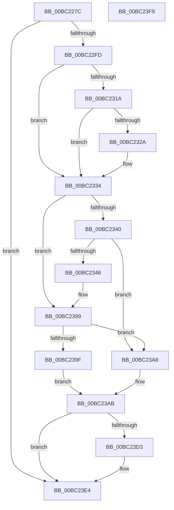

# AnFwpProgressAnimationManual

- RVA: `0x00BC227C`–`0x00BC23FA` (길이 `382` bytes)
- VA: `0x0000000140BC227C`
- 실행 섹션: `PAGEBGFX`
- PDB 이름 있음: `예`; PDB Function 태그: `아니요`
- unwind 정보 RVA: `0x000C7B58`
- 디코드: `95`개 명령, `382/382` bytes 표시
- 미해석 바이트: `0` (있으면 어셈블리에 `.byte`로 보존)

> 이 문서는 커널 이미지의 기계어와 PDB 기호를 분석해 생성했습니다. 4번과 5번은 함수 원형과 자료형을 바이너리 사용 방식에서 추정한 C 해석이며 원본 소스 복구 결과는 아닙니다.

## 1. Dependencies

- 직접 호출 지점: **6**; 고유 호출 대상: **3**
- 직접 호출자로 확인된 함수: **1**
- RIP 상대 이미지 참조: **8**

### Outgoing calls
- `0x00BC2299` → [BgpFwQueryPerformanceCounter](../../text/4C/BgpFwQueryPerformanceCounter_function_004C0614.md) (function, `0x004C0614`)
- `0x00BC234D` → [LogFwStat](LogFwStat_function_00BC4790.md) (function, `0x00BC4790`)
- `0x00BC2372` → [BgpTxtDisplayCharacter](../../text/47/BgpTxtDisplayCharacter_function_0047F120.md) (function, `0x0047F120`)
- `0x00BC237E` → [LogFwStat](LogFwStat_function_00BC4790.md) (function, `0x00BC4790`)
- `0x00BC23C6` → [BgpFwQueryPerformanceCounter](../../text/4C/BgpFwQueryPerformanceCounter_function_004C0614.md) (function, `0x004C0614`)
- `0x00BC23D5` → [BgpFwQueryPerformanceCounter](../../text/4C/BgpFwQueryPerformanceCounter_function_004C0614.md) (function, `0x004C0614`)

### Direct callers
- [AnFwDisplayProgressIndicator](AnFwDisplayProgressIndicator_function_00BC1FD0.md) at `0x00BC2019`

### Static image references
- `0x00BC22E5` → RVA `0x00EEFEE8` (`.data`; read)
- `0x00BC22FD` → RVA `0x00E0EEAC` (`.data`; read)
- `0x00BC2309` → RVA `0x00E0EEB8` (`.data`; read)
- `0x00BC232D` → RVA `0x00E0EEAC` (`.data`; write)
- `0x00BC2334` → RVA `0x00E0EEB4` (`.data`; read)
- `0x00BC235C` → RVA `0x00EF0510` (`.data`; read)
- `0x00BC239F` → RVA `0x00E0EEB0` (`.data`; read)
- `0x00BC23B7` → RVA `0x00EEFEE8` (`.data`; write)

## 2. Other-region calls and transfers

- 다른 실행 섹션으로 향하는 call: **4**
  - `0x00BC2299` → [BgpFwQueryPerformanceCounter](../../text/4C/BgpFwQueryPerformanceCounter_function_004C0614.md) (`PAGEBGFX` → `.text`)
  - `0x00BC2372` → [BgpTxtDisplayCharacter](../../text/47/BgpTxtDisplayCharacter_function_0047F120.md) (`PAGEBGFX` → `.text`)
  - `0x00BC23C6` → [BgpFwQueryPerformanceCounter](../../text/4C/BgpFwQueryPerformanceCounter_function_004C0614.md) (`PAGEBGFX` → `.text`)
  - `0x00BC23D5` → [BgpFwQueryPerformanceCounter](../../text/4C/BgpFwQueryPerformanceCounter_function_004C0614.md) (`PAGEBGFX` → `.text`)
- 별도 외부 분기/꼬리 이동을 확인하지 못했습니다.

## 3. Assembly (complete function range)

```asm
00BC227C  48 8B C4                        mov rax, rsp
00BC227F  48 89 58 10                     mov qword ptr [rax + 0x10], rbx
00BC2283  48 89 68 18                     mov qword ptr [rax + 0x18], rbp
00BC2287  48 89 70 20                     mov qword ptr [rax + 0x20], rsi
00BC228B  57                              push rdi
00BC228C  48 83 EC 40                     sub rsp, 0x40
00BC2290  48 83 60 08 00                  and qword ptr [rax + 8], 0
00BC2295  48 8D 48 08                     lea rcx, [rax + 8]
00BC2299  E8 76 E3 8F FF                  call 0x1404c0614
00BC229E  48 8B F8                        mov rdi, rax
00BC22A1  48 B8 E1 83 0F 3E F8 E0 83 0F   movabs rax, 0xf83e0f83e0f83e1
00BC22AB  48 F7 6C 24 50                  imul qword ptr [rsp + 0x50]
00BC22B0  48 8B DA                        mov rbx, rdx
00BC22B3  48 D1 FB                        sar rbx, 1
00BC22B6  48 8B C3                        mov rax, rbx
00BC22B9  48 C1 E8 3F                     shr rax, 0x3f
00BC22BD  48 03 D8                        add rbx, rax
00BC22C0  48 B8 0B D7 A3 70 3D 0A D7 A3   movabs rax, 0xa3d70a3d70a3d70b
00BC22CA  48 8D 0C 9B                     lea rcx, [rbx + rbx*4]
00BC22CE  48 03 C9                        add rcx, rcx
00BC22D1  48 F7 E9                        imul rcx
00BC22D4  48 03 D1                        add rdx, rcx
00BC22D7  48 C1 FA 06                     sar rdx, 6
00BC22DB  48 8B C2                        mov rax, rdx
00BC22DE  48 C1 E8 3F                     shr rax, 0x3f
00BC22E2  48 03 D0                        add rdx, rax
00BC22E5  48 8B 05 FC DB 32 00            mov rax, qword ptr [rip + 0x32dbfc]
00BC22EC  4C 8D 04 18                     lea r8, [rax + rbx]
00BC22F0  48 8D 0C 17                     lea rcx, [rdi + rdx]
00BC22F4  49 3B C8                        cmp rcx, r8
00BC22F7  0F 8C E7 00 00 00               jl 0x140bc23e4
00BC22FD  0F B7 0D A8 CB 24 00            movzx ecx, word ptr [rip + 0x24cba8]
00BC2304  BD 02 00 00 00                  mov ebp, 2
00BC2309  44 0F B7 05 A7 CB 24 00         movzx r8d, word ptr [rip + 0x24cba7]
00BC2311  8D 75 FF                        lea esi, [rbp - 1]
00BC2314  66 41 3B C8                     cmp cx, r8w
00BC2318  74 1A                           je 0x140bc2334
00BC231A  48 2B C7                        sub rax, rdi
00BC231D  48 2B C2                        sub rax, rdx
00BC2320  48 99                           cqo
00BC2322  48 F7 FB                        idiv rbx
00BC2325  48 3B C5                        cmp rax, rbp
00BC2328  7C 0A                           jl 0x140bc2334
00BC232A  66 03 CE                        add cx, si
00BC232D  66 89 0D 78 CB 24 00            mov word ptr [rip + 0x24cb78], cx
00BC2334  0F B7 05 79 CB 24 00            movzx eax, word ptr [rip + 0x24cb79]
00BC233B  66 3B C8                        cmp cx, ax
00BC233E  72 59                           jb 0x140bc2399
00BC2340  66 41 3B C8                     cmp cx, r8w
00BC2344  77 62                           ja 0x140bc23a8
00BC2346  45 33 C0                        xor r8d, r8d
00BC2349  8B D6                           mov edx, esi
00BC234B  8B CE                           mov ecx, esi
00BC234D  E8 3E 24 00 00                  call 0x140bc4790
00BC2352  0F B7 15 53 CB 24 00            movzx edx, word ptr [rip + 0x24cb53]
00BC2359  45 33 C9                        xor r9d, r9d
00BC235C  48 8B 0D AD E1 32 00            mov rcx, qword ptr [rip + 0x32e1ad]
00BC2363  45 33 C0                        xor r8d, r8d
00BC2366  48 83 64 24 30 00               and qword ptr [rsp + 0x30], 0
00BC236C  48 83 64 24 20 00               and qword ptr [rsp + 0x20], 0
00BC2372  E8 A9 CD 8B FF                  call 0x14047f120
00BC2377  45 33 C0                        xor r8d, r8d
00BC237A  8B D6                           mov edx, esi
00BC237C  33 C9                           xor ecx, ecx
00BC237E  E8 0D 24 00 00                  call 0x140bc4790
00BC2383  0F B7 0D 22 CB 24 00            movzx ecx, word ptr [rip + 0x24cb22]
00BC238A  44 0F B7 05 26 CB 24 00         movzx r8d, word ptr [rip + 0x24cb26]
00BC2392  0F B7 05 1B CB 24 00            movzx eax, word ptr [rip + 0x24cb1b]
00BC2399  66 41 3B C8                     cmp cx, r8w
00BC239D  75 09                           jne 0x140bc23a8
00BC239F  66 2B 05 0A CB 24 00            sub ax, word ptr [rip + 0x24cb0a]
00BC23A6  EB 03                           jmp 0x140bc23ab
00BC23A8  8D 04 0E                        lea eax, [rsi + rcx]
00BC23AB  66 89 05 FA CA 24 00            mov word ptr [rip + 0x24cafa], ax
00BC23B2  33 C9                           xor ecx, ecx
00BC23B4  48 8B C3                        mov rax, rbx
00BC23B7  48 89 3D 2A DB 32 00            mov qword ptr [rip + 0x32db2a], rdi
00BC23BE  48 99                           cqo
00BC23C0  48 F7 FD                        idiv rbp
00BC23C3  48 8B D8                        mov rbx, rax
00BC23C6  E8 49 E2 8F FF                  call 0x1404c0614
00BC23CB  48 2B C7                        sub rax, rdi
00BC23CE  48 3B C3                        cmp rax, rbx
00BC23D1  7E 11                           jle 0x140bc23e4
00BC23D3  33 C9                           xor ecx, ecx
00BC23D5  E8 3A E2 8F FF                  call 0x1404c0614
00BC23DA  48 2B C3                        sub rax, rbx
00BC23DD  48 89 05 04 DB 32 00            mov qword ptr [rip + 0x32db04], rax
00BC23E4  48 8B 5C 24 58                  mov rbx, qword ptr [rsp + 0x58]
00BC23E9  48 8B 6C 24 60                  mov rbp, qword ptr [rsp + 0x60]
00BC23EE  48 8B 74 24 68                  mov rsi, qword ptr [rsp + 0x68]
00BC23F3  48 83 C4 40                     add rsp, 0x40
00BC23F7  5F                              pop rdi
00BC23F8  C3                              ret
00BC23F9  CC                              int3
```

## 4. C-style interpretation (structured pseudocode)

```c
__int64 __fastcall AnFwpProgressAnimationManual(__int64 a1, __int64 a2, __int64 a3, int a4)
{
    __int64 result;
    __int64 v_rbx;
    __int64 v_rsp;
    unsigned __int64 v_stack_m18;
    unsigned __int64 v_stack_m28;
    unsigned __int64 v_stack_p10;
    unsigned __int64 v_stack_p18;
    unsigned __int64 v_stack_p20;
    unsigned __int64 v_stack_p8;

    *(unsigned __int64 *)(v_rsp + 16) = v_rbx;
    *(unsigned __int64 *)(v_rsp + 24) = v_rbp;
    *(unsigned __int64 *)(v_rsp + 32) = v_rsi;
    v_rsp = (v_rsp) - (64);
    result = BgpFwQueryPerformanceCounter(v_rsp + 8, a2, a3, a4);
    v_rbx = (a2) >> (1);
    result = (v_rbx) >> (63);
    v_rbx = (v_rbx) + (result);
    a1 = (v_rbx + v_rbx * 4) + (v_rbx + v_rbx * 4);
    a2 = (a2) + (a1);
    a2 = (a2) >> (6);
    result = (a2) >> (63);
    a2 = (a2) + (result);
    if ((result + a2 * 1) < (*(unsigned __int64 *)(v_rip + 3333116) + v_rbx * 1)) goto loc_00BC23E4;
    if (((unsigned __int16)(*(unsigned __int16 *)(v_rip + 2411432))) == ((unsigned __int16)(*(unsigned __int16 *)(v_rip + 2411431)))) goto loc_00BC2334;
    result = (*(unsigned __int64 *)(v_rip + 3333116)) - (result);
    result = (result) - (a2);
    if (result >= 2) {
        a1 = (unsigned __int16)((*(unsigned __int16 *)(v_rip + 2411432)) + ((unsigned __int16)(2 - 1)));
        *(unsigned __int16 *)(v_rip + 2411384) = (unsigned __int16)(a1);
    }
    if (((unsigned __int16)(a1)) < ((unsigned __int16)(*(unsigned __int16 *)(v_rip + 2411385)))) goto loc_00BC2399;
    if (((unsigned __int16)(a1)) > ((unsigned __int16)(*(unsigned __int16 *)(v_rip + 2411431)))) goto loc_00BC23A8;
    a3 = 0;
    result = LogFwStat((unsigned int)((unsigned int)(2 - 1)), (unsigned int)((unsigned int)(2 - 1)), a3, a4);
    a4 = 0;
    a3 = 0;
    result = BgpTxtDisplayCharacter(*(unsigned __int64 *)(v_rip + 3334573), *(unsigned __int16 *)(v_rip + 2411347), a3, a4);
    a3 = 0;
    a1 = 0;
    result = LogFwStat(a1, (unsigned int)((unsigned int)(2 - 1)), a3, a4);
loc_00BC2399:
    if (((unsigned __int16)(*(unsigned __int16 *)(v_rip + 2411298))) != ((unsigned __int16)(*(unsigned __int16 *)(v_rip + 2411302)))) goto loc_00BC23A8;
    result = (unsigned __int16)((*(unsigned __int16 *)(v_rip + 2411291)) - (*(unsigned __int16 *)(v_rip + 2411274)));
    goto loc_00BC23AB;
loc_00BC23A8:
loc_00BC23AB:
    *(unsigned __int16 *)(v_rip + 2411258) = (unsigned __int16)(2 - 1 + *(unsigned __int16 *)(v_rip + 2411298) * 1);
    a1 = 0;
    *(unsigned __int64 *)(v_rip + 3332906) = result;
    result = BgpFwQueryPerformanceCounter(a1, (unsigned int)((unsigned int)(2 - 1)), *(unsigned __int16 *)(v_rip + 2411302), a4);
    result = (result) - (result);
    if (result >= = v_rbx) {
        a1 = 0;
        result = BgpFwQueryPerformanceCounter(a1, (unsigned int)((unsigned int)(2 - 1)), *(unsigned __int16 *)(v_rip + 2411302), a4);
        result = (result) - (v_rbx);
        *(unsigned __int64 *)(v_rip + 3332868) = result;
    }
    v_rsp = (v_rsp) + (64);
    return result;
}
```

## 5. (Beta) C Style

```c
int64_t AnFwpProgressAnimationManual(int64_t Arg1, int64_t Arg2, int64_t Arg3, int32_t Arg4)
{
    int64_t result;
    int64_t local_rbx;
    int64_t local_rsp;
    uint64_t v_stack_m18;
    uint64_t v_stack_m28;
    uint64_t v_stack_p10;
    uint64_t v_stack_p18;
    uint64_t v_stack_p20;
    uint64_t v_stack_p8;

    *(uint64_t *)(local_rsp + 0x10) = local_rbx;
    *(uint64_t *)(local_rsp + 0x18) = local_rbp;
    *(uint64_t *)(local_rsp + 0x20) = local_rsi;
    local_rsp = (local_rsp) - (64);
    result = BgpFwQueryPerformanceCounter(local_rsp + 8, Arg2, Arg3, Arg4);
    local_rbx = (Arg2) >> (1);
    result = (local_rbx) >> (63);
    local_rbx = (local_rbx) + (result);
    Arg1 = (local_rbx + local_rbx * 4) + (local_rbx + local_rbx * 4);
    Arg2 = (Arg2) + (Arg1);
    Arg2 = (Arg2) >> (6);
    result = (Arg2) >> (63);
    Arg2 = (Arg2) + (result);
    if ((result + Arg2 * 1) < (*(uint64_t *)(v_rip + 0x32DBFC) + local_rbx * 1)) goto loc_00BC23E4;
    if (((uint16_t)(*(uint16_t *)(v_rip + 0x24CBA8))) == ((uint16_t)(*(uint16_t *)(v_rip + 0x24CBA7)))) goto loc_00BC2334;
    result = (*(uint64_t *)(v_rip + 0x32DBFC)) - (result);
    result = (result) - (Arg2);
    if (result >= 2) {
        Arg1 = (uint16_t)((*(uint16_t *)(v_rip + 0x24CBA8)) + ((uint16_t)(2 - 1)));
        *(uint16_t *)(v_rip + 0x24CB78) = (uint16_t)(Arg1);
    }
    if (((uint16_t)(Arg1)) < ((uint16_t)(*(uint16_t *)(v_rip + 0x24CB79)))) goto loc_00BC2399;
    if (((uint16_t)(Arg1)) > ((uint16_t)(*(uint16_t *)(v_rip + 0x24CBA7)))) goto loc_00BC23A8;
    Arg3 = 0;
    result = LogFwStat((uint32_t)((uint32_t)(2 - 1)), (uint32_t)((uint32_t)(2 - 1)), Arg3, Arg4);
    Arg4 = 0;
    Arg3 = 0;
    result = BgpTxtDisplayCharacter(*(uint64_t *)(v_rip + 0x32E1AD), *(uint16_t *)(v_rip + 0x24CB53), Arg3, Arg4);
    Arg3 = 0;
    Arg1 = 0;
    result = LogFwStat(Arg1, (uint32_t)((uint32_t)(2 - 1)), Arg3, Arg4);
loc_00BC2399:
    if (((uint16_t)(*(uint16_t *)(v_rip + 0x24CB22))) != ((uint16_t)(*(uint16_t *)(v_rip + 0x24CB26)))) goto loc_00BC23A8;
    result = (uint16_t)((*(uint16_t *)(v_rip + 0x24CB1B)) - (*(uint16_t *)(v_rip + 0x24CB0A)));
    goto loc_00BC23AB;
loc_00BC23A8:
loc_00BC23AB:
    *(uint16_t *)(v_rip + 0x24CAFA) = (uint16_t)(2 - 1 + *(uint16_t *)(v_rip + 0x24CB22) * 1);
    Arg1 = 0;
    *(uint64_t *)(v_rip + 0x32DB2A) = result;
    result = BgpFwQueryPerformanceCounter(Arg1, (uint32_t)((uint32_t)(2 - 1)), *(uint16_t *)(v_rip + 0x24CB26), Arg4);
    result = (result) - (result);
    if (result >= = local_rbx) {
        Arg1 = 0;
        result = BgpFwQueryPerformanceCounter(Arg1, (uint32_t)((uint32_t)(2 - 1)), *(uint16_t *)(v_rip + 0x24CB26), Arg4);
        result = (result) - (local_rbx);
        *(uint64_t *)(v_rip + 0x32DB04) = result;
    }
    local_rsp = (local_rsp) + (64);
    return result;
}
```

## 6. Execution-region graph

[열기: 2D/3D 그래프와 함수 탐색 컨트롤 패널](../../../control-panel.html?section=pagebgfx&rva=0x00BC227C&view=graph)

- 2D 그래프는 위에서 아래로 흐르고, 3D 그래프는 빈 공간을 드래그해 회전합니다. Shift+드래그는 이동, 휠은 확대·축소, 함수 노드 선택은 대상 보고서 이동입니다.

### Static fallback


