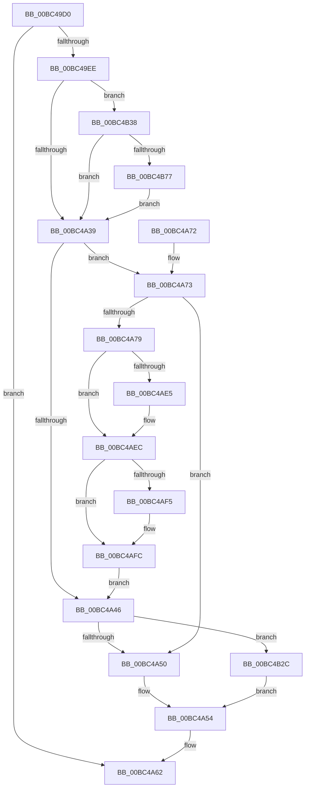

# AnFwpProgressIndicatorTimer

- RVA: `0x00BC49D0`–`0x00BC4B88` (길이 `440` bytes)
- VA: `0x0000000140BC49D0`
- 실행 섹션: `PAGEBGFX`
- PDB 이름 있음: `예`; PDB Function 태그: `아니요`
- unwind 정보 RVA: `0x000BA96C`
- 디코드: `89`개 명령, `440/440` bytes 표시
- 미해석 바이트: `0` (있으면 어셈블리에 `.byte`로 보존)

> 이 문서는 커널 이미지의 기계어와 PDB 기호를 분석해 생성했습니다. 4번과 5번은 함수 원형과 자료형을 바이너리 사용 방식에서 추정한 C 해석이며 원본 소스 복구 결과는 아닙니다.

## 1. Dependencies

- 직접 호출 지점: **7**; 고유 호출 대상: **4**
- 직접 호출자로 확인된 함수: **0**
- RIP 상대 이미지 참조: **20**

### Outgoing calls
- `0x00BC49E0` → [BgpFwAcquireLock](../../text/4B/BgpFwAcquireLock_function_004B3AA4.md) (function, `0x004B3AA4`)
- `0x00BC49F3` → [BgpFwQueryPerformanceCounter](../../text/4C/BgpFwQueryPerformanceCounter_function_004C0614.md) (function, `0x004C0614`)
- `0x00BC4A62` → [BgpFwReleaseLock](../../text/4B/BgpFwReleaseLock_function_004B357C.md) (function, `0x004B357C`)
- `0x00BC4A7E` → [BgpFwQueryPerformanceCounter](../../text/4C/BgpFwQueryPerformanceCounter_function_004C0614.md) (function, `0x004C0614`)
- `0x00BC4AB1` → [BgpTxtDisplayCharacter](../../text/47/BgpTxtDisplayCharacter_function_0047F120.md) (function, `0x0047F120`)
- `0x00BC4ABB` → [BgpFwQueryPerformanceCounter](../../text/4C/BgpFwQueryPerformanceCounter_function_004C0614.md) (function, `0x004C0614`)
- `0x00BC4AC9` → [BgpFwQueryPerformanceCounter](../../text/4C/BgpFwQueryPerformanceCounter_function_004C0614.md) (function, `0x004C0614`)

### Direct callers
- 이 함수 시작 RVA로 연결되는 직접 call은 확인되지 않았습니다. 간접 호출은 완전히 역산할 수 없습니다.

### Static image references
- `0x00BC49E5` → RVA `0x00EEFEE1` (`.data`; read)
- `0x00BC49F8` → RVA `0x00E0EEAC` (`.data`; read)
- `0x00BC4A03` → RVA `0x00E0EEB8` (`.data`; read)
- `0x00BC4A39` → RVA `0x00E0EEB4` (`.data`; read)
- `0x00BC4A54` → RVA `0x00E0EEAC` (`.data`; write)
- `0x00BC4A5B` → RVA `0x00EEFEE8` (`.data`; write)
- `0x00BC4A8D` → RVA `0x00EF0510` (`.data`; read)
- `0x00BC4AA3` → RVA `0x00EEFF48` (`.data`; write)
- `0x00BC4AAA` → RVA `0x00E65120` (`.data`; write)
- `0x00BC4ACE` → RVA `0x00E65120` (`.data`; read)
- `0x00BC4AD5` → RVA `0x00E0F108` (`.data`; read)
- `0x00BC4ADC` → RVA `0x00EEFFA0` (`.data`; write)
- `0x00BC4AE5` → RVA `0x00E0F108` (`.data`; write)
- `0x00BC4AEC` → RVA `0x00EEFF20` (`.data`; read)
- `0x00BC4AF5` → RVA `0x00EEFF20` (`.data`; write)
- `0x00BC4AFC` → RVA `0x00EEFF60` (`.data`; read/write)
- `0x00BC4B03` → RVA `0x00EEFF78` (`.data`; read/write)
- `0x00BC4B09` → RVA `0x00EEFF50` (`.data`; read/write)
- `0x00BC4B2C` → RVA `0x00E0EEB0` (`.data`; read)
- `0x00BC4B61` → RVA `0x00EEFEE8` (`.data`; read)

## 2. Other-region calls and transfers

- 다른 실행 섹션으로 향하는 call: **7**
  - `0x00BC49E0` → [BgpFwAcquireLock](../../text/4B/BgpFwAcquireLock_function_004B3AA4.md) (`PAGEBGFX` → `.text`)
  - `0x00BC49F3` → [BgpFwQueryPerformanceCounter](../../text/4C/BgpFwQueryPerformanceCounter_function_004C0614.md) (`PAGEBGFX` → `.text`)
  - `0x00BC4A62` → [BgpFwReleaseLock](../../text/4B/BgpFwReleaseLock_function_004B357C.md) (`PAGEBGFX` → `.text`)
  - `0x00BC4A7E` → [BgpFwQueryPerformanceCounter](../../text/4C/BgpFwQueryPerformanceCounter_function_004C0614.md) (`PAGEBGFX` → `.text`)
  - `0x00BC4AB1` → [BgpTxtDisplayCharacter](../../text/47/BgpTxtDisplayCharacter_function_0047F120.md) (`PAGEBGFX` → `.text`)
  - `0x00BC4ABB` → [BgpFwQueryPerformanceCounter](../../text/4C/BgpFwQueryPerformanceCounter_function_004C0614.md) (`PAGEBGFX` → `.text`)
  - `0x00BC4AC9` → [BgpFwQueryPerformanceCounter](../../text/4C/BgpFwQueryPerformanceCounter_function_004C0614.md) (`PAGEBGFX` → `.text`)
- 별도 외부 분기/꼬리 이동을 확인하지 못했습니다.

## 3. Assembly (complete function range)

```asm
00BC49D0  48 89 5C 24 08                  mov qword ptr [rsp + 8], rbx
00BC49D5  56                              push rsi
00BC49D6  48 83 EC 50                     sub rsp, 0x50
00BC49DA  48 83 64 24 40 00               and qword ptr [rsp + 0x40], 0
00BC49E0  E8 BF F0 8E FF                  call 0x1404b3aa4
00BC49E5  80 3D F5 B4 32 00 00            cmp byte ptr [rip + 0x32b4f5], 0
00BC49EC  74 74                           je 0x140bc4a62
00BC49EE  48 8D 4C 24 40                  lea rcx, [rsp + 0x40]
00BC49F3  E8 1C BC 8F FF                  call 0x1404c0614
00BC49F8  44 0F B7 0D AC A4 24 00         movzx r9d, word ptr [rip + 0x24a4ac]
00BC4A00  48 8B D8                        mov rbx, rax
00BC4A03  44 0F B7 15 AD A4 24 00         movzx r10d, word ptr [rip + 0x24a4ad]
00BC4A0B  48 B8 E1 83 0F 3E F8 E0 83 0F   movabs rax, 0xf83e0f83e0f83e1
00BC4A15  48 F7 6C 24 40                  imul qword ptr [rsp + 0x40]
00BC4A1A  BE 01 00 00 00                  mov esi, 1
00BC4A1F  48 8B CA                        mov rcx, rdx
00BC4A22  48 D1 F9                        sar rcx, 1
00BC4A25  48 8B C1                        mov rax, rcx
00BC4A28  48 C1 E8 3F                     shr rax, 0x3f
00BC4A2C  48 03 C8                        add rcx, rax
00BC4A2F  66 45 3B CA                     cmp r9w, r10w
00BC4A33  0F 85 FF 00 00 00               jne 0x140bc4b38
00BC4A39  0F B7 05 74 A4 24 00            movzx eax, word ptr [rip + 0x24a474]
00BC4A40  66 44 3B C8                     cmp r9w, ax
00BC4A44  73 2D                           jae 0x140bc4a73
00BC4A46  66 45 3B CA                     cmp r9w, r10w
00BC4A4A  0F 84 DC 00 00 00               je 0x140bc4b2c
00BC4A50  42 8D 04 0E                     lea eax, [rsi + r9]
00BC4A54  66 89 05 51 A4 24 00            mov word ptr [rip + 0x24a451], ax
00BC4A5B  48 89 1D 86 B4 32 00            mov qword ptr [rip + 0x32b486], rbx
00BC4A62  E8 15 EB 8E FF                  call 0x1404b357c
00BC4A67  48 8B 5C 24 60                  mov rbx, qword ptr [rsp + 0x60]
00BC4A6C  48 83 C4 50                     add rsp, 0x50
00BC4A70  5E                              pop rsi
00BC4A71  C3                              ret
00BC4A72  CC                              int3
00BC4A73  66 45 3B CA                     cmp r9w, r10w
00BC4A77  77 D7                           ja 0x140bc4a50
00BC4A79  48 8D 4C 24 40                  lea rcx, [rsp + 0x40]
00BC4A7E  E8 91 BB 8F FF                  call 0x1404c0614
00BC4A83  0F B7 15 22 A4 24 00            movzx edx, word ptr [rip + 0x24a422]
00BC4A8A  45 33 C9                        xor r9d, r9d
00BC4A8D  48 8B 0D 7C BA 32 00            mov rcx, qword ptr [rip + 0x32ba7c]
00BC4A94  45 33 C0                        xor r8d, r8d
00BC4A97  48 83 64 24 30 00               and qword ptr [rsp + 0x30], 0
00BC4A9D  48 83 64 24 20 00               and qword ptr [rsp + 0x20], 0
00BC4AA3  48 89 05 9E B4 32 00            mov qword ptr [rip + 0x32b49e], rax
00BC4AAA  48 89 05 6F 06 2A 00            mov qword ptr [rip + 0x2a066f], rax
00BC4AB1  E8 6A A6 8B FF                  call 0x14047f120
00BC4AB6  48 8D 4C 24 40                  lea rcx, [rsp + 0x40]
00BC4ABB  E8 54 BB 8F FF                  call 0x1404c0614
00BC4AC0  33 C9                           xor ecx, ecx
00BC4AC2  48 89 05 7F B4 32 00            mov qword ptr [rip + 0x32b47f], rax
00BC4AC9  E8 46 BB 8F FF                  call 0x1404c0614
00BC4ACE  48 2B 05 4B 06 2A 00            sub rax, qword ptr [rip + 0x2a064b]
00BC4AD5  48 3B 05 2C A6 24 00            cmp rax, qword ptr [rip + 0x24a62c]
00BC4ADC  48 89 05 BD B4 32 00            mov qword ptr [rip + 0x32b4bd], rax
00BC4AE3  7D 07                           jge 0x140bc4aec
00BC4AE5  48 89 05 1C A6 24 00            mov qword ptr [rip + 0x24a61c], rax
00BC4AEC  48 3B 05 2D B4 32 00            cmp rax, qword ptr [rip + 0x32b42d]
00BC4AF3  7E 07                           jle 0x140bc4afc
00BC4AF5  48 89 05 24 B4 32 00            mov qword ptr [rip + 0x32b424], rax
00BC4AFC  48 01 05 5D B4 32 00            add qword ptr [rip + 0x32b45d], rax
00BC4B03  01 35 6F B4 32 00               add dword ptr [rip + 0x32b46f], esi
00BC4B09  48 01 05 40 B4 32 00            add qword ptr [rip + 0x32b440], rax
00BC4B10  0F B7 05 9D A3 24 00            movzx eax, word ptr [rip + 0x24a39d]
00BC4B17  44 0F B7 0D 8D A3 24 00         movzx r9d, word ptr [rip + 0x24a38d]
00BC4B1F  44 0F B7 15 91 A3 24 00         movzx r10d, word ptr [rip + 0x24a391]
00BC4B27  E9 1A FF FF FF                  jmp 0x140bc4a46
00BC4B2C  66 2B 05 7D A3 24 00            sub ax, word ptr [rip + 0x24a37d]
00BC4B33  E9 1C FF FF FF                  jmp 0x140bc4a54
00BC4B38  4C 8D 04 89                     lea r8, [rcx + rcx*4]
00BC4B3C  48 B8 0B D7 A3 70 3D 0A D7 A3   movabs rax, 0xa3d70a3d70a3d70b
00BC4B46  4D 03 C0                        add r8, r8
00BC4B49  49 F7 E8                        imul r8
00BC4B4C  49 8D 04 10                     lea rax, [r8 + rdx]
00BC4B50  48 C1 F8 06                     sar rax, 6
00BC4B54  48 8B D0                        mov rdx, rax
00BC4B57  48 C1 EA 3F                     shr rdx, 0x3f
00BC4B5B  48 03 C2                        add rax, rdx
00BC4B5E  48 2B C3                        sub rax, rbx
00BC4B61  48 03 05 80 B3 32 00            add rax, qword ptr [rip + 0x32b380]
00BC4B68  48 99                           cqo
00BC4B6A  48 F7 F9                        idiv rcx
00BC4B6D  48 83 F8 02                     cmp rax, 2
00BC4B71  0F 8C C2 FE FF FF               jl 0x140bc4a39
00BC4B77  66 44 03 CE                     add r9w, si
00BC4B7B  66 44 89 0D 29 A3 24 00         mov word ptr [rip + 0x24a329], r9w
00BC4B83  E9 B1 FE FF FF                  jmp 0x140bc4a39
```

## 4. C-style interpretation (structured pseudocode)

```c
__int64 __fastcall AnFwpProgressIndicatorTimer(__int64 a1, __int64 a2, int a3)
{
    __int64 result;
    __int64 v_rsp;
    unsigned __int64 v_stack_m18;
    unsigned __int64 v_stack_p20;
    unsigned __int64 v_stack_p30;
    unsigned __int64 v_stack_p40;
    unsigned __int64 v_stack_p8;

    v_stack_p8 = v_rbx;
    v_rsp = (v_rsp) - (80);
    result = BgpFwAcquireLock(a1, a2, a3, a4);
    if ((*(unsigned __int8 *)(v_rip + 3323125)) == 0) goto loc_00BC4A62;
    result = BgpFwQueryPerformanceCounter(v_stack_m18, a2, a3, a4);
    a1 = (a2) >> (1);
    result = (a1) >> (63);
    a1 = (a1) + (result);
    if (((unsigned __int16)(*(unsigned __int16 *)(v_rip + 2401452))) != ((unsigned __int16)(*(unsigned __int16 *)(v_rip + 2401453)))) goto loc_00BC4B38;
loc_00BC4A39:
    if (((unsigned __int16)(*(unsigned __int16 *)(v_rip + 2401452))) >= ((unsigned __int16)(*(unsigned __int16 *)(v_rip + 2401396)))) goto loc_00BC4A73;
loc_00BC4A46:
    if (((unsigned __int16)(*(unsigned __int16 *)(v_rip + 2401452))) == ((unsigned __int16)(*(unsigned __int16 *)(v_rip + 2401453)))) goto loc_00BC4B2C;
loc_00BC4A50:
loc_00BC4A54:
    *(unsigned __int16 *)(v_rip + 2401361) = (unsigned __int16)(1 + *(unsigned __int16 *)(v_rip + 2401452) * 1);
    *(unsigned __int64 *)(v_rip + 3323014) = result;
loc_00BC4A62:
    result = BgpFwReleaseLock(a1, a2, a3, *(unsigned __int16 *)(v_rip + 2401452));
    v_rsp = (v_rsp) + (80);
    return result;
loc_00BC4A73:
    if (((unsigned __int16)(*(unsigned __int16 *)(v_rip + 2401452))) > ((unsigned __int16)(*(unsigned __int16 *)(v_rip + 2401453)))) goto loc_00BC4A50;
    result = BgpFwQueryPerformanceCounter(v_stack_p40, a2, a3, *(unsigned __int16 *)(v_rip + 2401452));
    a4 = 0;
    a3 = 0;
    *(unsigned __int64 *)(v_rip + 3323038) = result;
    *(unsigned __int64 *)(v_rip + 2754159) = result;
    result = BgpTxtDisplayCharacter(*(unsigned __int64 *)(v_rip + 3324540), *(unsigned __int16 *)(v_rip + 2401314), a3, a4);
    result = BgpFwQueryPerformanceCounter(v_stack_p40, *(unsigned __int16 *)(v_rip + 2401314), a3, a4);
    a1 = 0;
    *(unsigned __int64 *)(v_rip + 3323007) = result;
    result = BgpFwQueryPerformanceCounter(a1, *(unsigned __int16 *)(v_rip + 2401314), a3, a4);
    result = (result) - (*(unsigned __int64 *)(v_rip + 2754123));
    *(unsigned __int64 *)(v_rip + 3323069) = result;
    if (result < (*(unsigned __int64 *)(v_rip + 2401836))) {
        *(unsigned __int64 *)(v_rip + 2401820) = result;
    }
    if (result >= = (*(unsigned __int64 *)(v_rip + 3322925))) {
        *(unsigned __int64 *)(v_rip + 3322916) = result;
    }
    goto loc_00BC4A46;
loc_00BC4B2C:
    result = (unsigned __int16)((*(unsigned __int16 *)(v_rip + 2401181)) - (*(unsigned __int16 *)(v_rip + 2401149)));
    goto loc_00BC4A54;
loc_00BC4B38:
    a3 = (a1 + a1 * 4) + (a1 + a1 * 4);
    result = (a3 + *(unsigned __int16 *)(v_rip + 2401314) * 1) >> (6);
    a2 = (result) >> (63);
    result = (result) + (a2);
    result = (result) - (v_stack_p8);
    result = (result) + (*(unsigned __int64 *)(v_rip + 3322752));
    if (result < 2) goto loc_00BC4A39;
    a4 = (unsigned __int16)((*(unsigned __int16 *)(v_rip + 2401165)) + (1));
    *(unsigned __int16 *)(v_rip + 2401065) = (unsigned __int16)(a4);
    goto loc_00BC4A39;
}
```

## 5. (Beta) C Style

```c
int64_t AnFwpProgressIndicatorTimer(int64_t Arg1, int64_t Arg2, int32_t Arg3)
{
    int64_t result;
    int64_t local_rsp;
    uint64_t v_stack_m18;
    uint64_t v_stack_p20;
    uint64_t v_stack_p30;
    uint64_t v_stack_p40;
    uint64_t v_stack_p8;

    v_stack_p8 = local_rbx;
    local_rsp = (local_rsp) - (80);
    result = BgpFwAcquireLock(Arg1, Arg2, Arg3, a4);
    if ((*(uint8_t *)(v_rip + 0x32B4F5)) == 0) goto loc_00BC4A62;
    result = BgpFwQueryPerformanceCounter(v_stack_m18, Arg2, Arg3, a4);
    Arg1 = (Arg2) >> (1);
    result = (Arg1) >> (63);
    Arg1 = (Arg1) + (result);
    if (((uint16_t)(*(uint16_t *)(v_rip + 0x24A4AC))) != ((uint16_t)(*(uint16_t *)(v_rip + 0x24A4AD)))) goto loc_00BC4B38;
loc_00BC4A39:
    if (((uint16_t)(*(uint16_t *)(v_rip + 0x24A4AC))) >= ((uint16_t)(*(uint16_t *)(v_rip + 0x24A474)))) goto loc_00BC4A73;
loc_00BC4A46:
    if (((uint16_t)(*(uint16_t *)(v_rip + 0x24A4AC))) == ((uint16_t)(*(uint16_t *)(v_rip + 0x24A4AD)))) goto loc_00BC4B2C;
loc_00BC4A50:
loc_00BC4A54:
    *(uint16_t *)(v_rip + 0x24A451) = (uint16_t)(1 + *(uint16_t *)(v_rip + 0x24A4AC) * 1);
    *(uint64_t *)(v_rip + 0x32B486) = result;
loc_00BC4A62:
    result = BgpFwReleaseLock(Arg1, Arg2, Arg3, *(uint16_t *)(v_rip + 0x24A4AC));
    local_rsp = (local_rsp) + (80);
    return result;
loc_00BC4A73:
    if (((uint16_t)(*(uint16_t *)(v_rip + 0x24A4AC))) > ((uint16_t)(*(uint16_t *)(v_rip + 0x24A4AD)))) goto loc_00BC4A50;
    result = BgpFwQueryPerformanceCounter(v_stack_p40, Arg2, Arg3, *(uint16_t *)(v_rip + 0x24A4AC));
    a4 = 0;
    Arg3 = 0;
    *(uint64_t *)(v_rip + 0x32B49E) = result;
    *(uint64_t *)(v_rip + 0x2A066F) = result;
    result = BgpTxtDisplayCharacter(*(uint64_t *)(v_rip + 0x32BA7C), *(uint16_t *)(v_rip + 0x24A422), Arg3, a4);
    result = BgpFwQueryPerformanceCounter(v_stack_p40, *(uint16_t *)(v_rip + 0x24A422), Arg3, a4);
    Arg1 = 0;
    *(uint64_t *)(v_rip + 0x32B47F) = result;
    result = BgpFwQueryPerformanceCounter(Arg1, *(uint16_t *)(v_rip + 0x24A422), Arg3, a4);
    result = (result) - (*(uint64_t *)(v_rip + 0x2A064B));
    *(uint64_t *)(v_rip + 0x32B4BD) = result;
    if (result < (*(uint64_t *)(v_rip + 0x24A62C))) {
        *(uint64_t *)(v_rip + 0x24A61C) = result;
    }
    if (result >= = (*(uint64_t *)(v_rip + 0x32B42D))) {
        *(uint64_t *)(v_rip + 0x32B424) = result;
    }
    goto loc_00BC4A46;
loc_00BC4B2C:
    result = (uint16_t)((*(uint16_t *)(v_rip + 0x24A39D)) - (*(uint16_t *)(v_rip + 0x24A37D)));
    goto loc_00BC4A54;
loc_00BC4B38:
    Arg3 = (Arg1 + Arg1 * 4) + (Arg1 + Arg1 * 4);
    result = (Arg3 + *(uint16_t *)(v_rip + 0x24A422) * 1) >> (6);
    Arg2 = (result) >> (63);
    result = (result) + (Arg2);
    result = (result) - (v_stack_p8);
    result = (result) + (*(uint64_t *)(v_rip + 0x32B380));
    if (result < 2) goto loc_00BC4A39;
    a4 = (uint16_t)((*(uint16_t *)(v_rip + 0x24A38D)) + (1));
    *(uint16_t *)(v_rip + 0x24A329) = (uint16_t)(a4);
    goto loc_00BC4A39;
}
```

## 6. Execution-region graph

[열기: 2D/3D 그래프와 함수 탐색 컨트롤 패널](../../../control-panel.html?section=pagebgfx&rva=0x00BC49D0&view=graph)

- 2D 그래프는 위에서 아래로 흐르고, 3D 그래프는 빈 공간을 드래그해 회전합니다. Shift+드래그는 이동, 휠은 확대·축소, 함수 노드 선택은 대상 보고서 이동입니다.

### Static fallback


