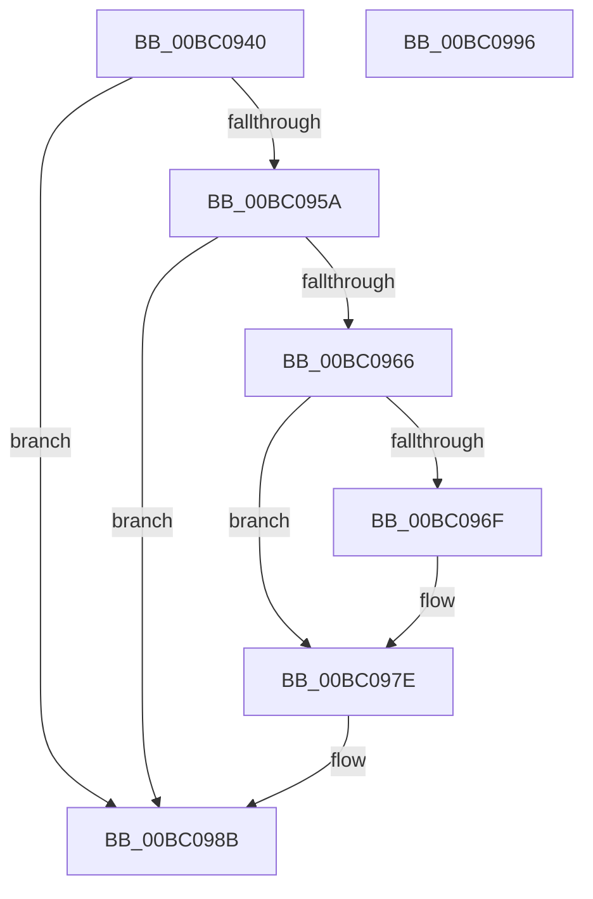

# BgConsoleDestroyInterface

- RVA: `0x00BC0940`–`0x00BC0997` (길이 `87` bytes)
- VA: `0x0000000140BC0940`
- 실행 섹션: `PAGEBGFX`
- PDB 이름 있음: `예`; PDB Function 태그: `아니요`
- unwind 정보 RVA: `0x0005CF00`
- 디코드: `23`개 명령, `87/87` bytes 표시
- 미해석 바이트: `0` (있으면 어셈블리에 `.byte`로 보존)

> 이 문서는 커널 이미지의 기계어와 PDB 기호를 분석해 생성했습니다. 4번과 5번은 함수 원형과 자료형을 바이너리 사용 방식에서 추정한 C 해석이며 원본 소스 복구 결과는 아닙니다.

## 1. Dependencies

- 직접 호출 지점: **4**; 고유 호출 대상: **4**
- 직접 호출자로 확인된 함수: **3**
- RIP 상대 이미지 참조: **3**

### Outgoing calls
- `0x00BC0949` → [BgpFwAcquireLock](../../text/4B/BgpFwAcquireLock_function_004B3AA4.md) (function, `0x004B3AA4`)
- `0x00BC0972` → [BgpDisplayCharacterDestroyContext](BgpDisplayCharacterDestroyContext_function_00BC0834.md) (function, `0x00BC0834`)
- `0x00BC097E` → [BgpFwFreeMemory](../../text/3E/BgpFwFreeMemory_function_003E25E0.md) (function, `0x003E25E0`)
- `0x00BC098B` → [BgpFwReleaseLock](../../text/4B/BgpFwReleaseLock_function_004B357C.md) (function, `0x004B357C`)

### Direct callers
- [BgkNotifyDisplayOwnershipChange](../../text/59/BgkNotifyDisplayOwnershipChange_function_00590CC0.md) at `0x00590E13`
- [BgkDestroy](BgkDestroy_function_00BC0170.md) at `0x00BC01C8`
- [BcpDisplayEarlyBugCheckScreen](../../init/C8/BcpDisplayEarlyBugCheckScreen_function_00C8108C.md) at `0x00C8126A`

### Static image references
- `0x00BC094E` → RVA `0x00E03950` (`.data`; read)
- `0x00BC095A` → RVA `0x00EEFEC8` (`.data`; read)
- `0x00BC0983` → RVA `0x00EEFEC8` (`.data`; read/write)

## 2. Other-region calls and transfers

- 다른 실행 섹션으로 향하는 call: **3**
  - `0x00BC0949` → [BgpFwAcquireLock](../../text/4B/BgpFwAcquireLock_function_004B3AA4.md) (`PAGEBGFX` → `.text`)
  - `0x00BC097E` → [BgpFwFreeMemory](../../text/3E/BgpFwFreeMemory_function_003E25E0.md) (`PAGEBGFX` → `.text`)
  - `0x00BC098B` → [BgpFwReleaseLock](../../text/4B/BgpFwReleaseLock_function_004B357C.md) (`PAGEBGFX` → `.text`)
- 별도 외부 분기/꼬리 이동을 확인하지 못했습니다.

## 3. Assembly (complete function range)

```asm
00BC0940  40 53                           push rbx
00BC0942  48 83 EC 20                     sub rsp, 0x20
00BC0946  48 8B D9                        mov rbx, rcx
00BC0949  E8 56 31 8F FF                  call 0x1404b3aa4
00BC094E  48 8D 05 FB 2F 24 00            lea rax, [rip + 0x242ffb]
00BC0955  48 3B D8                        cmp rbx, rax
00BC0958  75 31                           jne 0x140bc098b
00BC095A  48 8B 0D 67 F5 32 00            mov rcx, qword ptr [rip + 0x32f567]
00BC0961  48 85 C9                        test rcx, rcx
00BC0964  74 25                           je 0x140bc098b
00BC0966  48 8B 41 28                     mov rax, qword ptr [rcx + 0x28]
00BC096A  48 85 C0                        test rax, rax
00BC096D  74 0F                           je 0x140bc097e
00BC096F  48 8B C8                        mov rcx, rax
00BC0972  E8 BD FE FF FF                  call 0x140bc0834
00BC0977  48 8B 0D 4A F5 32 00            mov rcx, qword ptr [rip + 0x32f54a]
00BC097E  E8 5D 1C 82 FF                  call 0x1403e25e0
00BC0983  48 83 25 3D F5 32 00 00         and qword ptr [rip + 0x32f53d], 0
00BC098B  E8 EC 2B 8F FF                  call 0x1404b357c
00BC0990  48 83 C4 20                     add rsp, 0x20
00BC0994  5B                              pop rbx
00BC0995  C3                              ret
00BC0996  CC                              int3
```

## 4. C-style interpretation (structured pseudocode)

```c
__int64 __fastcall BgConsoleDestroyInterface(__int64 a1)
{
    __int64 result;
    __int64 v_rsp;

    v_rsp = (v_rsp) - (32);
    result = BgpFwAcquireLock(a1, a2, a3, a4);
    if (a1 != (v_rip + 2371579)) goto loc_00BC098B;
    if (*(unsigned __int64 *)(v_rip + 3339623) == 0) goto loc_00BC098B;
    result = *(unsigned __int64 *)(*(unsigned __int64 *)(v_rip + 3339623) + 40);
    if (*(unsigned __int64 *)(*(unsigned __int64 *)(v_rip + 3339623) + 40) != 0) {
        a1 = *(unsigned __int64 *)(*(unsigned __int64 *)(v_rip + 3339623) + 40);
        result = BgpDisplayCharacterDestroyContext(a1, a2, a3, a4);
        a1 = *(unsigned __int64 *)(v_rip + 3339594);
    }
    result = BgpFwFreeMemory(a1, a2, a3, a4);
loc_00BC098B:
    result = BgpFwReleaseLock(a1, a2, a3, a4);
    v_rsp = (v_rsp) + (32);
    return result;
}
```

## 5. (Beta) C Style

```c
int64_t BgConsoleDestroyInterface(int64_t Arg1)
{
    int64_t result;
    int64_t local_rsp;

    local_rsp = (local_rsp) - (32);
    result = BgpFwAcquireLock(Arg1, a2, a3, a4);
    if (Arg1 != (v_rip + 2371579)) goto loc_00BC098B;
    if (*(uint64_t *)(v_rip + 0x32F567) == 0) goto loc_00BC098B;
    result = *(uint64_t *)(*(uint64_t *)(v_rip + 0x32F567) + 0x28);
    if (*(uint64_t *)(*(uint64_t *)(v_rip + 0x32F567) + 0x28) != 0) {
        Arg1 = *(uint64_t *)(*(uint64_t *)(v_rip + 0x32F567) + 0x28);
        result = BgpDisplayCharacterDestroyContext(Arg1, a2, a3, a4);
        Arg1 = *(uint64_t *)(v_rip + 0x32F54A);
    }
    result = BgpFwFreeMemory(Arg1, a2, a3, a4);
loc_00BC098B:
    result = BgpFwReleaseLock(Arg1, a2, a3, a4);
    local_rsp = (local_rsp) + (32);
    return result;
}
```

## 6. Execution-region graph

[열기: 2D/3D 그래프와 함수 탐색 컨트롤 패널](../../../control-panel.html?section=pagebgfx&rva=0x00BC0940&view=graph)

- 2D 그래프는 위에서 아래로 흐르고, 3D 그래프는 빈 공간을 드래그해 회전합니다. Shift+드래그는 이동, 휠은 확대·축소, 함수 노드 선택은 대상 보고서 이동입니다.

### Static fallback


