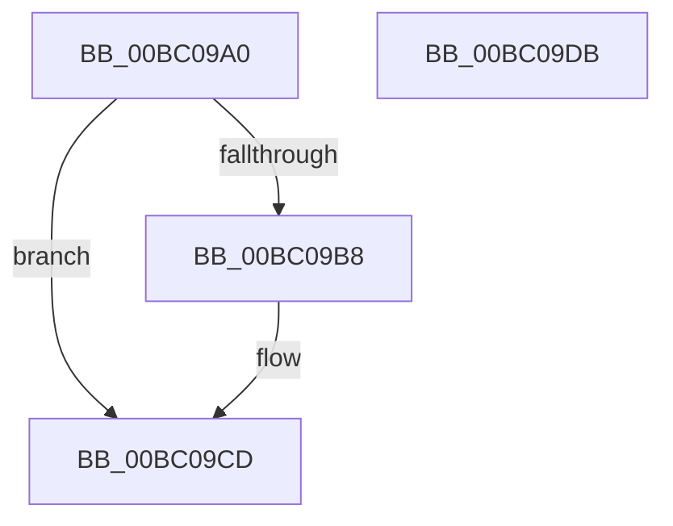

# BgConsoleGetInterface

- RVA: `0x00BC09A0`–`0x00BC09DC` (길이 `60` bytes)
- VA: `0x0000000140BC09A0`
- 실행 섹션: `PAGEBGFX`
- PDB 이름 있음: `예`; PDB Function 태그: `아니요`
- unwind 정보 RVA: `0x0005CF00`
- 디코드: `17`개 명령, `60/60` bytes 표시
- 미해석 바이트: `0` (있으면 어셈블리에 `.byte`로 보존)

> 이 문서는 커널 이미지의 기계어와 PDB 기호를 분석해 생성했습니다. 4번과 5번은 함수 원형과 자료형을 바이너리 사용 방식에서 추정한 C 해석이며 원본 소스 복구 결과는 아닙니다.

## 1. Dependencies

- 직접 호출 지점: **2**; 고유 호출 대상: **2**
- 직접 호출자로 확인된 함수: **3**
- RIP 상대 이미지 참조: **3**

### Outgoing calls
- `0x00BC09A8` → [BgpFwAcquireLock](../../text/4B/BgpFwAcquireLock_function_004B3AA4.md) (function, `0x004B3AA4`)
- `0x00BC09CD` → [BgpFwReleaseLock](../../text/4B/BgpFwReleaseLock_function_004B357C.md) (function, `0x004B357C`)

### Direct callers
- [BgkNotifyDisplayOwnershipChange](../../text/59/BgkNotifyDisplayOwnershipChange_function_00590CC0.md) at `0x00590D83`
- [BgkInitialize](../../init/C8/BgkInitialize_function_00C80488.md) at `0x00C804F3`
- [BcpDisplayEarlyBugCheckScreen](../../init/C8/BcpDisplayEarlyBugCheckScreen_function_00C8108C.md) at `0x00C810AC`

### Static image references
- `0x00BC09AD` → RVA `0x00EF0450` (`.data`; read)
- `0x00BC09B8` → RVA `0x00EF04F8` (`.data`; read)
- `0x00BC09BF` → RVA `0x00E03950` (`.data`; read)

## 2. Other-region calls and transfers

- 다른 실행 섹션으로 향하는 call: **2**
  - `0x00BC09A8` → [BgpFwAcquireLock](../../text/4B/BgpFwAcquireLock_function_004B3AA4.md) (`PAGEBGFX` → `.text`)
  - `0x00BC09CD` → [BgpFwReleaseLock](../../text/4B/BgpFwReleaseLock_function_004B357C.md) (`PAGEBGFX` → `.text`)
- 별도 외부 분기/꼬리 이동을 확인하지 못했습니다.

## 3. Assembly (complete function range)

```asm
00BC09A0  40 53                           push rbx
00BC09A2  48 83 EC 20                     sub rsp, 0x20
00BC09A6  33 DB                           xor ebx, ebx
00BC09A8  E8 F7 30 8F FF                  call 0x1404b3aa4
00BC09AD  8B 0D 9D FA 32 00               mov ecx, dword ptr [rip + 0x32fa9d]
00BC09B3  F6 C1 01                        test cl, 1
00BC09B6  74 15                           je 0x140bc09cd
00BC09B8  48 39 1D 39 FB 32 00            cmp qword ptr [rip + 0x32fb39], rbx
00BC09BF  48 8D 0D 8A 2F 24 00            lea rcx, [rip + 0x242f8a]
00BC09C6  48 0F 44 CB                     cmove rcx, rbx
00BC09CA  48 8B D9                        mov rbx, rcx
00BC09CD  E8 AA 2B 8F FF                  call 0x1404b357c
00BC09D2  48 8B C3                        mov rax, rbx
00BC09D5  48 83 C4 20                     add rsp, 0x20
00BC09D9  5B                              pop rbx
00BC09DA  C3                              ret
00BC09DB  CC                              int3
```

## 4. C-style interpretation (structured pseudocode)

```c
__int64 __fastcall BgConsoleGetInterface(void)
{
    __int64 result;
    __int64 v_rbx;
    __int64 v_rsp;

    v_rsp = (v_rsp) - (32);
    v_rbx = 0;
    result = BgpFwAcquireLock(a1, a2, a3, a4);
    if ((((unsigned __int8)((unsigned int)(*(unsigned int *)(v_rip + 3340957)))) & (1)) != 0) {
        a1 = v_rip + 2371466;
        if ((*(unsigned __int64 *)(v_rip + 3341113)) == 0) { a1 = 0; }
        v_rbx = a1;
    }
    result = BgpFwReleaseLock(a1, a2, a3, a4);
    v_rsp = (v_rsp) + (32);
    return v_rbx;
}
```

## 5. (Beta) C Style

```c
void BgConsoleGetInterface(void)
{
    int64_t result;
    int64_t local_rbx;
    int64_t local_rsp;

    local_rsp = (local_rsp) - (32);
    local_rbx = 0;
    result = BgpFwAcquireLock(a1, a2, a3, a4);
    if ((((uint8_t)((uint32_t)(*(uint32_t *)(v_rip + 0x32FA9D)))) & (1)) != 0) {
        a1 = v_rip + 2371466;
        if ((*(uint64_t *)(v_rip + 0x32FB39)) == 0) { a1 = 0; }
        local_rbx = a1;
    }
    result = BgpFwReleaseLock(a1, a2, a3, a4);
    local_rsp = (local_rsp) + (32);
    return local_rbx;
}
```

## 6. Execution-region graph

[열기: 2D/3D 그래프와 함수 탐색 컨트롤 패널](../../../control-panel.html?section=pagebgfx&rva=0x00BC09A0&view=graph)

- 2D 그래프는 위에서 아래로 흐르고, 3D 그래프는 빈 공간을 드래그해 회전합니다. Shift+드래그는 이동, 휠은 확대·축소, 함수 노드 선택은 대상 보고서 이동입니다.

### Static fallback


