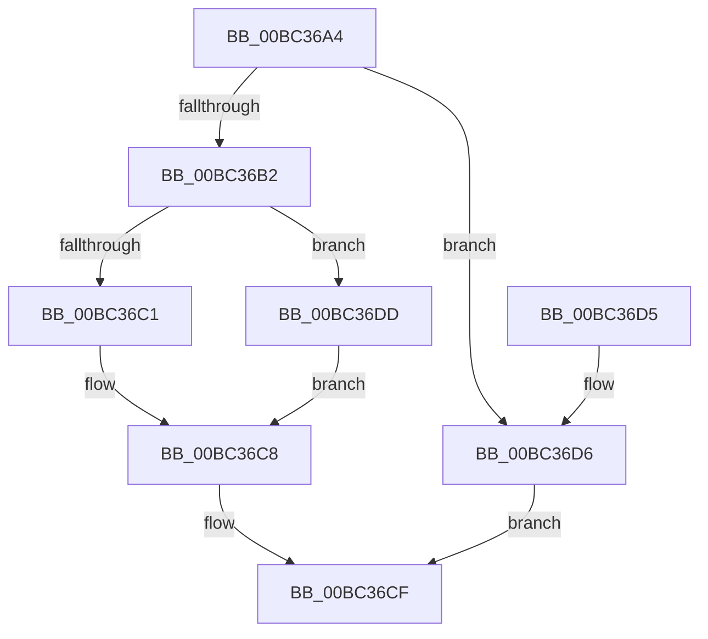

# BgDisplayFade

- RVA: `0x00BC36A4`–`0x00BC36E4` (길이 `64` bytes)
- VA: `0x0000000140BC36A4`
- 실행 섹션: `PAGEBGFX`
- PDB 이름 있음: `예`; PDB Function 태그: `아니요`
- unwind 정보 RVA: `0x000704F4`
- 디코드: `21`개 명령, `64/64` bytes 표시
- 미해석 바이트: `0` (있으면 어셈블리에 `.byte`로 보존)

> 이 문서는 커널 이미지의 기계어와 PDB 기호를 분석해 생성했습니다. 4번과 5번은 함수 원형과 자료형을 바이너리 사용 방식에서 추정한 C 해석이며 원본 소스 복구 결과는 아닙니다.

## 1. Dependencies

- 직접 호출 지점: **3**; 고유 호출 대상: **3**
- 직접 호출자로 확인된 함수: **4**
- RIP 상대 이미지 참조: **1**

### Outgoing calls
- `0x00BC36B2` → [BgpFwAcquireLock](../../text/4B/BgpFwAcquireLock_function_004B3AA4.md) (function, `0x004B3AA4`)
- `0x00BC36C1` → [AnFwDisplayFade](AnFwDisplayFade_function_00BC36EC.md) (function, `0x00BC36EC`)
- `0x00BC36C8` → [BgpFwReleaseLock](../../text/4B/BgpFwReleaseLock_function_004B357C.md) (function, `0x004B357C`)

### Direct callers
- [BgkDisplayStringEx](../../text/59/BgkDisplayStringEx_function_00590C04.md) at `0x00590C7B`
- [BgkNotifyDisplayOwnershipChange](../../text/59/BgkNotifyDisplayOwnershipChange_function_00590CC0.md) at `0x00590DD6`
- [PoBroadcastSystemState](../../pagelk/B7/PoBroadcastSystemState_function_00B761B0.md) at `0x00B76404`
- [BgkDisplayCharacter](BgkDisplayCharacter_function_00BC0240.md) at `0x00BC028D`

### Static image references
- `0x00BC36B7` → RVA `0x00EF0450` (`.data`; read)

## 2. Other-region calls and transfers

- 다른 실행 섹션으로 향하는 call: **2**
  - `0x00BC36B2` → [BgpFwAcquireLock](../../text/4B/BgpFwAcquireLock_function_004B3AA4.md) (`PAGEBGFX` → `.text`)
  - `0x00BC36C8` → [BgpFwReleaseLock](../../text/4B/BgpFwReleaseLock_function_004B357C.md) (`PAGEBGFX` → `.text`)
- 별도 외부 분기/꼬리 이동을 확인하지 못했습니다.

## 3. Assembly (complete function range)

```asm
00BC36A4  40 53                           push rbx
00BC36A6  48 83 EC 20                     sub rsp, 0x20
00BC36AA  44 0F 20 C0                     mov rax, cr8
00BC36AE  3C 02                           cmp al, 2
00BC36B0  77 24                           ja 0x140bc36d6
00BC36B2  E8 ED 03 8F FF                  call 0x1404b3aa4
00BC36B7  8B 05 93 CD 32 00               mov eax, dword ptr [rip + 0x32cd93]
00BC36BD  A8 01                           test al, 1
00BC36BF  74 1C                           je 0x140bc36dd
00BC36C1  E8 26 00 00 00                  call 0x140bc36ec
00BC36C6  8B D8                           mov ebx, eax
00BC36C8  E8 AF FE 8E FF                  call 0x1404b357c
00BC36CD  8B C3                           mov eax, ebx
00BC36CF  48 83 C4 20                     add rsp, 0x20
00BC36D3  5B                              pop rbx
00BC36D4  C3                              ret
00BC36D5  CC                              int3
00BC36D6  B8 01 00 00 C0                  mov eax, 0xc0000001
00BC36DB  EB F2                           jmp 0x140bc36cf
00BC36DD  BB 01 00 00 C0                  mov ebx, 0xc0000001
00BC36E2  EB E4                           jmp 0x140bc36c8
```

## 4. C-style interpretation (structured pseudocode)

```c
__int64 __fastcall BgDisplayFade(void)
{
    __int64 result;
    __int64 v_rsp;

    v_rsp = (v_rsp) - (32);
    if (((unsigned __int8)(v_cr8)) > 2) goto loc_00BC36D6;
    result = BgpFwAcquireLock(a1, a2, a3, a4);
    if ((((unsigned __int8)((unsigned int)(*(unsigned int *)(v_rip + 3329427)))) & (1)) == 0) goto loc_00BC36DD;
    result = AnFwDisplayFade(a1, a2, a3, a4);
loc_00BC36C8:
    result = BgpFwReleaseLock(a1, a2, a3, a4);
loc_00BC36CF:
    v_rsp = (v_rsp) + (32);
    return (unsigned int)((unsigned int)((unsigned int)((unsigned int)(result))));
loc_00BC36D6:
    goto loc_00BC36CF;
loc_00BC36DD:
    goto loc_00BC36C8;
}
```

## 5. (Beta) C Style

```c
void BgDisplayFade(void)
{
    int64_t result;
    int64_t local_rsp;

    local_rsp = (local_rsp) - (32);
    if (((uint8_t)(v_cr8)) > 2) goto loc_00BC36D6;
    result = BgpFwAcquireLock(a1, a2, a3, a4);
    if ((((uint8_t)((uint32_t)(*(uint32_t *)(v_rip + 0x32CD93)))) & (1)) == 0) goto loc_00BC36DD;
    result = AnFwDisplayFade(a1, a2, a3, a4);
loc_00BC36C8:
    result = BgpFwReleaseLock(a1, a2, a3, a4);
loc_00BC36CF:
    local_rsp = (local_rsp) + (32);
    return (uint32_t)((uint32_t)((uint32_t)((uint32_t)(result))));
loc_00BC36D6:
    goto loc_00BC36CF;
loc_00BC36DD:
    goto loc_00BC36C8;
}
```

## 6. Execution-region graph

[열기: 2D/3D 그래프와 함수 탐색 컨트롤 패널](../../../control-panel.html?section=pagebgfx&rva=0x00BC36A4&view=graph)

- 2D 그래프는 위에서 아래로 흐르고, 3D 그래프는 빈 공간을 드래그해 회전합니다. Shift+드래그는 이동, 휠은 확대·축소, 함수 노드 선택은 대상 보고서 이동입니다.

### Static fallback


