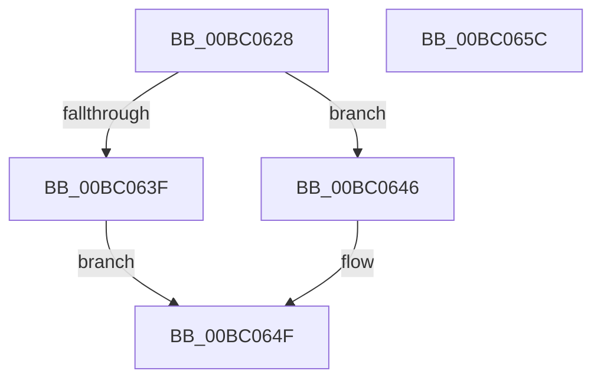

# BgDisplayProgressIndicator

- RVA: `0x00BC0628`–`0x00BC065D` (길이 `53` bytes)
- VA: `0x0000000140BC0628`
- 실행 섹션: `PAGEBGFX`
- PDB 이름 있음: `예`; PDB Function 태그: `아니요`
- unwind 정보 RVA: `0x0005CF00`
- 디코드: `18`개 명령, `53/53` bytes 표시
- 미해석 바이트: `0` (있으면 어셈블리에 `.byte`로 보존)

> 이 문서는 커널 이미지의 기계어와 PDB 기호를 분석해 생성했습니다. 4번과 5번은 함수 원형과 자료형을 바이너리 사용 방식에서 추정한 C 해석이며 원본 소스 복구 결과는 아닙니다.

## 1. Dependencies

- 직접 호출 지점: **3**; 고유 호출 대상: **3**
- 직접 호출자로 확인된 함수: **3**
- RIP 상대 이미지 참조: **1**

### Outgoing calls
- `0x00BC0630` → [BgpFwAcquireLock](../../text/4B/BgpFwAcquireLock_function_004B3AA4.md) (function, `0x004B3AA4`)
- `0x00BC0648` → [AnFwDisplayProgressIndicator](AnFwDisplayProgressIndicator_function_00BC1FD0.md) (function, `0x00BC1FD0`)
- `0x00BC064F` → [BgpFwReleaseLock](../../text/4B/BgpFwReleaseLock_function_004B357C.md) (function, `0x004B357C`)

### Direct callers
- [PopDecompressHiberBlocks](../../pagelk/B6/PopDecompressHiberBlocks_function_00B6D074.md) at `0x00B6D16D`
- [BgkDestroy](BgkDestroy_function_00BC0170.md) at `0x00BC019E`
- [Phase1InitializationDiscard](../../init/C1/Phase1InitializationDiscard_function_00C1C728.md) at `0x00C1CAE2`

### Static image references
- `0x00BC0635` → RVA `0x00EF0450` (`.data`; read)

## 2. Other-region calls and transfers

- 다른 실행 섹션으로 향하는 call: **2**
  - `0x00BC0630` → [BgpFwAcquireLock](../../text/4B/BgpFwAcquireLock_function_004B3AA4.md) (`PAGEBGFX` → `.text`)
  - `0x00BC064F` → [BgpFwReleaseLock](../../text/4B/BgpFwReleaseLock_function_004B357C.md) (`PAGEBGFX` → `.text`)
- 별도 외부 분기/꼬리 이동을 확인하지 못했습니다.

## 3. Assembly (complete function range)

```asm
00BC0628  40 53                           push rbx
00BC062A  48 83 EC 20                     sub rsp, 0x20
00BC062E  8A D9                           mov bl, cl
00BC0630  E8 6F 34 8F FF                  call 0x1404b3aa4
00BC0635  8B 05 15 FE 32 00               mov eax, dword ptr [rip + 0x32fe15]
00BC063B  A8 01                           test al, 1
00BC063D  75 07                           jne 0x140bc0646
00BC063F  BB 01 00 00 C0                  mov ebx, 0xc0000001
00BC0644  EB 09                           jmp 0x140bc064f
00BC0646  8A CB                           mov cl, bl
00BC0648  E8 83 19 00 00                  call 0x140bc1fd0
00BC064D  8B D8                           mov ebx, eax
00BC064F  E8 28 2F 8F FF                  call 0x1404b357c
00BC0654  8B C3                           mov eax, ebx
00BC0656  48 83 C4 20                     add rsp, 0x20
00BC065A  5B                              pop rbx
00BC065B  C3                              ret
00BC065C  CC                              int3
```

## 4. C-style interpretation (structured pseudocode)

```c
__int64 __fastcall BgDisplayProgressIndicator(unsigned __int8 a1)
{
    __int64 result;
    __int64 v_rsp;

    v_rsp = (v_rsp) - (32);
    result = BgpFwAcquireLock(a1, a2, a3, a4);
    if ((((unsigned __int8)((unsigned int)(*(unsigned int *)(v_rip + 3341845)))) & (1)) != 0) goto loc_00BC0646;
    goto loc_00BC064F;
loc_00BC0646:
    result = AnFwDisplayProgressIndicator((unsigned __int8)((unsigned int)(0xC0000001ULL)), a2, a3, a4);
loc_00BC064F:
    result = BgpFwReleaseLock((unsigned __int8)((unsigned int)(0xC0000001ULL)), a2, a3, a4);
    v_rsp = (v_rsp) + (32);
    return (unsigned int)((unsigned int)((unsigned int)((unsigned int)(result))));
}
```

## 5. (Beta) C Style

```c
int64_t BgDisplayProgressIndicator(uint8_t Arg1)
{
    int64_t result;
    int64_t local_rsp;

    local_rsp = (local_rsp) - (32);
    result = BgpFwAcquireLock(Arg1, a2, a3, a4);
    if ((((uint8_t)((uint32_t)(*(uint32_t *)(v_rip + 0x32FE15)))) & (1)) != 0) goto loc_00BC0646;
    goto loc_00BC064F;
loc_00BC0646:
    result = AnFwDisplayProgressIndicator((uint8_t)((uint32_t)(0xC0000001ULL)), a2, a3, a4);
loc_00BC064F:
    result = BgpFwReleaseLock((uint8_t)((uint32_t)(0xC0000001ULL)), a2, a3, a4);
    local_rsp = (local_rsp) + (32);
    return (uint32_t)((uint32_t)((uint32_t)((uint32_t)(result))));
}
```

## 6. Execution-region graph

[열기: 2D/3D 그래프와 함수 탐색 컨트롤 패널](../../../control-panel.html?section=pagebgfx&rva=0x00BC0628&view=graph)

- 2D 그래프는 위에서 아래로 흐르고, 3D 그래프는 빈 공간을 드래그해 회전합니다. Shift+드래그는 이동, 휠은 확대·축소, 함수 노드 선택은 대상 보고서 이동입니다.

### Static fallback


