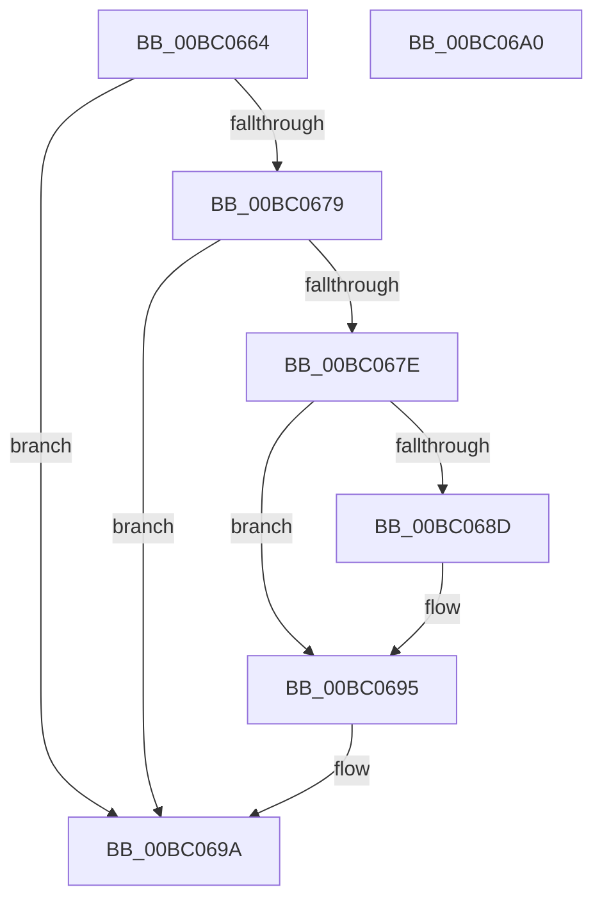

# BgFreeContext

- RVA: `0x00BC0664`–`0x00BC06A1` (길이 `61` bytes)
- VA: `0x0000000140BC0664`
- 실행 섹션: `PAGEBGFX`
- PDB 이름 있음: `예`; PDB Function 태그: `아니요`
- unwind 정보 RVA: `0x0005CF00`
- 디코드: `19`개 명령, `61/61` bytes 표시
- 미해석 바이트: `0` (있으면 어셈블리에 `.byte`로 보존)

> 이 문서는 커널 이미지의 기계어와 PDB 기호를 분석해 생성했습니다. 4번과 5번은 함수 원형과 자료형을 바이너리 사용 방식에서 추정한 C 해석이며 원본 소스 복구 결과는 아닙니다.

## 1. Dependencies

- 직접 호출 지점: **3**; 고유 호출 대상: **3**
- 직접 호출자로 확인된 함수: **1**
- RIP 상대 이미지 참조: **2**

### Outgoing calls
- `0x00BC067E` → [BgpFwAcquireLock](../../text/4B/BgpFwAcquireLock_function_004B3AA4.md) (function, `0x004B3AA4`)
- `0x00BC0690` → [ResFwFreeContext](ResFwFreeContext_function_00BC34C4.md) (function, `0x00BC34C4`)
- `0x00BC0695` → [BgpFwReleaseLock](../../text/4B/BgpFwReleaseLock_function_004B357C.md) (function, `0x004B357C`)

### Direct callers
- [BgkResumeFinished](../../pagelk/B7/BgkResumeFinished_function_00B7C7FC.md) at `0x00B7C815`

### Static image references
- `0x00BC066A` → RVA `0x00E65E90` (`.data`; read)
- `0x00BC0683` → RVA `0x00EF0450` (`.data`; read)

## 2. Other-region calls and transfers

- 다른 실행 섹션으로 향하는 call: **2**
  - `0x00BC067E` → [BgpFwAcquireLock](../../text/4B/BgpFwAcquireLock_function_004B3AA4.md) (`PAGEBGFX` → `.text`)
  - `0x00BC0695` → [BgpFwReleaseLock](../../text/4B/BgpFwReleaseLock_function_004B357C.md) (`PAGEBGFX` → `.text`)
- 별도 외부 분기/꼬리 이동을 확인하지 못했습니다.

## 3. Assembly (complete function range)

```asm
00BC0664  40 53                           push rbx
00BC0666  48 83 EC 20                     sub rsp, 0x20
00BC066A  48 8B 1D 1F 58 2A 00            mov rbx, qword ptr [rip + 0x2a581f]
00BC0671  44 0F 20 C0                     mov rax, cr8
00BC0675  3C 02                           cmp al, 2
00BC0677  77 21                           ja 0x140bc069a
00BC0679  48 85 DB                        test rbx, rbx
00BC067C  74 1C                           je 0x140bc069a
00BC067E  E8 21 34 8F FF                  call 0x1404b3aa4
00BC0683  8B 05 C7 FD 32 00               mov eax, dword ptr [rip + 0x32fdc7]
00BC0689  A8 01                           test al, 1
00BC068B  74 08                           je 0x140bc0695
00BC068D  48 8B CB                        mov rcx, rbx
00BC0690  E8 2F 2E 00 00                  call 0x140bc34c4
00BC0695  E8 E2 2E 8F FF                  call 0x1404b357c
00BC069A  48 83 C4 20                     add rsp, 0x20
00BC069E  5B                              pop rbx
00BC069F  C3                              ret
00BC06A0  CC                              int3
```

## 4. C-style interpretation (structured pseudocode)

```c
__int64 __fastcall BgFreeContext(void)
{
    __int64 result;
    __int64 v_rsp;

    v_rsp = (v_rsp) - (32);
    if (((unsigned __int8)(v_cr8)) > 2) goto loc_00BC069A;
    if (*(unsigned __int64 *)(v_rip + 2775071) == 0) goto loc_00BC069A;
    result = BgpFwAcquireLock(a1, a2, a3, a4);
    result = (unsigned int)(*(unsigned int *)(v_rip + 3341767));
    if ((((unsigned __int8)((unsigned int)(*(unsigned int *)(v_rip + 3341767)))) & (1)) != 0) {
        a1 = *(unsigned __int64 *)(v_rip + 2775071);
        result = ResFwFreeContext(a1, a2, a3, a4);
    }
    result = BgpFwReleaseLock(a1, a2, a3, a4);
loc_00BC069A:
    v_rsp = (v_rsp) + (32);
    return result;
}
```

## 5. (Beta) C Style

```c
void BgFreeContext(void)
{
    int64_t result;
    int64_t local_rsp;

    local_rsp = (local_rsp) - (32);
    if (((uint8_t)(v_cr8)) > 2) goto loc_00BC069A;
    if (*(uint64_t *)(v_rip + 0x2A581F) == 0) goto loc_00BC069A;
    result = BgpFwAcquireLock(a1, a2, a3, a4);
    result = (uint32_t)(*(uint32_t *)(v_rip + 0x32FDC7));
    if ((((uint8_t)((uint32_t)(*(uint32_t *)(v_rip + 0x32FDC7)))) & (1)) != 0) {
        a1 = *(uint64_t *)(v_rip + 0x2A581F);
        result = ResFwFreeContext(a1, a2, a3, a4);
    }
    result = BgpFwReleaseLock(a1, a2, a3, a4);
loc_00BC069A:
    local_rsp = (local_rsp) + (32);
    return result;
}
```

## 6. Execution-region graph

[열기: 2D/3D 그래프와 함수 탐색 컨트롤 패널](../../../control-panel.html?section=pagebgfx&rva=0x00BC0664&view=graph)

- 2D 그래프는 위에서 아래로 흐르고, 3D 그래프는 빈 공간을 드래그해 회전합니다. Shift+드래그는 이동, 휠은 확대·축소, 함수 노드 선택은 대상 보고서 이동입니다.

### Static fallback


