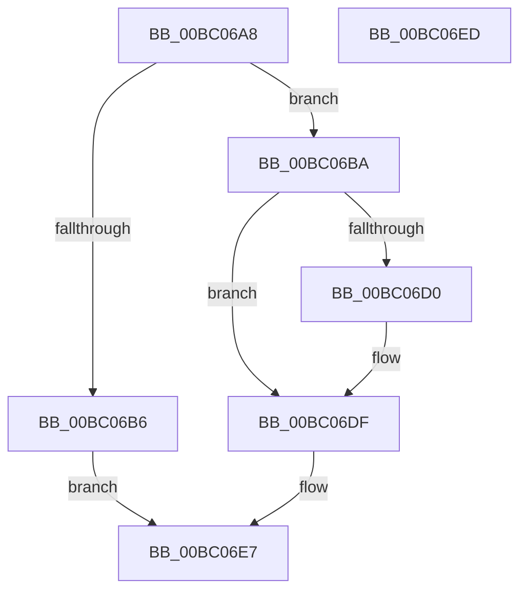

# BgGetContext

- RVA: `0x00BC06A8`–`0x00BC06EE` (길이 `70` bytes)
- VA: `0x0000000140BC06A8`
- 실행 섹션: `PAGEBGFX`
- PDB 이름 있음: `예`; PDB Function 태그: `아니요`
- unwind 정보 RVA: `0x0005CF00`
- 디코드: `22`개 명령, `70/70` bytes 표시
- 미해석 바이트: `0` (있으면 어셈블리에 `.byte`로 보존)

> 이 문서는 커널 이미지의 기계어와 PDB 기호를 분석해 생성했습니다. 4번과 5번은 함수 원형과 자료형을 바이너리 사용 방식에서 추정한 C 해석이며 원본 소스 복구 결과는 아닙니다.

## 1. Dependencies

- 직접 호출 지점: **3**; 고유 호출 대상: **3**
- 직접 호출자로 확인된 함수: **1**
- RIP 상대 이미지 참조: **1**

### Outgoing calls
- `0x00BC06C1` → [BgpFwAcquireLock](../../text/4B/BgpFwAcquireLock_function_004B3AA4.md) (function, `0x004B3AA4`)
- `0x00BC06D5` → [ResFwGetContext](ResFwGetContext_function_00BC19D8.md) (function, `0x00BC19D8`)
- `0x00BC06DF` → [BgpFwReleaseLock](../../text/4B/BgpFwReleaseLock_function_004B357C.md) (function, `0x004B357C`)

### Direct callers
- [BgkResumePrepare](../../pagelk/B6/BgkResumePrepare_function_00B63ACC.md) at `0x00B63AEA`

### Static image references
- `0x00BC06C6` → RVA `0x00EF0450` (`.data`; read)

## 2. Other-region calls and transfers

- 다른 실행 섹션으로 향하는 call: **2**
  - `0x00BC06C1` → [BgpFwAcquireLock](../../text/4B/BgpFwAcquireLock_function_004B3AA4.md) (`PAGEBGFX` → `.text`)
  - `0x00BC06DF` → [BgpFwReleaseLock](../../text/4B/BgpFwReleaseLock_function_004B357C.md) (`PAGEBGFX` → `.text`)
- 별도 외부 분기/꼬리 이동을 확인하지 못했습니다.

## 3. Assembly (complete function range)

```asm
00BC06A8  40 53                           push rbx
00BC06AA  48 83 EC 20                     sub rsp, 0x20
00BC06AE  44 0F 20 C0                     mov rax, cr8
00BC06B2  3C 02                           cmp al, 2
00BC06B4  76 04                           jbe 0x140bc06ba
00BC06B6  33 C0                           xor eax, eax
00BC06B8  EB 2D                           jmp 0x140bc06e7
00BC06BA  33 DB                           xor ebx, ebx
00BC06BC  48 89 5C 24 30                  mov qword ptr [rsp + 0x30], rbx
00BC06C1  E8 DE 33 8F FF                  call 0x1404b3aa4
00BC06C6  8B 05 84 FD 32 00               mov eax, dword ptr [rip + 0x32fd84]
00BC06CC  A8 01                           test al, 1
00BC06CE  74 0F                           je 0x140bc06df
00BC06D0  48 8D 4C 24 30                  lea rcx, [rsp + 0x30]
00BC06D5  E8 FE 12 00 00                  call 0x140bc19d8
00BC06DA  48 8B 5C 24 30                  mov rbx, qword ptr [rsp + 0x30]
00BC06DF  E8 98 2E 8F FF                  call 0x1404b357c
00BC06E4  48 8B C3                        mov rax, rbx
00BC06E7  48 83 C4 20                     add rsp, 0x20
00BC06EB  5B                              pop rbx
00BC06EC  C3                              ret
00BC06ED  CC                              int3
```

## 4. C-style interpretation (structured pseudocode)

```c
__int64 __fastcall BgGetContext(void)
{
    __int64 result;
    __int64 v_rbx;
    __int64 v_rsp;
    unsigned __int64 v_stack_p8;

    v_rsp = (v_rsp) - (32);
    if (((unsigned __int8)(v_cr8)) <= 2) goto loc_00BC06BA;
    result = 0;
    goto loc_00BC06E7;
loc_00BC06BA:
    v_rbx = 0;
    v_stack_p8 = 0;
    result = BgpFwAcquireLock(a1, a2, a3, a4);
    result = (unsigned int)(*(unsigned int *)(v_rip + 3341700));
    if ((((unsigned __int8)((unsigned int)(*(unsigned int *)(v_rip + 3341700)))) & (1)) != 0) {
        a1 = v_stack_p8;
        result = ResFwGetContext(a1, a2, a3, a4);
        v_rbx = v_stack_p8;
    }
    result = BgpFwReleaseLock(a1, a2, a3, a4);
loc_00BC06E7:
    v_rsp = (v_rsp) + (32);
    return v_rbx;
}
```

## 5. (Beta) C Style

```c
void BgGetContext(void)
{
    int64_t result;
    int64_t local_rbx;
    int64_t local_rsp;
    uint64_t v_stack_p8;

    local_rsp = (local_rsp) - (32);
    if (((uint8_t)(v_cr8)) <= 2) goto loc_00BC06BA;
    result = 0;
    goto loc_00BC06E7;
loc_00BC06BA:
    local_rbx = 0;
    v_stack_p8 = 0;
    result = BgpFwAcquireLock(a1, a2, a3, a4);
    result = (uint32_t)(*(uint32_t *)(v_rip + 0x32FD84));
    if ((((uint8_t)((uint32_t)(*(uint32_t *)(v_rip + 0x32FD84)))) & (1)) != 0) {
        a1 = v_stack_p8;
        result = ResFwGetContext(a1, a2, a3, a4);
        local_rbx = v_stack_p8;
    }
    result = BgpFwReleaseLock(a1, a2, a3, a4);
loc_00BC06E7:
    local_rsp = (local_rsp) + (32);
    return local_rbx;
}
```

## 6. Execution-region graph

[열기: 2D/3D 그래프와 함수 탐색 컨트롤 패널](../../../control-panel.html?section=pagebgfx&rva=0x00BC06A8&view=graph)

- 2D 그래프는 위에서 아래로 흐르고, 3D 그래프는 빈 공간을 드래그해 회전합니다. Shift+드래그는 이동, 휠은 확대·축소, 함수 노드 선택은 대상 보고서 이동입니다.

### Static fallback


