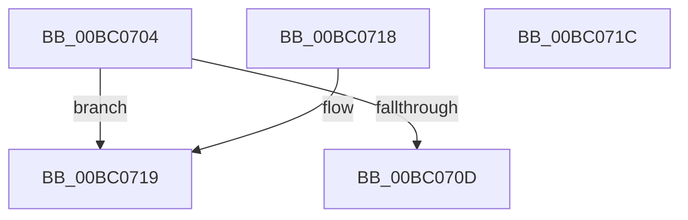

# BgGetIsColorOverridden

- RVA: `0x00BC0704`–`0x00BC071D` (길이 `25` bytes)
- VA: `0x0000000140BC0704`
- 실행 섹션: `PAGEBGFX`
- PDB 이름 있음: `예`; PDB Function 태그: `아니요`
- unwind 정보 RVA: `0x000DB714`
- 디코드: `10`개 명령, `25/25` bytes 표시
- 미해석 바이트: `0` (있으면 어셈블리에 `.byte`로 보존)

> 이 문서는 커널 이미지의 기계어와 PDB 기호를 분석해 생성했습니다. 4번과 5번은 함수 원형과 자료형을 바이너리 사용 방식에서 추정한 C 해석이며 원본 소스 복구 결과는 아닙니다.

## 1. Dependencies

- 직접 호출 지점: **0**; 고유 호출 대상: **0**
- 직접 호출자로 확인된 함수: **1**
- RIP 상대 이미지 참조: **2**

### Outgoing calls
- 직접 디코드된 call 명령이 없습니다.

### Direct callers
- [BgkSetVirtualFrameBuffer](../../text/59/BgkSetVirtualFrameBuffer_function_00590F50.md) at `0x00590FA7`

### Static image references
- `0x00BC0704` → RVA `0x00EF05D0` (`.data`; read)
- `0x00BC070D` → RVA `0x00EF05D4` (`.data`; read)

## 2. Other-region calls and transfers

- 다른 실행 섹션으로 향하는 call: **0**
- 별도 외부 분기/꼬리 이동을 확인하지 못했습니다.

## 3. Assembly (complete function range)

```asm
00BC0704  80 3D C5 FE 32 00 00            cmp byte ptr [rip + 0x32fec5], 0
00BC070B  74 0C                           je 0x140bc0719
00BC070D  8B 05 C1 FE 32 00               mov eax, dword ptr [rip + 0x32fec1]
00BC0713  89 01                           mov dword ptr [rcx], eax
00BC0715  B0 01                           mov al, 1
00BC0717  C3                              ret
00BC0718  CC                              int3
00BC0719  32 C0                           xor al, al
00BC071B  C3                              ret
00BC071C  CC                              int3
```

## 4. C-style interpretation (structured pseudocode)

```c
__int64 __fastcall BgGetIsColorOverridden(__int64 a1)
{
    __int64 result;

    if ((*(unsigned __int8 *)(v_rip + 3342021)) == 0) goto loc_00BC0719;
    *(unsigned int *)(a1) = (unsigned int)((unsigned int)(*(unsigned int *)(v_rip + 3342017)));
    return 1;
loc_00BC0719:
    result = 0;
    return result;
}
```

## 5. (Beta) C Style

```c
int64_t BgGetIsColorOverridden(void *Arg1)
{
    uint8_t *arg1 = (uint8_t *)Arg1;

    int64_t result;

    if ((*(uint8_t *)(v_rip + 0x32FEC5)) == 0) goto loc_00BC0719;
    *(uint32_t *)(arg1) = (uint32_t)((uint32_t)(*(uint32_t *)(v_rip + 0x32FEC1)));
    return 1;
loc_00BC0719:
    result = 0;
    return result;
}
```

### 관측된 메모리 오프셋

구조체 형식이 확인되지 않은 접근은 인자 기준의 오프셋으로만 기록했습니다.

| 기준 인자 | 오프셋 표현 | 폭 (bit) | 접근 |
|---|---:|---:|---|
| `Arg1` | `+ 0x0` | `32` | `W` |

## 6. Execution-region graph

[열기: 2D/3D 그래프와 함수 탐색 컨트롤 패널](../../../control-panel.html?section=pagebgfx&rva=0x00BC0704&view=graph)

- 2D 그래프는 위에서 아래로 흐르고, 3D 그래프는 빈 공간을 드래그해 회전합니다. Shift+드래그는 이동, 휠은 확대·축소, 함수 노드 선택은 대상 보고서 이동입니다.

### Static fallback


