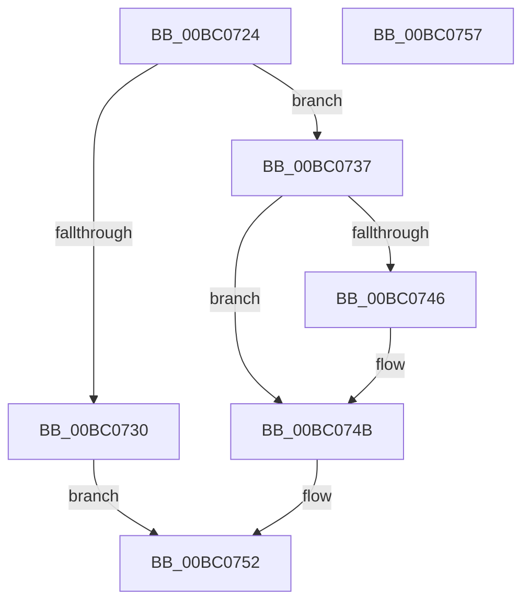

# BgLibraryDisable

- RVA: `0x00BC0724`–`0x00BC0758` (길이 `52` bytes)
- VA: `0x0000000140BC0724`
- 실행 섹션: `PAGEBGFX`
- PDB 이름 있음: `예`; PDB Function 태그: `아니요`
- unwind 정보 RVA: `0x0005C788`
- 디코드: `16`개 명령, `52/52` bytes 표시
- 미해석 바이트: `0` (있으면 어셈블리에 `.byte`로 보존)

> 이 문서는 커널 이미지의 기계어와 PDB 기호를 분석해 생성했습니다. 4번과 5번은 함수 원형과 자료형을 바이너리 사용 방식에서 추정한 C 해석이며 원본 소스 복구 결과는 아닙니다.

## 1. Dependencies

- 직접 호출 지점: **3**; 고유 호출 대상: **3**
- 직접 호출자로 확인된 함수: **1**
- RIP 상대 이미지 참조: **1**

### Outgoing calls
- `0x00BC0737` → [BgpFwAcquireLock](../../text/4B/BgpFwAcquireLock_function_004B3AA4.md) (function, `0x004B3AA4`)
- `0x00BC0746` → [BgpFwLibraryDisable](BgpFwLibraryDisable_function_00BC1724.md) (function, `0x00BC1724`)
- `0x00BC074B` → [BgpFwReleaseLock](../../text/4B/BgpFwReleaseLock_function_004B357C.md) (function, `0x004B357C`)

### Direct callers
- [BgkNotifyDisplayOwnershipChange](../../text/59/BgkNotifyDisplayOwnershipChange_function_00590CC0.md) at `0x00590DEE`

### Static image references
- `0x00BC073C` → RVA `0x00EF0450` (`.data`; read)

## 2. Other-region calls and transfers

- 다른 실행 섹션으로 향하는 call: **2**
  - `0x00BC0737` → [BgpFwAcquireLock](../../text/4B/BgpFwAcquireLock_function_004B3AA4.md) (`PAGEBGFX` → `.text`)
  - `0x00BC074B` → [BgpFwReleaseLock](../../text/4B/BgpFwReleaseLock_function_004B357C.md) (`PAGEBGFX` → `.text`)
- 별도 외부 분기/꼬리 이동을 확인하지 못했습니다.

## 3. Assembly (complete function range)

```asm
00BC0724  48 83 EC 28                     sub rsp, 0x28
00BC0728  44 0F 20 C0                     mov rax, cr8
00BC072C  84 C0                           test al, al
00BC072E  74 07                           je 0x140bc0737
00BC0730  B8 01 00 00 C0                  mov eax, 0xc0000001
00BC0735  EB 1B                           jmp 0x140bc0752
00BC0737  E8 68 33 8F FF                  call 0x1404b3aa4
00BC073C  8B 05 0E FD 32 00               mov eax, dword ptr [rip + 0x32fd0e]
00BC0742  A8 01                           test al, 1
00BC0744  74 05                           je 0x140bc074b
00BC0746  E8 D9 0F 00 00                  call 0x140bc1724
00BC074B  E8 2C 2E 8F FF                  call 0x1404b357c
00BC0750  33 C0                           xor eax, eax
00BC0752  48 83 C4 28                     add rsp, 0x28
00BC0756  C3                              ret
00BC0757  CC                              int3
```

## 4. C-style interpretation (structured pseudocode)

```c
__int64 __fastcall BgLibraryDisable(void)
{
    __int64 result;
    __int64 v_rsp;

    v_rsp = (v_rsp) - (40);
    if ((unsigned __int8)(v_cr8) == 0) goto loc_00BC0737;
    goto loc_00BC0752;
loc_00BC0737:
    result = BgpFwAcquireLock(a1, a2, a3, a4);
    result = (unsigned int)(*(unsigned int *)(v_rip + 3341582));
    if ((((unsigned __int8)((unsigned int)(*(unsigned int *)(v_rip + 3341582)))) & (1)) != 0) {
        result = BgpFwLibraryDisable(a1, a2, a3, a4);
    }
    result = BgpFwReleaseLock(a1, a2, a3, a4);
    result = 0;
loc_00BC0752:
    v_rsp = (v_rsp) + (40);
    return result;
}
```

## 5. (Beta) C Style

```c
void BgLibraryDisable(void)
{
    int64_t result;
    int64_t local_rsp;

    local_rsp = (local_rsp) - (40);
    if ((uint8_t)(v_cr8) == 0) goto loc_00BC0737;
    goto loc_00BC0752;
loc_00BC0737:
    result = BgpFwAcquireLock(a1, a2, a3, a4);
    result = (uint32_t)(*(uint32_t *)(v_rip + 0x32FD0E));
    if ((((uint8_t)((uint32_t)(*(uint32_t *)(v_rip + 0x32FD0E)))) & (1)) != 0) {
        result = BgpFwLibraryDisable(a1, a2, a3, a4);
    }
    result = BgpFwReleaseLock(a1, a2, a3, a4);
    result = 0;
loc_00BC0752:
    local_rsp = (local_rsp) + (40);
    return result;
}
```

## 6. Execution-region graph

[열기: 2D/3D 그래프와 함수 탐색 컨트롤 패널](../../../control-panel.html?section=pagebgfx&rva=0x00BC0724&view=graph)

- 2D 그래프는 위에서 아래로 흐르고, 3D 그래프는 빈 공간을 드래그해 회전합니다. Shift+드래그는 이동, 휠은 확대·축소, 함수 노드 선택은 대상 보고서 이동입니다.

### Static fallback


