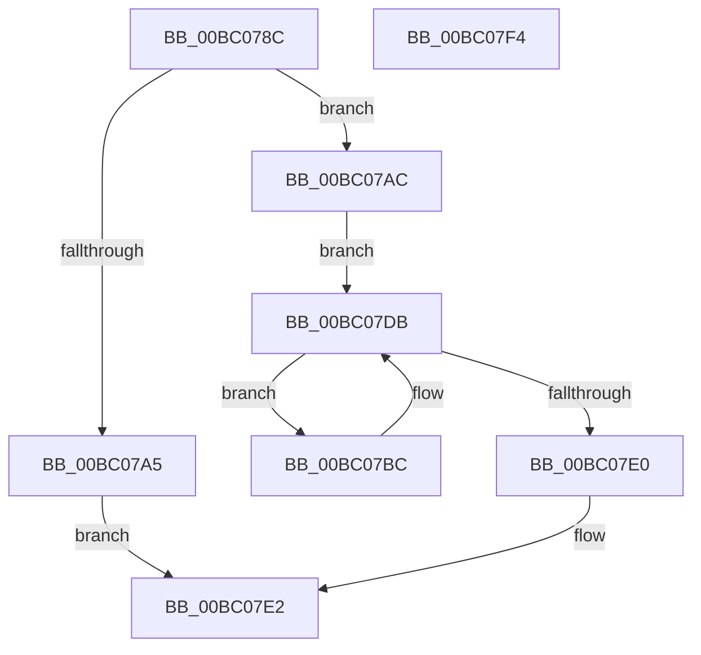

# BgMarkHiberPhase

- RVA: `0x00BC078C`–`0x00BC07F5` (길이 `105` bytes)
- VA: `0x0000000140BC078C`
- 실행 섹션: `PAGEBGFX`
- PDB 이름 있음: `예`; PDB Function 태그: `아니요`
- unwind 정보 RVA: `0x0006E5F8`
- 디코드: `29`개 명령, `105/105` bytes 표시
- 미해석 바이트: `0` (있으면 어셈블리에 `.byte`로 보존)

> 이 문서는 커널 이미지의 기계어와 PDB 기호를 분석해 생성했습니다. 4번과 5번은 함수 원형과 자료형을 바이너리 사용 방식에서 추정한 C 해석이며 원본 소스 복구 결과는 아닙니다.

## 1. Dependencies

- 직접 호출 지점: **3**; 고유 호출 대상: **3**
- 직접 호출자로 확인된 함수: **1**
- RIP 상대 이미지 참조: **2**

### Outgoing calls
- `0x00BC0796` → [BgpFwAcquireLock](../../text/4B/BgpFwAcquireLock_function_004B3AA4.md) (function, `0x004B3AA4`)
- `0x00BC07D3` → [PoSetHiberRange](../../text/47/PoSetHiberRange_function_0047C580.md) (function, `0x0047C580`)
- `0x00BC07E2` → [BgpFwReleaseLock](../../text/4B/BgpFwReleaseLock_function_004B357C.md) (function, `0x004B357C`)

### Direct callers
- [BgkResumePrepare](../../pagelk/B6/BgkResumePrepare_function_00B63ACC.md) at `0x00B63B6C`

### Static image references
- `0x00BC079B` → RVA `0x00EF0450` (`.data`; read)
- `0x00BC07AC` → RVA `0x00EF0520` (`.data`; read)

## 2. Other-region calls and transfers

- 다른 실행 섹션으로 향하는 call: **3**
  - `0x00BC0796` → [BgpFwAcquireLock](../../text/4B/BgpFwAcquireLock_function_004B3AA4.md) (`PAGEBGFX` → `.text`)
  - `0x00BC07D3` → [PoSetHiberRange](../../text/47/PoSetHiberRange_function_0047C580.md) (`PAGEBGFX` → `.text`)
  - `0x00BC07E2` → [BgpFwReleaseLock](../../text/4B/BgpFwReleaseLock_function_004B357C.md) (`PAGEBGFX` → `.text`)
- 별도 외부 분기/꼬리 이동을 확인하지 못했습니다.

## 3. Assembly (complete function range)

```asm
00BC078C  48 89 5C 24 08                  mov qword ptr [rsp + 8], rbx
00BC0791  57                              push rdi
00BC0792  48 83 EC 30                     sub rsp, 0x30
00BC0796  E8 09 33 8F FF                  call 0x1404b3aa4
00BC079B  8B 05 AF FC 32 00               mov eax, dword ptr [rip + 0x32fcaf]
00BC07A1  A8 01                           test al, 1
00BC07A3  75 07                           jne 0x140bc07ac
00BC07A5  BB 01 00 00 C0                  mov ebx, 0xc0000001
00BC07AA  EB 36                           jmp 0x140bc07e2
00BC07AC  48 8B 1D 6D FD 32 00            mov rbx, qword ptr [rip + 0x32fd6d]
00BC07B3  48 8D 3D 66 FD 32 00            lea rdi, [rip + 0x32fd66]
00BC07BA  EB 1F                           jmp 0x140bc07db
00BC07BC  4C 8B 4B 18                     mov r9, qword ptr [rbx + 0x18]
00BC07C0  4C 8D 43 F8                     lea r8, [rbx - 8]
00BC07C4  BA 00 00 01 00                  mov edx, 0x10000
00BC07C9  C7 44 24 20 42 47 42 4B         mov dword ptr [rsp + 0x20], 0x4b424742
00BC07D1  33 C9                           xor ecx, ecx
00BC07D3  E8 A8 BD 8B FF                  call 0x14047c580
00BC07D8  48 8B 1B                        mov rbx, qword ptr [rbx]
00BC07DB  48 3B DF                        cmp rbx, rdi
00BC07DE  75 DC                           jne 0x140bc07bc
00BC07E0  33 DB                           xor ebx, ebx
00BC07E2  E8 95 2D 8F FF                  call 0x1404b357c
00BC07E7  8B C3                           mov eax, ebx
00BC07E9  48 8B 5C 24 40                  mov rbx, qword ptr [rsp + 0x40]
00BC07EE  48 83 C4 30                     add rsp, 0x30
00BC07F2  5F                              pop rdi
00BC07F3  C3                              ret
00BC07F4  CC                              int3
```

## 4. C-style interpretation (structured pseudocode)

```c
__int64 __fastcall BgMarkHiberPhase(int a1)
{
    __int64 result;
    __int64 v_rbx;
    __int64 v_rsp;
    unsigned int v_stack_m18;
    unsigned __int64 v_stack_p8;

    v_stack_p8 = v_rbx;
    v_rsp = (v_rsp) - (48);
    result = BgpFwAcquireLock(a1, a2, a3, a4);
    if ((((unsigned __int8)((unsigned int)(*(unsigned int *)(v_rip + 3341487)))) & (1)) != 0) goto loc_00BC07AC;
    goto loc_00BC07E2;
loc_00BC07AC:
    goto loc_00BC07DB;
loc_00BC07BC:
    v_stack_m18 = 0x4B424742ULL;
    a1 = 0;
    result = PoSetHiberRange(a1, (unsigned int)(0x10000ULL), *(unsigned __int64 *)(v_rip + 3341677) - 8, *(unsigned __int64 *)(*(unsigned __int64 *)(v_rip + 3341677) + 24));
loc_00BC07DB:
    if ((*(unsigned __int64 *)(*(unsigned __int64 *)(v_rip + 3341677))) != (v_rip + 3341670)) goto loc_00BC07BC;
    v_rbx = 0;
loc_00BC07E2:
    result = BgpFwReleaseLock(a1, (unsigned int)(0x10000ULL), *(unsigned __int64 *)(v_rip + 3341677) - 8, *(unsigned __int64 *)(*(unsigned __int64 *)(v_rip + 3341677) + 24));
    v_rsp = (v_rsp) + (48);
    return 0;
}
```

## 5. (Beta) C Style

```c
int64_t BgMarkHiberPhase(int32_t Arg1)
{
    int64_t result;
    int64_t local_rbx;
    int64_t local_rsp;
    uint32_t v_stack_m18;
    uint64_t v_stack_p8;

    v_stack_p8 = local_rbx;
    local_rsp = (local_rsp) - (48);
    result = BgpFwAcquireLock(Arg1, a2, a3, a4);
    if ((((uint8_t)((uint32_t)(*(uint32_t *)(v_rip + 0x32FCAF)))) & (1)) != 0) goto loc_00BC07AC;
    goto loc_00BC07E2;
loc_00BC07AC:
    goto loc_00BC07DB;
loc_00BC07BC:
    v_stack_m18 = 0x4B424742ULL;
    Arg1 = 0;
    result = PoSetHiberRange(Arg1, (uint32_t)(0x10000ULL), *(uint64_t *)(v_rip + 0x32FD6D) - 8, *(uint64_t *)(*(uint64_t *)(v_rip + 0x32FD6D) + 0x18));
loc_00BC07DB:
    if ((*(uint64_t *)(*(uint64_t *)(v_rip + 0x32FD6D))) != (v_rip + 3341670)) goto loc_00BC07BC;
    local_rbx = 0;
loc_00BC07E2:
    result = BgpFwReleaseLock(Arg1, (uint32_t)(0x10000ULL), *(uint64_t *)(v_rip + 0x32FD6D) - 8, *(uint64_t *)(*(uint64_t *)(v_rip + 0x32FD6D) + 0x18));
    local_rsp = (local_rsp) + (48);
    return 0;
}
```

## 6. Execution-region graph

[열기: 2D/3D 그래프와 함수 탐색 컨트롤 패널](../../../control-panel.html?section=pagebgfx&rva=0x00BC078C&view=graph)

- 2D 그래프는 위에서 아래로 흐르고, 3D 그래프는 빈 공간을 드래그해 회전합니다. Shift+드래그는 이동, 휠은 확대·축소, 함수 노드 선택은 대상 보고서 이동입니다.

### Static fallback


