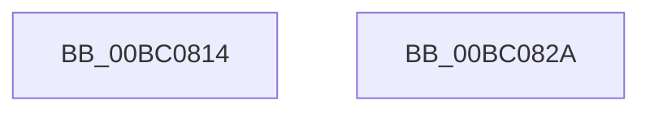

# BgSetFrameBufferAccess

- RVA: `0x00BC0814`–`0x00BC082B` (길이 `23` bytes)
- VA: `0x0000000140BC0814`
- 실행 섹션: `PAGEBGFX`
- PDB 이름 있음: `예`; PDB Function 태그: `아니요`
- unwind 정보 RVA: `0x000DB714`
- 디코드: `5`개 명령, `23/23` bytes 표시
- 미해석 바이트: `0` (있으면 어셈블리에 `.byte`로 보존)

> 이 문서는 커널 이미지의 기계어와 PDB 기호를 분석해 생성했습니다. 4번과 5번은 함수 원형과 자료형을 바이너리 사용 방식에서 추정한 C 해석이며 원본 소스 복구 결과는 아닙니다.

## 1. Dependencies

- 직접 호출 지점: **0**; 고유 호출 대상: **0**
- 직접 호출자로 확인된 함수: **2**
- RIP 상대 이미지 참조: **3**

### Outgoing calls
- 직접 디코드된 call 명령이 없습니다.

### Direct callers
- [BgkNotifyDisplayOwnershipChange](../../text/59/BgkNotifyDisplayOwnershipChange_function_00590CC0.md) at `0x00590E3A`
- [BgkSetVirtualFrameBuffer](../../text/59/BgkSetVirtualFrameBuffer_function_00590F50.md) at `0x00591114`

### Static image references
- `0x00BC0814` → RVA `0x00EF05B0` (`.data`; write)
- `0x00BC081B` → RVA `0x00EF05C0` (`.data`; write)
- `0x00BC0822` → RVA `0x00EF05C8` (`.data`; write)

## 2. Other-region calls and transfers

- 다른 실행 섹션으로 향하는 call: **0**
- 별도 외부 분기/꼬리 이동을 확인하지 못했습니다.

## 3. Assembly (complete function range)

```asm
00BC0814  48 89 0D 95 FD 32 00            mov qword ptr [rip + 0x32fd95], rcx
00BC081B  48 89 15 9E FD 32 00            mov qword ptr [rip + 0x32fd9e], rdx
00BC0822  4C 89 05 9F FD 32 00            mov qword ptr [rip + 0x32fd9f], r8
00BC0829  C3                              ret
00BC082A  CC                              int3
```

## 4. C-style interpretation (structured pseudocode)

```c
void __fastcall BgSetFrameBufferAccess(__int64 a1, __int64 a2, __int64 a3)
{
    *(unsigned __int64 *)(v_rip + 3341717) = a1;
    *(unsigned __int64 *)(v_rip + 3341726) = a2;
    *(unsigned __int64 *)(v_rip + 3341727) = a3;
    return;
}
```

## 5. (Beta) C Style

```c
void BgSetFrameBufferAccess(int64_t Arg1, int64_t Arg2, int64_t Arg3)
{
    *(uint64_t *)(v_rip + 0x32FD95) = Arg1;
    *(uint64_t *)(v_rip + 0x32FD9E) = Arg2;
    *(uint64_t *)(v_rip + 0x32FD9F) = Arg3;
    return;
}
```

## 6. Execution-region graph

[열기: 2D/3D 그래프와 함수 탐색 컨트롤 패널](../../../control-panel.html?section=pagebgfx&rva=0x00BC0814&view=graph)

- 2D 그래프는 위에서 아래로 흐르고, 3D 그래프는 빈 공간을 드래그해 회전합니다. Shift+드래그는 이동, 휠은 확대·축소, 함수 노드 선택은 대상 보고서 이동입니다.

### Static fallback


