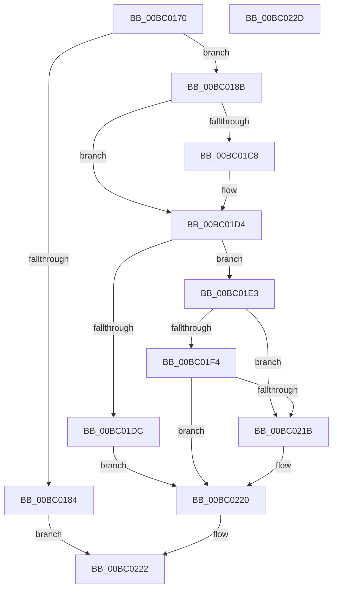

# BgkDestroy

- RVA: `0x00BC0170`–`0x00BC022E` (길이 `190` bytes)
- VA: `0x0000000140BC0170`
- 실행 섹션: `PAGEBGFX`
- PDB 이름 있음: `예`; PDB Function 태그: `아니요`
- unwind 정보 RVA: `0x0005CAAC`
- 디코드: `47`개 명령, `190/190` bytes 표시
- 미해석 바이트: `0` (있으면 어셈블리에 `.byte`로 보존)

> 이 문서는 커널 이미지의 기계어와 PDB 기호를 분석해 생성했습니다. 4번과 5번은 함수 원형과 자료형을 바이너리 사용 방식에서 추정한 C 해석이며 원본 소스 복구 결과는 아닙니다.

## 1. Dependencies

- 직접 호출 지점: **7**; 고유 호출 대상: **7**
- 직접 호출자로 확인된 함수: **2**
- RIP 상대 이미지 참조: **11**

### Outgoing calls
- `0x00BC018B` → [BgkpDisableConsole](../../text/59/BgkpDisableConsole_function_005911EC.md) (function, `0x005911EC`)
- `0x00BC019E` → [BgDisplayProgressIndicator](BgDisplayProgressIndicator_function_00BC0628.md) (function, `0x00BC0628`)
- `0x00BC01AB` → [BgDisplayBackgroundUpdate](BgDisplayBackgroundUpdate_function_00BC05EC.md) (function, `0x00BC05EC`)
- `0x00BC01C8` → [BgConsoleDestroyInterface](BgConsoleDestroyInterface_function_00BC0940.md) (function, `0x00BC0940`)
- `0x00BC01E3` → [BgpFwAcquireLock](../../text/4B/BgpFwAcquireLock_function_004B3AA4.md) (function, `0x004B3AA4`)
- `0x00BC020C` → [BgpFwLibraryDestroy](BgpFwLibraryDestroy_function_00BC1678.md) (function, `0x00BC1678`)
- `0x00BC021B` → [BgpFwReleaseLock](../../text/4B/BgpFwReleaseLock_function_004B357C.md) (function, `0x004B357C`)

### Direct callers
- [BgkNotifyDisplayOwnershipChange](../../text/59/BgkNotifyDisplayOwnershipChange_function_00590CC0.md) at `0x00590E22`
- [BgkInitialize](../../init/C8/BgkInitialize_function_00C80488.md) at `0x00C804C4`

### Static image references
- `0x00BC017C` → RVA `0x00E65EB0` (`.data`; read)
- `0x00BC0192` → RVA `0x00E65EBA` (`.data`; write)
- `0x00BC0198` → RVA `0x00E65EB0` (`.data`; write)
- `0x00BC01A5` → RVA `0x00E65EB8` (`.data`; write)
- `0x00BC01B0` → RVA `0x00E65E70` (`.data`; read)
- `0x00BC01B7` → RVA `0x00E65E81` (`.data`; write)
- `0x00BC01BD` → RVA `0x00E65E80` (`.data`; write)
- `0x00BC01CD` → RVA `0x00E65E70` (`.data`; write)
- `0x00BC01E8` → RVA `0x00EF0450` (`.data`; read)
- `0x00BC01F7` → RVA `0x00EF05B0` (`.data`; write)
- `0x00BC0204` → RVA `0x00EF05C0` (`.data`; write)

## 2. Other-region calls and transfers

- 다른 실행 섹션으로 향하는 call: **3**
  - `0x00BC018B` → [BgkpDisableConsole](../../text/59/BgkpDisableConsole_function_005911EC.md) (`PAGEBGFX` → `.text`)
  - `0x00BC01E3` → [BgpFwAcquireLock](../../text/4B/BgpFwAcquireLock_function_004B3AA4.md) (`PAGEBGFX` → `.text`)
  - `0x00BC021B` → [BgpFwReleaseLock](../../text/4B/BgpFwReleaseLock_function_004B357C.md) (`PAGEBGFX` → `.text`)
- 별도 외부 분기/꼬리 이동을 확인하지 못했습니다.

## 3. Assembly (complete function range)

```asm
00BC0170  48 89 5C 24 08                  mov qword ptr [rsp + 8], rbx
00BC0175  57                              push rdi
00BC0176  48 83 EC 20                     sub rsp, 0x20
00BC017A  33 DB                           xor ebx, ebx
00BC017C  38 1D 2E 5D 2A 00               cmp byte ptr [rip + 0x2a5d2e], bl
00BC0182  75 07                           jne 0x140bc018b
00BC0184  33 C0                           xor eax, eax
00BC0186  E9 97 00 00 00                  jmp 0x140bc0222
00BC018B  E8 5C 10 9D FF                  call 0x1405911ec
00BC0190  33 C9                           xor ecx, ecx
00BC0192  88 1D 22 5D 2A 00               mov byte ptr [rip + 0x2a5d22], bl
00BC0198  88 1D 12 5D 2A 00               mov byte ptr [rip + 0x2a5d12], bl
00BC019E  E8 85 04 00 00                  call 0x140bc0628
00BC01A3  33 C9                           xor ecx, ecx
00BC01A5  88 1D 0D 5D 2A 00               mov byte ptr [rip + 0x2a5d0d], bl
00BC01AB  E8 3C 04 00 00                  call 0x140bc05ec
00BC01B0  48 8B 0D B9 5C 2A 00            mov rcx, qword ptr [rip + 0x2a5cb9]
00BC01B7  88 1D C4 5C 2A 00               mov byte ptr [rip + 0x2a5cc4], bl
00BC01BD  88 1D BD 5C 2A 00               mov byte ptr [rip + 0x2a5cbd], bl
00BC01C3  48 85 C9                        test rcx, rcx
00BC01C6  74 0C                           je 0x140bc01d4
00BC01C8  E8 73 07 00 00                  call 0x140bc0940
00BC01CD  48 89 1D 9C 5C 2A 00            mov qword ptr [rip + 0x2a5c9c], rbx
00BC01D4  44 0F 20 C0                     mov rax, cr8
00BC01D8  3C 02                           cmp al, 2
00BC01DA  76 07                           jbe 0x140bc01e3
00BC01DC  BB 01 00 00 C0                  mov ebx, 0xc0000001
00BC01E1  EB 3D                           jmp 0x140bc0220
00BC01E3  E8 BC 38 8F FF                  call 0x1404b3aa4
00BC01E8  8B 3D 62 02 33 00               mov edi, dword ptr [rip + 0x330262]
00BC01EE  40 F6 C7 01                     test dil, 1
00BC01F2  74 27                           je 0x140bc021b
00BC01F4  0F 57 C0                        xorps xmm0, xmm0
00BC01F7  48 89 1D B2 03 33 00            mov qword ptr [rip + 0x3303b2], rbx
00BC01FE  81 E7 00 0C 00 00               and edi, 0xc00
00BC0204  F3 0F 7F 05 B4 03 33 00         movdqu xmmword ptr [rip + 0x3303b4], xmm0
00BC020C  E8 67 14 00 00                  call 0x140bc1678
00BC0211  8B D8                           mov ebx, eax
00BC0213  81 FF 00 0C 00 00               cmp edi, 0xc00
00BC0219  74 05                           je 0x140bc0220
00BC021B  E8 5C 33 8F FF                  call 0x1404b357c
00BC0220  8B C3                           mov eax, ebx
00BC0222  48 8B 5C 24 30                  mov rbx, qword ptr [rsp + 0x30]
00BC0227  48 83 C4 20                     add rsp, 0x20
00BC022B  5F                              pop rdi
00BC022C  C3                              ret
00BC022D  CC                              int3
```

## 4. C-style interpretation (structured pseudocode)

```c
__int64 __fastcall BgkDestroy(int a1)
{
    __int64 result;
    __int64 v_rbx;
    __int64 v_rdi;
    __int64 v_rsp;
    unsigned __int64 v_stack_p8;

    v_stack_p8 = v_rbx;
    v_rsp = (v_rsp) - (32);
    v_rbx = 0;
    if ((*(unsigned __int8 *)(v_rip + 2776366)) != 0) goto loc_00BC018B;
    result = 0;
    goto loc_00BC0222;
loc_00BC018B:
    result = BgkpDisableConsole(a1, a2, a3, a4);
    a1 = 0;
    *(unsigned __int8 *)(v_rip + 2776354) = 0;
    *(unsigned __int8 *)(v_rip + 2776338) = 0;
    result = BgDisplayProgressIndicator(a1, a2, a3, a4);
    a1 = 0;
    *(unsigned __int8 *)(v_rip + 2776333) = 0;
    result = BgDisplayBackgroundUpdate(a1, a2, a3, a4);
    *(unsigned __int8 *)(v_rip + 2776260) = 0;
    *(unsigned __int8 *)(v_rip + 2776253) = 0;
    if (*(unsigned __int64 *)(v_rip + 2776249) != 0) {
        result = BgConsoleDestroyInterface(*(unsigned __int64 *)(v_rip + 2776249), a2, a3, a4);
        *(unsigned __int64 *)(v_rip + 2776220) = 0;
    }
    if (((unsigned __int8)(v_cr8)) <= 2) goto loc_00BC01E3;
    goto loc_00BC0220;
loc_00BC01E3:
    result = BgpFwAcquireLock(*(unsigned __int64 *)(v_rip + 2776249), a2, a3, a4);
    if ((((unsigned __int8)((unsigned int)(*(unsigned int *)(v_rip + 3342946)))) & (1)) == 0) goto loc_00BC021B;
    *(unsigned __int64 *)(v_rip + 3343282) = (unsigned int)(0xC0000001ULL);
    v_rdi = (unsigned int)(((unsigned int)(*(unsigned int *)(v_rip + 3342946))) & (0xC00ULL));
    *(unsigned __int64 *)(v_rip + 3343284) = v_xmm0;
    result = BgpFwLibraryDestroy(*(unsigned __int64 *)(v_rip + 2776249), a2, a3, a4);
    if (((unsigned int)(v_rdi)) != 0xC00ULL) {
        result = BgpFwReleaseLock(*(unsigned __int64 *)(v_rip + 2776249), a2, a3, a4);
    }
loc_00BC0222:
    v_rsp = (v_rsp) + (32);
    return (unsigned int)((unsigned int)((unsigned int)((unsigned int)(result))));
}
```

## 5. (Beta) C Style

```c
int64_t BgkDestroy(int32_t Arg1)
{
    int64_t result;
    int64_t local_rbx;
    int64_t local_rdi;
    int64_t local_rsp;
    uint64_t v_stack_p8;

    v_stack_p8 = local_rbx;
    local_rsp = (local_rsp) - (32);
    local_rbx = 0;
    if ((*(uint8_t *)(v_rip + 0x2A5D2E)) != 0) goto loc_00BC018B;
    result = 0;
    goto loc_00BC0222;
loc_00BC018B:
    result = BgkpDisableConsole(Arg1, a2, a3, a4);
    Arg1 = 0;
    *(uint8_t *)(v_rip + 0x2A5D22) = 0;
    *(uint8_t *)(v_rip + 0x2A5D12) = 0;
    result = BgDisplayProgressIndicator(Arg1, a2, a3, a4);
    Arg1 = 0;
    *(uint8_t *)(v_rip + 0x2A5D0D) = 0;
    result = BgDisplayBackgroundUpdate(Arg1, a2, a3, a4);
    *(uint8_t *)(v_rip + 0x2A5CC4) = 0;
    *(uint8_t *)(v_rip + 0x2A5CBD) = 0;
    if (*(uint64_t *)(v_rip + 0x2A5CB9) != 0) {
        result = BgConsoleDestroyInterface(*(uint64_t *)(v_rip + 0x2A5CB9), a2, a3, a4);
        *(uint64_t *)(v_rip + 0x2A5C9C) = 0;
    }
    if (((uint8_t)(v_cr8)) <= 2) goto loc_00BC01E3;
    goto loc_00BC0220;
loc_00BC01E3:
    result = BgpFwAcquireLock(*(uint64_t *)(v_rip + 0x2A5CB9), a2, a3, a4);
    if ((((uint8_t)((uint32_t)(*(uint32_t *)(v_rip + 0x330262)))) & (1)) == 0) goto loc_00BC021B;
    *(uint64_t *)(v_rip + 0x3303B2) = (uint32_t)(0xC0000001ULL);
    local_rdi = (uint32_t)(((uint32_t)(*(uint32_t *)(v_rip + 0x330262))) & (0xC00ULL));
    *(uint64_t *)(v_rip + 0x3303B4) = v_xmm0;
    result = BgpFwLibraryDestroy(*(uint64_t *)(v_rip + 0x2A5CB9), a2, a3, a4);
    if (((uint32_t)(local_rdi)) != 0xC00ULL) {
        result = BgpFwReleaseLock(*(uint64_t *)(v_rip + 0x2A5CB9), a2, a3, a4);
    }
loc_00BC0222:
    local_rsp = (local_rsp) + (32);
    return (uint32_t)((uint32_t)((uint32_t)((uint32_t)(result))));
}
```

## 6. Execution-region graph

[열기: 2D/3D 그래프와 함수 탐색 컨트롤 패널](../../../control-panel.html?section=pagebgfx&rva=0x00BC0170&view=graph)

- 2D 그래프는 위에서 아래로 흐르고, 3D 그래프는 빈 공간을 드래그해 회전합니다. Shift+드래그는 이동, 휠은 확대·축소, 함수 노드 선택은 대상 보고서 이동입니다.

### Static fallback


