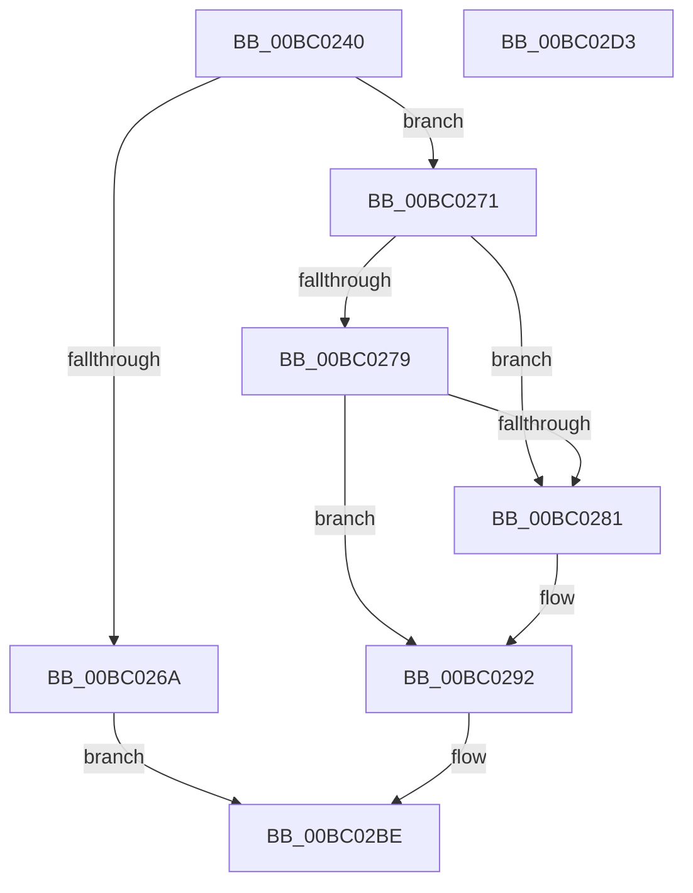

# BgkDisplayCharacter

- RVA: `0x00BC0240`–`0x00BC02D4` (길이 `148` bytes)
- VA: `0x0000000140BC0240`
- 실행 섹션: `PAGEBGFX`
- PDB 이름 있음: `예`; PDB Function 태그: `아니요`
- unwind 정보 RVA: `0x00066400`
- 디코드: `41`개 명령, `148/148` bytes 표시
- 미해석 바이트: `0` (있으면 어셈블리에 `.byte`로 보존)

> 이 문서는 커널 이미지의 기계어와 PDB 기호를 분석해 생성했습니다. 4번과 5번은 함수 원형과 자료형을 바이너리 사용 방식에서 추정한 C 해석이며 원본 소스 복구 결과는 아닙니다.

## 1. Dependencies

- 직접 호출 지점: **4**; 고유 호출 대상: **4**
- 직접 호출자로 확인된 함수: **0**
- RIP 상대 이미지 참조: **5**

### Outgoing calls
- `0x00BC025F` → [BgkpAcquireConsole](../../text/59/BgkpAcquireConsole_function_005911C8.md) (function, `0x005911C8`)
- `0x00BC028D` → [BgDisplayFade](BgDisplayFade_function_00BC36A4.md) (function, `0x00BC36A4`)
- `0x00BC02B0` → [guard_dispatch_icall](../../text/6B/guard_dispatch_icall_function_006BAAD0.md) (function, `0x006BAAD0`)
- `0x00BC02B7` → [BgkpReleaseConsole](../../text/59/BgkpReleaseConsole_function_00591214.md) (function, `0x00591214`)

### Direct callers
- 이 함수 시작 RVA로 연결되는 직접 call은 확인되지 않았습니다. 간접 호출은 완전히 역산할 수 없습니다.

### Static image references
- `0x00BC0271` → RVA `0x00E65EB8` (`.data`; read)
- `0x00BC0279` → RVA `0x00E65E81` (`.data`; read)
- `0x00BC0281` → RVA `0x00E65EB8` (`.data`; write)
- `0x00BC0287` → RVA `0x00E65E81` (`.data`; write)
- `0x00BC0299` → RVA `0x00E65E70` (`.data`; read)

## 2. Other-region calls and transfers

- 다른 실행 섹션으로 향하는 call: **3**
  - `0x00BC025F` → [BgkpAcquireConsole](../../text/59/BgkpAcquireConsole_function_005911C8.md) (`PAGEBGFX` → `.text`)
  - `0x00BC02B0` → [guard_dispatch_icall](../../text/6B/guard_dispatch_icall_function_006BAAD0.md) (`PAGEBGFX` → `.text`)
  - `0x00BC02B7` → [BgkpReleaseConsole](../../text/59/BgkpReleaseConsole_function_00591214.md) (`PAGEBGFX` → `.text`)
- 별도 외부 분기/꼬리 이동을 확인하지 못했습니다.

## 3. Assembly (complete function range)

```asm
00BC0240  48 89 5C 24 08                  mov qword ptr [rsp + 8], rbx
00BC0245  48 89 6C 24 10                  mov qword ptr [rsp + 0x10], rbp
00BC024A  48 89 74 24 18                  mov qword ptr [rsp + 0x18], rsi
00BC024F  57                              push rdi
00BC0250  48 83 EC 30                     sub rsp, 0x30
00BC0254  41 8B D9                        mov ebx, r9d
00BC0257  41 8B F8                        mov edi, r8d
00BC025A  8B F2                           mov esi, edx
00BC025C  0F B7 E9                        movzx ebp, cx
00BC025F  E8 64 0F 9D FF                  call 0x1405911c8
00BC0264  33 C9                           xor ecx, ecx
00BC0266  84 C0                           test al, al
00BC0268  75 07                           jne 0x140bc0271
00BC026A  B8 01 00 00 C0                  mov eax, 0xc0000001
00BC026F  EB 4D                           jmp 0x140bc02be
00BC0271  38 0D 41 5C 2A 00               cmp byte ptr [rip + 0x2a5c41], cl
00BC0277  75 08                           jne 0x140bc0281
00BC0279  38 0D 02 5C 2A 00               cmp byte ptr [rip + 0x2a5c02], cl
00BC027F  74 11                           je 0x140bc0292
00BC0281  88 0D 31 5C 2A 00               mov byte ptr [rip + 0x2a5c31], cl
00BC0287  88 0D F4 5B 2A 00               mov byte ptr [rip + 0x2a5bf4], cl
00BC028D  E8 12 34 00 00                  call 0x140bc36a4
00BC0292  8B 4C 24 60                     mov ecx, dword ptr [rsp + 0x60]
00BC0296  44 8B CB                        mov r9d, ebx
00BC0299  48 8B 05 D0 5B 2A 00            mov rax, qword ptr [rip + 0x2a5bd0]
00BC02A0  44 8B C7                        mov r8d, edi
00BC02A3  89 4C 24 20                     mov dword ptr [rsp + 0x20], ecx
00BC02A7  8B D6                           mov edx, esi
00BC02A9  0F B7 CD                        movzx ecx, bp
00BC02AC  48 8B 40 20                     mov rax, qword ptr [rax + 0x20]
00BC02B0  E8 1B A8 AF FF                  call 0x1406baad0
00BC02B5  8B D8                           mov ebx, eax
00BC02B7  E8 58 0F 9D FF                  call 0x140591214
00BC02BC  8B C3                           mov eax, ebx
00BC02BE  48 8B 5C 24 40                  mov rbx, qword ptr [rsp + 0x40]
00BC02C3  48 8B 6C 24 48                  mov rbp, qword ptr [rsp + 0x48]
00BC02C8  48 8B 74 24 50                  mov rsi, qword ptr [rsp + 0x50]
00BC02CD  48 83 C4 30                     add rsp, 0x30
00BC02D1  5F                              pop rdi
00BC02D2  C3                              ret
00BC02D3  CC                              int3
```

## 4. C-style interpretation (structured pseudocode)

```c
__int64 __fastcall BgkDisplayCharacter(int a1, int a2, int a3, int a4, unsigned int a5)
{
    __int64 result;
    __int64 v_rsp;
    unsigned int v_stack_m18;
    unsigned __int64 v_stack_p10;
    unsigned __int64 v_stack_p18;
    unsigned __int64 v_stack_p8;

    v_stack_p8 = v_rbx;
    v_stack_p10 = v_rbp;
    v_stack_p18 = v_rsi;
    v_rsp = (v_rsp) - (48);
    result = BgkpAcquireConsole(a1, a2, a3, a4);
    a1 = 0;
    if ((unsigned __int8)(result) != 0) goto loc_00BC0271;
    goto loc_00BC02BE;
loc_00BC0271:
    if ((*(unsigned __int8 *)(v_rip + 2776129)) != 0) goto loc_00BC0281;
    result = (unsigned int)(0xC0000001ULL);
    if ((*(unsigned __int8 *)(v_rip + 2776066)) != 0) {
        *(unsigned __int8 *)(v_rip + 2776113) = 0;
        *(unsigned __int8 *)(v_rip + 2776052) = 0;
        result = BgDisplayFade(a1, a2, a3, a4);
    }
    v_stack_m18 = (unsigned int)((unsigned int)(a5));
    result = guard_dispatch_icall((unsigned __int16)((unsigned __int16)(a1)), (unsigned int)((unsigned int)((unsigned int)(a2))), (unsigned int)((unsigned int)((unsigned int)(a3))), (unsigned int)((unsigned int)((unsigned int)(a4))));
    result = BgkpReleaseConsole((unsigned __int16)((unsigned __int16)(a1)), (unsigned int)((unsigned int)((unsigned int)(a2))), (unsigned int)((unsigned int)((unsigned int)(a3))), (unsigned int)((unsigned int)((unsigned int)(a4))));
loc_00BC02BE:
    v_rsp = (v_rsp) + (48);
    return (unsigned int)((unsigned int)((unsigned int)((unsigned int)(result))));
}
```

## 5. (Beta) C Style

```c
int64_t BgkDisplayCharacter(int32_t Arg1, int32_t Arg2, int32_t Arg3, int32_t Arg4, uint32_t Arg5)
{
    int64_t result;
    int64_t local_rsp;
    uint32_t v_stack_m18;
    uint64_t v_stack_p10;
    uint64_t v_stack_p18;
    uint64_t v_stack_p8;

    v_stack_p8 = local_rbx;
    v_stack_p10 = local_rbp;
    v_stack_p18 = local_rsi;
    local_rsp = (local_rsp) - (48);
    result = BgkpAcquireConsole(Arg1, Arg2, Arg3, Arg4);
    Arg1 = 0;
    if ((uint8_t)(result) != 0) goto loc_00BC0271;
    goto loc_00BC02BE;
loc_00BC0271:
    if ((*(uint8_t *)(v_rip + 0x2A5C41)) != 0) goto loc_00BC0281;
    result = (uint32_t)(0xC0000001ULL);
    if ((*(uint8_t *)(v_rip + 0x2A5C02)) != 0) {
        *(uint8_t *)(v_rip + 0x2A5C31) = 0;
        *(uint8_t *)(v_rip + 0x2A5BF4) = 0;
        result = BgDisplayFade(Arg1, Arg2, Arg3, Arg4);
    }
    v_stack_m18 = (uint32_t)((uint32_t)(Arg5));
    result = guard_dispatch_icall((uint16_t)((uint16_t)(Arg1)), (uint32_t)((uint32_t)((uint32_t)(Arg2))), (uint32_t)((uint32_t)((uint32_t)(Arg3))), (uint32_t)((uint32_t)((uint32_t)(Arg4))));
    result = BgkpReleaseConsole((uint16_t)((uint16_t)(Arg1)), (uint32_t)((uint32_t)((uint32_t)(Arg2))), (uint32_t)((uint32_t)((uint32_t)(Arg3))), (uint32_t)((uint32_t)((uint32_t)(Arg4))));
loc_00BC02BE:
    local_rsp = (local_rsp) + (48);
    return (uint32_t)((uint32_t)((uint32_t)((uint32_t)(result))));
}
```

## 6. Execution-region graph

[열기: 2D/3D 그래프와 함수 탐색 컨트롤 패널](../../../control-panel.html?section=pagebgfx&rva=0x00BC0240&view=graph)

- 2D 그래프는 위에서 아래로 흐르고, 3D 그래프는 빈 공간을 드래그해 회전합니다. Shift+드래그는 이동, 휠은 확대·축소, 함수 노드 선택은 대상 보고서 이동입니다.

### Static fallback


