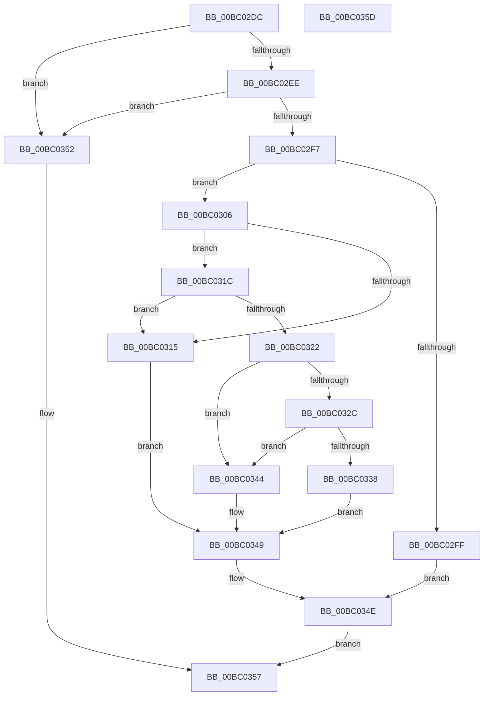

# BgkDrawText

- RVA: `0x00BC02DC`–`0x00BC035E` (길이 `130` bytes)
- VA: `0x0000000140BC02DC`
- 실행 섹션: `PAGEBGFX`
- PDB 이름 있음: `예`; PDB Function 태그: `아니요`
- unwind 정보 RVA: `0x00064C80`
- 디코드: `38`개 명령, `130/130` bytes 표시
- 미해석 바이트: `0` (있으면 어셈블리에 `.byte`로 보존)

> 이 문서는 커널 이미지의 기계어와 PDB 기호를 분석해 생성했습니다. 4번과 5번은 함수 원형과 자료형을 바이너리 사용 방식에서 추정한 C 해석이며 원본 소스 복구 결과는 아닙니다.

## 1. Dependencies

- 직접 호출 지점: **3**; 고유 호출 대상: **3**
- 직접 호출자로 확인된 함수: **1**
- RIP 상대 이미지 참조: **5**

### Outgoing calls
- `0x00BC0306` → [BgpFwAcquireLock](../../text/4B/BgpFwAcquireLock_function_004B3AA4.md) (function, `0x004B3AA4`)
- `0x00BC033B` → [BgpTxtDisplayString](BgpTxtDisplayString_function_00BC2BB0.md) (function, `0x00BC2BB0`)
- `0x00BC0349` → [BgpFwReleaseLock](../../text/4B/BgpFwReleaseLock_function_004B357C.md) (function, `0x004B357C`)

### Direct callers
- [NtDrawText](../../text/65/NtDrawText_function_006559F0.md) at `0x00655B2F`

### Static image references
- `0x00BC02E2` → RVA `0x00E65EB0` (`.data`; read)
- `0x00BC02EE` → RVA `0x00E65EBA` (`.data`; read)
- `0x00BC030B` → RVA `0x00EF0450` (`.data`; read)
- `0x00BC0322` → RVA `0x00EF0500` (`.data`; read)
- `0x00BC032C` → RVA `0x00EF0518` (`.data`; read)

## 2. Other-region calls and transfers

- 다른 실행 섹션으로 향하는 call: **2**
  - `0x00BC0306` → [BgpFwAcquireLock](../../text/4B/BgpFwAcquireLock_function_004B3AA4.md) (`PAGEBGFX` → `.text`)
  - `0x00BC0349` → [BgpFwReleaseLock](../../text/4B/BgpFwReleaseLock_function_004B357C.md) (`PAGEBGFX` → `.text`)
- 별도 외부 분기/꼬리 이동을 확인하지 못했습니다.

## 3. Assembly (complete function range)

```asm
00BC02DC  40 53                           push rbx
00BC02DE  48 83 EC 30                     sub rsp, 0x30
00BC02E2  80 3D C7 5B 2A 00 00            cmp byte ptr [rip + 0x2a5bc7], 0
00BC02E9  48 8B D9                        mov rbx, rcx
00BC02EC  74 64                           je 0x140bc0352
00BC02EE  80 3D C5 5B 2A 00 00            cmp byte ptr [rip + 0x2a5bc5], 0
00BC02F5  74 5B                           je 0x140bc0352
00BC02F7  44 0F 20 C0                     mov rax, cr8
00BC02FB  3C 02                           cmp al, 2
00BC02FD  76 07                           jbe 0x140bc0306
00BC02FF  BB 01 00 00 C0                  mov ebx, 0xc0000001
00BC0304  EB 48                           jmp 0x140bc034e
00BC0306  E8 99 37 8F FF                  call 0x1404b3aa4
00BC030B  8B 05 3F 01 33 00               mov eax, dword ptr [rip + 0x33013f]
00BC0311  A8 01                           test al, 1
00BC0313  75 07                           jne 0x140bc031c
00BC0315  BB 01 00 00 C0                  mov ebx, 0xc0000001
00BC031A  EB 2D                           jmp 0x140bc0349
00BC031C  0F BA E0 08                     bt eax, 8
00BC0320  72 F3                           jb 0x140bc0315
00BC0322  48 83 3D D6 01 33 00 00         cmp qword ptr [rip + 0x3301d6], 0
00BC032A  74 18                           je 0x140bc0344
00BC032C  48 8B 0D E5 01 33 00            mov rcx, qword ptr [rip + 0x3301e5]
00BC0333  48 85 C9                        test rcx, rcx
00BC0336  74 0C                           je 0x140bc0344
00BC0338  48 8B D3                        mov rdx, rbx
00BC033B  E8 70 28 00 00                  call 0x140bc2bb0
00BC0340  8B D8                           mov ebx, eax
00BC0342  EB 05                           jmp 0x140bc0349
00BC0344  BB 9A 00 00 C0                  mov ebx, 0xc000009a
00BC0349  E8 2E 32 8F FF                  call 0x1404b357c
00BC034E  8B C3                           mov eax, ebx
00BC0350  EB 05                           jmp 0x140bc0357
00BC0352  B8 01 00 00 C0                  mov eax, 0xc0000001
00BC0357  48 83 C4 30                     add rsp, 0x30
00BC035B  5B                              pop rbx
00BC035C  C3                              ret
00BC035D  CC                              int3
```

## 4. C-style interpretation (structured pseudocode)

```c
__int64 __fastcall BgkDrawText(__int64 a1)
{
    __int64 result;
    __int64 v_rsp;

    v_rsp = (v_rsp) - (48);
    if ((*(unsigned __int8 *)(v_rip + 2776007)) == 0) goto loc_00BC0352;
    if ((*(unsigned __int8 *)(v_rip + 2776005)) == 0) goto loc_00BC0352;
    if (((unsigned __int8)(v_cr8)) <= 2) goto loc_00BC0306;
    goto loc_00BC034E;
loc_00BC0306:
    result = BgpFwAcquireLock(a1, a2, a3, a4);
    if ((((unsigned __int8)((unsigned int)(*(unsigned int *)(v_rip + 3342655)))) & (1)) != 0) goto loc_00BC031C;
loc_00BC0315:
    goto loc_00BC0349;
loc_00BC031C:
    if (condition_is_below) goto loc_00BC0315;
    if ((*(unsigned __int64 *)(v_rip + 3342806)) == 0) goto loc_00BC0344;
    if (*(unsigned __int64 *)(v_rip + 3342821) == 0) goto loc_00BC0344;
    result = BgpTxtDisplayString(*(unsigned __int64 *)(v_rip + 3342821), (unsigned int)(0xC0000001ULL), a3, a4);
    goto loc_00BC0349;
loc_00BC0344:
loc_00BC0349:
    result = BgpFwReleaseLock(*(unsigned __int64 *)(v_rip + 3342821), (unsigned int)(0xC0000001ULL), a3, a4);
loc_00BC034E:
    goto loc_00BC0357;
loc_00BC0352:
loc_00BC0357:
    v_rsp = (v_rsp) + (48);
    return (unsigned int)(0xC0000001ULL);
}
```

## 5. (Beta) C Style

```c
int64_t BgkDrawText(int64_t Arg1)
{
    int64_t result;
    int64_t local_rsp;

    local_rsp = (local_rsp) - (48);
    if ((*(uint8_t *)(v_rip + 0x2A5BC7)) == 0) goto loc_00BC0352;
    if ((*(uint8_t *)(v_rip + 0x2A5BC5)) == 0) goto loc_00BC0352;
    if (((uint8_t)(v_cr8)) <= 2) goto loc_00BC0306;
    goto loc_00BC034E;
loc_00BC0306:
    result = BgpFwAcquireLock(Arg1, a2, a3, a4);
    if ((((uint8_t)((uint32_t)(*(uint32_t *)(v_rip + 0x33013F)))) & (1)) != 0) goto loc_00BC031C;
loc_00BC0315:
    goto loc_00BC0349;
loc_00BC031C:
    if (condition_is_below) goto loc_00BC0315;
    if ((*(uint64_t *)(v_rip + 0x3301D6)) == 0) goto loc_00BC0344;
    if (*(uint64_t *)(v_rip + 0x3301E5) == 0) goto loc_00BC0344;
    result = BgpTxtDisplayString(*(uint64_t *)(v_rip + 0x3301E5), (uint32_t)(0xC0000001ULL), a3, a4);
    goto loc_00BC0349;
loc_00BC0344:
loc_00BC0349:
    result = BgpFwReleaseLock(*(uint64_t *)(v_rip + 0x3301E5), (uint32_t)(0xC0000001ULL), a3, a4);
loc_00BC034E:
    goto loc_00BC0357;
loc_00BC0352:
loc_00BC0357:
    local_rsp = (local_rsp) + (48);
    return (uint32_t)(0xC0000001ULL);
}
```

## 6. Execution-region graph

[열기: 2D/3D 그래프와 함수 탐색 컨트롤 패널](../../../control-panel.html?section=pagebgfx&rva=0x00BC02DC&view=graph)

- 2D 그래프는 위에서 아래로 흐르고, 3D 그래프는 빈 공간을 드래그해 회전합니다. Shift+드래그는 이동, 휠은 확대·축소, 함수 노드 선택은 대상 보고서 이동입니다.

### Static fallback


