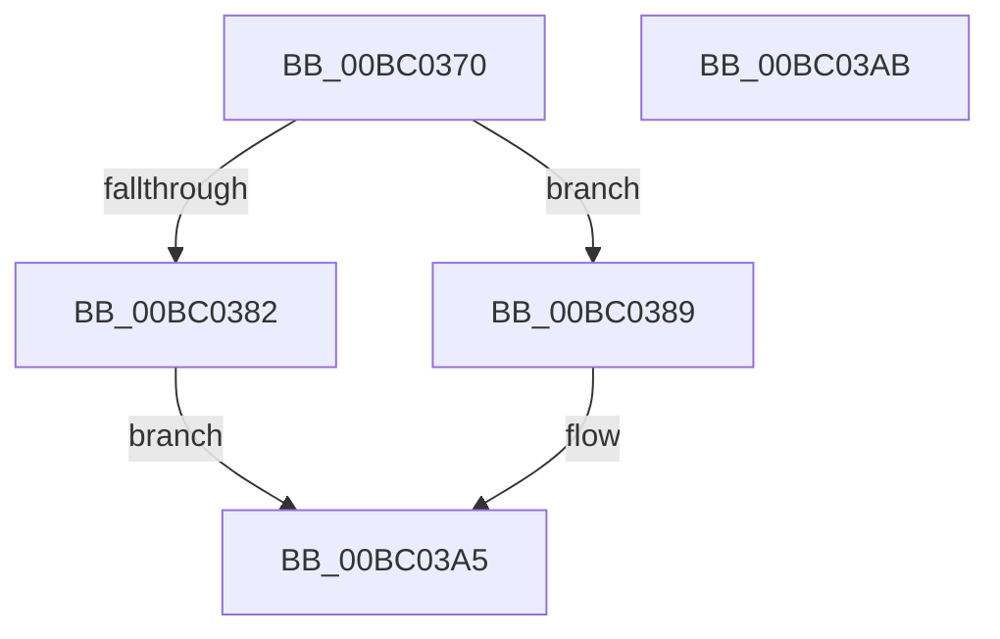

# BgkGetConsoleState

- RVA: `0x00BC0370`–`0x00BC03AC` (길이 `60` bytes)
- VA: `0x0000000140BC0370`
- 실행 섹션: `PAGEBGFX`
- PDB 이름 있음: `예`; PDB Function 태그: `아니요`
- unwind 정보 RVA: `0x0005CF00`
- 디코드: `19`개 명령, `60/60` bytes 표시
- 미해석 바이트: `0` (있으면 어셈블리에 `.byte`로 보존)

> 이 문서는 커널 이미지의 기계어와 PDB 기호를 분석해 생성했습니다. 4번과 5번은 함수 원형과 자료형을 바이너리 사용 방식에서 추정한 C 해석이며 원본 소스 복구 결과는 아닙니다.

## 1. Dependencies

- 직접 호출 지점: **3**; 고유 호출 대상: **3**
- 직접 호출자로 확인된 함수: **0**
- RIP 상대 이미지 참조: **1**

### Outgoing calls
- `0x00BC0379` → [BgkpAcquireConsole](../../text/59/BgkpAcquireConsole_function_005911C8.md) (function, `0x005911C8`)
- `0x00BC0397` → [guard_dispatch_icall](../../text/6B/guard_dispatch_icall_function_006BAAD0.md) (function, `0x006BAAD0`)
- `0x00BC039E` → [BgkpReleaseConsole](../../text/59/BgkpReleaseConsole_function_00591214.md) (function, `0x00591214`)

### Direct callers
- 이 함수 시작 RVA로 연결되는 직접 call은 확인되지 않았습니다. 간접 호출은 완전히 역산할 수 없습니다.

### Static image references
- `0x00BC0389` → RVA `0x00E65E70` (`.data`; read)

## 2. Other-region calls and transfers

- 다른 실행 섹션으로 향하는 call: **3**
  - `0x00BC0379` → [BgkpAcquireConsole](../../text/59/BgkpAcquireConsole_function_005911C8.md) (`PAGEBGFX` → `.text`)
  - `0x00BC0397` → [guard_dispatch_icall](../../text/6B/guard_dispatch_icall_function_006BAAD0.md) (`PAGEBGFX` → `.text`)
  - `0x00BC039E` → [BgkpReleaseConsole](../../text/59/BgkpReleaseConsole_function_00591214.md) (`PAGEBGFX` → `.text`)
- 별도 외부 분기/꼬리 이동을 확인하지 못했습니다.

## 3. Assembly (complete function range)

```asm
00BC0370  40 53                           push rbx
00BC0372  48 83 EC 20                     sub rsp, 0x20
00BC0376  48 8B D9                        mov rbx, rcx
00BC0379  E8 4A 0E 9D FF                  call 0x1405911c8
00BC037E  84 C0                           test al, al
00BC0380  75 07                           jne 0x140bc0389
00BC0382  B8 01 00 00 C0                  mov eax, 0xc0000001
00BC0387  EB 1C                           jmp 0x140bc03a5
00BC0389  48 8B 05 E0 5A 2A 00            mov rax, qword ptr [rip + 0x2a5ae0]
00BC0390  48 8B CB                        mov rcx, rbx
00BC0393  48 8B 40 28                     mov rax, qword ptr [rax + 0x28]
00BC0397  E8 34 A7 AF FF                  call 0x1406baad0
00BC039C  8B D8                           mov ebx, eax
00BC039E  E8 71 0E 9D FF                  call 0x140591214
00BC03A3  8B C3                           mov eax, ebx
00BC03A5  48 83 C4 20                     add rsp, 0x20
00BC03A9  5B                              pop rbx
00BC03AA  C3                              ret
00BC03AB  CC                              int3
```

## 4. C-style interpretation (structured pseudocode)

```c
__int64 __fastcall BgkGetConsoleState(__int64 a1)
{
    __int64 result;
    __int64 v_rsp;

    v_rsp = (v_rsp) - (32);
    result = BgkpAcquireConsole(a1, a2, a3, a4);
    if ((unsigned __int8)(result) != 0) goto loc_00BC0389;
    goto loc_00BC03A5;
loc_00BC0389:
    result = guard_dispatch_icall(a1, a2, a3, a4);
    result = BgkpReleaseConsole(a1, a2, a3, a4);
loc_00BC03A5:
    v_rsp = (v_rsp) + (32);
    return (unsigned int)((unsigned int)((unsigned int)((unsigned int)(result))));
}
```

## 5. (Beta) C Style

```c
int64_t BgkGetConsoleState(int64_t Arg1)
{
    int64_t result;
    int64_t local_rsp;

    local_rsp = (local_rsp) - (32);
    result = BgkpAcquireConsole(Arg1, a2, a3, a4);
    if ((uint8_t)(result) != 0) goto loc_00BC0389;
    goto loc_00BC03A5;
loc_00BC0389:
    result = guard_dispatch_icall(Arg1, a2, a3, a4);
    result = BgkpReleaseConsole(Arg1, a2, a3, a4);
loc_00BC03A5:
    local_rsp = (local_rsp) + (32);
    return (uint32_t)((uint32_t)((uint32_t)((uint32_t)(result))));
}
```

## 6. Execution-region graph

[열기: 2D/3D 그래프와 함수 탐색 컨트롤 패널](../../../control-panel.html?section=pagebgfx&rva=0x00BC0370&view=graph)

- 2D 그래프는 위에서 아래로 흐르고, 3D 그래프는 빈 공간을 드래그해 회전합니다. Shift+드래그는 이동, 휠은 확대·축소, 함수 노드 선택은 대상 보고서 이동입니다.

### Static fallback


