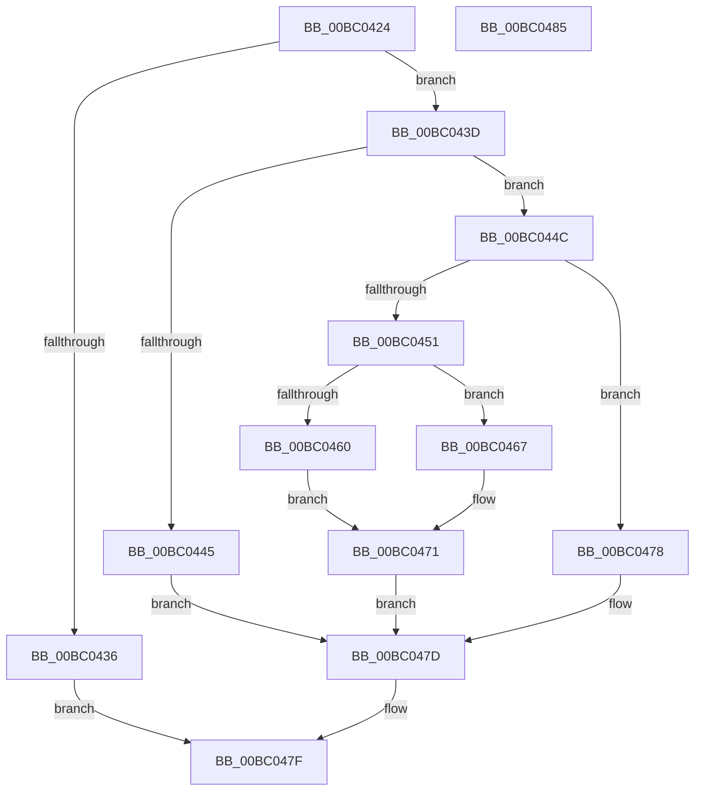

# BgkSetBootGraphicsInformation

- RVA: `0x00BC0424`–`0x00BC0486` (길이 `98` bytes)
- VA: `0x0000000140BC0424`
- 실행 섹션: `PAGEBGFX`
- PDB 이름 있음: `예`; PDB Function 태그: `아니요`
- unwind 정보 RVA: `0x0005CF00`
- 디코드: `31`개 명령, `98/98` bytes 표시
- 미해석 바이트: `0` (있으면 어셈블리에 `.byte`로 보존)

> 이 문서는 커널 이미지의 기계어와 PDB 기호를 분석해 생성했습니다. 4번과 5번은 함수 원형과 자료형을 바이너리 사용 방식에서 추정한 C 해석이며 원본 소스 복구 결과는 아닙니다.

## 1. Dependencies

- 직접 호출 지점: **3**; 고유 호출 대상: **3**
- 직접 호출자로 확인된 함수: **1**
- RIP 상대 이미지 참조: **2**

### Outgoing calls
- `0x00BC0451` → [BgpFwAcquireLock](../../text/4B/BgpFwAcquireLock_function_004B3AA4.md) (function, `0x004B3AA4`)
- `0x00BC046A` → [BgpFwSetBootGraphicsInformation](../../text/69/BgpFwSetBootGraphicsInformation_function_0069F048.md) (function, `0x0069F048`)
- `0x00BC0471` → [BgpFwReleaseLock](../../text/4B/BgpFwReleaseLock_function_004B357C.md) (function, `0x004B357C`)

### Direct callers
- [NtSetSystemInformation](../../page/AF/NtSetSystemInformation_function_00AF4A60.md) at `0x00AF5CA0`

### Static image references
- `0x00BC042A` → RVA `0x00E65EB0` (`.data`; read)
- `0x00BC0456` → RVA `0x00EF0450` (`.data`; read)

## 2. Other-region calls and transfers

- 다른 실행 섹션으로 향하는 call: **3**
  - `0x00BC0451` → [BgpFwAcquireLock](../../text/4B/BgpFwAcquireLock_function_004B3AA4.md) (`PAGEBGFX` → `.text`)
  - `0x00BC046A` → [BgpFwSetBootGraphicsInformation](../../text/69/BgpFwSetBootGraphicsInformation_function_0069F048.md) (`PAGEBGFX` → `.text`)
  - `0x00BC0471` → [BgpFwReleaseLock](../../text/4B/BgpFwReleaseLock_function_004B357C.md) (`PAGEBGFX` → `.text`)
- 별도 외부 분기/꼬리 이동을 확인하지 못했습니다.

## 3. Assembly (complete function range)

```asm
00BC0424  40 53                           push rbx
00BC0426  48 83 EC 20                     sub rsp, 0x20
00BC042A  80 3D 7F 5A 2A 00 00            cmp byte ptr [rip + 0x2a5a7f], 0
00BC0431  48 8B DA                        mov rbx, rdx
00BC0434  75 07                           jne 0x140bc043d
00BC0436  B8 01 00 00 C0                  mov eax, 0xc0000001
00BC043B  EB 42                           jmp 0x140bc047f
00BC043D  44 0F 20 C0                     mov rax, cr8
00BC0441  84 C0                           test al, al
00BC0443  74 07                           je 0x140bc044c
00BC0445  BB 01 00 00 C0                  mov ebx, 0xc0000001
00BC044A  EB 31                           jmp 0x140bc047d
00BC044C  48 85 DB                        test rbx, rbx
00BC044F  74 27                           je 0x140bc0478
00BC0451  E8 4E 36 8F FF                  call 0x1404b3aa4
00BC0456  8B 05 F4 FF 32 00               mov eax, dword ptr [rip + 0x32fff4]
00BC045C  A8 01                           test al, 1
00BC045E  75 07                           jne 0x140bc0467
00BC0460  BB 01 00 00 C0                  mov ebx, 0xc0000001
00BC0465  EB 0A                           jmp 0x140bc0471
00BC0467  48 8B D3                        mov rdx, rbx
00BC046A  E8 D9 EB AD FF                  call 0x14069f048
00BC046F  8B D8                           mov ebx, eax
00BC0471  E8 06 31 8F FF                  call 0x1404b357c
00BC0476  EB 05                           jmp 0x140bc047d
00BC0478  BB 0D 00 00 C0                  mov ebx, 0xc000000d
00BC047D  8B C3                           mov eax, ebx
00BC047F  48 83 C4 20                     add rsp, 0x20
00BC0483  5B                              pop rbx
00BC0484  C3                              ret
00BC0485  CC                              int3
```

## 4. C-style interpretation (structured pseudocode)

```c
__int64 __fastcall BgkSetBootGraphicsInformation(__int64 a1, __int64 a2)
{
    __int64 result;
    __int64 v_rsp;

    v_rsp = (v_rsp) - (32);
    if ((*(unsigned __int8 *)(v_rip + 2775679)) != 0) goto loc_00BC043D;
    goto loc_00BC047F;
loc_00BC043D:
    if ((unsigned __int8)(v_cr8) == 0) goto loc_00BC044C;
    goto loc_00BC047D;
loc_00BC044C:
    if ((unsigned int)(0xC0000001ULL) == 0) goto loc_00BC0478;
    result = BgpFwAcquireLock(a1, a2, a3, a4);
    if ((((unsigned __int8)((unsigned int)(*(unsigned int *)(v_rip + 3342324)))) & (1)) != 0) goto loc_00BC0467;
    goto loc_00BC0471;
loc_00BC0467:
    result = BgpFwSetBootGraphicsInformation(a1, (unsigned int)(0xC0000001ULL), a3, a4);
loc_00BC0471:
    result = BgpFwReleaseLock(a1, (unsigned int)(0xC0000001ULL), a3, a4);
    goto loc_00BC047D;
loc_00BC0478:
loc_00BC047D:
loc_00BC047F:
    v_rsp = (v_rsp) + (32);
    return (unsigned int)((unsigned int)((unsigned int)(0xC000000DULL)));
}
```

## 5. (Beta) C Style

```c
int64_t BgkSetBootGraphicsInformation(int64_t Arg1, int64_t Arg2)
{
    int64_t result;
    int64_t local_rsp;

    local_rsp = (local_rsp) - (32);
    if ((*(uint8_t *)(v_rip + 0x2A5A7F)) != 0) goto loc_00BC043D;
    goto loc_00BC047F;
loc_00BC043D:
    if ((uint8_t)(v_cr8) == 0) goto loc_00BC044C;
    goto loc_00BC047D;
loc_00BC044C:
    if ((uint32_t)(0xC0000001ULL) == 0) goto loc_00BC0478;
    result = BgpFwAcquireLock(Arg1, Arg2, a3, a4);
    if ((((uint8_t)((uint32_t)(*(uint32_t *)(v_rip + 0x32FFF4)))) & (1)) != 0) goto loc_00BC0467;
    goto loc_00BC0471;
loc_00BC0467:
    result = BgpFwSetBootGraphicsInformation(Arg1, (uint32_t)(0xC0000001ULL), a3, a4);
loc_00BC0471:
    result = BgpFwReleaseLock(Arg1, (uint32_t)(0xC0000001ULL), a3, a4);
    goto loc_00BC047D;
loc_00BC0478:
loc_00BC047D:
loc_00BC047F:
    local_rsp = (local_rsp) + (32);
    return (uint32_t)((uint32_t)((uint32_t)(0xC000000DULL)));
}
```

## 6. Execution-region graph

[열기: 2D/3D 그래프와 함수 탐색 컨트롤 패널](../../../control-panel.html?section=pagebgfx&rva=0x00BC0424&view=graph)

- 2D 그래프는 위에서 아래로 흐르고, 3D 그래프는 빈 공간을 드래그해 회전합니다. Shift+드래그는 이동, 휠은 확대·축소, 함수 노드 선택은 대상 보고서 이동입니다.

### Static fallback


