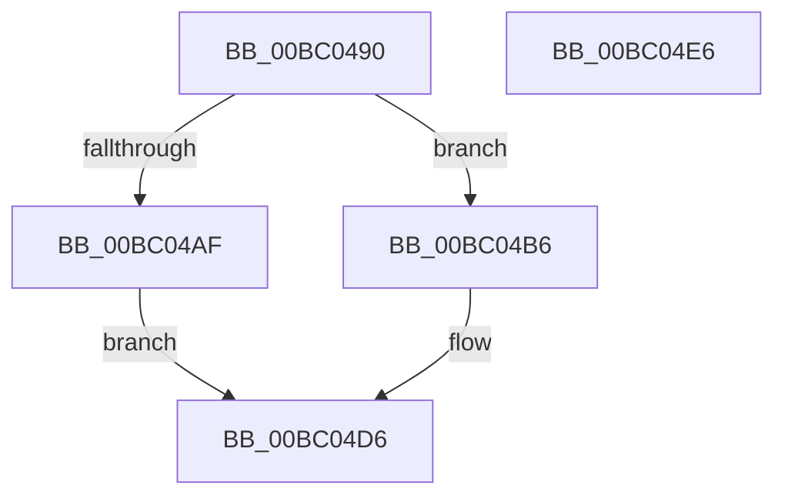

# BgkSetCursor

- RVA: `0x00BC0490`–`0x00BC04E7` (길이 `87` bytes)
- VA: `0x0000000140BC0490`
- 실행 섹션: `PAGEBGFX`
- PDB 이름 있음: `예`; PDB Function 태그: `아니요`
- unwind 정보 RVA: `0x00060BC4`
- 디코드: `27`개 명령, `87/87` bytes 표시
- 미해석 바이트: `0` (있으면 어셈블리에 `.byte`로 보존)

> 이 문서는 커널 이미지의 기계어와 PDB 기호를 분석해 생성했습니다. 4번과 5번은 함수 원형과 자료형을 바이너리 사용 방식에서 추정한 C 해석이며 원본 소스 복구 결과는 아닙니다.

## 1. Dependencies

- 직접 호출 지점: **3**; 고유 호출 대상: **3**
- 직접 호출자로 확인된 함수: **0**
- RIP 상대 이미지 참조: **1**

### Outgoing calls
- `0x00BC04A6` → [BgkpAcquireConsole](../../text/59/BgkpAcquireConsole_function_005911C8.md) (function, `0x005911C8`)
- `0x00BC04C8` → [guard_dispatch_icall](../../text/6B/guard_dispatch_icall_function_006BAAD0.md) (function, `0x006BAAD0`)
- `0x00BC04CF` → [BgkpReleaseConsole](../../text/59/BgkpReleaseConsole_function_00591214.md) (function, `0x00591214`)

### Direct callers
- 이 함수 시작 RVA로 연결되는 직접 call은 확인되지 않았습니다. 간접 호출은 완전히 역산할 수 없습니다.

### Static image references
- `0x00BC04B6` → RVA `0x00E65E70` (`.data`; read)

## 2. Other-region calls and transfers

- 다른 실행 섹션으로 향하는 call: **3**
  - `0x00BC04A6` → [BgkpAcquireConsole](../../text/59/BgkpAcquireConsole_function_005911C8.md) (`PAGEBGFX` → `.text`)
  - `0x00BC04C8` → [guard_dispatch_icall](../../text/6B/guard_dispatch_icall_function_006BAAD0.md) (`PAGEBGFX` → `.text`)
  - `0x00BC04CF` → [BgkpReleaseConsole](../../text/59/BgkpReleaseConsole_function_00591214.md) (`PAGEBGFX` → `.text`)
- 별도 외부 분기/꼬리 이동을 확인하지 못했습니다.

## 3. Assembly (complete function range)

```asm
00BC0490  48 89 5C 24 08                  mov qword ptr [rsp + 8], rbx
00BC0495  48 89 74 24 10                  mov qword ptr [rsp + 0x10], rsi
00BC049A  57                              push rdi
00BC049B  48 83 EC 20                     sub rsp, 0x20
00BC049F  41 8B D8                        mov ebx, r8d
00BC04A2  8B FA                           mov edi, edx
00BC04A4  8B F1                           mov esi, ecx
00BC04A6  E8 1D 0D 9D FF                  call 0x1405911c8
00BC04AB  84 C0                           test al, al
00BC04AD  75 07                           jne 0x140bc04b6
00BC04AF  B8 01 00 00 C0                  mov eax, 0xc0000001
00BC04B4  EB 20                           jmp 0x140bc04d6
00BC04B6  48 8B 05 B3 59 2A 00            mov rax, qword ptr [rip + 0x2a59b3]
00BC04BD  44 8B C3                        mov r8d, ebx
00BC04C0  8B D7                           mov edx, edi
00BC04C2  8B CE                           mov ecx, esi
00BC04C4  48 8B 40 38                     mov rax, qword ptr [rax + 0x38]
00BC04C8  E8 03 A6 AF FF                  call 0x1406baad0
00BC04CD  8B D8                           mov ebx, eax
00BC04CF  E8 40 0D 9D FF                  call 0x140591214
00BC04D4  8B C3                           mov eax, ebx
00BC04D6  48 8B 5C 24 30                  mov rbx, qword ptr [rsp + 0x30]
00BC04DB  48 8B 74 24 38                  mov rsi, qword ptr [rsp + 0x38]
00BC04E0  48 83 C4 20                     add rsp, 0x20
00BC04E4  5F                              pop rdi
00BC04E5  C3                              ret
00BC04E6  CC                              int3
```

## 4. C-style interpretation (structured pseudocode)

```c
__int64 __fastcall BgkSetCursor(int a1, int a2, int a3)
{
    __int64 result;
    __int64 v_rsp;
    unsigned __int64 v_stack_p10;
    unsigned __int64 v_stack_p8;

    v_stack_p8 = v_rbx;
    v_stack_p10 = v_rsi;
    v_rsp = (v_rsp) - (32);
    result = BgkpAcquireConsole(a1, a2, a3, a4);
    if ((unsigned __int8)(result) != 0) goto loc_00BC04B6;
    goto loc_00BC04D6;
loc_00BC04B6:
    result = guard_dispatch_icall((unsigned int)((unsigned int)((unsigned int)(a1))), (unsigned int)((unsigned int)((unsigned int)(a2))), (unsigned int)((unsigned int)((unsigned int)(a3))), a4);
    result = BgkpReleaseConsole((unsigned int)((unsigned int)((unsigned int)(a1))), (unsigned int)((unsigned int)((unsigned int)(a2))), (unsigned int)((unsigned int)((unsigned int)(a3))), a4);
loc_00BC04D6:
    v_rsp = (v_rsp) + (32);
    return (unsigned int)((unsigned int)((unsigned int)((unsigned int)(result))));
}
```

## 5. (Beta) C Style

```c
int64_t BgkSetCursor(int32_t Arg1, int32_t Arg2, int32_t Arg3)
{
    int64_t result;
    int64_t local_rsp;
    uint64_t v_stack_p10;
    uint64_t v_stack_p8;

    v_stack_p8 = local_rbx;
    v_stack_p10 = local_rsi;
    local_rsp = (local_rsp) - (32);
    result = BgkpAcquireConsole(Arg1, Arg2, Arg3, a4);
    if ((uint8_t)(result) != 0) goto loc_00BC04B6;
    goto loc_00BC04D6;
loc_00BC04B6:
    result = guard_dispatch_icall((uint32_t)((uint32_t)((uint32_t)(Arg1))), (uint32_t)((uint32_t)((uint32_t)(Arg2))), (uint32_t)((uint32_t)((uint32_t)(Arg3))), a4);
    result = BgkpReleaseConsole((uint32_t)((uint32_t)((uint32_t)(Arg1))), (uint32_t)((uint32_t)((uint32_t)(Arg2))), (uint32_t)((uint32_t)((uint32_t)(Arg3))), a4);
loc_00BC04D6:
    local_rsp = (local_rsp) + (32);
    return (uint32_t)((uint32_t)((uint32_t)((uint32_t)(result))));
}
```

## 6. Execution-region graph

[열기: 2D/3D 그래프와 함수 탐색 컨트롤 패널](../../../control-panel.html?section=pagebgfx&rva=0x00BC0490&view=graph)

- 2D 그래프는 위에서 아래로 흐르고, 3D 그래프는 빈 공간을 드래그해 회전합니다. Shift+드래그는 이동, 휠은 확대·축소, 함수 노드 선택은 대상 보고서 이동입니다.

### Static fallback


