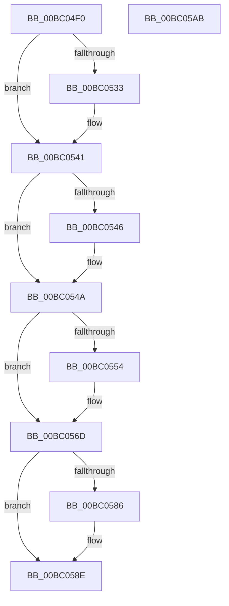

# BgkpLockBgfxCodeSection

- RVA: `0x00BC04F0`–`0x00BC05AC` (길이 `188` bytes)
- VA: `0x0000000140BC04F0`
- 실행 섹션: `PAGEBGFX`
- PDB 이름 있음: `예`; PDB Function 태그: `아니요`
- unwind 정보 RVA: `0x00060BC4`
- 디코드: `47`개 명령, `188/188` bytes 표시
- 미해석 바이트: `0` (있으면 어셈블리에 `.byte`로 보존)

> 이 문서는 커널 이미지의 기계어와 PDB 기호를 분석해 생성했습니다. 4번과 5번은 함수 원형과 자료형을 바이너리 사용 방식에서 추정한 C 해석이며 원본 소스 복구 결과는 아닙니다.

## 1. Dependencies

- 직접 호출 지점: **6**; 고유 호출 대상: **6**
- 직접 호출자로 확인된 함수: **3**
- RIP 상대 이미지 참조: **6**

### Outgoing calls
- `0x00BC0523` → [KeAbPreAcquire](../../text/21/KeAbPreAcquire_function_00210230.md) (function, `0x00210230`)
- `0x00BC053C` → [ExfAcquirePushLockExclusiveEx](../../text/20/ExfAcquirePushLockExclusiveEx_function_0020FC90.md) (function, `0x0020FC90`)
- `0x00BC055B` → [MmLockPagableDataSection](../../page/A7/MmLockPagableDataSection_function_00A73E80.md) (function, `0x00A73E80`)
- `0x00BC0589` → [ExfTryToWakePushLock](../../text/26/ExfTryToWakePushLock_function_00265DD0.md) (function, `0x00265DD0`)
- `0x00BC0591` → [KeAbPostRelease](../../text/2E/KeAbPostRelease_function_002E1600.md) (function, `0x002E1600`)
- `0x00BC0596` → [KeLeaveCriticalRegion](../../text/25/KeLeaveCriticalRegion_function_0025D8B0.md) (function, `0x0025D8B0`)

### Direct callers
- [BgkNotifyDisplayOwnershipChange](../../text/59/BgkNotifyDisplayOwnershipChange_function_00590CC0.md) at `0x00590D65`
- [BgkResumePrepare](../../pagelk/B6/BgkResumePrepare_function_00B63ACC.md) at `0x00B63AE5`
- [BgkInitialize](../../init/C8/BgkInitialize_function_00C80488.md) at `0x00C804D1`

### Static image references
- `0x00BC0508` → RVA `0x00E3EE20` (`.data`; read)
- `0x00BC054A` → RVA `0x00E65E98` (`.data`; read)
- `0x00BC0554` → RVA `0x00BC04F0` (`BgkpLockBgfxCodeSection`; read)
- `0x00BC0560` → RVA `0x00E65E78` (`.data`; write)
- `0x00BC056F` → RVA `0x00E65E98` (`.data`; write)
- `0x00BC0575` → RVA `0x00E3EE20` (`.data`; read/write)

## 2. Other-region calls and transfers

- 다른 실행 섹션으로 향하는 call: **6**
  - `0x00BC0523` → [KeAbPreAcquire](../../text/21/KeAbPreAcquire_function_00210230.md) (`PAGEBGFX` → `.text`)
  - `0x00BC053C` → [ExfAcquirePushLockExclusiveEx](../../text/20/ExfAcquirePushLockExclusiveEx_function_0020FC90.md) (`PAGEBGFX` → `.text`)
  - `0x00BC055B` → [MmLockPagableDataSection](../../page/A7/MmLockPagableDataSection_function_00A73E80.md) (`PAGEBGFX` → `PAGE`)
  - `0x00BC0589` → [ExfTryToWakePushLock](../../text/26/ExfTryToWakePushLock_function_00265DD0.md) (`PAGEBGFX` → `.text`)
  - `0x00BC0591` → [KeAbPostRelease](../../text/2E/KeAbPostRelease_function_002E1600.md) (`PAGEBGFX` → `.text`)
  - `0x00BC0596` → [KeLeaveCriticalRegion](../../text/25/KeLeaveCriticalRegion_function_0025D8B0.md) (`PAGEBGFX` → `.text`)
- 별도 외부 분기/꼬리 이동을 확인하지 못했습니다.

## 3. Assembly (complete function range)

```asm
00BC04F0  48 89 5C 24 08                  mov qword ptr [rsp + 8], rbx
00BC04F5  48 89 74 24 10                  mov qword ptr [rsp + 0x10], rsi
00BC04FA  57                              push rdi
00BC04FB  48 83 EC 20                     sub rsp, 0x20
00BC04FF  65 48 8B 04 25 88 01 00 00      mov rax, qword ptr gs:[0x188]
00BC0508  48 8D 35 11 E9 27 00            lea rsi, [rip + 0x27e911]
00BC050F  48 83 CB FF                     or rbx, 0xffffffffffffffff
00BC0513  45 33 C0                        xor r8d, r8d
00BC0516  33 D2                           xor edx, edx
00BC0518  48 8B CE                        mov rcx, rsi
00BC051B  66 01 98 E4 01 00 00            add word ptr [rax + 0x1e4], bx
00BC0522  90                              nop
00BC0523  E8 08 FD 64 FF                  call 0x140210230
00BC0528  F0 48 0F BA 2E 00               lock bts qword ptr [rsi], 0
00BC052E  48 8B F8                        mov rdi, rax
00BC0531  73 0E                           jae 0x140bc0541
00BC0533  4C 8B C6                        mov r8, rsi
00BC0536  48 8B D0                        mov rdx, rax
00BC0539  48 8B CE                        mov rcx, rsi
00BC053C  E8 4F F7 64 FF                  call 0x14020fc90
00BC0541  48 85 FF                        test rdi, rdi
00BC0544  74 04                           je 0x140bc054a
00BC0546  C6 47 0A 01                     mov byte ptr [rdi + 0xa], 1
00BC054A  8B 05 48 59 2A 00               mov eax, dword ptr [rip + 0x2a5948]
00BC0550  85 C0                           test eax, eax
00BC0552  75 19                           jne 0x140bc056d
00BC0554  48 8D 0D 95 FF FF FF            lea rcx, [rip - 0x6b]
00BC055B  E8 20 39 EB FF                  call 0x140a73e80
00BC0560  48 89 05 11 59 2A 00            mov qword ptr [rip + 0x2a5911], rax
00BC0567  8B 05 2B 59 2A 00               mov eax, dword ptr [rip + 0x2a592b]
00BC056D  FF C0                           inc eax
00BC056F  89 05 23 59 2A 00               mov dword ptr [rip + 0x2a5923], eax
00BC0575  F0 48 0F C1 1D A2 E8 27 00      lock xadd qword ptr [rip + 0x27e8a2], rbx
00BC057E  80 E3 06                        and bl, 6
00BC0581  80 FB 02                        cmp bl, 2
00BC0584  75 08                           jne 0x140bc058e
00BC0586  48 8B CE                        mov rcx, rsi
00BC0589  E8 42 58 6A FF                  call 0x140265dd0
00BC058E  48 8B CE                        mov rcx, rsi
00BC0591  E8 6A 10 72 FF                  call 0x1402e1600
00BC0596  E8 15 D3 69 FF                  call 0x14025d8b0
00BC059B  48 8B 5C 24 30                  mov rbx, qword ptr [rsp + 0x30]
00BC05A0  48 8B 74 24 38                  mov rsi, qword ptr [rsp + 0x38]
00BC05A5  48 83 C4 20                     add rsp, 0x20
00BC05A9  5F                              pop rdi
00BC05AA  C3                              ret
00BC05AB  CC                              int3
```

## 4. C-style interpretation (structured pseudocode)

```c
__int64 __fastcall BgkpLockBgfxCodeSection(__int64 a1, int a2, int a3)
{
    __int64 result;
    __int64 v_rbx;
    __int64 v_rsp;
    unsigned __int64 v_stack_p10;
    unsigned __int64 v_stack_p8;

    v_stack_p8 = v_rbx;
    v_stack_p10 = v_rsi;
    v_rsp = (v_rsp) - (32);
    v_rbx = (v_rbx) | (-1);
    a3 = 0;
    a2 = 0;
    result = KeAbPreAcquire(v_rip + 2615569, a2, a3, a4);
    if (!(condition_is_above_or_equal)) {
        a3 = v_rip + 2615569;
        a2 = result;
        a1 = v_rip + 2615569;
        result = ExfAcquirePushLockExclusiveEx(a1, a2, a3, a4);
    }
    if (result != 0) {
        *(unsigned __int8 *)(result + 10) = 1;
    }
    result = (unsigned int)(*(unsigned int *)(v_rip + 2775368));
    if ((unsigned int)((unsigned int)(*(unsigned int *)(v_rip + 2775368))) == 0) {
        a1 = v_rip - 107;
        result = MmLockPagableDataSection(a1, a2, a3, a4);
        *(unsigned __int64 *)(v_rip + 2775313) = result;
        result = *(unsigned int *)(v_rip + 2775339);
    }
    result = (unsigned int)((result) + 1);
    *(unsigned int *)(v_rip + 2775331) = (unsigned int)(result);
    v_rbx = (unsigned __int8)((v_rbx) & (6));
    if (((unsigned __int8)(v_rbx)) == 2) {
        a1 = v_rip + 2615569;
        result = ExfTryToWakePushLock(a1, a2, a3, a4);
    }
    result = KeAbPostRelease(v_rip + 2615569, a2, a3, a4);
    result = KeLeaveCriticalRegion(v_rip + 2615569, a2, a3, a4);
    v_rsp = (v_rsp) + (32);
    return result;
}
```

## 5. (Beta) C Style

```c
int64_t BgkpLockBgfxCodeSection(int64_t Arg1, int32_t Arg2, int32_t Arg3)
{
    int64_t result;
    int64_t local_rbx;
    int64_t local_rsp;
    uint64_t v_stack_p10;
    uint64_t v_stack_p8;

    v_stack_p8 = local_rbx;
    v_stack_p10 = local_rsi;
    local_rsp = (local_rsp) - (32);
    local_rbx = (local_rbx) | (-1);
    Arg3 = 0;
    Arg2 = 0;
    result = KeAbPreAcquire(v_rip + 2615569, Arg2, Arg3, a4);
    if (!(condition_is_above_or_equal)) {
        Arg3 = v_rip + 2615569;
        Arg2 = result;
        Arg1 = v_rip + 2615569;
        result = ExfAcquirePushLockExclusiveEx(Arg1, Arg2, Arg3, a4);
    }
    if (result != 0) {
        *(uint8_t *)(result + 0xA) = 1;
    }
    result = (uint32_t)(*(uint32_t *)(v_rip + 0x2A5948));
    if ((uint32_t)((uint32_t)(*(uint32_t *)(v_rip + 0x2A5948))) == 0) {
        Arg1 = v_rip - 107;
        result = MmLockPagableDataSection(Arg1, Arg2, Arg3, a4);
        *(uint64_t *)(v_rip + 0x2A5911) = result;
        result = *(uint32_t *)(v_rip + 0x2A592B);
    }
    result = (uint32_t)((result) + 1);
    *(uint32_t *)(v_rip + 0x2A5923) = (uint32_t)(result);
    local_rbx = (uint8_t)((local_rbx) & (6));
    if (((uint8_t)(local_rbx)) == 2) {
        Arg1 = v_rip + 2615569;
        result = ExfTryToWakePushLock(Arg1, Arg2, Arg3, a4);
    }
    result = KeAbPostRelease(v_rip + 2615569, Arg2, Arg3, a4);
    result = KeLeaveCriticalRegion(v_rip + 2615569, Arg2, Arg3, a4);
    local_rsp = (local_rsp) + (32);
    return result;
}
```

## 6. Execution-region graph

[열기: 2D/3D 그래프와 함수 탐색 컨트롤 패널](../../../control-panel.html?section=pagebgfx&rva=0x00BC04F0&view=graph)

- 2D 그래프는 위에서 아래로 흐르고, 3D 그래프는 빈 공간을 드래그해 회전합니다. Shift+드래그는 이동, 휠은 확대·축소, 함수 노드 선택은 대상 보고서 이동입니다.

### Static fallback


