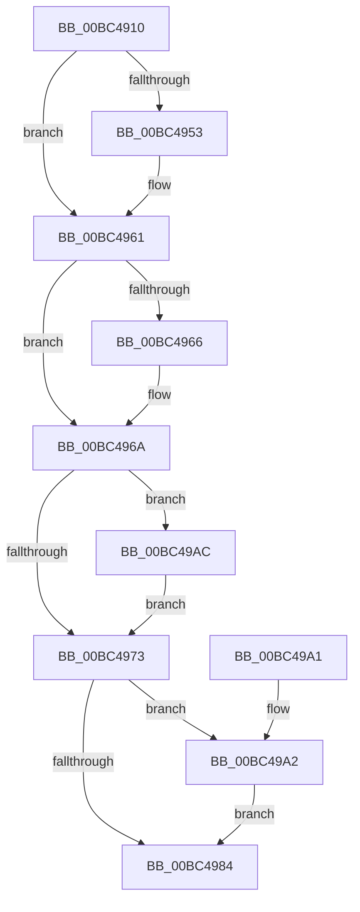

# BgkpUnlockBgfxCodeSection

- RVA: `0x00BC4910`–`0x00BC49C2` (길이 `178` bytes)
- VA: `0x0000000140BC4910`
- 실행 섹션: `PAGEBGFX`
- PDB 이름 있음: `예`; PDB Function 태그: `아니요`
- unwind 정보 RVA: `0x00065748`
- 디코드: `45`개 명령, `178/178` bytes 표시
- 미해석 바이트: `0` (있으면 어셈블리에 `.byte`로 보존)

> 이 문서는 커널 이미지의 기계어와 PDB 기호를 분석해 생성했습니다. 4번과 5번은 함수 원형과 자료형을 바이너리 사용 방식에서 추정한 C 해석이며 원본 소스 복구 결과는 아닙니다.

## 1. Dependencies

- 직접 호출 지점: **6**; 고유 호출 대상: **6**
- 직접 호출자로 확인된 함수: **3**
- RIP 상대 이미지 참조: **5**

### Outgoing calls
- `0x00BC4943` → [KeAbPreAcquire](../../text/21/KeAbPreAcquire_function_00210230.md) (function, `0x00210230`)
- `0x00BC495C` → [ExfAcquirePushLockExclusiveEx](../../text/20/ExfAcquirePushLockExclusiveEx_function_0020FC90.md) (function, `0x0020FC90`)
- `0x00BC4987` → [KeAbPostRelease](../../text/2E/KeAbPostRelease_function_002E1600.md) (function, `0x002E1600`)
- `0x00BC498C` → [KeLeaveCriticalRegion](../../text/25/KeLeaveCriticalRegion_function_0025D8B0.md) (function, `0x0025D8B0`)
- `0x00BC49A5` → [ExfTryToWakePushLock](../../text/26/ExfTryToWakePushLock_function_00265DD0.md) (function, `0x00265DD0`)
- `0x00BC49B3` → [MmUnlockPagableImageSection](../../text/2A/MmUnlockPagableImageSection_function_002A39F0.md) (function, `0x002A39F0`)

### Direct callers
- [BgkNotifyDisplayOwnershipChange](../../text/59/BgkNotifyDisplayOwnershipChange_function_00590CC0.md) at `0x00590E3F`
- [BgkResumePrepare](../../pagelk/B6/BgkResumePrepare_function_00B63ACC.md) at `0x00B63AF7`
- [BgkResumeFinished](../../pagelk/B7/BgkResumeFinished_function_00B7C7FC.md) at `0x00B7C80A`
- [BgkResumeFinished](../../pagelk/B7/BgkResumeFinished_function_00B7C7FC.md) at `0x00B7C822`

### Static image references
- `0x00BC4928` → RVA `0x00E3EE20` (`.data`; read)
- `0x00BC496A` → RVA `0x00E65E98` (`.data`; read/write)
- `0x00BC4973` → RVA `0x00E3EE20` (`.data`; read/write)
- `0x00BC49AC` → RVA `0x00E65E78` (`.data`; read)
- `0x00BC49B8` → RVA `0x00E65E78` (`.data`; read/write)

## 2. Other-region calls and transfers

- 다른 실행 섹션으로 향하는 call: **6**
  - `0x00BC4943` → [KeAbPreAcquire](../../text/21/KeAbPreAcquire_function_00210230.md) (`PAGEBGFX` → `.text`)
  - `0x00BC495C` → [ExfAcquirePushLockExclusiveEx](../../text/20/ExfAcquirePushLockExclusiveEx_function_0020FC90.md) (`PAGEBGFX` → `.text`)
  - `0x00BC4987` → [KeAbPostRelease](../../text/2E/KeAbPostRelease_function_002E1600.md) (`PAGEBGFX` → `.text`)
  - `0x00BC498C` → [KeLeaveCriticalRegion](../../text/25/KeLeaveCriticalRegion_function_0025D8B0.md) (`PAGEBGFX` → `.text`)
  - `0x00BC49A5` → [ExfTryToWakePushLock](../../text/26/ExfTryToWakePushLock_function_00265DD0.md) (`PAGEBGFX` → `.text`)
  - `0x00BC49B3` → [MmUnlockPagableImageSection](../../text/2A/MmUnlockPagableImageSection_function_002A39F0.md) (`PAGEBGFX` → `.text`)
- 별도 외부 분기/꼬리 이동을 확인하지 못했습니다.

## 3. Assembly (complete function range)

```asm
00BC4910  48 89 5C 24 08                  mov qword ptr [rsp + 8], rbx
00BC4915  48 89 74 24 10                  mov qword ptr [rsp + 0x10], rsi
00BC491A  57                              push rdi
00BC491B  48 83 EC 20                     sub rsp, 0x20
00BC491F  65 48 8B 04 25 88 01 00 00      mov rax, qword ptr gs:[0x188]
00BC4928  48 8D 35 F1 A4 27 00            lea rsi, [rip + 0x27a4f1]
00BC492F  48 83 CB FF                     or rbx, 0xffffffffffffffff
00BC4933  45 33 C0                        xor r8d, r8d
00BC4936  33 D2                           xor edx, edx
00BC4938  48 8B CE                        mov rcx, rsi
00BC493B  66 01 98 E4 01 00 00            add word ptr [rax + 0x1e4], bx
00BC4942  90                              nop
00BC4943  E8 E8 B8 64 FF                  call 0x140210230
00BC4948  F0 48 0F BA 2E 00               lock bts qword ptr [rsi], 0
00BC494E  48 8B F8                        mov rdi, rax
00BC4951  73 0E                           jae 0x140bc4961
00BC4953  4C 8B C6                        mov r8, rsi
00BC4956  48 8B D0                        mov rdx, rax
00BC4959  48 8B CE                        mov rcx, rsi
00BC495C  E8 2F B3 64 FF                  call 0x14020fc90
00BC4961  48 85 FF                        test rdi, rdi
00BC4964  74 04                           je 0x140bc496a
00BC4966  C6 47 0A 01                     mov byte ptr [rdi + 0xa], 1
00BC496A  83 05 27 15 2A 00 FF            add dword ptr [rip + 0x2a1527], -1
00BC4971  74 39                           je 0x140bc49ac
00BC4973  F0 48 0F C1 1D A4 A4 27 00      lock xadd qword ptr [rip + 0x27a4a4], rbx
00BC497C  80 E3 06                        and bl, 6
00BC497F  80 FB 02                        cmp bl, 2
00BC4982  74 1E                           je 0x140bc49a2
00BC4984  48 8B CE                        mov rcx, rsi
00BC4987  E8 74 CC 71 FF                  call 0x1402e1600
00BC498C  E8 1F 8F 69 FF                  call 0x14025d8b0
00BC4991  48 8B 5C 24 30                  mov rbx, qword ptr [rsp + 0x30]
00BC4996  48 8B 74 24 38                  mov rsi, qword ptr [rsp + 0x38]
00BC499B  48 83 C4 20                     add rsp, 0x20
00BC499F  5F                              pop rdi
00BC49A0  C3                              ret
00BC49A1  CC                              int3
00BC49A2  48 8B CE                        mov rcx, rsi
00BC49A5  E8 26 14 6A FF                  call 0x140265dd0
00BC49AA  EB D8                           jmp 0x140bc4984
00BC49AC  48 8B 0D C5 14 2A 00            mov rcx, qword ptr [rip + 0x2a14c5]
00BC49B3  E8 38 F0 6D FF                  call 0x1402a39f0
00BC49B8  48 83 25 B8 14 2A 00 00         and qword ptr [rip + 0x2a14b8], 0
00BC49C0  EB B1                           jmp 0x140bc4973
```

## 4. C-style interpretation (structured pseudocode)

```c
__int64 __fastcall BgkpUnlockBgfxCodeSection(__int64 a1, int a2, int a3)
{
    __int64 result;
    __int64 v_rbx;
    __int64 v_rsp;
    unsigned __int64 v_stack_p10;
    unsigned __int64 v_stack_p8;

    v_stack_p8 = v_rbx;
    v_stack_p10 = v_rsi;
    v_rsp = (v_rsp) - (32);
    v_rbx = (v_rbx) | (-1);
    a3 = 0;
    a2 = 0;
    result = KeAbPreAcquire(v_rip + 2598129, a2, a3, a4);
    if (!(condition_is_above_or_equal)) {
        a3 = v_rip + 2598129;
        a2 = result;
        a1 = v_rip + 2598129;
        result = ExfAcquirePushLockExclusiveEx(a1, a2, a3, a4);
    }
    if (result != 0) {
        *(unsigned __int8 *)(result + 10) = 1;
    }
    if (result == 0) goto loc_00BC49AC;
loc_00BC4973:
    v_rbx = (unsigned __int8)((v_rbx) & (6));
    if (((unsigned __int8)(v_rbx)) == 2) goto loc_00BC49A2;
loc_00BC4984:
    result = KeAbPostRelease(v_rip + 2598129, a2, a3, a4);
    result = KeLeaveCriticalRegion(v_rip + 2598129, a2, a3, a4);
    v_rsp = (v_rsp) + (32);
    return result;
loc_00BC49A2:
    result = ExfTryToWakePushLock(v_stack_p10, a2, a3, a4);
    goto loc_00BC4984;
loc_00BC49AC:
    result = MmUnlockPagableImageSection(*(unsigned __int64 *)(v_rip + 2757829), a2, a3, a4);
    goto loc_00BC4973;
}
```

## 5. (Beta) C Style

```c
int64_t BgkpUnlockBgfxCodeSection(int64_t Arg1, int32_t Arg2, int32_t Arg3)
{
    int64_t result;
    int64_t local_rbx;
    int64_t local_rsp;
    uint64_t v_stack_p10;
    uint64_t v_stack_p8;

    v_stack_p8 = local_rbx;
    v_stack_p10 = local_rsi;
    local_rsp = (local_rsp) - (32);
    local_rbx = (local_rbx) | (-1);
    Arg3 = 0;
    Arg2 = 0;
    result = KeAbPreAcquire(v_rip + 2598129, Arg2, Arg3, a4);
    if (!(condition_is_above_or_equal)) {
        Arg3 = v_rip + 2598129;
        Arg2 = result;
        Arg1 = v_rip + 2598129;
        result = ExfAcquirePushLockExclusiveEx(Arg1, Arg2, Arg3, a4);
    }
    if (result != 0) {
        *(uint8_t *)(result + 0xA) = 1;
    }
    if (result == 0) goto loc_00BC49AC;
loc_00BC4973:
    local_rbx = (uint8_t)((local_rbx) & (6));
    if (((uint8_t)(local_rbx)) == 2) goto loc_00BC49A2;
loc_00BC4984:
    result = KeAbPostRelease(v_rip + 2598129, Arg2, Arg3, a4);
    result = KeLeaveCriticalRegion(v_rip + 2598129, Arg2, Arg3, a4);
    local_rsp = (local_rsp) + (32);
    return result;
loc_00BC49A2:
    result = ExfTryToWakePushLock(v_stack_p10, Arg2, Arg3, a4);
    goto loc_00BC4984;
loc_00BC49AC:
    result = MmUnlockPagableImageSection(*(uint64_t *)(v_rip + 0x2A14C5), Arg2, Arg3, a4);
    goto loc_00BC4973;
}
```

## 6. Execution-region graph

[열기: 2D/3D 그래프와 함수 탐색 컨트롤 패널](../../../control-panel.html?section=pagebgfx&rva=0x00BC4910&view=graph)

- 2D 그래프는 위에서 아래로 흐르고, 3D 그래프는 빈 공간을 드래그해 회전합니다. Shift+드래그는 이동, 휠은 확대·축소, 함수 노드 선택은 대상 보고서 이동입니다.

### Static fallback


