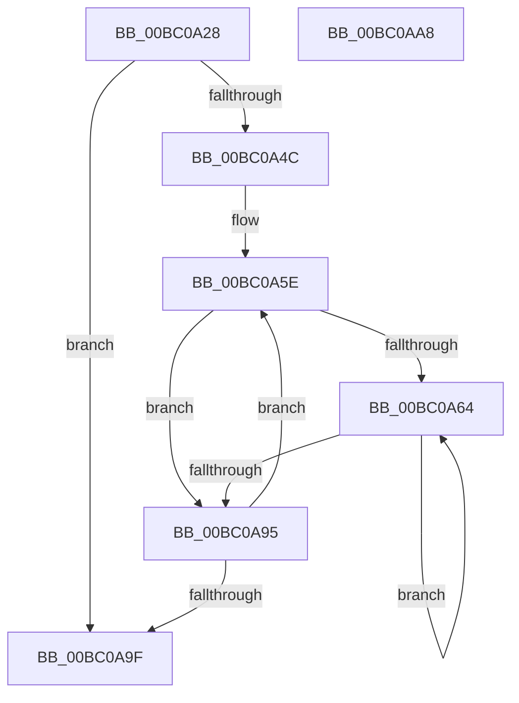

# BgpConsoleClearScreenEx

- RVA: `0x00BC0A28`–`0x00BC0AA9` (길이 `129` bytes)
- VA: `0x0000000140BC0A28`
- 실행 섹션: `PAGEBGFX`
- PDB 이름 있음: `예`; PDB Function 태그: `아니요`
- unwind 정보 RVA: `0x0005CF00`
- 디코드: `38`개 명령, `129/129` bytes 표시
- 미해석 바이트: `0` (있으면 어셈블리에 `.byte`로 보존)

> 이 문서는 커널 이미지의 기계어와 PDB 기호를 분석해 생성했습니다. 4번과 5번은 함수 원형과 자료형을 바이너리 사용 방식에서 추정한 C 해석이며 원본 소스 복구 결과는 아닙니다.

## 1. Dependencies

- 직접 호출 지점: **1**; 고유 호출 대상: **1**
- 직접 호출자로 확인된 함수: **2**
- RIP 상대 이미지 참조: **1**

### Outgoing calls
- `0x00BC0A40` → [BgpClearScreen](../../text/69/BgpClearScreen_function_0069EAB0.md) (function, `0x0069EAB0`)

### Direct callers
- [BgpConsoleClearScreen](BgpConsoleClearScreen_function_00BC09F0.md) at `0x00BC0A0C`
- [BgpConsoleInitialize](BgpConsoleInitialize_function_00BC10B0.md) at `0x00BC12C6`

### Static image references
- `0x00BC0A2E` → RVA `0x00EEFEC8` (`.data`; read)

## 2. Other-region calls and transfers

- 다른 실행 섹션으로 향하는 call: **1**
  - `0x00BC0A40` → [BgpClearScreen](../../text/69/BgpClearScreen_function_0069EAB0.md) (`PAGEBGFX` → `.text`)
- 별도 외부 분기/꼬리 이동을 확인하지 못했습니다.

## 3. Assembly (complete function range)

```asm
00BC0A28  40 53                           push rbx
00BC0A2A  48 83 EC 20                     sub rsp, 0x20
00BC0A2E  48 8B 0D 93 F4 32 00            mov rcx, qword ptr [rip + 0x32f493]
00BC0A35  83 61 44 00                     and dword ptr [rcx + 0x44], 0
00BC0A39  83 61 48 00                     and dword ptr [rcx + 0x48], 0
00BC0A3D  8B 49 10                        mov ecx, dword ptr [rcx + 0x10]
00BC0A40  E8 6B E0 AD FF                  call 0x14069eab0
00BC0A45  44 8B C0                        mov r8d, eax
00BC0A48  85 C0                           test eax, eax
00BC0A4A  78 53                           js 0x140bc0a9f
00BC0A4C  4C 8B 0D 75 F4 32 00            mov r9, qword ptr [rip + 0x32f475]
00BC0A53  45 33 D2                        xor r10d, r10d
00BC0A56  41 8B 41 04                     mov eax, dword ptr [r9 + 4]
00BC0A5A  45 8D 5A 50                     lea r11d, [r10 + 0x50]
00BC0A5E  33 DB                           xor ebx, ebx
00BC0A60  85 C0                           test eax, eax
00BC0A62  74 31                           je 0x140bc0a95
00BC0A64  8B CB                           mov ecx, ebx
00BC0A66  FF C3                           inc ebx
00BC0A68  49 03 CA                        add rcx, r10
00BC0A6B  48 8D 14 49                     lea rdx, [rcx + rcx*2]
00BC0A6F  66 41 C7 44 91 58 20 00         mov word ptr [r9 + rdx*4 + 0x58], 0x20
00BC0A77  48 8D 0C 49                     lea rcx, [rcx + rcx*2]
00BC0A7B  41 8B 41 10                     mov eax, dword ptr [r9 + 0x10]
00BC0A7F  41 89 44 89 54                  mov dword ptr [r9 + rcx*4 + 0x54], eax
00BC0A84  41 8B 41 0C                     mov eax, dword ptr [r9 + 0xc]
00BC0A88  41 89 44 91 50                  mov dword ptr [r9 + rdx*4 + 0x50], eax
00BC0A8D  41 8B 41 04                     mov eax, dword ptr [r9 + 4]
00BC0A91  3B D8                           cmp ebx, eax
00BC0A93  72 CF                           jb 0x140bc0a64
00BC0A95  49 83 C2 19                     add r10, 0x19
00BC0A99  49 83 EB 01                     sub r11, 1
00BC0A9D  75 BF                           jne 0x140bc0a5e
00BC0A9F  41 8B C0                        mov eax, r8d
00BC0AA2  48 83 C4 20                     add rsp, 0x20
00BC0AA6  5B                              pop rbx
00BC0AA7  C3                              ret
00BC0AA8  CC                              int3
```

## 4. C-style interpretation (structured pseudocode)

```c
__int64 __fastcall BgpConsoleClearScreenEx(void)
{
    __int64 result;
    __int64 v_r10;
    __int64 v_r11;
    __int64 v_rbx;
    __int64 v_rsp;

    v_rsp = (v_rsp) - (32);
    result = BgpClearScreen((unsigned int)(*(unsigned int *)(*(unsigned __int64 *)(v_rip + 3339411) + 16)), a2, a3, a4);
    if (sign_flag) goto loc_00BC0A9F;
    v_r10 = 0;
loc_00BC0A5E:
    v_rbx = 0;
    if ((unsigned int)((unsigned int)(*(unsigned int *)(*(unsigned __int64 *)(v_rip + 3339381) + 4))) == 0) goto loc_00BC0A95;
loc_00BC0A64:
    v_rbx = (unsigned int)((v_rbx) + 1);
    a1 = (0) + (0);
    *(unsigned __int16 *)(*(unsigned __int64 *)(v_rip + 3339381) + a1 + a1 * 2 * 4 + 88) = 32;
    *(unsigned int *)(*(unsigned __int64 *)(v_rip + 3339381) + a1 + a1 * 2 * 4 + 84) = (unsigned int)((unsigned int)(*(unsigned int *)(*(unsigned __int64 *)(v_rip + 3339381) + 16)));
    *(unsigned int *)(*(unsigned __int64 *)(v_rip + 3339381) + a1 + a1 * 2 * 4 + 80) = (unsigned int)((unsigned int)(*(unsigned int *)(*(unsigned __int64 *)(v_rip + 3339381) + 12)));
    if (((unsigned int)(v_rbx)) < ((unsigned int)((unsigned int)(*(unsigned int *)(*(unsigned __int64 *)(v_rip + 3339381) + 4))))) goto loc_00BC0A64;
loc_00BC0A95:
    v_r10 = (v_r10) + (25);
    v_r11 = (v_r10 + 80) - (1);
    if (condition_is_not_equal) goto loc_00BC0A5E;
loc_00BC0A9F:
    v_rsp = (v_rsp) + (32);
    return (unsigned int)((unsigned int)((unsigned int)((unsigned int)(result))));
}
```

## 5. (Beta) C Style

```c
void BgpConsoleClearScreenEx(void)
{
    int64_t result;
    int64_t local_r10;
    int64_t local_r11;
    int64_t local_rbx;
    int64_t local_rsp;

    local_rsp = (local_rsp) - (32);
    result = BgpClearScreen((uint32_t)(*(uint32_t *)(*(uint64_t *)(v_rip + 0x32F493) + 0x10)), a2, a3, a4);
    if (sign_flag) goto loc_00BC0A9F;
    local_r10 = 0;
loc_00BC0A5E:
    local_rbx = 0;
    if ((uint32_t)((uint32_t)(*(uint32_t *)(*(uint64_t *)(v_rip + 0x32F475) + 0x4))) == 0) goto loc_00BC0A95;
loc_00BC0A64:
    local_rbx = (uint32_t)((local_rbx) + 1);
    a1 = (0) + (0);
    *(uint16_t *)(*(uint64_t *)(v_rip + 0x32F475) + a1 + a1 * 2 * 4 + 0x58) = 32;
    *(uint32_t *)(*(uint64_t *)(v_rip + 0x32F475) + a1 + a1 * 2 * 4 + 0x54) = (uint32_t)((uint32_t)(*(uint32_t *)(*(uint64_t *)(v_rip + 0x32F475) + 0x10)));
    *(uint32_t *)(*(uint64_t *)(v_rip + 0x32F475) + a1 + a1 * 2 * 4 + 0x50) = (uint32_t)((uint32_t)(*(uint32_t *)(*(uint64_t *)(v_rip + 0x32F475) + 0xC)));
    if (((uint32_t)(local_rbx)) < ((uint32_t)((uint32_t)(*(uint32_t *)(*(uint64_t *)(v_rip + 0x32F475) + 0x4))))) goto loc_00BC0A64;
loc_00BC0A95:
    local_r10 = (local_r10) + (25);
    local_r11 = (local_r10 + 80) - (1);
    if (condition_is_not_equal) goto loc_00BC0A5E;
loc_00BC0A9F:
    local_rsp = (local_rsp) + (32);
    return (uint32_t)((uint32_t)((uint32_t)((uint32_t)(result))));
}
```

## 6. Execution-region graph

[열기: 2D/3D 그래프와 함수 탐색 컨트롤 패널](../../../control-panel.html?section=pagebgfx&rva=0x00BC0A28&view=graph)

- 2D 그래프는 위에서 아래로 흐르고, 3D 그래프는 빈 공간을 드래그해 회전합니다. Shift+드래그는 이동, 휠은 확대·축소, 함수 노드 선택은 대상 보고서 이동입니다.

### Static fallback


