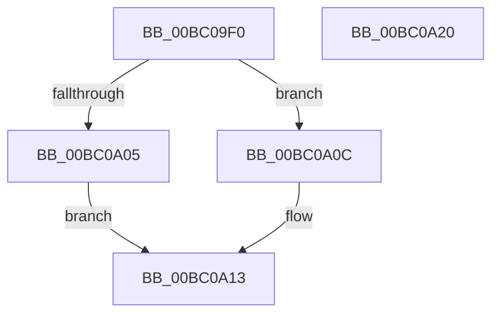

# BgpConsoleClearScreen

- RVA: `0x00BC09F0`–`0x00BC0A21` (길이 `49` bytes)
- VA: `0x0000000140BC09F0`
- 실행 섹션: `PAGEBGFX`
- PDB 이름 있음: `예`; PDB Function 태그: `아니요`
- unwind 정보 RVA: `0x0005CF00`
- 디코드: `15`개 명령, `49/49` bytes 표시
- 미해석 바이트: `0` (있으면 어셈블리에 `.byte`로 보존)

> 이 문서는 커널 이미지의 기계어와 PDB 기호를 분석해 생성했습니다. 4번과 5번은 함수 원형과 자료형을 바이너리 사용 방식에서 추정한 C 해석이며 원본 소스 복구 결과는 아닙니다.

## 1. Dependencies

- 직접 호출 지점: **3**; 고유 호출 대상: **3**
- 직접 호출자로 확인된 함수: **0**
- RIP 상대 이미지 참조: **1**

### Outgoing calls
- `0x00BC09F6` → [BgpFwAcquireLock](../../text/4B/BgpFwAcquireLock_function_004B3AA4.md) (function, `0x004B3AA4`)
- `0x00BC0A0C` → [BgpConsoleClearScreenEx](BgpConsoleClearScreenEx_function_00BC0A28.md) (function, `0x00BC0A28`)
- `0x00BC0A13` → [BgpFwReleaseLock](../../text/4B/BgpFwReleaseLock_function_004B357C.md) (function, `0x004B357C`)

### Direct callers
- 이 함수 시작 RVA로 연결되는 직접 call은 확인되지 않았습니다. 간접 호출은 완전히 역산할 수 없습니다.

### Static image references
- `0x00BC09FB` → RVA `0x00EEFEC8` (`.data`; read)

## 2. Other-region calls and transfers

- 다른 실행 섹션으로 향하는 call: **2**
  - `0x00BC09F6` → [BgpFwAcquireLock](../../text/4B/BgpFwAcquireLock_function_004B3AA4.md) (`PAGEBGFX` → `.text`)
  - `0x00BC0A13` → [BgpFwReleaseLock](../../text/4B/BgpFwReleaseLock_function_004B357C.md) (`PAGEBGFX` → `.text`)
- 별도 외부 분기/꼬리 이동을 확인하지 못했습니다.

## 3. Assembly (complete function range)

```asm
00BC09F0  40 53                           push rbx
00BC09F2  48 83 EC 20                     sub rsp, 0x20
00BC09F6  E8 A9 30 8F FF                  call 0x1404b3aa4
00BC09FB  48 83 3D C5 F4 32 00 00         cmp qword ptr [rip + 0x32f4c5], 0
00BC0A03  75 07                           jne 0x140bc0a0c
00BC0A05  BB 01 00 00 C0                  mov ebx, 0xc0000001
00BC0A0A  EB 07                           jmp 0x140bc0a13
00BC0A0C  E8 17 00 00 00                  call 0x140bc0a28
00BC0A11  8B D8                           mov ebx, eax
00BC0A13  E8 64 2B 8F FF                  call 0x1404b357c
00BC0A18  8B C3                           mov eax, ebx
00BC0A1A  48 83 C4 20                     add rsp, 0x20
00BC0A1E  5B                              pop rbx
00BC0A1F  C3                              ret
00BC0A20  CC                              int3
```

## 4. C-style interpretation (structured pseudocode)

```c
__int64 __fastcall BgpConsoleClearScreen(void)
{
    __int64 result;
    __int64 v_rsp;

    v_rsp = (v_rsp) - (32);
    result = BgpFwAcquireLock(a1, a2, a3, a4);
    if ((*(unsigned __int64 *)(v_rip + 3339461)) != 0) goto loc_00BC0A0C;
    goto loc_00BC0A13;
loc_00BC0A0C:
    result = BgpConsoleClearScreenEx(a1, a2, a3, a4);
loc_00BC0A13:
    result = BgpFwReleaseLock(a1, a2, a3, a4);
    v_rsp = (v_rsp) + (32);
    return (unsigned int)((unsigned int)((unsigned int)((unsigned int)(result))));
}
```

## 5. (Beta) C Style

```c
void BgpConsoleClearScreen(void)
{
    int64_t result;
    int64_t local_rsp;

    local_rsp = (local_rsp) - (32);
    result = BgpFwAcquireLock(a1, a2, a3, a4);
    if ((*(uint64_t *)(v_rip + 0x32F4C5)) != 0) goto loc_00BC0A0C;
    goto loc_00BC0A13;
loc_00BC0A0C:
    result = BgpConsoleClearScreenEx(a1, a2, a3, a4);
loc_00BC0A13:
    result = BgpFwReleaseLock(a1, a2, a3, a4);
    local_rsp = (local_rsp) + (32);
    return (uint32_t)((uint32_t)((uint32_t)((uint32_t)(result))));
}
```

## 6. Execution-region graph

[열기: 2D/3D 그래프와 함수 탐색 컨트롤 패널](../../../control-panel.html?section=pagebgfx&rva=0x00BC09F0&view=graph)

- 2D 그래프는 위에서 아래로 흐르고, 3D 그래프는 빈 공간을 드래그해 회전합니다. Shift+드래그는 이동, 휠은 확대·축소, 함수 노드 선택은 대상 보고서 이동입니다.

### Static fallback


