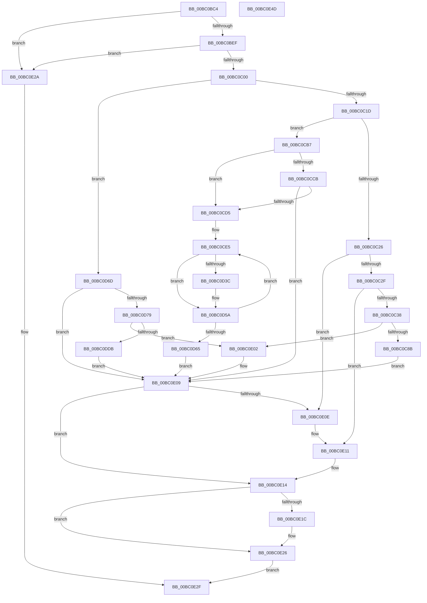

# BgpConsoleDisplayCharacterEx

- RVA: `0x00BC0BC4`–`0x00BC0E4E` (길이 `650` bytes)
- VA: `0x0000000140BC0BC4`
- 실행 섹션: `PAGEBGFX`
- PDB 이름 있음: `예`; PDB Function 태그: `아니요`
- unwind 정보 RVA: `0x000D9068`
- 디코드: `168`개 명령, `650/650` bytes 표시
- 미해석 바이트: `0` (있으면 어셈블리에 `.byte`로 보존)

> 이 문서는 커널 이미지의 기계어와 PDB 기호를 분석해 생성했습니다. 4번과 5번은 함수 원형과 자료형을 바이너리 사용 방식에서 추정한 C 해석이며 원본 소스 복구 결과는 아닙니다.

## 1. Dependencies

- 직접 호출 지점: **4**; 고유 호출 대상: **2**
- 직접 호출자로 확인된 함수: **1**
- RIP 상대 이미지 참조: **1**

### Outgoing calls
- `0x00BC0C7C` → [BgpDisplayCharacterEx](../../text/69/BgpDisplayCharacterEx_function_0069EBF4.md) (function, `0x0069EBF4`)
- `0x00BC0D2A` → [BgpDisplayCharacterEx](../../text/69/BgpDisplayCharacterEx_function_0069EBF4.md) (function, `0x0069EBF4`)
- `0x00BC0DD0` → [BgpDisplayCharacterEx](../../text/69/BgpDisplayCharacterEx_function_0069EBF4.md) (function, `0x0069EBF4`)
- `0x00BC0E21` → [BgpConsoleScrollScreen](BgpConsoleScrollScreen_function_00BC1314.md) (function, `0x00BC1314`)

### Direct callers
- [BgpConsoleDisplayString](BgpConsoleDisplayString_function_00BC0E60.md) at `0x00BC0EED`

### Static image references
- `0x00BC0BEF` → RVA `0x00EEFEC8` (`.data`; read)

## 2. Other-region calls and transfers

- 다른 실행 섹션으로 향하는 call: **3**
  - `0x00BC0C7C` → [BgpDisplayCharacterEx](../../text/69/BgpDisplayCharacterEx_function_0069EBF4.md) (`PAGEBGFX` → `.text`)
  - `0x00BC0D2A` → [BgpDisplayCharacterEx](../../text/69/BgpDisplayCharacterEx_function_0069EBF4.md) (`PAGEBGFX` → `.text`)
  - `0x00BC0DD0` → [BgpDisplayCharacterEx](../../text/69/BgpDisplayCharacterEx_function_0069EBF4.md) (`PAGEBGFX` → `.text`)
- 별도 외부 분기/꼬리 이동을 확인하지 못했습니다.

## 3. Assembly (complete function range)

```asm
00BC0BC4  4C 8B DC                        mov r11, rsp
00BC0BC7  49 89 5B 08                     mov qword ptr [r11 + 8], rbx
00BC0BCB  49 89 6B 18                     mov qword ptr [r11 + 0x18], rbp
00BC0BCF  49 89 73 20                     mov qword ptr [r11 + 0x20], rsi
00BC0BD3  57                              push rdi
00BC0BD4  41 54                           push r12
00BC0BD6  41 55                           push r13
00BC0BD8  41 56                           push r14
00BC0BDA  41 57                           push r15
00BC0BDC  48 83 EC 50                     sub rsp, 0x50
00BC0BE0  0F B7 F1                        movzx esi, cx
00BC0BE3  41 8B F9                        mov edi, r9d
00BC0BE6  83 FA 50                        cmp edx, 0x50
00BC0BE9  0F 87 3B 02 00 00               ja 0x140bc0e2a
00BC0BEF  48 8B 15 D2 F2 32 00            mov rdx, qword ptr [rip + 0x32f2d2]
00BC0BF6  44 3B 42 04                     cmp r8d, dword ptr [rdx + 4]
00BC0BFA  0F 87 2A 02 00 00               ja 0x140bc0e2a
00BC0C00  45 33 ED                        xor r13d, r13d
00BC0C03  48 8D 5A 44                     lea rbx, [rdx + 0x44]
00BC0C07  8B CE                           mov ecx, esi
00BC0C09  4C 8D 7A 3C                     lea r15, [rdx + 0x3c]
00BC0C0D  4C 8D 62 30                     lea r12, [rdx + 0x30]
00BC0C11  41 8B ED                        mov ebp, r13d
00BC0C14  83 E9 08                        sub ecx, 8
00BC0C17  0F 84 50 01 00 00               je 0x140bc0d6d
00BC0C1D  83 E9 01                        sub ecx, 1
00BC0C20  0F 84 91 00 00 00               je 0x140bc0cb7
00BC0C26  83 E9 01                        sub ecx, 1
00BC0C29  0F 84 DF 01 00 00               je 0x140bc0e0e
00BC0C2F  83 F9 03                        cmp ecx, 3
00BC0C32  0F 84 D9 01 00 00               je 0x140bc0e11
00BC0C38  45 8B 4C 24 04                  mov r9d, dword ptr [r12 + 4]
00BC0C3D  49 8D 43 10                     lea rax, [r11 + 0x10]
00BC0C41  45 8B 04 24                     mov r8d, dword ptr [r12]
00BC0C45  0F B7 CE                        movzx ecx, si
00BC0C48  44 0F AF 4B 04                  imul r9d, dword ptr [rbx + 4]
00BC0C4D  44 0F AF 03                     imul r8d, dword ptr [rbx]
00BC0C51  48 8B 52 28                     mov rdx, qword ptr [rdx + 0x28]
00BC0C55  44 8B B4 24 A0 00 00 00         mov r14d, dword ptr [rsp + 0xa0]
00BC0C5D  4D 89 6B D0                     mov qword ptr [r11 - 0x30], r13
00BC0C61  45 03 4F 04                     add r9d, dword ptr [r15 + 4]
00BC0C65  45 03 07                        add r8d, dword ptr [r15]
00BC0C68  49 89 43 C0                     mov qword ptr [r11 - 0x40], rax
00BC0C6C  49 8D 43 30                     lea rax, [r11 + 0x30]
00BC0C70  49 89 43 B8                     mov qword ptr [r11 - 0x48], rax
00BC0C74  89 7C 24 28                     mov dword ptr [rsp + 0x28], edi
00BC0C78  45 89 73 A8                     mov dword ptr [r11 - 0x58], r14d
00BC0C7C  E8 73 DF AD FF                  call 0x14069ebf4
00BC0C81  8B E8                           mov ebp, eax
00BC0C83  85 C0                           test eax, eax
00BC0C85  0F 88 77 01 00 00               js 0x140bc0e02
00BC0C8B  8B 0B                           mov ecx, dword ptr [rbx]
00BC0C8D  48 6B D1 19                     imul rdx, rcx, 0x19
00BC0C91  8B 4B 04                        mov ecx, dword ptr [rbx + 4]
00BC0C94  48 03 D1                        add rdx, rcx
00BC0C97  48 8D 0C 52                     lea rcx, [rdx + rdx*2]
00BC0C9B  48 8B 15 26 F2 32 00            mov rdx, qword ptr [rip + 0x32f226]
00BC0CA2  66 89 74 8A 58                  mov word ptr [rdx + rcx*4 + 0x58], si
00BC0CA7  89 7C 8A 50                     mov dword ptr [rdx + rcx*4 + 0x50], edi
00BC0CAB  44 89 74 8A 54                  mov dword ptr [rdx + rcx*4 + 0x54], r14d
00BC0CB0  FF 03                           inc dword ptr [rbx]
00BC0CB2  E9 52 01 00 00                  jmp 0x140bc0e09
00BC0CB7  44 8B 03                        mov r8d, dword ptr [rbx]
00BC0CBA  B8 50 00 00 00                  mov eax, 0x50
00BC0CBF  41 2B C0                        sub eax, r8d
00BC0CC2  B9 05 00 00 00                  mov ecx, 5
00BC0CC7  3B C1                           cmp eax, ecx
00BC0CC9  73 0A                           jae 0x140bc0cd5
00BC0CCB  8B C8                           mov ecx, eax
00BC0CCD  85 C0                           test eax, eax
00BC0CCF  0F 84 34 01 00 00               je 0x140bc0e09
00BC0CD5  44 8B AC 24 A0 00 00 00         mov r13d, dword ptr [rsp + 0xa0]
00BC0CDD  BE 20 00 00 00                  mov esi, 0x20
00BC0CE2  44 8B F1                        mov r14d, ecx
00BC0CE5  48 83 64 24 48 00               and qword ptr [rsp + 0x48], 0
00BC0CEB  48 8D 84 24 88 00 00 00         lea rax, [rsp + 0x88]
00BC0CF3  44 8B 4B 04                     mov r9d, dword ptr [rbx + 4]
00BC0CF7  8B CE                           mov ecx, esi
00BC0CF9  45 0F AF 4C 24 04               imul r9d, dword ptr [r12 + 4]
00BC0CFF  45 0F AF 04 24                  imul r8d, dword ptr [r12]
00BC0D04  48 8B 52 28                     mov rdx, qword ptr [rdx + 0x28]
00BC0D08  48 89 44 24 38                  mov qword ptr [rsp + 0x38], rax
00BC0D0D  48 8D 84 24 A8 00 00 00         lea rax, [rsp + 0xa8]
00BC0D15  48 89 44 24 30                  mov qword ptr [rsp + 0x30], rax
00BC0D1A  45 03 4F 04                     add r9d, dword ptr [r15 + 4]
00BC0D1E  45 03 07                        add r8d, dword ptr [r15]
00BC0D21  89 7C 24 28                     mov dword ptr [rsp + 0x28], edi
00BC0D25  44 89 6C 24 20                  mov dword ptr [rsp + 0x20], r13d
00BC0D2A  E8 C5 DE AD FF                  call 0x14069ebf4
00BC0D2F  48 8B 15 92 F1 32 00            mov rdx, qword ptr [rip + 0x32f192]
00BC0D36  8B E8                           mov ebp, eax
00BC0D38  85 C0                           test eax, eax
00BC0D3A  78 1E                           js 0x140bc0d5a
00BC0D3C  8B 03                           mov eax, dword ptr [rbx]
00BC0D3E  48 6B C8 19                     imul rcx, rax, 0x19
00BC0D42  8B 43 04                        mov eax, dword ptr [rbx + 4]
00BC0D45  48 03 C8                        add rcx, rax
00BC0D48  48 8D 04 49                     lea rax, [rcx + rcx*2]
00BC0D4C  66 89 74 82 58                  mov word ptr [rdx + rax*4 + 0x58], si
00BC0D51  89 7C 82 50                     mov dword ptr [rdx + rax*4 + 0x50], edi
00BC0D55  44 89 6C 82 54                  mov dword ptr [rdx + rax*4 + 0x54], r13d
00BC0D5A  FF 03                           inc dword ptr [rbx]
00BC0D5C  44 8B 03                        mov r8d, dword ptr [rbx]
00BC0D5F  49 83 EE 01                     sub r14, 1
00BC0D63  75 80                           jne 0x140bc0ce5
00BC0D65  45 33 ED                        xor r13d, r13d
00BC0D68  E9 9C 00 00 00                  jmp 0x140bc0e09
00BC0D6D  44 8B 03                        mov r8d, dword ptr [rbx]
00BC0D70  45 85 C0                        test r8d, r8d
00BC0D73  0F 84 90 00 00 00               je 0x140bc0e09
00BC0D79  44 8B B4 24 A0 00 00 00         mov r14d, dword ptr [rsp + 0xa0]
00BC0D81  48 8D 84 24 88 00 00 00         lea rax, [rsp + 0x88]
00BC0D89  41 FF C8                        dec r8d
00BC0D8C  4C 89 6C 24 48                  mov qword ptr [rsp + 0x48], r13
00BC0D91  44 89 03                        mov dword ptr [rbx], r8d
00BC0D94  BE 20 00 00 00                  mov esi, 0x20
00BC0D99  45 8B 4C 24 04                  mov r9d, dword ptr [r12 + 4]
00BC0D9E  8B CE                           mov ecx, esi
00BC0DA0  44 0F AF 4B 04                  imul r9d, dword ptr [rbx + 4]
00BC0DA5  45 0F AF 04 24                  imul r8d, dword ptr [r12]
00BC0DAA  48 8B 52 28                     mov rdx, qword ptr [rdx + 0x28]
00BC0DAE  48 89 44 24 38                  mov qword ptr [rsp + 0x38], rax
00BC0DB3  48 8D 84 24 A8 00 00 00         lea rax, [rsp + 0xa8]
00BC0DBB  48 89 44 24 30                  mov qword ptr [rsp + 0x30], rax
00BC0DC0  45 03 4F 04                     add r9d, dword ptr [r15 + 4]
00BC0DC4  45 03 07                        add r8d, dword ptr [r15]
00BC0DC7  89 7C 24 28                     mov dword ptr [rsp + 0x28], edi
00BC0DCB  44 89 74 24 20                  mov dword ptr [rsp + 0x20], r14d
00BC0DD0  E8 1F DE AD FF                  call 0x14069ebf4
00BC0DD5  8B E8                           mov ebp, eax
00BC0DD7  85 C0                           test eax, eax
00BC0DD9  78 27                           js 0x140bc0e02
00BC0DDB  8B 03                           mov eax, dword ptr [rbx]
00BC0DDD  48 8B 15 E4 F0 32 00            mov rdx, qword ptr [rip + 0x32f0e4]
00BC0DE4  48 6B C8 19                     imul rcx, rax, 0x19
00BC0DE8  8B 43 04                        mov eax, dword ptr [rbx + 4]
00BC0DEB  48 03 C8                        add rcx, rax
00BC0DEE  48 8D 04 49                     lea rax, [rcx + rcx*2]
00BC0DF2  66 89 74 82 58                  mov word ptr [rdx + rax*4 + 0x58], si
00BC0DF7  89 7C 82 50                     mov dword ptr [rdx + rax*4 + 0x50], edi
00BC0DFB  44 89 74 82 54                  mov dword ptr [rdx + rax*4 + 0x54], r14d
00BC0E00  EB 07                           jmp 0x140bc0e09
00BC0E02  48 8B 15 BF F0 32 00            mov rdx, qword ptr [rip + 0x32f0bf]
00BC0E09  83 3B 50                        cmp dword ptr [rbx], 0x50
00BC0E0C  72 06                           jb 0x140bc0e14
00BC0E0E  FF 43 04                        inc dword ptr [rbx + 4]
00BC0E11  44 89 2B                        mov dword ptr [rbx], r13d
00BC0E14  8B 43 04                        mov eax, dword ptr [rbx + 4]
00BC0E17  3B 42 04                        cmp eax, dword ptr [rdx + 4]
00BC0E1A  72 0A                           jb 0x140bc0e26
00BC0E1C  FF C8                           dec eax
00BC0E1E  89 43 04                        mov dword ptr [rbx + 4], eax
00BC0E21  E8 EE 04 00 00                  call 0x140bc1314
00BC0E26  8B C5                           mov eax, ebp
00BC0E28  EB 05                           jmp 0x140bc0e2f
00BC0E2A  B8 0D 00 00 C0                  mov eax, 0xc000000d
00BC0E2F  4C 8D 5C 24 50                  lea r11, [rsp + 0x50]
00BC0E34  49 8B 5B 30                     mov rbx, qword ptr [r11 + 0x30]
00BC0E38  49 8B 6B 40                     mov rbp, qword ptr [r11 + 0x40]
00BC0E3C  49 8B 73 48                     mov rsi, qword ptr [r11 + 0x48]
00BC0E40  49 8B E3                        mov rsp, r11
00BC0E43  41 5F                           pop r15
00BC0E45  41 5E                           pop r14
00BC0E47  41 5D                           pop r13
00BC0E49  41 5C                           pop r12
00BC0E4B  5F                              pop rdi
00BC0E4C  C3                              ret
00BC0E4D  CC                              int3
```

## 4. C-style interpretation (structured pseudocode)

```c
__int64 __fastcall BgpConsoleDisplayCharacterEx(unsigned __int16 a1, int a2, int a3, int a4, unsigned int a5, __int64 a6)
{
    __int64 result;
    __int64 v_r13;
    __int64 v_r14;
    __int64 v_rsp;
    unsigned __int64 v_stack_m28;
    unsigned __int64 v_stack_m30;
    unsigned __int64 v_stack_m40;
    unsigned __int64 v_stack_m48;
    unsigned int v_stack_m50;
    unsigned int v_stack_m58;
    unsigned __int64 v_stack_p10;

    *(unsigned __int64 *)(v_rsp + 8) = v_rbx;
    *(unsigned __int64 *)(v_rsp + 24) = v_rbp;
    *(unsigned __int64 *)(v_rsp + 32) = v_rsi;
    v_rsp = (v_rsp) - (80);
    if (a2 > 80) goto loc_00BC0E2A;
    if (a3 > (*(unsigned int *)(*(unsigned __int64 *)(v_rip + 3338962) + 4))) goto loc_00BC0E2A;
    v_r13 = 0;
    a1 = (unsigned int)(((unsigned int)(a1)) - (8));
    if (condition_is_equal) goto loc_00BC0D6D;
    a1 = (unsigned int)((a1) - (1));
    if (condition_is_equal) goto loc_00BC0CB7;
    a1 = (unsigned int)((a1) - (1));
    if (condition_is_equal) goto loc_00BC0E0E;
    if (a1 == 3) goto loc_00BC0E11;
    a4 = (unsigned int)(((unsigned int)(*(unsigned int *)(*(unsigned __int64 *)(v_rip + 3338962) + 48 + 4))) * (*(unsigned int *)(*(unsigned __int64 *)(v_rip + 3338962) + 68 + 4)));
    a3 = (unsigned int)(((unsigned int)(*(unsigned int *)(*(unsigned __int64 *)(v_rip + 3338962) + 48))) * (*(unsigned int *)(*(unsigned __int64 *)(v_rip + 3338962) + 68)));
    *(unsigned __int64 *)(v_rsp - 48) = 0;
    a4 = (unsigned int)((a4) + (*(unsigned int *)(*(unsigned __int64 *)(v_rip + 3338962) + 60 + 4)));
    a3 = (unsigned int)((a3) + (*(unsigned int *)(*(unsigned __int64 *)(v_rip + 3338962) + 60)));
    *(unsigned __int64 *)(v_rsp - 64) = v_rsp + 16;
    *(unsigned __int64 *)(v_rsp - 72) = v_rsp + 48;
    v_stack_m50 = (unsigned int)((unsigned int)(a4));
    *(unsigned int *)(v_rsp - 88) = (unsigned int)((unsigned int)(a5));
    result = BgpDisplayCharacterEx(a1, *(unsigned __int64 *)(*(unsigned __int64 *)(v_rip + 3338962) + 40), a3, a4);
    if (sign_flag) goto loc_00BC0E02;
    a2 = (*(unsigned __int64 *)(*(unsigned __int64 *)(v_rip + 3338962) + 40)) * ((unsigned int)(*(unsigned int *)(*(unsigned __int64 *)(v_rip + 3338962) + 68)));
    a2 = (a2) + ((unsigned int)(*(unsigned int *)(*(unsigned __int64 *)(v_rip + 3338962) + 68 + 4)));
    *(unsigned __int16 *)(*(unsigned __int64 *)(v_rip + 3338790) + a2 + a2 * 2 * 4 + 88) = a1;
    *(unsigned int *)(*(unsigned __int64 *)(v_rip + 3338790) + a2 + a2 * 2 * 4 + 80) = (unsigned int)((unsigned int)(a4));
    *(unsigned int *)(*(unsigned __int64 *)(v_rip + 3338790) + a2 + a2 * 2 * 4 + 84) = (unsigned int)((unsigned int)(a5));
    goto loc_00BC0E09;
loc_00BC0CB7:
    result = (unsigned int)((80) - ((unsigned int)((unsigned int)(*(unsigned int *)(*(unsigned __int64 *)(v_rip + 3338962) + 68)))));
    if (((unsigned int)(result)) >= 5) goto loc_00BC0CD5;
    if ((unsigned int)(result) == 0) goto loc_00BC0E09;
loc_00BC0CD5:
loc_00BC0CE5:
    a4 = (unsigned int)(((unsigned int)(*(unsigned int *)(*(unsigned __int64 *)(v_rip + 3338962) + 68 + 4))) * (*(unsigned int *)(*(unsigned __int64 *)(v_rip + 3338962) + 48 + 4)));
    a3 = (unsigned int)(((unsigned int)(*(unsigned int *)(*(unsigned __int64 *)(v_rip + 3338962) + 68))) * (*(unsigned int *)(*(unsigned __int64 *)(v_rip + 3338962) + 48)));
    v_stack_m40 = v_stack_p10;
    v_stack_m48 = a6;
    a4 = (unsigned int)((a4) + (*(unsigned int *)(*(unsigned __int64 *)(v_rip + 3338962) + 60 + 4)));
    a3 = (unsigned int)((a3) + (*(unsigned int *)(*(unsigned __int64 *)(v_rip + 3338962) + 60)));
    v_stack_m50 = (unsigned int)((unsigned int)(a4));
    v_stack_m58 = (unsigned int)((unsigned int)(a5));
    result = BgpDisplayCharacterEx(32, *(unsigned __int64 *)(*(unsigned __int64 *)(v_rip + 3338790) + 40), a3, a4);
    if (!(sign_flag)) {
        result = *(unsigned int *)(*(unsigned __int64 *)(v_rip + 3338962) + 68);
        a1 = (32) * (result);
        result = *(unsigned int *)(*(unsigned __int64 *)(v_rip + 3338962) + 68 + 4);
        a1 = (a1) + (result);
        result = a1 + a1 * 2;
        *(unsigned __int16 *)(*(unsigned __int64 *)(v_rip + 3338642) + result * 4 + 88) = 32;
        *(unsigned int *)(*(unsigned __int64 *)(v_rip + 3338642) + result * 4 + 80) = (unsigned int)((unsigned int)(a4));
        *(unsigned int *)(*(unsigned __int64 *)(v_rip + 3338642) + result * 4 + 84) = (unsigned int)((unsigned int)(a5));
    }
    v_r14 = ((unsigned int)((unsigned int)((unsigned int)((unsigned int)(result))))) - (1);
    if (condition_is_not_equal) goto loc_00BC0CE5;
    v_r13 = 0;
    goto loc_00BC0E09;
loc_00BC0D6D:
    if ((unsigned int)((unsigned int)(*(unsigned int *)(*(unsigned __int64 *)(v_rip + 3338962) + 68))) == 0) goto loc_00BC0E09;
    a3 = (unsigned int)(((unsigned int)(*(unsigned int *)(*(unsigned __int64 *)(v_rip + 3338962) + 68))) - 1);
    v_stack_m30 = 0;
    *(unsigned int *)(*(unsigned __int64 *)(v_rip + 3338962) + 68) = a3;
    a4 = (unsigned int)(((unsigned int)(*(unsigned int *)(*(unsigned __int64 *)(v_rip + 3338962) + 48 + 4))) * (*(unsigned int *)(*(unsigned __int64 *)(v_rip + 3338962) + 68 + 4)));
    a3 = (unsigned int)((a3) * (*(unsigned int *)(*(unsigned __int64 *)(v_rip + 3338962) + 48)));
    v_stack_m40 = v_stack_p10;
    v_stack_m48 = a6;
    a4 = (unsigned int)((a4) + (*(unsigned int *)(*(unsigned __int64 *)(v_rip + 3338962) + 60 + 4)));
    a3 = (unsigned int)((a3) + (*(unsigned int *)(*(unsigned __int64 *)(v_rip + 3338962) + 60)));
    v_stack_m50 = (unsigned int)((unsigned int)(a4));
    v_stack_m58 = (unsigned int)((unsigned int)(a5));
    result = BgpDisplayCharacterEx(32, *(unsigned __int64 *)(*(unsigned __int64 *)(v_rip + 3338642) + 40), a3, a4);
    if (sign_flag) goto loc_00BC0E02;
    a1 = (32) * ((unsigned int)(*(unsigned int *)(*(unsigned __int64 *)(v_rip + 3338962) + 68)));
    a1 = (a1) + ((unsigned int)(*(unsigned int *)(*(unsigned __int64 *)(v_rip + 3338962) + 68 + 4)));
    *(unsigned __int16 *)(*(unsigned __int64 *)(v_rip + 3338468) + a1 + a1 * 2 * 4 + 88) = 32;
    *(unsigned int *)(*(unsigned __int64 *)(v_rip + 3338468) + a1 + a1 * 2 * 4 + 80) = (unsigned int)((unsigned int)(a4));
    *(unsigned int *)(*(unsigned __int64 *)(v_rip + 3338468) + a1 + a1 * 2 * 4 + 84) = (unsigned int)((unsigned int)(a5));
    goto loc_00BC0E09;
loc_00BC0E02:
loc_00BC0E09:
    if ((*(unsigned int *)(*(unsigned __int64 *)(v_rip + 3338962) + 68)) < 80) goto loc_00BC0E14;
loc_00BC0E0E:
loc_00BC0E11:
    *(unsigned int *)(*(unsigned __int64 *)(v_rip + 3338962) + 68) = 0;
loc_00BC0E14:
    result = (unsigned int)(*(unsigned int *)(*(unsigned __int64 *)(v_rip + 3338962) + 68 + 4));
    if (((unsigned int)((unsigned int)(*(unsigned int *)(*(unsigned __int64 *)(v_rip + 3338962) + 68 + 4)))) >= (*(unsigned int *)(*(unsigned __int64 *)(v_rip + 3338431) + 4))) {
        result = (unsigned int)(((unsigned int)(*(unsigned int *)(*(unsigned __int64 *)(v_rip + 3338962) + 68 + 4))) - 1);
        *(unsigned int *)(*(unsigned __int64 *)(v_rip + 3338962) + 68 + 4) = (unsigned int)(result);
        result = BgpConsoleScrollScreen(a1, *(unsigned __int64 *)(v_rip + 3338431), a3, a4);
    }
    goto loc_00BC0E2F;
loc_00BC0E2A:
loc_00BC0E2F:
    return (unsigned int)(0xC000000DULL);
}
```

## 5. (Beta) C Style

```c
int64_t BgpConsoleDisplayCharacterEx(uint16_t Arg1, int32_t Arg2, int32_t Arg3, int32_t Arg4, uint32_t Arg5, int64_t Arg6)
{
    int64_t result;
    int64_t local_r13;
    int64_t local_r14;
    int64_t local_rsp;
    uint64_t v_stack_m28;
    uint64_t v_stack_m30;
    uint64_t v_stack_m40;
    uint64_t v_stack_m48;
    uint32_t v_stack_m50;
    uint32_t v_stack_m58;
    uint64_t v_stack_p10;

    *(uint64_t *)(local_rsp + 0x8) = local_rbx;
    *(uint64_t *)(local_rsp + 0x18) = local_rbp;
    *(uint64_t *)(local_rsp + 0x20) = local_rsi;
    local_rsp = (local_rsp) - (80);
    if (Arg2 > 80) goto loc_00BC0E2A;
    if (Arg3 > (*(uint32_t *)(*(uint64_t *)(v_rip + 0x32F2D2) + 0x4))) goto loc_00BC0E2A;
    local_r13 = 0;
    Arg1 = (uint32_t)(((uint32_t)(Arg1)) - (8));
    if (condition_is_equal) goto loc_00BC0D6D;
    Arg1 = (uint32_t)((Arg1) - (1));
    if (condition_is_equal) goto loc_00BC0CB7;
    Arg1 = (uint32_t)((Arg1) - (1));
    if (condition_is_equal) goto loc_00BC0E0E;
    if (Arg1 == 3) goto loc_00BC0E11;
    Arg4 = (uint32_t)(((uint32_t)(*(uint32_t *)(*(uint64_t *)(v_rip + 0x32F2D2) + 0x30 + 0x4))) * (*(uint32_t *)(*(uint64_t *)(v_rip + 0x32F2D2) + 0x44 + 0x4)));
    Arg3 = (uint32_t)(((uint32_t)(*(uint32_t *)(*(uint64_t *)(v_rip + 0x32F2D2) + 0x30))) * (*(uint32_t *)(*(uint64_t *)(v_rip + 0x32F2D2) + 0x44)));
    *(uint64_t *)(local_rsp - 0x30) = 0;
    Arg4 = (uint32_t)((Arg4) + (*(uint32_t *)(*(uint64_t *)(v_rip + 0x32F2D2) + 0x3C + 0x4)));
    Arg3 = (uint32_t)((Arg3) + (*(uint32_t *)(*(uint64_t *)(v_rip + 0x32F2D2) + 0x3C)));
    *(uint64_t *)(local_rsp - 0x40) = local_rsp + 16;
    *(uint64_t *)(local_rsp - 0x48) = local_rsp + 48;
    v_stack_m50 = (uint32_t)((uint32_t)(Arg4));
    *(uint32_t *)(local_rsp - 0x58) = (uint32_t)((uint32_t)(Arg5));
    result = BgpDisplayCharacterEx(Arg1, *(uint64_t *)(*(uint64_t *)(v_rip + 0x32F2D2) + 0x28), Arg3, Arg4);
    if (sign_flag) goto loc_00BC0E02;
    Arg2 = (*(uint64_t *)(*(uint64_t *)(v_rip + 0x32F2D2) + 0x28)) * ((uint32_t)(*(uint32_t *)(*(uint64_t *)(v_rip + 0x32F2D2) + 0x44)));
    Arg2 = (Arg2) + ((uint32_t)(*(uint32_t *)(*(uint64_t *)(v_rip + 0x32F2D2) + 0x44 + 0x4)));
    *(uint16_t *)(*(uint64_t *)(v_rip + 0x32F226) + Arg2 + Arg2 * 2 * 4 + 0x58) = Arg1;
    *(uint32_t *)(*(uint64_t *)(v_rip + 0x32F226) + Arg2 + Arg2 * 2 * 4 + 0x50) = (uint32_t)((uint32_t)(Arg4));
    *(uint32_t *)(*(uint64_t *)(v_rip + 0x32F226) + Arg2 + Arg2 * 2 * 4 + 0x54) = (uint32_t)((uint32_t)(Arg5));
    goto loc_00BC0E09;
loc_00BC0CB7:
    result = (uint32_t)((80) - ((uint32_t)((uint32_t)(*(uint32_t *)(*(uint64_t *)(v_rip + 0x32F2D2) + 0x44)))));
    if (((uint32_t)(result)) >= 5) goto loc_00BC0CD5;
    if ((uint32_t)(result) == 0) goto loc_00BC0E09;
loc_00BC0CD5:
loc_00BC0CE5:
    Arg4 = (uint32_t)(((uint32_t)(*(uint32_t *)(*(uint64_t *)(v_rip + 0x32F2D2) + 0x44 + 0x4))) * (*(uint32_t *)(*(uint64_t *)(v_rip + 0x32F2D2) + 0x30 + 0x4)));
    Arg3 = (uint32_t)(((uint32_t)(*(uint32_t *)(*(uint64_t *)(v_rip + 0x32F2D2) + 0x44))) * (*(uint32_t *)(*(uint64_t *)(v_rip + 0x32F2D2) + 0x30)));
    v_stack_m40 = v_stack_p10;
    v_stack_m48 = Arg6;
    Arg4 = (uint32_t)((Arg4) + (*(uint32_t *)(*(uint64_t *)(v_rip + 0x32F2D2) + 0x3C + 0x4)));
    Arg3 = (uint32_t)((Arg3) + (*(uint32_t *)(*(uint64_t *)(v_rip + 0x32F2D2) + 0x3C)));
    v_stack_m50 = (uint32_t)((uint32_t)(Arg4));
    v_stack_m58 = (uint32_t)((uint32_t)(Arg5));
    result = BgpDisplayCharacterEx(32, *(uint64_t *)(*(uint64_t *)(v_rip + 0x32F226) + 0x28), Arg3, Arg4);
    if (!(sign_flag)) {
        result = *(uint32_t *)(*(uint64_t *)(v_rip + 0x32F2D2) + 0x44);
        Arg1 = (32) * (result);
        result = *(uint32_t *)(*(uint64_t *)(v_rip + 0x32F2D2) + 0x44 + 0x4);
        Arg1 = (Arg1) + (result);
        result = Arg1 + Arg1 * 2;
        *(uint16_t *)(*(uint64_t *)(v_rip + 0x32F192) + result * 4 + 0x58) = 32;
        *(uint32_t *)(*(uint64_t *)(v_rip + 0x32F192) + result * 4 + 0x50) = (uint32_t)((uint32_t)(Arg4));
        *(uint32_t *)(*(uint64_t *)(v_rip + 0x32F192) + result * 4 + 0x54) = (uint32_t)((uint32_t)(Arg5));
    }
    local_r14 = ((uint32_t)((uint32_t)((uint32_t)((uint32_t)(result))))) - (1);
    if (condition_is_not_equal) goto loc_00BC0CE5;
    local_r13 = 0;
    goto loc_00BC0E09;
loc_00BC0D6D:
    if ((uint32_t)((uint32_t)(*(uint32_t *)(*(uint64_t *)(v_rip + 0x32F2D2) + 0x44))) == 0) goto loc_00BC0E09;
    Arg3 = (uint32_t)(((uint32_t)(*(uint32_t *)(*(uint64_t *)(v_rip + 0x32F2D2) + 0x44))) - 1);
    v_stack_m30 = 0;
    *(uint32_t *)(*(uint64_t *)(v_rip + 0x32F2D2) + 0x44) = Arg3;
    Arg4 = (uint32_t)(((uint32_t)(*(uint32_t *)(*(uint64_t *)(v_rip + 0x32F2D2) + 0x30 + 0x4))) * (*(uint32_t *)(*(uint64_t *)(v_rip + 0x32F2D2) + 0x44 + 0x4)));
    Arg3 = (uint32_t)((Arg3) * (*(uint32_t *)(*(uint64_t *)(v_rip + 0x32F2D2) + 0x30)));
    v_stack_m40 = v_stack_p10;
    v_stack_m48 = Arg6;
    Arg4 = (uint32_t)((Arg4) + (*(uint32_t *)(*(uint64_t *)(v_rip + 0x32F2D2) + 0x3C + 0x4)));
    Arg3 = (uint32_t)((Arg3) + (*(uint32_t *)(*(uint64_t *)(v_rip + 0x32F2D2) + 0x3C)));
    v_stack_m50 = (uint32_t)((uint32_t)(Arg4));
    v_stack_m58 = (uint32_t)((uint32_t)(Arg5));
    result = BgpDisplayCharacterEx(32, *(uint64_t *)(*(uint64_t *)(v_rip + 0x32F192) + 0x28), Arg3, Arg4);
    if (sign_flag) goto loc_00BC0E02;
    Arg1 = (32) * ((uint32_t)(*(uint32_t *)(*(uint64_t *)(v_rip + 0x32F2D2) + 0x44)));
    Arg1 = (Arg1) + ((uint32_t)(*(uint32_t *)(*(uint64_t *)(v_rip + 0x32F2D2) + 0x44 + 0x4)));
    *(uint16_t *)(*(uint64_t *)(v_rip + 0x32F0E4) + Arg1 + Arg1 * 2 * 4 + 0x58) = 32;
    *(uint32_t *)(*(uint64_t *)(v_rip + 0x32F0E4) + Arg1 + Arg1 * 2 * 4 + 0x50) = (uint32_t)((uint32_t)(Arg4));
    *(uint32_t *)(*(uint64_t *)(v_rip + 0x32F0E4) + Arg1 + Arg1 * 2 * 4 + 0x54) = (uint32_t)((uint32_t)(Arg5));
    goto loc_00BC0E09;
loc_00BC0E02:
loc_00BC0E09:
    if ((*(uint32_t *)(*(uint64_t *)(v_rip + 0x32F2D2) + 0x44)) < 80) goto loc_00BC0E14;
loc_00BC0E0E:
loc_00BC0E11:
    *(uint32_t *)(*(uint64_t *)(v_rip + 0x32F2D2) + 0x44) = 0;
loc_00BC0E14:
    result = (uint32_t)(*(uint32_t *)(*(uint64_t *)(v_rip + 0x32F2D2) + 0x44 + 0x4));
    if (((uint32_t)((uint32_t)(*(uint32_t *)(*(uint64_t *)(v_rip + 0x32F2D2) + 0x44 + 0x4)))) >= (*(uint32_t *)(*(uint64_t *)(v_rip + 0x32F0BF) + 0x4))) {
        result = (uint32_t)(((uint32_t)(*(uint32_t *)(*(uint64_t *)(v_rip + 0x32F2D2) + 0x44 + 0x4))) - 1);
        *(uint32_t *)(*(uint64_t *)(v_rip + 0x32F2D2) + 0x44 + 0x4) = (uint32_t)(result);
        result = BgpConsoleScrollScreen(Arg1, *(uint64_t *)(v_rip + 0x32F0BF), Arg3, Arg4);
    }
    goto loc_00BC0E2F;
loc_00BC0E2A:
loc_00BC0E2F:
    return (uint32_t)(0xC000000DULL);
}
```

## 6. Execution-region graph

[열기: 2D/3D 그래프와 함수 탐색 컨트롤 패널](../../../control-panel.html?section=pagebgfx&rva=0x00BC0BC4&view=graph)

- 2D 그래프는 위에서 아래로 흐르고, 3D 그래프는 빈 공간을 드래그해 회전합니다. Shift+드래그는 이동, 휠은 확대·축소, 함수 노드 선택은 대상 보고서 이동입니다.

### Static fallback


