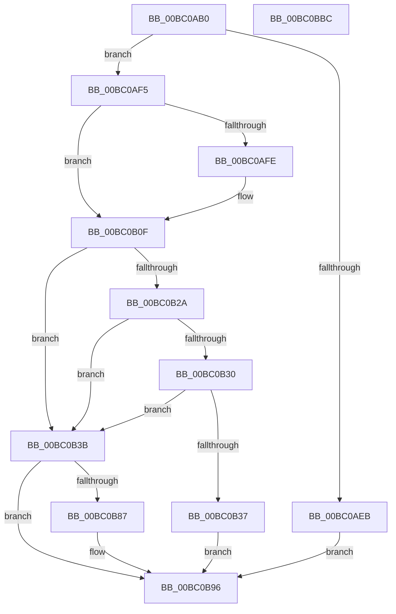

# BgpConsoleDisplayCharacter

- RVA: `0x00BC0AB0`–`0x00BC0BBD` (길이 `269` bytes)
- VA: `0x0000000140BC0AB0`
- 실행 섹션: `PAGEBGFX`
- PDB 이름 있음: `예`; PDB Function 태그: `아니요`
- unwind 정보 RVA: `0x000BD2A0`
- 디코드: `71`개 명령, `269/269` bytes 표시
- 미해석 바이트: `0` (있으면 어셈블리에 `.byte`로 보존)

> 이 문서는 커널 이미지의 기계어와 PDB 기호를 분석해 생성했습니다. 4번과 5번은 함수 원형과 자료형을 바이너리 사용 방식에서 추정한 C 해석이며 원본 소스 복구 결과는 아닙니다.

## 1. Dependencies

- 직접 호출 지점: **4**; 고유 호출 대상: **4**
- 직접 호출자로 확인된 함수: **0**
- RIP 상대 이미지 참조: **1**

### Outgoing calls
- `0x00BC0ADA` → [BgpFwAcquireLock](../../text/4B/BgpFwAcquireLock_function_004B3AA4.md) (function, `0x004B3AA4`)
- `0x00BC0AFE` → [AnFwFadeCompletion](AnFwFadeCompletion_function_00BC358C.md) (function, `0x00BC358C`)
- `0x00BC0B7C` → [BgpDisplayCharacterEx](../../text/69/BgpDisplayCharacterEx_function_0069EBF4.md) (function, `0x0069EBF4`)
- `0x00BC0B96` → [BgpFwReleaseLock](../../text/4B/BgpFwReleaseLock_function_004B357C.md) (function, `0x004B357C`)

### Direct callers
- 이 함수 시작 RVA로 연결되는 직접 call은 확인되지 않았습니다. 간접 호출은 완전히 역산할 수 없습니다.

### Static image references
- `0x00BC0ADF` → RVA `0x00EEFEC8` (`.data`; read)

## 2. Other-region calls and transfers

- 다른 실행 섹션으로 향하는 call: **3**
  - `0x00BC0ADA` → [BgpFwAcquireLock](../../text/4B/BgpFwAcquireLock_function_004B3AA4.md) (`PAGEBGFX` → `.text`)
  - `0x00BC0B7C` → [BgpDisplayCharacterEx](../../text/69/BgpDisplayCharacterEx_function_0069EBF4.md) (`PAGEBGFX` → `.text`)
  - `0x00BC0B96` → [BgpFwReleaseLock](../../text/4B/BgpFwReleaseLock_function_004B357C.md) (`PAGEBGFX` → `.text`)
- 별도 외부 분기/꼬리 이동을 확인하지 못했습니다.

## 3. Assembly (complete function range)

```asm
00BC0AB0  48 8B C4                        mov rax, rsp
00BC0AB3  48 89 58 08                     mov qword ptr [rax + 8], rbx
00BC0AB7  48 89 68 10                     mov qword ptr [rax + 0x10], rbp
00BC0ABB  48 89 70 18                     mov qword ptr [rax + 0x18], rsi
00BC0ABF  48 89 78 20                     mov qword ptr [rax + 0x20], rdi
00BC0AC3  41 54                           push r12
00BC0AC5  41 56                           push r14
00BC0AC7  41 57                           push r15
00BC0AC9  48 83 EC 60                     sub rsp, 0x60
00BC0ACD  41 8B E9                        mov ebp, r9d
00BC0AD0  41 8B F0                        mov esi, r8d
00BC0AD3  44 8B E2                        mov r12d, edx
00BC0AD6  44 0F B7 F9                     movzx r15d, cx
00BC0ADA  E8 C5 2F 8F FF                  call 0x1404b3aa4
00BC0ADF  48 8B 1D E2 F3 32 00            mov rbx, qword ptr [rip + 0x32f3e2]
00BC0AE6  48 85 DB                        test rbx, rbx
00BC0AE9  75 0A                           jne 0x140bc0af5
00BC0AEB  BE 01 00 00 C0                  mov esi, 0xc0000001
00BC0AF0  E9 A1 00 00 00                  jmp 0x140bc0b96
00BC0AF5  F7 43 08 00 00 01 00            test dword ptr [rbx + 8], 0x10000
00BC0AFC  74 11                           je 0x140bc0b0f
00BC0AFE  E8 89 2A 00 00                  call 0x140bc358c
00BC0B03  48 8B 1D BE F3 32 00            mov rbx, qword ptr [rip + 0x32f3be]
00BC0B0A  0F BA 73 08 10                  btr dword ptr [rbx + 8], 0x10
00BC0B0F  44 8B B4 24 A0 00 00 00         mov r14d, dword ptr [rsp + 0xa0]
00BC0B17  49 6B CC 19                     imul rcx, r12, 0x19
00BC0B1B  48 03 CE                        add rcx, rsi
00BC0B1E  48 8D 3C 49                     lea rdi, [rcx + rcx*2]
00BC0B22  66 44 39 7C BB 58               cmp word ptr [rbx + rdi*4 + 0x58], r15w
00BC0B28  75 11                           jne 0x140bc0b3b
00BC0B2A  39 6C BB 50                     cmp dword ptr [rbx + rdi*4 + 0x50], ebp
00BC0B2E  75 0B                           jne 0x140bc0b3b
00BC0B30  44 39 74 BB 54                  cmp dword ptr [rbx + rdi*4 + 0x54], r14d
00BC0B35  75 04                           jne 0x140bc0b3b
00BC0B37  33 F6                           xor esi, esi
00BC0B39  EB 5B                           jmp 0x140bc0b96
00BC0B3B  48 83 64 24 48 00               and qword ptr [rsp + 0x48], 0
00BC0B41  48 8D 44 24 50                  lea rax, [rsp + 0x50]
00BC0B46  0F AF 73 34                     imul esi, dword ptr [rbx + 0x34]
00BC0B4A  41 0F B7 CF                     movzx ecx, r15w
00BC0B4E  44 0F AF 63 30                  imul r12d, dword ptr [rbx + 0x30]
00BC0B53  48 8B 53 28                     mov rdx, qword ptr [rbx + 0x28]
00BC0B57  48 89 44 24 38                  mov qword ptr [rsp + 0x38], rax
00BC0B5C  48 8D 44 24 54                  lea rax, [rsp + 0x54]
00BC0B61  48 89 44 24 30                  mov qword ptr [rsp + 0x30], rax
00BC0B66  03 73 40                        add esi, dword ptr [rbx + 0x40]
00BC0B69  44 03 63 3C                     add r12d, dword ptr [rbx + 0x3c]
00BC0B6D  44 8B CE                        mov r9d, esi
00BC0B70  45 8B C4                        mov r8d, r12d
00BC0B73  89 6C 24 28                     mov dword ptr [rsp + 0x28], ebp
00BC0B77  44 89 74 24 20                  mov dword ptr [rsp + 0x20], r14d
00BC0B7C  E8 73 E0 AD FF                  call 0x14069ebf4
00BC0B81  8B F0                           mov esi, eax
00BC0B83  85 C0                           test eax, eax
00BC0B85  78 0F                           js 0x140bc0b96
00BC0B87  66 44 89 7C BB 58               mov word ptr [rbx + rdi*4 + 0x58], r15w
00BC0B8D  89 6C BB 50                     mov dword ptr [rbx + rdi*4 + 0x50], ebp
00BC0B91  44 89 74 BB 54                  mov dword ptr [rbx + rdi*4 + 0x54], r14d
00BC0B96  E8 E1 29 8F FF                  call 0x1404b357c
00BC0B9B  4C 8D 5C 24 60                  lea r11, [rsp + 0x60]
00BC0BA0  8B C6                           mov eax, esi
00BC0BA2  49 8B 5B 20                     mov rbx, qword ptr [r11 + 0x20]
00BC0BA6  49 8B 6B 28                     mov rbp, qword ptr [r11 + 0x28]
00BC0BAA  49 8B 73 30                     mov rsi, qword ptr [r11 + 0x30]
00BC0BAE  49 8B 7B 38                     mov rdi, qword ptr [r11 + 0x38]
00BC0BB2  49 8B E3                        mov rsp, r11
00BC0BB5  41 5F                           pop r15
00BC0BB7  41 5E                           pop r14
00BC0BB9  41 5C                           pop r12
00BC0BBB  C3                              ret
00BC0BBC  CC                              int3
```

## 4. C-style interpretation (structured pseudocode)

```c
__int64 __fastcall BgpConsoleDisplayCharacter(unsigned __int16 a1, int a2, int a3, int a4, unsigned int a5)
{
    __int64 result;
    __int64 v_r12;
    __int64 v_rbx;
    __int64 v_rsi;
    __int64 v_rsp;
    unsigned __int64 v_stack_m18;
    unsigned __int64 v_stack_m24;
    unsigned __int64 v_stack_m28;
    unsigned __int64 v_stack_m30;
    unsigned __int64 v_stack_m40;
    unsigned __int64 v_stack_m48;
    unsigned int v_stack_m50;
    unsigned int v_stack_m58;

    *(unsigned __int64 *)(v_rsp + 8) = v_rbx;
    *(unsigned __int64 *)(v_rsp + 16) = v_rbp;
    *(unsigned __int64 *)(v_rsp + 24) = v_rsi;
    *(unsigned __int64 *)(v_rsp + 32) = v_rdi;
    v_rsp = (v_rsp) - (96);
    result = BgpFwAcquireLock(a1, a2, a3, a4);
    if (*(unsigned __int64 *)(v_rip + 3339234) != 0) goto loc_00BC0AF5;
    goto loc_00BC0B96;
loc_00BC0AF5:
    v_rbx = *(unsigned __int64 *)(v_rip + 3339234);
    if (((*(unsigned int *)(*(unsigned __int64 *)(v_rip + 3339234) + 8)) & (0x10000ULL)) != 0) {
        result = AnFwFadeCompletion(a1, a2, a3, a4);
        v_rbx = *(unsigned __int64 *)(v_rip + 3339198);
    }
    a1 = (a1) * ((unsigned int)(a2));
    a1 = (a1) + ((unsigned int)(0xC0000001ULL));
    if ((*(unsigned __int16 *)(v_rbx + a1 + a1 * 2 * 4 + 88)) != a1) goto loc_00BC0B3B;
    if ((*(unsigned int *)(v_rbx + a1 + a1 * 2 * 4 + 80)) != ((unsigned int)((unsigned int)(a4)))) goto loc_00BC0B3B;
    if ((*(unsigned int *)(v_rbx + a1 + a1 * 2 * 4 + 84)) != ((unsigned int)((unsigned int)(a5)))) goto loc_00BC0B3B;
    v_rsi = 0;
    goto loc_00BC0B96;
loc_00BC0B3B:
    v_rsi = (unsigned int)((v_rsi) * (*(unsigned int *)(v_rbx + 52)));
    v_r12 = (unsigned int)(((unsigned int)(a2)) * (*(unsigned int *)(v_rbx + 48)));
    v_stack_m40 = v_stack_m28;
    v_stack_m48 = v_stack_m24;
    v_rsi = (unsigned int)((v_rsi) + (*(unsigned int *)(v_rbx + 64)));
    v_r12 = (unsigned int)((v_r12) + (*(unsigned int *)(v_rbx + 60)));
    v_stack_m50 = (unsigned int)((unsigned int)(a4));
    v_stack_m58 = (unsigned int)((unsigned int)(a5));
    result = BgpDisplayCharacterEx(a1, *(unsigned __int64 *)(v_rbx + 40), (unsigned int)((unsigned int)(v_r12)), (unsigned int)((unsigned int)(v_rsi)));
    if (!(sign_flag)) {
        *(unsigned __int16 *)(v_rbx + a1 + a1 * 2 * 4 + 88) = a1;
        *(unsigned int *)(v_rbx + a1 + a1 * 2 * 4 + 80) = (unsigned int)((unsigned int)(a4));
        *(unsigned int *)(v_rbx + a1 + a1 * 2 * 4 + 84) = (unsigned int)((unsigned int)(a5));
    }
    result = BgpFwReleaseLock(a1, *(unsigned __int64 *)(v_rbx + 40), (unsigned int)((unsigned int)(v_r12)), (unsigned int)((unsigned int)(v_rsi)));
    return (unsigned int)((unsigned int)((unsigned int)((unsigned int)(result))));
}
```

## 5. (Beta) C Style

```c
int64_t BgpConsoleDisplayCharacter(uint16_t Arg1, int32_t Arg2, int32_t Arg3, int32_t Arg4, uint32_t Arg5)
{
    int64_t result;
    int64_t local_r12;
    int64_t local_rbx;
    int64_t local_rsi;
    int64_t local_rsp;
    uint64_t v_stack_m18;
    uint64_t v_stack_m24;
    uint64_t v_stack_m28;
    uint64_t v_stack_m30;
    uint64_t v_stack_m40;
    uint64_t v_stack_m48;
    uint32_t v_stack_m50;
    uint32_t v_stack_m58;

    *(uint64_t *)(local_rsp + 0x8) = local_rbx;
    *(uint64_t *)(local_rsp + 0x10) = local_rbp;
    *(uint64_t *)(local_rsp + 0x18) = local_rsi;
    *(uint64_t *)(local_rsp + 0x20) = local_rdi;
    local_rsp = (local_rsp) - (96);
    result = BgpFwAcquireLock(Arg1, Arg2, Arg3, Arg4);
    if (*(uint64_t *)(v_rip + 0x32F3E2) != 0) goto loc_00BC0AF5;
    goto loc_00BC0B96;
loc_00BC0AF5:
    local_rbx = *(uint64_t *)(v_rip + 0x32F3E2);
    if (((*(uint32_t *)(*(uint64_t *)(v_rip + 0x32F3E2) + 0x8)) & (0x10000ULL)) != 0) {
        result = AnFwFadeCompletion(Arg1, Arg2, Arg3, Arg4);
        local_rbx = *(uint64_t *)(v_rip + 0x32F3BE);
    }
    Arg1 = (Arg1) * ((uint32_t)(Arg2));
    Arg1 = (Arg1) + ((uint32_t)(0xC0000001ULL));
    if ((*(uint16_t *)(local_rbx + Arg1 + Arg1 * 2 * 4 + 0x58)) != Arg1) goto loc_00BC0B3B;
    if ((*(uint32_t *)(local_rbx + Arg1 + Arg1 * 2 * 4 + 0x50)) != ((uint32_t)((uint32_t)(Arg4)))) goto loc_00BC0B3B;
    if ((*(uint32_t *)(local_rbx + Arg1 + Arg1 * 2 * 4 + 0x54)) != ((uint32_t)((uint32_t)(Arg5)))) goto loc_00BC0B3B;
    local_rsi = 0;
    goto loc_00BC0B96;
loc_00BC0B3B:
    local_rsi = (uint32_t)((local_rsi) * (*(uint32_t *)(local_rbx + 0x34)));
    local_r12 = (uint32_t)(((uint32_t)(Arg2)) * (*(uint32_t *)(local_rbx + 0x30)));
    v_stack_m40 = v_stack_m28;
    v_stack_m48 = v_stack_m24;
    local_rsi = (uint32_t)((local_rsi) + (*(uint32_t *)(local_rbx + 0x40)));
    local_r12 = (uint32_t)((local_r12) + (*(uint32_t *)(local_rbx + 0x3C)));
    v_stack_m50 = (uint32_t)((uint32_t)(Arg4));
    v_stack_m58 = (uint32_t)((uint32_t)(Arg5));
    result = BgpDisplayCharacterEx(Arg1, *(uint64_t *)(local_rbx + 0x28), (uint32_t)((uint32_t)(local_r12)), (uint32_t)((uint32_t)(local_rsi)));
    if (!(sign_flag)) {
        *(uint16_t *)(local_rbx + Arg1 + Arg1 * 2 * 4 + 0x58) = Arg1;
        *(uint32_t *)(local_rbx + Arg1 + Arg1 * 2 * 4 + 0x50) = (uint32_t)((uint32_t)(Arg4));
        *(uint32_t *)(local_rbx + Arg1 + Arg1 * 2 * 4 + 0x54) = (uint32_t)((uint32_t)(Arg5));
    }
    result = BgpFwReleaseLock(Arg1, *(uint64_t *)(local_rbx + 0x28), (uint32_t)((uint32_t)(local_r12)), (uint32_t)((uint32_t)(local_rsi)));
    return (uint32_t)((uint32_t)((uint32_t)((uint32_t)(result))));
}
```

## 6. Execution-region graph

[열기: 2D/3D 그래프와 함수 탐색 컨트롤 패널](../../../control-panel.html?section=pagebgfx&rva=0x00BC0AB0&view=graph)

- 2D 그래프는 위에서 아래로 흐르고, 3D 그래프는 빈 공간을 드래그해 회전합니다. Shift+드래그는 이동, 휠은 확대·축소, 함수 노드 선택은 대상 보고서 이동입니다.

### Static fallback


