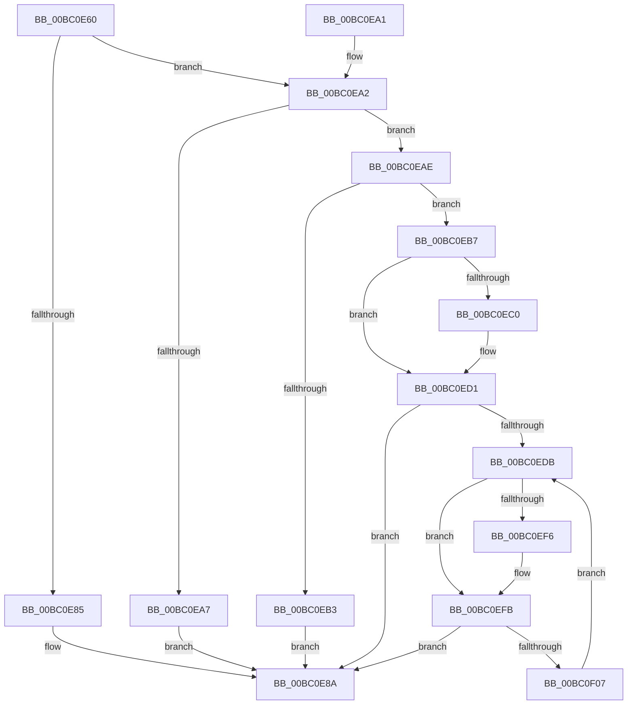

# BgpConsoleDisplayString

- RVA: `0x00BC0E60`–`0x00BC0F10` (길이 `176` bytes)
- VA: `0x0000000140BC0E60`
- 실행 섹션: `PAGEBGFX`
- PDB 이름 있음: `예`; PDB Function 태그: `아니요`
- unwind 정보 RVA: `0x000DA40C`
- 디코드: `52`개 명령, `176/176` bytes 표시
- 미해석 바이트: `0` (있으면 어셈블리에 `.byte`로 보존)

> 이 문서는 커널 이미지의 기계어와 PDB 기호를 분석해 생성했습니다. 4번과 5번은 함수 원형과 자료형을 바이너리 사용 방식에서 추정한 C 해석이며 원본 소스 복구 결과는 아닙니다.

## 1. Dependencies

- 직접 호출 지점: **4**; 고유 호출 대상: **4**
- 직접 호출자로 확인된 함수: **0**
- RIP 상대 이미지 참조: **1**

### Outgoing calls
- `0x00BC0E72` → [BgpFwAcquireLock](../../text/4B/BgpFwAcquireLock_function_004B3AA4.md) (function, `0x004B3AA4`)
- `0x00BC0E8A` → [BgpFwReleaseLock](../../text/4B/BgpFwReleaseLock_function_004B357C.md) (function, `0x004B357C`)
- `0x00BC0EC0` → [AnFwFadeCompletion](AnFwFadeCompletion_function_00BC358C.md) (function, `0x00BC358C`)
- `0x00BC0EED` → [BgpConsoleDisplayCharacterEx](BgpConsoleDisplayCharacterEx_function_00BC0BC4.md) (function, `0x00BC0BC4`)

### Direct callers
- 이 함수 시작 RVA로 연결되는 직접 call은 확인되지 않았습니다. 간접 호출은 완전히 역산할 수 없습니다.

### Static image references
- `0x00BC0E77` → RVA `0x00EEFEC8` (`.data`; read)

## 2. Other-region calls and transfers

- 다른 실행 섹션으로 향하는 call: **2**
  - `0x00BC0E72` → [BgpFwAcquireLock](../../text/4B/BgpFwAcquireLock_function_004B3AA4.md) (`PAGEBGFX` → `.text`)
  - `0x00BC0E8A` → [BgpFwReleaseLock](../../text/4B/BgpFwReleaseLock_function_004B357C.md) (`PAGEBGFX` → `.text`)
- 별도 외부 분기/꼬리 이동을 확인하지 못했습니다.

## 3. Assembly (complete function range)

```asm
00BC0E60  48 89 5C 24 08                  mov qword ptr [rsp + 8], rbx
00BC0E65  48 89 74 24 10                  mov qword ptr [rsp + 0x10], rsi
00BC0E6A  57                              push rdi
00BC0E6B  48 83 EC 30                     sub rsp, 0x30
00BC0E6F  48 8B F9                        mov rdi, rcx
00BC0E72  E8 2D 2C 8F FF                  call 0x1404b3aa4
00BC0E77  48 8B 15 4A F0 32 00            mov rdx, qword ptr [rip + 0x32f04a]
00BC0E7E  33 F6                           xor esi, esi
00BC0E80  48 85 D2                        test rdx, rdx
00BC0E83  75 1D                           jne 0x140bc0ea2
00BC0E85  BB 01 00 00 C0                  mov ebx, 0xc0000001
00BC0E8A  E8 ED 26 8F FF                  call 0x1404b357c
00BC0E8F  48 8B 74 24 48                  mov rsi, qword ptr [rsp + 0x48]
00BC0E94  8B C3                           mov eax, ebx
00BC0E96  48 8B 5C 24 40                  mov rbx, qword ptr [rsp + 0x40]
00BC0E9B  48 83 C4 30                     add rsp, 0x30
00BC0E9F  5F                              pop rdi
00BC0EA0  C3                              ret
00BC0EA1  CC                              int3
00BC0EA2  48 85 FF                        test rdi, rdi
00BC0EA5  75 07                           jne 0x140bc0eae
00BC0EA7  BB 0D 00 00 C0                  mov ebx, 0xc000000d
00BC0EAC  EB DC                           jmp 0x140bc0e8a
00BC0EAE  66 39 37                        cmp word ptr [rdi], si
00BC0EB1  75 04                           jne 0x140bc0eb7
00BC0EB3  8B DE                           mov ebx, esi
00BC0EB5  EB D3                           jmp 0x140bc0e8a
00BC0EB7  F7 42 08 00 00 01 00            test dword ptr [rdx + 8], 0x10000
00BC0EBE  74 11                           je 0x140bc0ed1
00BC0EC0  E8 C7 26 00 00                  call 0x140bc358c
00BC0EC5  48 8B 15 FC EF 32 00            mov rdx, qword ptr [rip + 0x32effc]
00BC0ECC  0F BA 72 08 10                  btr dword ptr [rdx + 8], 0x10
00BC0ED1  0F B7 0F                        movzx ecx, word ptr [rdi]
00BC0ED4  8B DE                           mov ebx, esi
00BC0ED6  66 85 C9                        test cx, cx
00BC0ED9  74 AF                           je 0x140bc0e8a
00BC0EDB  8B 42 10                        mov eax, dword ptr [rdx + 0x10]
00BC0EDE  44 8B 4A 0C                     mov r9d, dword ptr [rdx + 0xc]
00BC0EE2  44 8B 42 48                     mov r8d, dword ptr [rdx + 0x48]
00BC0EE6  8B 52 44                        mov edx, dword ptr [rdx + 0x44]
00BC0EE9  89 44 24 20                     mov dword ptr [rsp + 0x20], eax
00BC0EED  E8 D2 FC FF FF                  call 0x140bc0bc4
00BC0EF2  85 C0                           test eax, eax
00BC0EF4  79 05                           jns 0x140bc0efb
00BC0EF6  85 DB                           test ebx, ebx
00BC0EF8  0F 49 D8                        cmovns ebx, eax
00BC0EFB  48 83 C7 02                     add rdi, 2
00BC0EFF  0F B7 0F                        movzx ecx, word ptr [rdi]
00BC0F02  66 85 C9                        test cx, cx
00BC0F05  74 83                           je 0x140bc0e8a
00BC0F07  48 8B 15 BA EF 32 00            mov rdx, qword ptr [rip + 0x32efba]
00BC0F0E  EB CB                           jmp 0x140bc0edb
```

## 4. C-style interpretation (structured pseudocode)

```c
__int64 __fastcall BgpConsoleDisplayString(__int64 a1)
{
    __int64 result;
    __int64 v_rbx;
    __int64 v_rdi;
    __int64 v_rsi;
    __int64 v_rsp;
    unsigned __int64 v_stack_p10;
    unsigned int v_stack_p20;
    unsigned __int64 v_stack_p8;

    v_stack_p8 = v_rbx;
    v_stack_p10 = v_rsi;
    v_rsp = (v_rsp) - (48);
    result = BgpFwAcquireLock(a1, a2, a3, a4);
    v_rsi = 0;
    if (*(unsigned __int64 *)(v_rip + 3338314) != 0) goto loc_00BC0EA2;
loc_00BC0E8A:
    result = BgpFwReleaseLock(a1, *(unsigned __int64 *)(v_rip + 3338314), a3, a4);
    v_rsp = (v_rsp) + (48);
    return (unsigned int)((unsigned int)((unsigned int)(0xC0000001ULL)));
loc_00BC0EA2:
    if (a1 != 0) goto loc_00BC0EAE;
    goto loc_00BC0E8A;
loc_00BC0EAE:
    if ((*(unsigned __int16 *)(a1)) != ((unsigned __int16)(v_stack_p10))) goto loc_00BC0EB7;
    goto loc_00BC0E8A;
loc_00BC0EB7:
    result = (unsigned int)((unsigned int)((unsigned int)(0xC0000001ULL)));
    if (((*(unsigned int *)(*(unsigned __int64 *)(v_rip + 3338314) + 8)) & (0x10000ULL)) != 0) {
        result = AnFwFadeCompletion(a1, *(unsigned __int64 *)(v_rip + 3338314), a3, a4);
        a2 = *(unsigned __int64 *)(v_rip + 3338236);
    }
    if ((unsigned __int16)(*(unsigned __int16 *)(a1)) == 0) goto loc_00BC0E8A;
loc_00BC0EDB:
    v_stack_p20 = (unsigned int)((unsigned int)(*(unsigned int *)(a2 + 16)));
    result = BgpConsoleDisplayCharacterEx(*(unsigned __int16 *)(a1), (unsigned int)(*(unsigned int *)(a2 + 68)), (unsigned int)(*(unsigned int *)(a2 + 72)), (unsigned int)(*(unsigned int *)(a2 + 12)));
    v_rbx = (unsigned int)((unsigned int)(v_stack_p10));
    if (sign_flag) {
        v_rbx = (unsigned int)((unsigned int)(v_stack_p10));
        if (!sign_flag) { v_rbx = (unsigned int)(result); }
    }
    v_rdi = (a1) + (2);
    if ((unsigned __int16)(*(unsigned __int16 *)(v_rdi)) == 0) goto loc_00BC0E8A;
    goto loc_00BC0EDB;
}
```

## 5. (Beta) C Style

```c
int64_t BgpConsoleDisplayString(int64_t Arg1)
{
    int64_t result;
    int64_t local_rbx;
    int64_t local_rdi;
    int64_t local_rsi;
    int64_t local_rsp;
    uint64_t v_stack_p10;
    uint32_t v_stack_p20;
    uint64_t v_stack_p8;

    v_stack_p8 = local_rbx;
    v_stack_p10 = local_rsi;
    local_rsp = (local_rsp) - (48);
    result = BgpFwAcquireLock(Arg1, a2, a3, a4);
    local_rsi = 0;
    if (*(uint64_t *)(v_rip + 0x32F04A) != 0) goto loc_00BC0EA2;
loc_00BC0E8A:
    result = BgpFwReleaseLock(Arg1, *(uint64_t *)(v_rip + 0x32F04A), a3, a4);
    local_rsp = (local_rsp) + (48);
    return (uint32_t)((uint32_t)((uint32_t)(0xC0000001ULL)));
loc_00BC0EA2:
    if (Arg1 != 0) goto loc_00BC0EAE;
    goto loc_00BC0E8A;
loc_00BC0EAE:
    if ((*(uint16_t *)(Arg1)) != ((uint16_t)(v_stack_p10))) goto loc_00BC0EB7;
    goto loc_00BC0E8A;
loc_00BC0EB7:
    result = (uint32_t)((uint32_t)((uint32_t)(0xC0000001ULL)));
    if (((*(uint32_t *)(*(uint64_t *)(v_rip + 0x32F04A) + 0x8)) & (0x10000ULL)) != 0) {
        result = AnFwFadeCompletion(Arg1, *(uint64_t *)(v_rip + 0x32F04A), a3, a4);
        a2 = *(uint64_t *)(v_rip + 0x32EFFC);
    }
    if ((uint16_t)(*(uint16_t *)(Arg1)) == 0) goto loc_00BC0E8A;
loc_00BC0EDB:
    v_stack_p20 = (uint32_t)((uint32_t)(*(uint32_t *)(a2 + 0x10)));
    result = BgpConsoleDisplayCharacterEx(*(uint16_t *)(Arg1), (uint32_t)(*(uint32_t *)(a2 + 0x44)), (uint32_t)(*(uint32_t *)(a2 + 0x48)), (uint32_t)(*(uint32_t *)(a2 + 0xC)));
    local_rbx = (uint32_t)((uint32_t)(v_stack_p10));
    if (sign_flag) {
        local_rbx = (uint32_t)((uint32_t)(v_stack_p10));
        if (!sign_flag) { local_rbx = (uint32_t)(result); }
    }
    local_rdi = (Arg1) + (2);
    if ((uint16_t)(*(uint16_t *)(local_rdi)) == 0) goto loc_00BC0E8A;
    goto loc_00BC0EDB;
}
```

## 6. Execution-region graph

[열기: 2D/3D 그래프와 함수 탐색 컨트롤 패널](../../../control-panel.html?section=pagebgfx&rva=0x00BC0E60&view=graph)

- 2D 그래프는 위에서 아래로 흐르고, 3D 그래프는 빈 공간을 드래그해 회전합니다. Shift+드래그는 이동, 휠은 확대·축소, 함수 노드 선택은 대상 보고서 이동입니다.

### Static fallback


