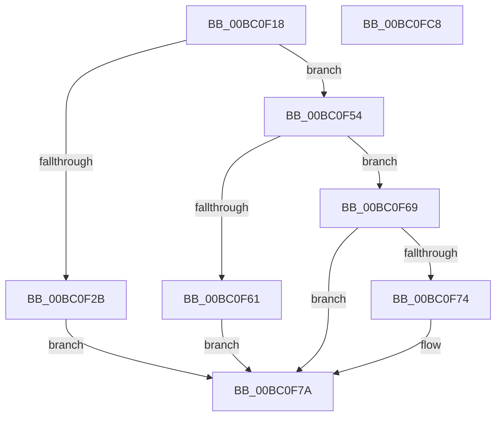

# BgpConsoleDrawCursor

- RVA: `0x00BC0F18`–`0x00BC0FC9` (길이 `177` bytes)
- VA: `0x0000000140BC0F18`
- 실행 섹션: `PAGEBGFX`
- PDB 이름 있음: `예`; PDB Function 태그: `아니요`
- unwind 정보 RVA: `0x0006C2A4`
- 디코드: `44`개 명령, `177/177` bytes 표시
- 미해석 바이트: `0` (있으면 어셈블리에 `.byte`로 보존)

> 이 문서는 커널 이미지의 기계어와 PDB 기호를 분석해 생성했습니다. 4번과 5번은 함수 원형과 자료형을 바이너리 사용 방식에서 추정한 C 해석이며 원본 소스 복구 결과는 아닙니다.

## 1. Dependencies

- 직접 호출 지점: **1**; 고유 호출 대상: **1**
- 직접 호출자로 확인된 함수: **1**
- RIP 상대 이미지 참조: **1**

### Outgoing calls
- `0x00BC0FBE` → [BgpDisplayCharacterEx](../../text/69/BgpDisplayCharacterEx_function_0069EBF4.md) (function, `0x0069EBF4`)

### Direct callers
- [BgpConsoleSetCursor](BgpConsoleSetCursor_function_00BC1520.md) at `0x00BC157B`
- [BgpConsoleSetCursor](BgpConsoleSetCursor_function_00BC1520.md) at `0x00BC1594`

### Static image references
- `0x00BC0F1C` → RVA `0x00EEFEC8` (`.data`; read)

## 2. Other-region calls and transfers

- 다른 실행 섹션으로 향하는 call: **1**
  - `0x00BC0FBE` → [BgpDisplayCharacterEx](../../text/69/BgpDisplayCharacterEx_function_0069EBF4.md) (`PAGEBGFX` → `.text`)
- 별도 외부 분기/꼬리 이동을 확인하지 못했습니다.

## 3. Assembly (complete function range)

```asm
00BC0F18  48 83 EC 58                     sub rsp, 0x58
00BC0F1C  4C 8B 15 A5 EF 32 00            mov r10, qword ptr [rip + 0x32efa5]
00BC0F23  41 8B 42 4C                     mov eax, dword ptr [r10 + 0x4c]
00BC0F27  85 C0                           test eax, eax
00BC0F29  75 29                           jne 0x140bc0f54
00BC0F2B  41 8B 42 44                     mov eax, dword ptr [r10 + 0x44]
00BC0F2F  48 6B D0 19                     imul rdx, rax, 0x19
00BC0F33  41 8B 42 48                     mov eax, dword ptr [r10 + 0x48]
00BC0F37  48 03 D0                        add rdx, rax
00BC0F3A  48 8D 0C 52                     lea rcx, [rdx + rdx*2]
00BC0F3E  45 0F B7 5C 8A 58               movzx r11d, word ptr [r10 + rcx*4 + 0x58]
00BC0F44  48 8D 04 52                     lea rax, [rdx + rdx*2]
00BC0F48  41 8B 4C 8A 50                  mov ecx, dword ptr [r10 + rcx*4 + 0x50]
00BC0F4D  41 8B 54 82 54                  mov edx, dword ptr [r10 + rax*4 + 0x54]
00BC0F52  EB 26                           jmp 0x140bc0f7a
00BC0F54  41 8B 52 10                     mov edx, dword ptr [r10 + 0x10]
00BC0F58  41 8B 4A 0C                     mov ecx, dword ptr [r10 + 0xc]
00BC0F5C  83 F8 22                        cmp eax, 0x22
00BC0F5F  73 08                           jae 0x140bc0f69
00BC0F61  41 BB 5F 00 00 00               mov r11d, 0x5f
00BC0F67  EB 11                           jmp 0x140bc0f7a
00BC0F69  41 BB 84 25 00 00               mov r11d, 0x2584
00BC0F6F  83 F8 43                        cmp eax, 0x43
00BC0F72  72 06                           jb 0x140bc0f7a
00BC0F74  41 BB 88 25 00 00               mov r11d, 0x2588
00BC0F7A  48 83 64 24 48 00               and qword ptr [rsp + 0x48], 0
00BC0F80  48 8D 44 24 60                  lea rax, [rsp + 0x60]
00BC0F85  45 8B 4A 34                     mov r9d, dword ptr [r10 + 0x34]
00BC0F89  45 8B 42 30                     mov r8d, dword ptr [r10 + 0x30]
00BC0F8D  45 0F AF 4A 48                  imul r9d, dword ptr [r10 + 0x48]
00BC0F92  45 0F AF 42 44                  imul r8d, dword ptr [r10 + 0x44]
00BC0F97  48 89 44 24 38                  mov qword ptr [rsp + 0x38], rax
00BC0F9C  48 8D 44 24 68                  lea rax, [rsp + 0x68]
00BC0FA1  48 89 44 24 30                  mov qword ptr [rsp + 0x30], rax
00BC0FA6  89 4C 24 28                     mov dword ptr [rsp + 0x28], ecx
00BC0FAA  41 0F B7 CB                     movzx ecx, r11w
00BC0FAE  45 03 4A 40                     add r9d, dword ptr [r10 + 0x40]
00BC0FB2  45 03 42 3C                     add r8d, dword ptr [r10 + 0x3c]
00BC0FB6  89 54 24 20                     mov dword ptr [rsp + 0x20], edx
00BC0FBA  49 8B 52 28                     mov rdx, qword ptr [r10 + 0x28]
00BC0FBE  E8 31 DC AD FF                  call 0x14069ebf4
00BC0FC3  48 83 C4 58                     add rsp, 0x58
00BC0FC7  C3                              ret
00BC0FC8  CC                              int3
```

## 4. C-style interpretation (structured pseudocode)

```c
__int64 __fastcall BgpConsoleDrawCursor(void)
{
    __int64 result;
    __int64 v_r11;
    __int64 v_rsp;
    unsigned __int64 v_stack_m10;
    unsigned __int64 v_stack_m20;
    unsigned __int64 v_stack_m28;
    unsigned int v_stack_m30;
    unsigned int v_stack_m38;
    unsigned __int64 v_stack_p10;
    unsigned __int64 v_stack_p8;

    v_rsp = (v_rsp) - (88);
    if ((unsigned int)((unsigned int)(*(unsigned int *)(*(unsigned __int64 *)(v_rip + 3338149) + 76))) != 0) goto loc_00BC0F54;
    a2 = (a2) * ((unsigned int)(*(unsigned int *)(*(unsigned __int64 *)(v_rip + 3338149) + 68)));
    a2 = (a2) + ((unsigned int)(*(unsigned int *)(*(unsigned __int64 *)(v_rip + 3338149) + 72)));
    goto loc_00BC0F7A;
loc_00BC0F54:
    if (((unsigned int)(a2 + a2 * 2)) >= 34) goto loc_00BC0F69;
    goto loc_00BC0F7A;
loc_00BC0F69:
    v_r11 = (unsigned int)(0x2584ULL);
    if (((unsigned int)(a2 + a2 * 2)) >= 67) {
        v_r11 = 0x2588ULL;
    }
    a4 = (unsigned int)(((unsigned int)(*(unsigned int *)(*(unsigned __int64 *)(v_rip + 3338149) + 52))) * (*(unsigned int *)(*(unsigned __int64 *)(v_rip + 3338149) + 72)));
    a3 = (unsigned int)(((unsigned int)(*(unsigned int *)(*(unsigned __int64 *)(v_rip + 3338149) + 48))) * (*(unsigned int *)(*(unsigned __int64 *)(v_rip + 3338149) + 68)));
    v_stack_m20 = v_stack_p8;
    v_stack_m28 = v_stack_p10;
    v_stack_m30 = (unsigned int)((unsigned int)(*(unsigned int *)(*(unsigned __int64 *)(v_rip + 3338149) + 12)));
    a4 = (unsigned int)((a4) + (*(unsigned int *)(*(unsigned __int64 *)(v_rip + 3338149) + 64)));
    a3 = (unsigned int)((a3) + (*(unsigned int *)(*(unsigned __int64 *)(v_rip + 3338149) + 60)));
    v_stack_m38 = (unsigned int)((unsigned int)(*(unsigned int *)(*(unsigned __int64 *)(v_rip + 3338149) + 16)));
    result = BgpDisplayCharacterEx((unsigned __int16)(v_r11), *(unsigned __int64 *)(*(unsigned __int64 *)(v_rip + 3338149) + 40), a3, a4);
    v_rsp = (v_rsp) + (88);
    return result;
}
```

## 5. (Beta) C Style

```c
void BgpConsoleDrawCursor(void)
{
    int64_t result;
    int64_t local_r11;
    int64_t local_rsp;
    uint64_t v_stack_m10;
    uint64_t v_stack_m20;
    uint64_t v_stack_m28;
    uint32_t v_stack_m30;
    uint32_t v_stack_m38;
    uint64_t v_stack_p10;
    uint64_t v_stack_p8;

    local_rsp = (local_rsp) - (88);
    if ((uint32_t)((uint32_t)(*(uint32_t *)(*(uint64_t *)(v_rip + 0x32EFA5) + 0x4C))) != 0) goto loc_00BC0F54;
    a2 = (a2) * ((uint32_t)(*(uint32_t *)(*(uint64_t *)(v_rip + 0x32EFA5) + 0x44)));
    a2 = (a2) + ((uint32_t)(*(uint32_t *)(*(uint64_t *)(v_rip + 0x32EFA5) + 0x48)));
    goto loc_00BC0F7A;
loc_00BC0F54:
    if (((uint32_t)(a2 + a2 * 2)) >= 34) goto loc_00BC0F69;
    goto loc_00BC0F7A;
loc_00BC0F69:
    local_r11 = (uint32_t)(0x2584ULL);
    if (((uint32_t)(a2 + a2 * 2)) >= 67) {
        local_r11 = 0x2588ULL;
    }
    a4 = (uint32_t)(((uint32_t)(*(uint32_t *)(*(uint64_t *)(v_rip + 0x32EFA5) + 0x34))) * (*(uint32_t *)(*(uint64_t *)(v_rip + 0x32EFA5) + 0x48)));
    a3 = (uint32_t)(((uint32_t)(*(uint32_t *)(*(uint64_t *)(v_rip + 0x32EFA5) + 0x30))) * (*(uint32_t *)(*(uint64_t *)(v_rip + 0x32EFA5) + 0x44)));
    v_stack_m20 = v_stack_p8;
    v_stack_m28 = v_stack_p10;
    v_stack_m30 = (uint32_t)((uint32_t)(*(uint32_t *)(*(uint64_t *)(v_rip + 0x32EFA5) + 0xC)));
    a4 = (uint32_t)((a4) + (*(uint32_t *)(*(uint64_t *)(v_rip + 0x32EFA5) + 0x40)));
    a3 = (uint32_t)((a3) + (*(uint32_t *)(*(uint64_t *)(v_rip + 0x32EFA5) + 0x3C)));
    v_stack_m38 = (uint32_t)((uint32_t)(*(uint32_t *)(*(uint64_t *)(v_rip + 0x32EFA5) + 0x10)));
    result = BgpDisplayCharacterEx((uint16_t)(local_r11), *(uint64_t *)(*(uint64_t *)(v_rip + 0x32EFA5) + 0x28), a3, a4);
    local_rsp = (local_rsp) + (88);
    return result;
}
```

## 6. Execution-region graph

[열기: 2D/3D 그래프와 함수 탐색 컨트롤 패널](../../../control-panel.html?section=pagebgfx&rva=0x00BC0F18&view=graph)

- 2D 그래프는 위에서 아래로 흐르고, 3D 그래프는 빈 공간을 드래그해 회전합니다. Shift+드래그는 이동, 휠은 확대·축소, 함수 노드 선택은 대상 보고서 이동입니다.

### Static fallback


