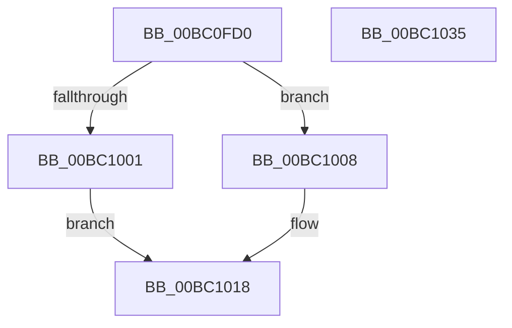

# BgpConsoleGetCursorState

- RVA: `0x00BC0FD0`–`0x00BC1036` (길이 `102` bytes)
- VA: `0x0000000140BC0FD0`
- 실행 섹션: `PAGEBGFX`
- PDB 이름 있음: `예`; PDB Function 태그: `아니요`
- unwind 정보 RVA: `0x0006F978`
- 디코드: `30`개 명령, `102/102` bytes 표시
- 미해석 바이트: `0` (있으면 어셈블리에 `.byte`로 보존)

> 이 문서는 커널 이미지의 기계어와 PDB 기호를 분석해 생성했습니다. 4번과 5번은 함수 원형과 자료형을 바이너리 사용 방식에서 추정한 C 해석이며 원본 소스 복구 결과는 아닙니다.

## 1. Dependencies

- 직접 호출 지점: **2**; 고유 호출 대상: **2**
- 직접 호출자로 확인된 함수: **0**
- RIP 상대 이미지 참조: **1**

### Outgoing calls
- `0x00BC0FEE` → [BgpFwAcquireLock](../../text/4B/BgpFwAcquireLock_function_004B3AA4.md) (function, `0x004B3AA4`)
- `0x00BC1018` → [BgpFwReleaseLock](../../text/4B/BgpFwReleaseLock_function_004B357C.md) (function, `0x004B357C`)

### Direct callers
- 이 함수 시작 RVA로 연결되는 직접 call은 확인되지 않았습니다. 간접 호출은 완전히 역산할 수 없습니다.

### Static image references
- `0x00BC0FF3` → RVA `0x00EEFEC8` (`.data`; read)

## 2. Other-region calls and transfers

- 다른 실행 섹션으로 향하는 call: **2**
  - `0x00BC0FEE` → [BgpFwAcquireLock](../../text/4B/BgpFwAcquireLock_function_004B3AA4.md) (`PAGEBGFX` → `.text`)
  - `0x00BC1018` → [BgpFwReleaseLock](../../text/4B/BgpFwReleaseLock_function_004B357C.md) (`PAGEBGFX` → `.text`)
- 별도 외부 분기/꼬리 이동을 확인하지 못했습니다.

## 3. Assembly (complete function range)

```asm
00BC0FD0  48 89 5C 24 08                  mov qword ptr [rsp + 8], rbx
00BC0FD5  48 89 74 24 10                  mov qword ptr [rsp + 0x10], rsi
00BC0FDA  48 89 7C 24 18                  mov qword ptr [rsp + 0x18], rdi
00BC0FDF  41 56                           push r14
00BC0FE1  48 83 EC 20                     sub rsp, 0x20
00BC0FE5  49 8B F8                        mov rdi, r8
00BC0FE8  48 8B F2                        mov rsi, rdx
00BC0FEB  4C 8B F1                        mov r14, rcx
00BC0FEE  E8 B1 2A 8F FF                  call 0x1404b3aa4
00BC0FF3  48 8B 05 CE EE 32 00            mov rax, qword ptr [rip + 0x32eece]
00BC0FFA  33 DB                           xor ebx, ebx
00BC0FFC  48 85 C0                        test rax, rax
00BC0FFF  75 07                           jne 0x140bc1008
00BC1001  BB 01 00 00 C0                  mov ebx, 0xc0000001
00BC1006  EB 10                           jmp 0x140bc1018
00BC1008  8B 48 44                        mov ecx, dword ptr [rax + 0x44]
00BC100B  41 89 0E                        mov dword ptr [r14], ecx
00BC100E  8B 48 48                        mov ecx, dword ptr [rax + 0x48]
00BC1011  89 0E                           mov dword ptr [rsi], ecx
00BC1013  8B 48 4C                        mov ecx, dword ptr [rax + 0x4c]
00BC1016  89 0F                           mov dword ptr [rdi], ecx
00BC1018  E8 5F 25 8F FF                  call 0x1404b357c
00BC101D  48 8B 74 24 38                  mov rsi, qword ptr [rsp + 0x38]
00BC1022  8B C3                           mov eax, ebx
00BC1024  48 8B 5C 24 30                  mov rbx, qword ptr [rsp + 0x30]
00BC1029  48 8B 7C 24 40                  mov rdi, qword ptr [rsp + 0x40]
00BC102E  48 83 C4 20                     add rsp, 0x20
00BC1032  41 5E                           pop r14
00BC1034  C3                              ret
00BC1035  CC                              int3
```

## 4. C-style interpretation (structured pseudocode)

```c
__int64 __fastcall BgpConsoleGetCursorState(__int64 a1, __int64 a2, __int64 a3)
{
    __int64 result;
    __int64 v_rbx;
    __int64 v_rsp;
    unsigned __int64 v_stack_p10;
    unsigned __int64 v_stack_p18;
    unsigned __int64 v_stack_p8;

    v_stack_p8 = v_rbx;
    v_stack_p10 = v_rsi;
    v_stack_p18 = v_rdi;
    v_rsp = (v_rsp) - (32);
    result = BgpFwAcquireLock(a1, a2, a3, a4);
    v_rbx = 0;
    if (*(unsigned __int64 *)(v_rip + 3337934) != 0) goto loc_00BC1008;
    goto loc_00BC1018;
loc_00BC1008:
    *(unsigned int *)(a1) = (unsigned int)((unsigned int)(*(unsigned int *)(*(unsigned __int64 *)(v_rip + 3337934) + 68)));
    *(unsigned int *)(a2) = (unsigned int)((unsigned int)(*(unsigned int *)(*(unsigned __int64 *)(v_rip + 3337934) + 72)));
    *(unsigned int *)(a3) = (unsigned int)((unsigned int)(*(unsigned int *)(*(unsigned __int64 *)(v_rip + 3337934) + 76)));
loc_00BC1018:
    result = BgpFwReleaseLock((unsigned int)(*(unsigned int *)(*(unsigned __int64 *)(v_rip + 3337934) + 76)), a2, a3, a4);
    v_rsp = (v_rsp) + (32);
    return (unsigned int)((unsigned int)((unsigned int)(0xC0000001ULL)));
}
```

## 5. (Beta) C Style

```c
int64_t BgpConsoleGetCursorState(void *Arg1, void *Arg2, void *Arg3)
{
    uint8_t *arg1 = (uint8_t *)Arg1;
    uint8_t *arg2 = (uint8_t *)Arg2;
    uint8_t *arg3 = (uint8_t *)Arg3;

    int64_t result;
    int64_t local_rbx;
    int64_t local_rsp;
    uint64_t v_stack_p10;
    uint64_t v_stack_p18;
    uint64_t v_stack_p8;

    v_stack_p8 = local_rbx;
    v_stack_p10 = local_rsi;
    v_stack_p18 = local_rdi;
    local_rsp = (local_rsp) - (32);
    result = BgpFwAcquireLock(Arg1, Arg2, Arg3, a4);
    local_rbx = 0;
    if (*(uint64_t *)(v_rip + 0x32EECE) != 0) goto loc_00BC1008;
    goto loc_00BC1018;
loc_00BC1008:
    *(uint32_t *)(arg1) = (uint32_t)((uint32_t)(*(uint32_t *)(*(uint64_t *)(v_rip + 0x32EECE) + 0x44)));
    *(uint32_t *)(arg2) = (uint32_t)((uint32_t)(*(uint32_t *)(*(uint64_t *)(v_rip + 0x32EECE) + 0x48)));
    *(uint32_t *)(arg3) = (uint32_t)((uint32_t)(*(uint32_t *)(*(uint64_t *)(v_rip + 0x32EECE) + 0x4C)));
loc_00BC1018:
    result = BgpFwReleaseLock((uint32_t)(*(uint32_t *)(*(uint64_t *)(v_rip + 0x32EECE) + 0x4C)), Arg2, Arg3, a4);
    local_rsp = (local_rsp) + (32);
    return (uint32_t)((uint32_t)((uint32_t)(0xC0000001ULL)));
}
```

### 관측된 메모리 오프셋

구조체 형식이 확인되지 않은 접근은 인자 기준의 오프셋으로만 기록했습니다.

| 기준 인자 | 오프셋 표현 | 폭 (bit) | 접근 |
|---|---:|---:|---|
| `Arg1` | `+ 0x0` | `32` | `W` |
| `Arg2` | `+ 0x0` | `32` | `W` |
| `Arg3` | `+ 0x0` | `32` | `W` |

## 6. Execution-region graph

[열기: 2D/3D 그래프와 함수 탐색 컨트롤 패널](../../../control-panel.html?section=pagebgfx&rva=0x00BC0FD0&view=graph)

- 2D 그래프는 위에서 아래로 흐르고, 3D 그래프는 빈 공간을 드래그해 회전합니다. Shift+드래그는 이동, 휠은 확대·축소, 함수 노드 선택은 대상 보고서 이동입니다.

### Static fallback


